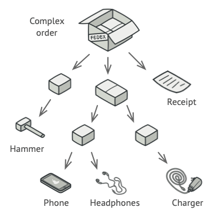
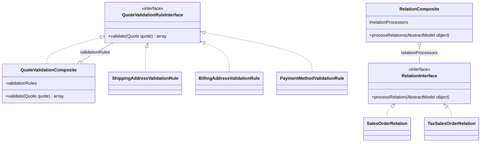

# Composite Pattern

> **Techstack:** Magento 2.4.x (Adobe Commerce / Magento Open Source)

## 1. Định nghĩa

Composite là một structural design pattern cho phép gom các object thành cấu trúc cây, rồi làm việc với cả cây như với một object đơn lẻ (client đối xử với leaf và composite như nhau).



*Hình 1: Complex order – hộp (composite) có thể chứa sản phẩm (leaf) hoặc các hộp nhỏ hơn, tạo thành cấu trúc cây*

## 2. Cách thức hoạt động


*Hình 2: Cấu trúc Composite Pattern – Leaf tự làm việc, Composite ủy thác (delegate) công việc cho các component con*

Cách thức hoạt động của Composite Pattern:

- **Component:** Đây là một interface hoặc một abstract class, định nghĩa các phương thức chung cho cả leaf và composite. Trong Magento, ví dụ đúng nghĩa là `QuoteValidationRuleInterface`.
- **Leaf:** Đại diện cho các đối tượng đơn lẻ, chúng không chứa các đối tượng khác. Trong Magento, Leaf là một class xử lý cụ thể, ví dụ `Magento\Sales\Model\ResourceModel\Order\Relation` hay `ShippingAddressValidationRule`.
- **Composite:** Đại diện cho các đối tượng phức hợp, có khả năng chứa các đối tượng leaf hoặc composite khác. Trong Magento là `QuoteValidationComposite` (cùng interface với rule con); `RelationComposite` chỉ là dạng gom mảng một tầng, không cùng interface với leaf (xem NOTE bên dưới). Composite sẽ delegate (ủy thác) tất cả các công việc cho các thành phần con của nó.

Cụ thể hơn, Composite Pattern hoạt động như sau:

- Một `RelationInterface` định nghĩa phương thức `processRelation($object)`.
- `RelationComposite` **không** implement `RelationInterface`: nó chứa mảng `$relationProcessors` (các `RelationInterface`, inject qua `di.xml`) và có method riêng `processRelations($object)` (số nhiều). Khi `processRelations()` được gọi, nó lặp qua tất cả các `RelationInterface` trong mảng, gọi `processRelation()` trên từng đối tượng, rồi dispatch event `<event_prefix>_process_relation`.
- Các Leaf là các class `Relation` trong resource model (ví dụ `Magento\Sales\Model\ResourceModel\Order\Relation`, `Magento\Tax\Model\ResourceModel\Sales\Order\Relation`) – chúng triển khai `RelationInterface` và thực hiện các hành động cụ thể khi `processRelation()` được gọi

> [!NOTE]
> Theo Refactoring.Guru, Composite (Container) phải làm việc qua **cùng** Component interface với Leaf để client đối xử với leaf và composite như nhau, và composite có thể lồng composite khác. `RelationComposite` không cùng interface với leaf nên chỉ là composite "phẳng" một tầng (không lồng được). `QuoteValidationComposite` mới là ví dụ đúng nghĩa: nó implement chính `QuoteValidationRuleInterface` – cùng interface với các rule con – và được khai báo làm preference cho interface đó (qua `QuoteValidationComposite\Proxy`, `Magento/Quote/etc/di.xml`).



*Hình 3: Composite trong Magento – `QuoteValidationComposite` implement chính `QuoteValidationRuleInterface` và chứa các rule con (global di.xml của Magento_Quote khai báo 6 rule, hình vẽ 3); `RelationComposite` giữ mảng `RelationInterface` (`Sales\...\Order\Relation`, `Tax\...\Sales\Order\Relation`) và gọi qua method `processRelations()`*

### Ví dụ PHP – Composite (Refactoring.Guru)

Conceptual example của [Refactoring.Guru – Composite in PHP](https://refactoring.guru/design-patterns/composite/php/example) (© Alexander Shvets, CC BY-NC-ND 4.0). `Leaf` và `Composite` cùng kế thừa `Component`; `Composite::operation()` duyệt các con và gộp kết quả, nên client gọi `operation()` mà không cần biết đang làm việc với leaf hay cây.

```php
<?php

namespace RefactoringGuru\Composite\Conceptual;

/**
 * The base Component class declares common operations for both simple and
 * complex objects of a composition.
 */
abstract class Component
{
    /**
     * @var Component|null
     */
    protected $parent;

    /**
     * Optionally, the base Component can declare an interface for setting
     * and accessing a parent of the component in a tree structure. It can also
     * provide some default implementation for these methods.
     */
    public function setParent(?Component $parent)
    {
        $this->parent = $parent;
    }

    public function getParent(): Component
    {
        return $this->parent;
    }

    /**
     * In some cases, it would be beneficial to define the child-management
     * operations right in the base Component class. This way, you won't need to
     * expose any concrete component classes to the client code, even during the
     * object tree assembly. The downside is that these methods will be empty
     * for the leaf-level components.
     */
    public function add(Component $component): void
    {
    }

    public function remove(Component $component): void
    {
    }

    /**
     * You can provide a method that lets the client code figure out whether
     * a component can bear children.
     */
    public function isComposite(): bool
    {
        return false;
    }

    /**
     * The base Component may implement some default behavior or leave it to
     * concrete classes (by declaring the method containing the behavior as
     * "abstract").
     */
    abstract public function operation(): string;
}

/**
 * The Leaf class represents the end objects of a composition. A leaf can't
 * have any children.
 *
 * Usually, it's the Leaf objects that do the actual work, whereas Composite
 * objects only delegate to their sub-components.
 */
class Leaf extends Component
{
    public function operation(): string
    {
        return "Leaf";
    }
}

/**
 * The Composite class represents the complex components that may have
 * children. Usually, the Composite objects delegate the actual work to their
 * children and then "sum-up" the result.
 */
class Composite extends Component
{
    /**
     * @var \SplObjectStorage
     */
    protected $children;

    public function __construct()
    {
        $this->children = new \SplObjectStorage();
    }

    /**
     * A composite object can add or remove other components (both simple or
     * complex) to or from its child list.
     */
    public function add(Component $component): void
    {
        $this->children->attach($component);
        $component->setParent($this);
    }

    public function remove(Component $component): void
    {
        $this->children->detach($component);
        $component->setParent(null);
    }

    public function isComposite(): bool
    {
        return true;
    }

    /**
     * The Composite executes its primary logic in a particular way. It
     * traverses recursively through all its children, collecting and summing
     * their results. Since the composite's children pass these calls to their
     * children and so forth, the whole object tree is traversed as a result.
     */
    public function operation(): string
    {
        $results = [];
        foreach ($this->children as $child) {
            $results[] = $child->operation();
        }

        return "Branch(" . implode("+", $results) . ")";
    }
}

/**
 * The client code works with all of the components via the base interface.
 */
function clientCode(Component $component)
{
    // ...

    echo "RESULT: " . $component->operation();

    // ...
}

/**
 * This way the client code can support the simple leaf components...
 */
$simple = new Leaf();
echo "Client: I've got a simple component:\n";
clientCode($simple);
echo "\n\n";

/**
 * ...as well as the complex composites.
 */
$tree = new Composite();
$branch1 = new Composite();
$branch1->add(new Leaf());
$branch1->add(new Leaf());
$branch2 = new Composite();
$branch2->add(new Leaf());
$tree->add($branch1);
$tree->add($branch2);
echo "Client: Now I've got a composite tree:\n";
clientCode($tree);
echo "\n\n";

/**
 * Thanks to the fact that the child-management operations are declared in
 * the base Component class, the client code can work with any component, simple
 * or complex, without depending on their concrete classes.
 */
function clientCode2(Component $component1, Component $component2)
{
    // ...

    if ($component1->isComposite()) {
        $component1->add($component2);
    }
    echo "RESULT: " . $component1->operation();

    // ...
}

echo "Client: I don't need to check the components classes even when managing the tree:\n";
clientCode2($tree, $simple);
```

## 3. Các ví dụ về Composite Pattern trong Magento

`\Magento\Framework\Model\ResourceModel\Db\VersionControl\RelationComposite`

VD: save Order => Đồng thời save các entity phụ thuộc (item, payment, status history, address, applied taxes) qua các `RelationInterface`

`Magento\Sales\Model\ResourceModel\Order\Relation::processRelation()`

`Magento\Quote\Model\ValidationRules\QuoteValidationComposite`

**Source:** `Magento\Quote\Model\ValidationRules\QuoteValidationComposite::validate()`

```php
foreach ($this->validationRules as $validationRule) {
    $ruleValidationResult = $validationRule->validate($quote);
    foreach ($ruleValidationResult as $item) {
        if (!$item->isValid()) {
            array_push($aggregateResult, $item);
        }
    }
}
```

## 4. Kết hợp với Chain of Responsibility

> Chain of Responsibility is often used in conjunction with Composite. In this case, when a leaf component gets a request, it may pass it through the chain of all of the parent components down to the root of the object tree.
>
> — [Refactoring.Guru – Chain of Responsibility, mục "Relations with Other Patterns"](https://refactoring.guru/design-patterns/chain-of-responsibility)

## Tham khảo

**Tài liệu chính thức**
- [The di.xml file](https://developer.adobe.com/commerce/php/development/build/dependency-injection-file) – inject mảng component con qua `<argument xsi:type="array">`

**Source code**
- [`Magento\Framework\Model\ResourceModel\Db\VersionControl\RelationComposite`](https://github.com/magento/magento2/blob/2.4-develop/lib/internal/Magento/Framework/Model/ResourceModel/Db/VersionControl/RelationComposite.php)
- [`Magento\Framework\Model\ResourceModel\Db\VersionControl\RelationInterface`](https://github.com/magento/magento2/blob/2.4-develop/lib/internal/Magento/Framework/Model/ResourceModel/Db/VersionControl/RelationInterface.php)
- [`Magento\Quote\Model\ValidationRules\QuoteValidationComposite`](https://github.com/magento/magento2/blob/2.4-develop/app/code/Magento/Quote/Model/ValidationRules/QuoteValidationComposite.php)
- [`Magento\Quote\Model\ValidationRules\QuoteValidationRuleInterface`](https://github.com/magento/magento2/blob/2.4-develop/app/code/Magento/Quote/Model/ValidationRules/QuoteValidationRuleInterface.php)

**Bài viết khác**
- [Refactoring.Guru – Composite](https://refactoring.guru/design-patterns/composite)

**Bài liên quan trong Knowledge Base**
- [Chain of Responsibility](Chain%20of%20Responsibility.md)
- [Iterator Pattern](Iterator%20Design%20Pattern.md)
- [VersionControl](../DB%20%26%20Data%20Object/VersionControl.md)
