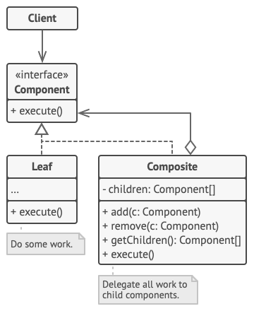

# Composite Pattern

> **Techstack:** Magento 2.4.x (Adobe Commerce / Magento Open Source)

## 1. Định nghĩa

Là một structure pattern


*Hình 1: Complex order – hộp (composite) có thể chứa sản phẩm (leaf) hoặc các hộp nhỏ hơn, tạo thành cấu trúc cây*

## 2. Cách thức hoạt động



*Hình 2: Cấu trúc Composite Pattern – Leaf tự làm việc, Composite ủy thác (delegate) công việc cho các component con*

Cách thức hoạt động của Composite Pattern:

- **Component:** Đây là một interface hoặc một abstract class, định nghĩa các phương thức chung cho cả leaf và composite. Trong Magento, Component có thể là một interface như `RelationInterface`.
- **Leaf:** Đại diện cho các đối tượng đơn lẻ, chúng không chứa các đối tượng khác. Trong Magento, Leaf có thể là một model cụ thể.
- **Composite:** Đại diện cho các đối tượng phức hợp, có khả năng chứa các đối tượng leaf hoặc composite khác. Trong Magento, Composite có thể là một class như `RelationComposite`. Composite sẽ delegate (ủy thác) tất cả các công việc cho các thành phần con của nó.

Cụ thể hơn, Composite Pattern hoạt động như sau:

- Một `RelationInterface` định nghĩa phương thức `processRelation($object)`.
- `RelationComposite` triển khai `RelationInterface` và chứa một mảng các `RelationInterface` khác. Khi phương thức `processRelation()` được gọi trên `RelationComposite`, nó sẽ lặp qua tất cả các `RelationInterface` trong mảng và gọi `processRelation()` trên từng đối tượng đó.
- Các Leaf (ví dụ: các model cụ thể) sẽ triển khai `RelationInterface` và thực hiện các hành động cụ thể khi `processRelation()` được gọi


*Hình 3: Composite trong Magento – `QuoteValidationComposite` implement chính `QuoteValidationRuleInterface` và chứa các rule con (di.xml của Magento_Quote khai báo 6 rule, hình vẽ 3); `RelationComposite` giữ mảng `RelationInterface` (`Sales\...\Order\Relation`, `Tax\...\Sales\Order\Relation`) và gọi qua method `processRelations()`*

## 3. Các ví dụ về Composite Pattern trong Magento

`\Magento\Framework\Model\ResourceModel\Db\VersionControl\RelationComposite`

VD: save Order => Đồng thời save các Composite phụ thuộc

`Magento\Sales\Model\ResourceModel\Order\Relation::processRelation()`

`Magento\Quote\Model\ValidationRules\QuoteValidationComposite`

**Source:** `Magento\Quote\Model\ValidationRules\QuoteValidationComposite::validate()`

```php
foreach ($this->validationRules as $validationRule) {
    $ruleValidationResult = $validationRule->validate($quote);
    foreach ($ruleValidationResult as $item) {
        if (!$item->isValid()) {
            array_push($aggregateResult, $item);
        }
    }
}
```

## 4. Kết hợp với Chain of Responsibility

> Chain of Responsibility is often used in conjunction with Composite. In this case, when a leaf component gets a request, it may pass it through the chain of all of the parent components down to the root of the object tree.

## Tham khảo

**Tài liệu chính thức**
- [The di.xml file](https://developer.adobe.com/commerce/php/development/build/dependency-injection-file) – inject mảng component con qua `<argument xsi:type="array">`

**Source code**
- [`Magento\Framework\Model\ResourceModel\Db\VersionControl\RelationComposite`](https://github.com/magento/magento2/blob/2.4-develop/lib/internal/Magento/Framework/Model/ResourceModel/Db/VersionControl/RelationComposite.php)
- [`Magento\Framework\Model\ResourceModel\Db\VersionControl\RelationInterface`](https://github.com/magento/magento2/blob/2.4-develop/lib/internal/Magento/Framework/Model/ResourceModel/Db/VersionControl/RelationInterface.php)
- [`Magento\Quote\Model\ValidationRules\QuoteValidationComposite`](https://github.com/magento/magento2/blob/2.4-develop/app/code/Magento/Quote/Model/ValidationRules/QuoteValidationComposite.php)
- [`Magento\Quote\Model\ValidationRules\QuoteValidationRuleInterface`](https://github.com/magento/magento2/blob/2.4-develop/app/code/Magento/Quote/Model/ValidationRules/QuoteValidationRuleInterface.php)

**Bài viết khác**
- [Refactoring.Guru – Composite](https://refactoring.guru/design-patterns/composite)

**Bài liên quan trong Knowledge Base**
- [Chain of Responsibility](Chain%20of%20Responsibility.md)
- [Iterator Pattern](Iterator%20Design%20Pattern.md)
- [VersionControl](../DB%20%26%20Data%20Object/VersionControl.md)
