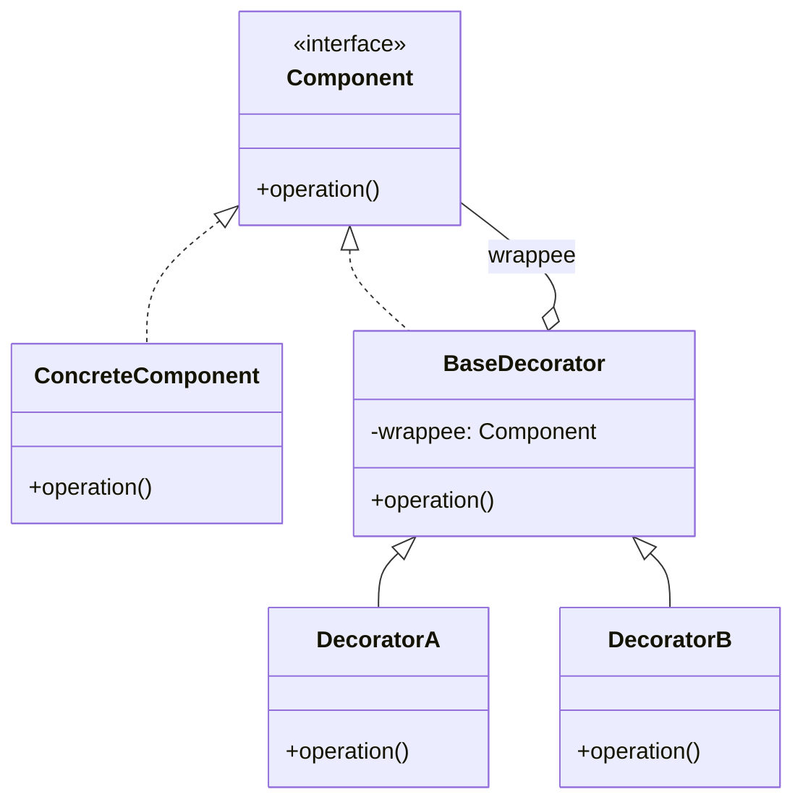
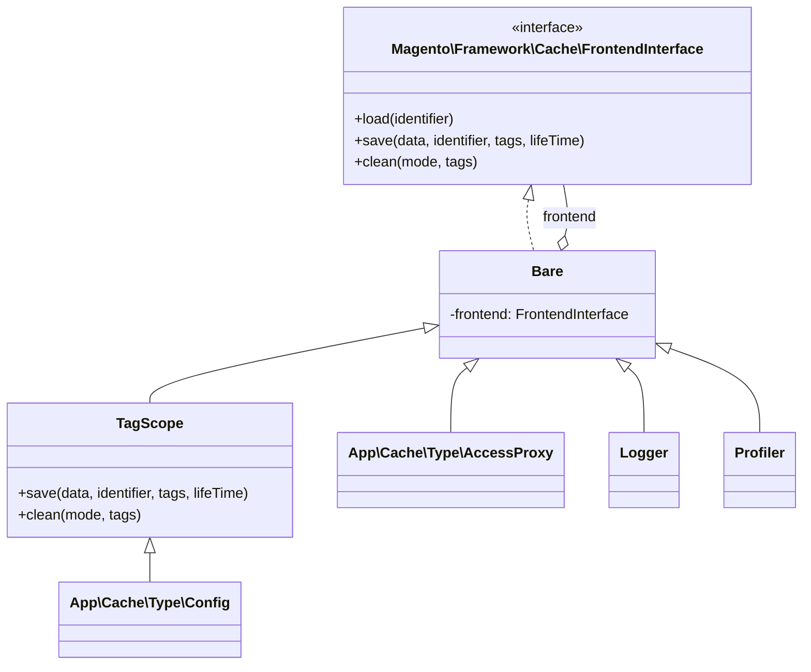
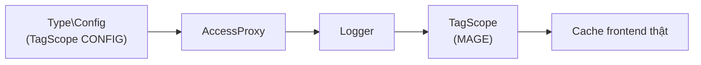
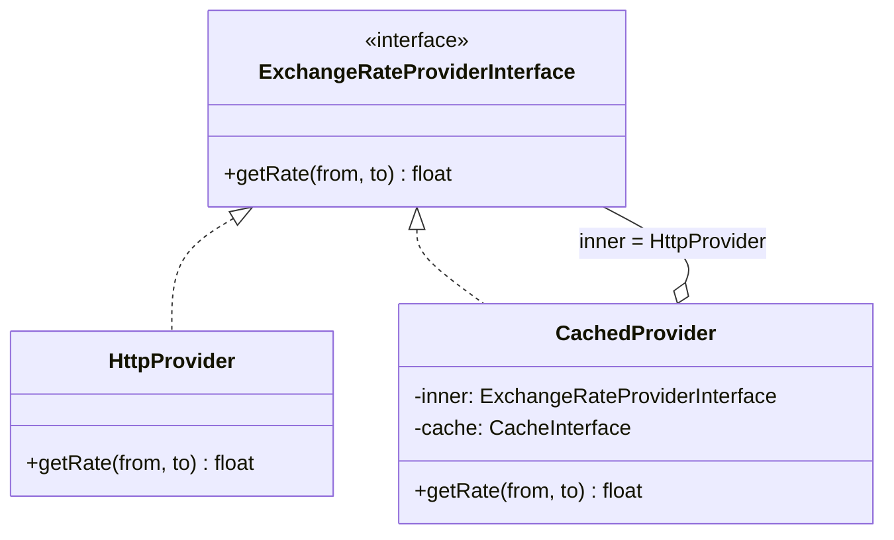

# Decorator Pattern

> **Techstack:** Magento 2.4.x (Adobe Commerce / Magento Open Source)

## 1. Định nghĩa

**Decorator** (còn gọi là *Wrapper*) là structural design pattern cho phép **gắn thêm hành vi cho một object tại runtime** bằng cách bọc nó trong một object khác **cùng interface**. Decorator nhận object gốc (wrappee), chuyển tiếp lời gọi tới nó và thêm xử lý trước/sau.

Vì decorator và object gốc cùng interface, client không phân biệt được đang dùng object gốc hay đã được bọc, và có thể **chồng nhiều lớp** decorator lên nhau.

## 2. Khi nào dùng / vấn đề giải quyết

- Cần thêm tính năng phụ (cache, log, profiling, retry, tag, phân quyền…) cho một service mà **không sửa** class gốc và **không kế thừa** (tránh bùng nổ subclass kiểu `LoggedTaggedCache`, `ProfiledLoggedCache`…).
- Muốn bật/tắt hoặc tổ hợp các hành vi bằng config.
- Class gốc là `final` hoặc thuộc vendor, không thể/không nên extend.

## 3. Cấu trúc



*Hình 1: Cấu trúc Decorator pattern (GoF) – `BaseDecorator` cùng interface và giữ reference tới `Component`*

- **Component**: interface chung.
- **ConcreteComponent**: object gốc.
- **BaseDecorator**: giữ reference tới Component, mặc định delegate mọi method.
- **ConcreteDecorator**: override method cần thêm hành vi.

## 4. Áp dụng trong Magento 2

### 4.1. Cache frontend decorators (ví dụ "sách giáo khoa")

Namespace `Magento\Framework\Cache\Frontend\Decorator`:

| Class | Vai trò |
|---|---|
| `Bare` | BaseDecorator: implement `Magento\Framework\Cache\FrontendInterface`, nhận `$frontend` qua constructor và delegate `test/load/save/remove/clean/getBackend…` |
| `TagScope` | Tự thêm một tag vào mọi `save()` và giới hạn `clean()` theo tag đó |
| `Logger` | Ghi log khi `remove()`/`clean()` qua `Magento\Framework\Cache\InvalidateLogger` |
| `Profiler` | Bọc các thao tác cache bằng timer `Magento\Framework\Profiler` |



*Hình 2: Cây decorator của cache frontend – mọi decorator kế thừa `Bare` và bọc một `FrontendInterface` khác*

`TagScope::save()` chỉ thêm một dòng rồi gọi parent – đúng bản chất decorator.

**Source:** `Magento\Framework\Cache\Frontend\Decorator\TagScope::save()`

```php
public function save($data, $identifier, array $tags = [], $lifeTime = null)
{
    $tags[] = $this->getTag();
    return parent::save($data, $identifier, $tags, $lifeTime);
}
```

Danh sách decorator được khai báo trong `app/etc/di.xml` cho `Magento\Framework\App\Cache\Frontend\Factory` (argument `decorators`: `TagScope` với tag `MAGE`, rồi `Logger`). `Factory::_applyDecorators()` lần lượt bọc frontend: `$decoratorParams['frontend'] = $frontend; $frontend = $objectManager->create($class, $params);`.

Các **cache type** cũng là decorator: `Magento\Framework\App\Cache\Type\Config extends TagScope` (tag `CONFIG`), bọc frontend lấy từ `Magento\Framework\App\Cache\Type\FrontendPool`, vốn đã được bọc thêm `Magento\Framework\App\Cache\Type\AccessProxy` (extends `Bare`, bỏ qua thao tác nếu cache type đang disabled). Chuỗi bọc thực tế:



*Hình 3: Chuỗi bọc thực tế của cache type `config` – mỗi lời gọi đi qua từng lớp decorator trước khi tới frontend thật*

Xem thêm: [Magento Cache](../Magento%20Cache.md).

### 4.2. Template engine Debug Hints

- `Magento\Developer\Model\TemplateEngine\Decorator\DebugHints` implement `Magento\Framework\View\TemplateEngineInterface`, nhận `$subject` (engine gốc) và bọc HTML render ra bằng khung hiển thị đường dẫn template/tên block.
- Được áp dụng bởi plugin `Magento\Developer\Model\TemplateEngine\Plugin\DebugHints::afterCreate()` trên `Magento\Framework\View\TemplateEngineFactory` (khai báo trong `Magento/Developer/etc/frontend/di.xml` và `adminhtml/di.xml`): khi bật *Template Path Hints*, plugin trả về engine đã được decorate thay vì engine gốc.

### 4.3. Interceptor / Plugin – decoration động

Khi class có plugin, ObjectManager trả về `<Class>\Interceptor` (sinh trong `generated/code`), là **subclass** của class gốc, override từng public method để chạy `before/around/after` rồi gọi method gốc. Về mặt mục đích đây là decoration (thêm hành vi quanh method mà client không biết), nhưng về kỹ thuật là **kế thừa + code generation**, không phải bọc object qua composition như Decorator kinh điển. Xem [Dependency injection configuration](../DI%20%26%20Interceptors/Dependency%20injection%20configuration.md).

### 4.4. Decorator bằng `preference` + argument trong `di.xml`

Có thể tự viết decorator cho một service contract: `preference` interface → decorator, và chỉ định object gốc cho argument của decorator. Đây là cách decorate "chuẩn GoF" trong Magento (ví dụ bên dưới).

## 5. Ví dụ code – thêm cache cho service gọi API ngoài



*Hình 4: Decorator `CachedProvider` bọc `HttpProvider`, client chỉ biết `ExchangeRateProviderInterface`*

**Ví dụ:** service contract cần decorate

```php
<?php
// app/code/Vendor/Module/Api/ExchangeRateProviderInterface.php
declare(strict_types=1);

namespace Vendor\Module\Api;

interface ExchangeRateProviderInterface
{
    public function getRate(string $from, string $to): float;
}
```

**Ví dụ:** decorator thêm cache quanh provider gốc

```php
<?php
// app/code/Vendor/Module/Model/ExchangeRate/CachedProvider.php
declare(strict_types=1);

namespace Vendor\Module\Model\ExchangeRate;

use Magento\Framework\App\CacheInterface;
use Vendor\Module\Api\ExchangeRateProviderInterface;

class CachedProvider implements ExchangeRateProviderInterface
{
    private const CACHE_TAG = 'VENDOR_EXCHANGE_RATE';

    public function __construct(
        private readonly ExchangeRateProviderInterface $inner, // wrappee
        private readonly CacheInterface $cache,
        private readonly int $lifetime = 3600
    ) {
    }

    public function getRate(string $from, string $to): float
    {
        $key = sprintf('vendor_rate_%s_%s', $from, $to);
        $cached = $this->cache->load($key);
        if ($cached !== false) {
            return (float)$cached;
        }

        $rate = $this->inner->getRate($from, $to);
        $this->cache->save((string)$rate, $key, [self::CACHE_TAG], $this->lifetime);

        return $rate;
    }
}
```

**Ví dụ:** cấu hình `preference` + argument `inner`

```xml
<!-- app/code/Vendor/Module/etc/di.xml -->
<preference for="Vendor\Module\Api\ExchangeRateProviderInterface"
            type="Vendor\Module\Model\ExchangeRate\CachedProvider"/>

<type name="Vendor\Module\Model\ExchangeRate\CachedProvider">
    <arguments>
        <!-- trỏ thẳng tới implementation gốc để tránh vòng lặp preference -->
        <argument name="inner" xsi:type="object">Vendor\Module\Model\ExchangeRate\HttpProvider</argument>
        <argument name="lifetime" xsi:type="number">1800</argument>
    </arguments>
</type>
```

Muốn thêm logging → viết `LoggingProvider` cùng interface, cho `CachedProvider::$inner` trỏ tới `LoggingProvider`, và `LoggingProvider::$inner` trỏ tới `HttpProvider`. Mọi client inject `ExchangeRateProviderInterface` không cần thay đổi.

## 6. Ưu / nhược điểm & lưu ý

**Ưu điểm**

- Open/Closed & Single Responsibility: mỗi decorator một mối quan tâm (cache, log, tag…).
- Tổ hợp hành vi linh hoạt bằng config, không bùng nổ subclass.
- Không cần sửa/extend class gốc.

**Nhược điểm**

- Nhiều lớp bọc → stack trace dài, khó debug thứ tự.
- Decorator phải implement **toàn bộ** interface (dùng base decorator như `Bare` để giảm boilerplate).
- Thứ tự bọc quan trọng (cache ngoài log ≠ log ngoài cache).

**Lưu ý trong Magento**

- Chỉ decorate qua **interface** (service contract); preference trên class concrete của core dễ conflict với extension khác.
- Khi chỉ cần thêm hành vi quanh 1–2 method của class core, plugin thường đơn giản hơn; tự viết decorator phù hợp khi muốn thay hẳn implementation của interface hoặc tổ hợp nhiều lớp.
- Phân biệt với [Proxies](Proxies.md) (cùng interface nhưng mục đích là lazy-load/kiểm soát truy cập) và [Adapter Pattern_](Adapter%20Pattern_.md) (đổi interface).

> [!WARNING]
> Argument `inner` phải trỏ tới class gốc cụ thể, nếu trỏ tới interface sẽ tự resolve về chính decorator → vòng lặp vô hạn.

## Tham khảo

**Tài liệu chính thức**

- [Cache types](https://developer.adobe.com/commerce/php/development/cache/partial/cache-type)
- [Plugins (Interceptors)](https://developer.adobe.com/commerce/php/development/components/plugins)
- [The di.xml file](https://developer.adobe.com/commerce/php/development/build/dependency-injection-file)

**Source code**

- [`Magento\Framework\Cache\Frontend\Decorator\Bare`](https://github.com/magento/magento2/blob/2.4-develop/lib/internal/Magento/Framework/Cache/Frontend/Decorator/Bare.php)
- [`Magento\Framework\Cache\Frontend\Decorator\TagScope`](https://github.com/magento/magento2/blob/2.4-develop/lib/internal/Magento/Framework/Cache/Frontend/Decorator/TagScope.php)
- [`Magento\Framework\App\Cache\Frontend\Factory`](https://github.com/magento/magento2/blob/2.4-develop/lib/internal/Magento/Framework/App/Cache/Frontend/Factory.php)
- [`Magento\Developer\Model\TemplateEngine\Decorator\DebugHints`](https://github.com/magento/magento2/blob/2.4-develop/app/code/Magento/Developer/Model/TemplateEngine/Decorator/DebugHints.php)

**Bài viết khác**

- [Refactoring.Guru – Decorator](https://refactoring.guru/design-patterns/decorator)

**Bài liên quan trong Knowledge Base**

- [Magento Cache](../Magento%20Cache.md)
- [Dependency injection configuration](../DI%20%26%20Interceptors/Dependency%20injection%20configuration.md)
- [Proxies](Proxies.md)
- [Adapter Pattern_](Adapter%20Pattern_.md)
