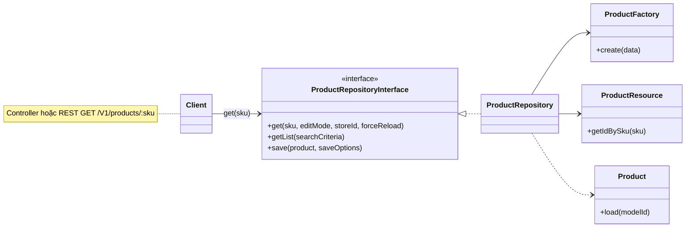

# Facade Pattern

> **Techstack:** Magento 2.4.x (Adobe Commerce / Magento Open Source)

## 1. Định nghĩa

Mô hình Facade là một mẫu thiết kế thuộc nhóm structural design pattern. Mục đích chính của nó là cung cấp một interface đơn giản hóa cho một hệ thống phức tạp, che giấu đi các chi tiết phức tạp bên trong.

## 2. Cách thức hoạt động

Cách thức hoạt động của Facade Pattern:

- **Facade (lớp Facade):** Lớp này cung cấp một giao diện đơn giản để tương tác với các lớp con phức tạp của một hệ thống con. Nó đóng vai trò như một điểm truy cập duy nhất cho các client muốn sử dụng hệ thống con đó.
- **Subsystem Classes (các lớp hệ thống con):** Đây là các lớp thực hiện các tác vụ phức tạp của hệ thống. Client không cần phải tương tác trực tiếp với các lớp này mà sẽ thông qua lớp Facade.

## 3. Lợi ích của Facade Pattern

- **Giảm độ phức tạp:** Facade giúp ẩn đi sự phức tạp của hệ thống con, giúp client sử dụng dễ dàng hơn.
- **Tăng tính dễ sử dụng:** Cung cấp một interface đơn giản để tương tác với hệ thống, giảm thiểu sự phụ thuộc của client vào các lớp con.
- **Tăng tính linh hoạt:** Cho phép thay đổi các lớp bên trong hệ thống con mà không ảnh hưởng đến client, miễn là giao diện của Facade không thay đổi.
- **Giảm sự phụ thuộc:** Client chỉ phụ thuộc vào Facade thay vì phụ thuộc vào nhiều lớp con, giúp hệ thống dễ bảo trì và mở rộng hơn.

## 4. Ví dụ thực tế

Hãy tưởng tượng bạn muốn đặt một ly cà phê. Thay vì phải làm tất cả các bước như pha cà phê, thêm đường, thêm sữa,... bạn chỉ cần đến quầy và gọi một ly cà phê. Người pha chế (facade) sẽ giúp bạn thực hiện tất cả các bước phức tạp đó.

## 5. Ứng dụng của Facade Pattern trong Magento

Mặc dù các nguồn không trực tiếp đề cập đến việc sử dụng Facade Pattern trong Magento, có thể hiểu rằng mẫu thiết kế này có thể được áp dụng ở một số khu vực:

- **API Gateway:** Magento có thể sử dụng Facade Pattern để cung cấp một giao diện API đơn giản cho các client bên ngoài, che giấu đi sự phức tạp của hệ thống bên trong. Ví dụ, khi một ứng dụng bên thứ ba muốn lấy thông tin sản phẩm, nó có thể tương tác với một Facade API, Facade này sẽ gọi các service cần thiết để lấy dữ liệu và trả về cho client.
- **Service Layer:** Trong Magento, service layer có thể được xem như một facade để client có thể sử dụng các function của một module. Các controller chỉ cần gọi đến các service để thực thi nghiệp vụ mà không cần quan tâm đến logic phức tạp bên dưới.

*Hình 1: Service contract như một facade – route `GET /V1/products/:sku` (webapi.xml của Magento_Catalog) và controller chỉ gọi `ProductRepositoryInterface::get()`; `Magento\Catalog\Model\ProductRepository` lo phần tạo model, tra id theo SKU (`ResourceModel\Product::getIdBySku()`) và load dữ liệu*

## Tham khảo

**Tài liệu chính thức**
- [Service contracts](https://developer.adobe.com/commerce/php/development/components/service-contracts/)
- [Service layer](https://developer.adobe.com/commerce/php/architecture/layers/service)

**Source code**
- [`Magento\Catalog\Api\ProductRepositoryInterface`](https://github.com/magento/magento2/blob/2.4-develop/app/code/Magento/Catalog/Api/ProductRepositoryInterface.php)
- [`Magento\Catalog\Model\ProductRepository`](https://github.com/magento/magento2/blob/2.4-develop/app/code/Magento/Catalog/Model/ProductRepository.php)

**Bài viết khác**
- [Refactoring.Guru – Facade](https://refactoring.guru/design-patterns/facade)

**Bài liên quan trong Knowledge Base**
- [Service contracts](../Service%20contracts.md)
- [REST](../API%20Rest%2C%20Soap%20%26%20Graphql/REST.md)
- [Adapter Pattern](Adapter%20Pattern_.md)
