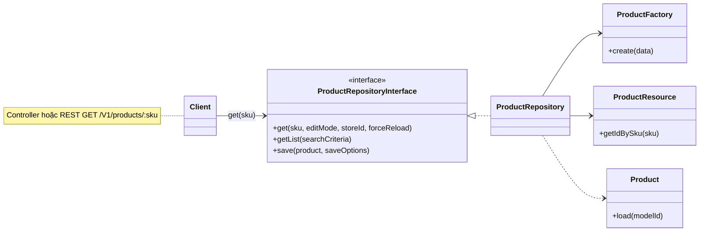

# Facade Pattern

> **Techstack:** Magento 2.4.x (Adobe Commerce / Magento Open Source)

## 1. Định nghĩa

Mô hình Facade là một mẫu thiết kế thuộc nhóm structural design pattern. Mục đích chính của nó là cung cấp một interface đơn giản hóa cho một hệ thống phức tạp, che giấu đi các chi tiết phức tạp bên trong.

## 2. Cách thức hoạt động

Cách thức hoạt động của Facade Pattern:

- **Facade (lớp Facade):** Lớp này cung cấp một giao diện đơn giản để tương tác với các lớp của hệ thống con (subsystem). Nó là điểm truy cập thuận tiện cho phần lớn client, nhưng không cấm client gọi thẳng subsystem khi cần tính năng nâng cao.
- **Subsystem Classes (các lớp hệ thống con):** Đây là các lớp thực hiện các tác vụ phức tạp của hệ thống. Client không cần phải tương tác trực tiếp với các lớp này mà sẽ thông qua lớp Facade.

### Ví dụ PHP – Facade (Refactoring.Guru)

Conceptual example của [Refactoring.Guru – Facade in PHP](https://refactoring.guru/design-patterns/facade/php/example) (© Alexander Shvets, CC BY-NC-ND 4.0). `Facade::operation()` gọi theo đúng thứ tự các method của `Subsystem1`/`Subsystem2`; client chỉ làm việc với `Facade`.

```php
<?php

namespace RefactoringGuru\Facade\Conceptual;

/**
 * The Facade class provides a simple interface to the complex logic of one
 * or several subsystems. The Facade delegates the client requests to the
 * appropriate objects within the subsystem. The Facade is also responsible for
 * managing their lifecycle. All of this shields the client from the undesired
 * complexity of the subsystem.
 */
class Facade
{
    protected $subsystem1;

    protected $subsystem2;

    /**
     * Depending on your application's needs, you can provide the Facade
     * with existing subsystem objects or force the Facade to create them on its
     * own.
     */
    public function __construct(
        Subsystem1 $subsystem1 = null,
        Subsystem2 $subsystem2 = null
    ) {
        $this->subsystem1 = $subsystem1 ?: new Subsystem1();
        $this->subsystem2 = $subsystem2 ?: new Subsystem2();
    }

    /**
     * The Facade's methods are convenient shortcuts to the sophisticated
     * functionality of the subsystems. However, clients get only to a fraction
     * of a subsystem's capabilities.
     */
    public function operation(): string
    {
        $result = "Facade initializes subsystems:\n";
        $result .= $this->subsystem1->operation1();
        $result .= $this->subsystem2->operation1();
        $result .= "Facade orders subsystems to perform the action:\n";
        $result .= $this->subsystem1->operationN();
        $result .= $this->subsystem2->operationZ();

        return $result;
    }
}

/**
 * The Subsystem can accept requests either from the facade or client
 * directly. In any case, to the Subsystem, the Facade is yet another client,
 * and it's not a part of the Subsystem.
 */
class Subsystem1
{
    public function operation1(): string
    {
        return "Subsystem1: Ready!\n";
    }

    // ...

    public function operationN(): string
    {
        return "Subsystem1: Go!\n";
    }
}

/**
 * Some facades can work with multiple subsystems at the same time.
 */
class Subsystem2
{
    public function operation1(): string
    {
        return "Subsystem2: Get ready!\n";
    }

    // ...

    public function operationZ(): string
    {
        return "Subsystem2: Fire!\n";
    }
}

/**
 * The client code works with complex subsystems through a simple interface
 * provided by the Facade. When a facade manages the lifecycle of the subsystem,
 * the client might not even know about the existence of the subsystem. This
 * approach lets you keep the complexity under control.
 */
function clientCode(Facade $facade)
{
    // ...

    echo $facade->operation();

    // ...
}

/**
 * The client code may have some of the subsystem's objects already created.
 * In this case, it might be worthwhile to initialize the Facade with these
 * objects instead of letting the Facade create new instances.
 */
$subsystem1 = new Subsystem1();
$subsystem2 = new Subsystem2();
$facade = new Facade($subsystem1, $subsystem2);
clientCode($facade);
```

## 3. Lợi ích của Facade Pattern

- **Giảm độ phức tạp:** Facade giúp ẩn đi sự phức tạp của hệ thống con, giúp client sử dụng dễ dàng hơn.
- **Tăng tính dễ sử dụng:** Cung cấp một interface đơn giản để tương tác với hệ thống, giảm thiểu sự phụ thuộc của client vào các lớp con.
- **Tăng tính linh hoạt:** Cho phép thay đổi các lớp bên trong hệ thống con mà không ảnh hưởng đến client, miễn là giao diện của Facade không thay đổi.
- **Giảm sự phụ thuộc:** Client chỉ phụ thuộc vào Facade thay vì phụ thuộc vào nhiều lớp con, giúp hệ thống dễ bảo trì và mở rộng hơn.

## 4. Ví dụ thực tế

Hãy tưởng tượng bạn muốn đặt một ly cà phê. Thay vì phải làm tất cả các bước như pha cà phê, thêm đường, thêm sữa,... bạn chỉ cần đến quầy và gọi một ly cà phê. Người pha chế (facade) sẽ giúp bạn thực hiện tất cả các bước phức tạp đó.

## 5. Ứng dụng của Facade Pattern trong Magento

Magento có chỗ gọi thẳng tên Facade, và một số khu vực khác cũng có thể hiểu theo tinh thần Facade:

- **Payment method facade (gọi đích danh trong source và Adobe docs):** `Magento\Payment\Model\Method\Adapter` có docblock *"Payment method facade. Abstract method adapter"* và được dùng làm base cho các `virtualType` tên `...Facade`. Sales/Checkout chỉ gọi `MethodInterface` (`authorize()`, `capture()`, `isAvailable()`…); Adapter che giấu `valueHandlerPool`, `validatorPool`, `commandPool` (gateway command, request builder, HTTP client, response handler) bên dưới. Xem [Payment method facade](https://developer.adobe.com/commerce/php/development/payments-integrations/base-integration/facade-configuration).

  ```xml
  <!-- Magento/PaymentServicesPaypal/etc/di.xml (bundled extension Payment Services, không thuộc core magento2) -->
  <virtualType name="PaymentServicesPaypalHostedFieldsFacade" type="Magento\Payment\Model\Method\Adapter">
      <arguments>
          <argument name="code" xsi:type="const">Magento\PaymentServicesPaypal\Model\HostedFieldsConfigProvider::CODE</argument>
          <argument name="formBlockType" xsi:type="string">Magento\PaymentServicesPaypal\Block\Adminhtml\Form\AdminHostedFields</argument>
          <argument name="infoBlockType" xsi:type="string">Magento\PaymentServicesPaypal\Block\HostedFieldsInfo</argument>
          <argument name="valueHandlerPool" xsi:type="object">PaymentServicesPaypalHostedFieldsValueHandlerPool</argument>
          <argument name="commandPool" xsi:type="object">PaymentServicesPaypalHostedFieldsCommandPool</argument>
      </arguments>
  </virtualType>
  ```

- **Web API:** Magento không có lớp "Facade API" riêng; route REST/SOAP trong `etc/webapi.xml` map thẳng tới một method của service contract (ví dụ `GET /V1/products/:sku` → `Magento\Catalog\Api\ProductRepositoryInterface::get`). Vì vậy với client bên ngoài, chính service contract đóng vai trò facade (xem Hình 1).
- **Service Layer:** Trong Magento, service layer có thể được xem như một facade để client có thể sử dụng các function của một module. Các controller chỉ cần gọi đến các service để thực thi nghiệp vụ mà không cần quan tâm đến logic phức tạp bên dưới.



*Hình 1: Service contract như một facade – route `GET /V1/products/:sku` (webapi.xml của Magento_Catalog) và controller chỉ gọi `ProductRepositoryInterface::get()`; `Magento\Catalog\Model\ProductRepository` lo phần tạo model, tra id theo SKU (`ResourceModel\Product::getIdBySku()`) và load dữ liệu*

## Tham khảo

**Tài liệu chính thức**
- [Service contracts](https://developer.adobe.com/commerce/php/development/components/service-contracts/)
- [Service layer](https://developer.adobe.com/commerce/php/architecture/layers/service)
- [Payment method facade](https://developer.adobe.com/commerce/php/development/payments-integrations/base-integration/facade-configuration)

**Source code**
- [`Magento\Catalog\Api\ProductRepositoryInterface`](https://github.com/magento/magento2/blob/2.4-develop/app/code/Magento/Catalog/Api/ProductRepositoryInterface.php)
- [`Magento\Catalog\Model\ProductRepository`](https://github.com/magento/magento2/blob/2.4-develop/app/code/Magento/Catalog/Model/ProductRepository.php)
- [`Magento\Payment\Model\Method\Adapter`](https://github.com/magento/magento2/blob/2.4-develop/app/code/Magento/Payment/Model/Method/Adapter.php)

**Bài viết khác**
- [Refactoring.Guru – Facade](https://refactoring.guru/design-patterns/facade)

**Bài liên quan trong Knowledge Base**
- [Service contracts](../Service%20contracts.md)
- [REST](../API%20Rest%2C%20Soap%20%26%20Graphql/REST.md)
- [Adapter Pattern](Adapter%20Pattern_.md)
