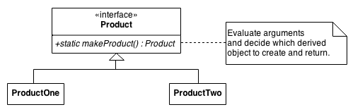
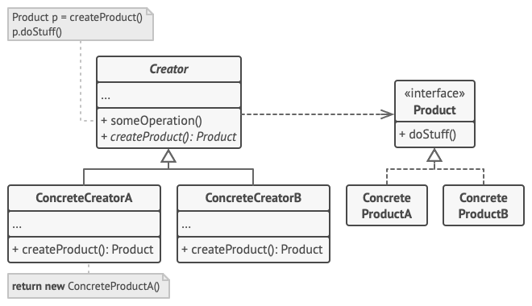
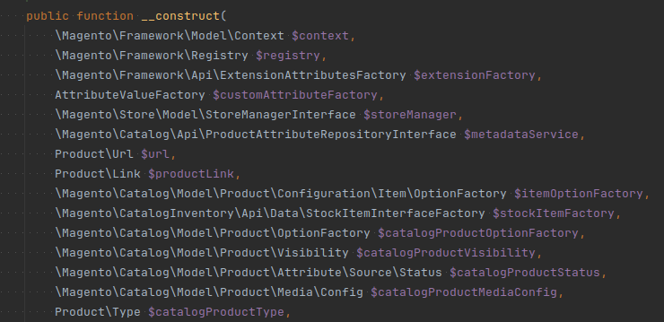
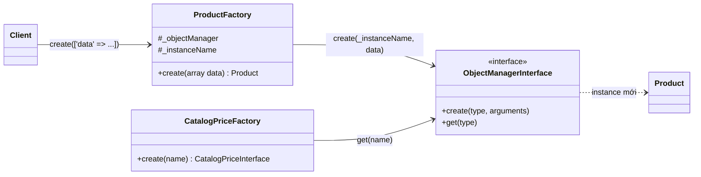

# Factories

> **Techstack:** Magento 2.4.x (Adobe Commerce / Magento Open Source)

## 1. Factory Method

`Factory Method` Design Pattern là một creational design pattern cung cấp một interface cho quá trình khởi tạo object.

Factory pattern sẽ định nghĩa một phương thức khởi tạo ảo

‘virtual constructor’ tại đây sẽ định nghĩa trước các config, các dữ liệu cần trong quá trình khởi tạo.(thay vì gọi trực tiếp toán tử `new` để khởi tạo object)

Tránh sử dụng trực tiếp toán tử `new`



*Hình 1: Factory method `makeProduct()` đánh giá tham số và quyết định lớp con (`ProductOne`, `ProductTwo`) nào được tạo và trả về*

Thử tưởng tượng bạn sẽ cần phải tạo ra 2 product với các input config

```text
ProductOne(store, brand, config, data1)
ProductTwo(store, brand, config, data2)
```

các context về store, brand, config … cần sử dụng lại



*Hình 2: Cấu trúc Factory Method – Creator gọi `createProduct()`, các ConcreteCreator quyết định ConcreteProduct cụ thể*

Trong trường hợp này factoryMethod : `makeProduct()` sẽ mô tả sẵn các tham số, cache các config sử dụng chung …. vì vậy khi thực hiện `Product::makeProduct()` sẽ giúp chúng ta dễ dàng khởi tạo cũng như thay đổi tham số input khi tạo Product.

## 2. Abstract Factory Design Pattern

Tương tự Factory Method Pattern, Abstract Factory cũng là một mẫu thiết kế để khởi tạo Object, nhưng thay vì sử dụng method đơn giản thì AbstractFactory định nghĩa bằng mẫu prototype, bao gồm:

- định nghĩa factory interface cho quá trình khởi tạo đối tượng.
- định nghĩa các lớp phụ thuộc, đóng gói (encapsulates) các references

## 3. Factory classes trong Magento

### 3.1. Factory được generate tự động

Cùng xem lại cách FactoryClasses thực hiện trong Magento

**Ví dụ:** factory class `ProductFactory` (rút gọn)

```php
/**
 * Magento\Catalog\Model\ProductFactory
 * Factory class for @see \Magento\Catalog\Model\Product
 */
class ProductFactory
{
    /**
     * Create class instance with specified parameters
     *
     * @param array $data
     * @return \Magento\Catalog\Model\Product
     */
    public function create(array $data = [])
    {
        return $this->_objectManager->create($this->_instanceName, $data);
    }
}
```

Factory này sẽ giúp chúng ta dễ dàng khởi tạo một instance của ProductModel

có thể thấy construct trong ProductModel bao gồm rất nhiều phụ thuộc từ các objects khác



*Hình 3: Constructor của `Magento\Catalog\Model\Product` – rất nhiều dependency cần inject khi khởi tạo*

với ObjectManager và Factory thì việc khởi tạo sẽ dễ dàng hơn:

```php
$product1 = $productFactory->create(['data' => $productData1]);
$product2 = $productFactory->create(['data' => $productData2]);
```

Factory cũng cải thiện đáng kể về mặt hiệu suất khi chúng ta ko cần phải khởi tạo lại các phụ thuộc.



*Hình 4: Factory trong Magento – `ProductFactory` (generate từ template `Magento\Framework\ObjectManager\Code\Generator\Factory`) uỷ quyền cho `ObjectManagerInterface::create()`; `CatalogPriceFactory` là factory viết tay, dùng `get()` và kiểm tra kiểu `CatalogPriceInterface`*

> [!NOTE]
> Trong M2 Factory Classes sẽ được auto generator `{NameClass}Factory` => sẽ tự động generator bên trong `generated\code`

### 3.2. Custom Factory

Nhưng chúng ta cũng có thể tự custom riêng Factory, như trong trường hợp này

`Magento\Catalog\Model\Product\CatalogPrice`

`Magento\Catalog\Model\Product\CatalogPriceFactory`

Hoặc trong trường hợp của ObjectManagerFactory

`Magento\Framework\App\ObjectManagerFactory`


*Hình 5: `Magento\Framework\App\ObjectManagerFactory::create()` – chuẩn bị shared instances và factory rồi khởi tạo ObjectManager*

## Tham khảo

**Tài liệu chính thức**
- [Factories](https://developer.adobe.com/commerce/php/development/components/factories)
- [Code generation](https://developer.adobe.com/commerce/php/development/components/code-generation)
- [ObjectManager](https://developer.adobe.com/commerce/php/development/components/object-manager/)

**Source code**
- [`Magento\Framework\ObjectManager\Code\Generator\Factory`](https://github.com/magento/magento2/blob/2.4-develop/lib/internal/Magento/Framework/ObjectManager/Code/Generator/Factory.php)
- [`Magento\Catalog\Model\Product\CatalogPriceFactory`](https://github.com/magento/magento2/blob/2.4-develop/app/code/Magento/Catalog/Model/Product/CatalogPriceFactory.php)
- [`Magento\Framework\App\ObjectManagerFactory`](https://github.com/magento/magento2/blob/2.4-develop/lib/internal/Magento/Framework/App/ObjectManagerFactory.php)

**Bài viết khác**
- [Refactoring.Guru – Factory Method](https://refactoring.guru/design-patterns/factory-method)
- [Refactoring.Guru – Abstract Factory](https://refactoring.guru/design-patterns/abstract-factory)

**Bài liên quan trong Knowledge Base**
- [ObjectManager trong Magento](../Object%20Manager.md)
- [Code generation & Optimal development environment](../Code%20generation%20%26%20Optimal%20development%20environment.md)
- [Object Pool](Object%20Pool_.md)
- [Proxy](Proxies.md)
