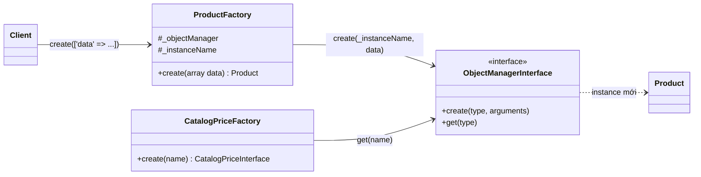
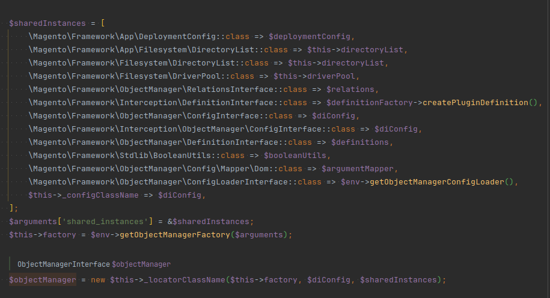

# Factories

> **Techstack:** Magento 2.4.x (Adobe Commerce / Magento Open Source)

## 1. Factory Method

`Factory Method` Design Pattern là một creational design pattern cung cấp một interface cho quá trình khởi tạo object ở superclass (Creator), nhưng cho phép **subclass** (ConcreteCreator) override để quyết định loại object cụ thể được tạo (xem Hình 2).

Factory pattern sẽ định nghĩa một phương thức khởi tạo ảo

‘virtual constructor’ tại đây sẽ định nghĩa trước các config, các dữ liệu cần trong quá trình khởi tạo.(thay vì gọi trực tiếp toán tử `new` để khởi tạo object)

Tránh sử dụng trực tiếp toán tử `new`


*Hình 1: Factory method `makeProduct()` đánh giá tham số và quyết định lớp con (`ProductOne`, `ProductTwo`) nào được tạo và trả về*

Thử tưởng tượng bạn sẽ cần phải tạo ra 2 product với các input config

```php
new ProductOne($store, $brand, $config, $data1);
new ProductTwo($store, $brand, $config, $data2);
```

các context về store, brand, config … cần sử dụng lại


*Hình 2: Cấu trúc Factory Method – Creator gọi `createProduct()`, các ConcreteCreator quyết định ConcreteProduct cụ thể*

Trong trường hợp này factoryMethod : `makeProduct()` sẽ mô tả sẵn các tham số, cache các config sử dụng chung …. vì vậy khi thực hiện `Product::makeProduct()` sẽ giúp chúng ta dễ dàng khởi tạo cũng như thay đổi tham số input khi tạo Product.

> [!NOTE]
> Nói chính xác, `Product::makeProduct()` ở Hình 1 là **static creation method / Simple Factory** (một method dùng điều kiện theo tham số để chọn class cần tạo), chưa phải Factory Method theo GoF. Factory Method (Hình 2) dựa vào kế thừa: `Creator::createProduct()` được các `ConcreteCreator` override. Xem [Refactoring.Guru – Factory Comparison](https://refactoring.guru/design-patterns/factory-comparison).

### Ví dụ PHP – Factory Method (Refactoring.Guru)

Conceptual example của [Refactoring.Guru – Factory Method in PHP](https://refactoring.guru/design-patterns/factory-method/php/example) (© Alexander Shvets, CC BY-NC-ND 4.0). `Creator::someOperation()` gọi `factoryMethod()`; mỗi `ConcreteCreator` override `factoryMethod()` để trả về `ConcreteProduct` của mình – đây là Factory Method theo nghĩa GoF (dựa vào kế thừa), khác với static `makeProduct()` ở Hình 1.

```php
<?php

namespace RefactoringGuru\FactoryMethod\Conceptual;

/**
 * The Creator class declares the factory method that is supposed to return
 * an object of a Product class. The Creator's subclasses usually provide the
 * implementation of this method.
 */
abstract class Creator
{
    /**
     * Note that the Creator may also provide some default implementation of
     * the factory method.
     */
    abstract public function factoryMethod(): Product;

    /**
     * Also note that, despite its name, the Creator's primary
     * responsibility is not creating products. Usually, it contains some core
     * business logic that relies on Product objects, returned by the factory
     * method. Subclasses can indirectly change that business logic by
     * overriding the factory method and returning a different type of product
     * from it.
     */
    public function someOperation(): string
    {
        // Call the factory method to create a Product object.
        $product = $this->factoryMethod();
        // Now, use the product.
        $result = "Creator: The same creator's code has just worked with " .
            $product->operation();

        return $result;
    }
}

/**
 * Concrete Creators override the factory method in order to change the
 * resulting product's type.
 */
class ConcreteCreator1 extends Creator
{
    /**
     * Note that the signature of the method still uses the abstract product
     * type, even though the concrete product is actually returned from the
     * method. This way the Creator can stay independent of concrete product
     * classes.
     */
    public function factoryMethod(): Product
    {
        return new ConcreteProduct1();
    }
}

class ConcreteCreator2 extends Creator
{
    public function factoryMethod(): Product
    {
        return new ConcreteProduct2();
    }
}

/**
 * The Product interface declares the operations that all concrete products
 * must implement.
 */
interface Product
{
    public function operation(): string;
}

/**
 * Concrete Products provide various implementations of the Product
 * interface.
 */
class ConcreteProduct1 implements Product
{
    public function operation(): string
    {
        return "{Result of the ConcreteProduct1}";
    }
}

class ConcreteProduct2 implements Product
{
    public function operation(): string
    {
        return "{Result of the ConcreteProduct2}";
    }
}

/**
 * The client code works with an instance of a concrete creator, albeit
 * through its base interface. As long as the client keeps working with the
 * creator via the base interface, you can pass it any creator's subclass.
 */
function clientCode(Creator $creator)
{
    // ...
    echo "Client: I'm not aware of the creator's class, but it still works.\n"
        . $creator->someOperation();
    // ...
}

/**
 * The Application picks a creator's type depending on the configuration or
 * environment.
 */
echo "App: Launched with the ConcreteCreator1.\n";
clientCode(new ConcreteCreator1());
echo "\n\n";

echo "App: Launched with the ConcreteCreator2.\n";
clientCode(new ConcreteCreator2());
```

## 2. Abstract Factory Design Pattern

Abstract Factory là creational design pattern cho phép tạo ra **một họ (family) các object liên quan** mà không cần chỉ rõ concrete class của chúng. Cấu trúc gồm:

- **AbstractFactory**: interface khai báo một nhóm creation method, mỗi method tạo một loại AbstractProduct (ví dụ `createChair()`, `createSofa()`).
- **ConcreteFactory**: mỗi class implement toàn bộ nhóm method đó cho một biến thể (ví dụ `ModernFurnitureFactory`, `VictorianFurnitureFactory`), đảm bảo các product tạo ra tương thích với nhau.
- Client chỉ làm việc qua interface AbstractFactory/AbstractProduct.

Các method của Abstract Factory thường được xây dựng từ các Factory Method; Prototype chỉ là một cách khác để hiện thực các method này, không phải định nghĩa của Abstract Factory.

### Ví dụ PHP – Abstract Factory (Refactoring.Guru)

Conceptual example của [Refactoring.Guru – Abstract Factory in PHP](https://refactoring.guru/design-patterns/abstract-factory/php/example) (© Alexander Shvets, CC BY-NC-ND 4.0). Mỗi `ConcreteFactory` tạo ra một **họ** sản phẩm đi cùng nhau (`ProductA1` + `ProductB1`, hoặc `ProductA2` + `ProductB2`); client chỉ phụ thuộc vào interface `AbstractFactory`, `AbstractProductA`, `AbstractProductB`.

```php
<?php

namespace RefactoringGuru\AbstractFactory\Conceptual;

/**
 * The Abstract Factory interface declares a set of methods that return
 * different abstract products. These products are called a family and are
 * related by a high-level theme or concept. Products of one family are usually
 * able to collaborate among themselves. A family of products may have several
 * variants, but the products of one variant are incompatible with products of
 * another.
 */
interface AbstractFactory
{
    public function createProductA(): AbstractProductA;

    public function createProductB(): AbstractProductB;
}

/**
 * Concrete Factories produce a family of products that belong to a single
 * variant. The factory guarantees that resulting products are compatible. Note
 * that signatures of the Concrete Factory's methods return an abstract product,
 * while inside the method a concrete product is instantiated.
 */
class ConcreteFactory1 implements AbstractFactory
{
    public function createProductA(): AbstractProductA
    {
        return new ConcreteProductA1();
    }

    public function createProductB(): AbstractProductB
    {
        return new ConcreteProductB1();
    }
}

/**
 * Each Concrete Factory has a corresponding product variant.
 */
class ConcreteFactory2 implements AbstractFactory
{
    public function createProductA(): AbstractProductA
    {
        return new ConcreteProductA2();
    }

    public function createProductB(): AbstractProductB
    {
        return new ConcreteProductB2();
    }
}

/**
 * Each distinct product of a product family should have a base interface.
 * All variants of the product must implement this interface.
 */
interface AbstractProductA
{
    public function usefulFunctionA(): string;
}

/**
 * Concrete Products are created by corresponding Concrete Factories.
 */
class ConcreteProductA1 implements AbstractProductA
{
    public function usefulFunctionA(): string
    {
        return "The result of the product A1.";
    }
}

class ConcreteProductA2 implements AbstractProductA
{
    public function usefulFunctionA(): string
    {
        return "The result of the product A2.";
    }
}

/**
 * Here's the the base interface of another product. All products can
 * interact with each other, but proper interaction is possible only between
 * products of the same concrete variant.
 */
interface AbstractProductB
{
    /**
     * Product B is able to do its own thing...
     */
    public function usefulFunctionB(): string;

    /**
     * ...but it also can collaborate with the ProductA.
     *
     * The Abstract Factory makes sure that all products it creates are of the
     * same variant and thus, compatible.
     */
    public function anotherUsefulFunctionB(AbstractProductA $collaborator): string;
}

/**
 * Concrete Products are created by corresponding Concrete Factories.
 */
class ConcreteProductB1 implements AbstractProductB
{
    public function usefulFunctionB(): string
    {
        return "The result of the product B1.";
    }

    /**
     * The variant, Product B1, is only able to work correctly with the
     * variant, Product A1. Nevertheless, it accepts any instance of
     * AbstractProductA as an argument.
     */
    public function anotherUsefulFunctionB(AbstractProductA $collaborator): string
    {
        $result = $collaborator->usefulFunctionA();

        return "The result of the B1 collaborating with the ({$result})";
    }
}

class ConcreteProductB2 implements AbstractProductB
{
    public function usefulFunctionB(): string
    {
        return "The result of the product B2.";
    }

    /**
     * The variant, Product B2, is only able to work correctly with the
     * variant, Product A2. Nevertheless, it accepts any instance of
     * AbstractProductA as an argument.
     */
    public function anotherUsefulFunctionB(AbstractProductA $collaborator): string
    {
        $result = $collaborator->usefulFunctionA();

        return "The result of the B2 collaborating with the ({$result})";
    }
}

/**
 * The client code works with factories and products only through abstract
 * types: AbstractFactory and AbstractProduct. This lets you pass any factory or
 * product subclass to the client code without breaking it.
 */
function clientCode(AbstractFactory $factory)
{
    $productA = $factory->createProductA();
    $productB = $factory->createProductB();

    echo $productB->usefulFunctionB() . "\n";
    echo $productB->anotherUsefulFunctionB($productA) . "\n";
}

/**
 * The client code can work with any concrete factory class.
 */
echo "Client: Testing client code with the first factory type:\n";
clientCode(new ConcreteFactory1());

echo "\n";

echo "Client: Testing the same client code with the second factory type:\n";
clientCode(new ConcreteFactory2());
```

## 3. Factory classes trong Magento

### 3.1. Factory được generate tự động

Cùng xem lại cách FactoryClasses thực hiện trong Magento

**Ví dụ:** factory class `ProductFactory` (rút gọn)

```php
/**
 * Magento\Catalog\Model\ProductFactory
 * Factory class for @see \Magento\Catalog\Model\Product
 */
class ProductFactory
{
    /**
     * Create class instance with specified parameters
     *
     * @param array $data
     * @return \Magento\Catalog\Model\Product
     */
    public function create(array $data = [])
    {
        return $this->_objectManager->create($this->_instanceName, $data);
    }
}
```

Factory này sẽ giúp chúng ta dễ dàng khởi tạo một instance của ProductModel

có thể thấy construct trong ProductModel bao gồm rất nhiều phụ thuộc từ các objects khác


*Hình 3: Constructor của `Magento\Catalog\Model\Product` – rất nhiều dependency cần inject khi khởi tạo*

với ObjectManager và Factory thì việc khởi tạo sẽ dễ dàng hơn:

```php
$product1 = $productFactory->create(['data' => $productData1]);
$product2 = $productFactory->create(['data' => $productData2]);
```

Mỗi lần gọi `create()` đều tạo một instance `Product` **mới**; các dependency trong constructor được ObjectManager tự resolve, và những dependency shared (mặc định) được lấy lại qua `ObjectManager::get()` thay vì khởi tạo lại (`Magento\Framework\ObjectManager\Factory\AbstractFactory::resolveArgument()`). Lợi ích này đến từ ObjectManager; vai trò chính của factory là cho phép tạo object non-injectable (entity/model) mà không inject trực tiếp `ObjectManager` vào business code.



*Hình 4: Factory trong Magento – `ProductFactory` (generate từ template `Magento\Framework\ObjectManager\Code\Generator\Factory`) uỷ quyền cho `ObjectManagerInterface::create()`; `CatalogPriceFactory` là factory viết tay, dùng `get()` và kiểm tra kiểu `CatalogPriceInterface`*

> [!NOTE]
> Trong M2 Factory Classes sẽ được auto generator `{NameClass}Factory` => sẽ tự động generator bên trong `generated/code` (ví dụ `generated/code/Magento/Catalog/Model/ProductFactory.php`), khi class được tham chiếu lần đầu (ví dụ trong constructor) hoặc khi chạy `bin/magento setup:di:compile`.

### 3.2. Custom Factory

Nhưng chúng ta cũng có thể tự custom riêng Factory, như trong trường hợp này

`Magento\Catalog\Model\Product\CatalogPrice`

`Magento\Catalog\Model\Product\CatalogPriceFactory`

`CatalogPrice` là class **dùng** factory: nó chọn class price model theo `$product->getTypeId()` từ argument `priceModelPool` (khai báo trong `Magento/Bundle/etc/di.xml`, `Magento/GroupedProduct/etc/di.xml`) rồi gọi `CatalogPriceFactory::create($name)`. Factory viết tay này dùng `ObjectManager::get()` (trả về instance shared, không tạo mới) và ném `\UnexpectedValueException` nếu object không implement `CatalogPriceInterface`.

Hoặc trong trường hợp của ObjectManagerFactory

`Magento\Framework\App\ObjectManagerFactory`



*Hình 5: `Magento\Framework\App\ObjectManagerFactory::create()` – chuẩn bị shared instances và factory rồi khởi tạo ObjectManager*

## Tham khảo

**Tài liệu chính thức**
- [Factories](https://developer.adobe.com/commerce/php/development/components/factories)
- [Code generation](https://developer.adobe.com/commerce/php/development/components/code-generation)
- [ObjectManager](https://developer.adobe.com/commerce/php/development/components/object-manager/)

**Source code**
- [`Magento\Framework\ObjectManager\Code\Generator\Factory`](https://github.com/magento/magento2/blob/2.4-develop/lib/internal/Magento/Framework/ObjectManager/Code/Generator/Factory.php)
- [`Magento\Catalog\Model\Product\CatalogPriceFactory`](https://github.com/magento/magento2/blob/2.4-develop/app/code/Magento/Catalog/Model/Product/CatalogPriceFactory.php)
- [`Magento\Framework\App\ObjectManagerFactory`](https://github.com/magento/magento2/blob/2.4-develop/lib/internal/Magento/Framework/App/ObjectManagerFactory.php)

**Bài viết khác**
- [Refactoring.Guru – Factory Method](https://refactoring.guru/design-patterns/factory-method)
- [Refactoring.Guru – Abstract Factory](https://refactoring.guru/design-patterns/abstract-factory)
- [Refactoring.Guru – Factory Comparison](https://refactoring.guru/design-patterns/factory-comparison)

**Bài liên quan trong Knowledge Base**
- [ObjectManager trong Magento](../Object%20Manager.md)
- [Code generation & Optimal development environment](../Code%20generation%20%26%20Optimal%20development%20environment.md)
- [Object Pool](Object%20Pool_.md)
- [Proxy](Proxies.md)
