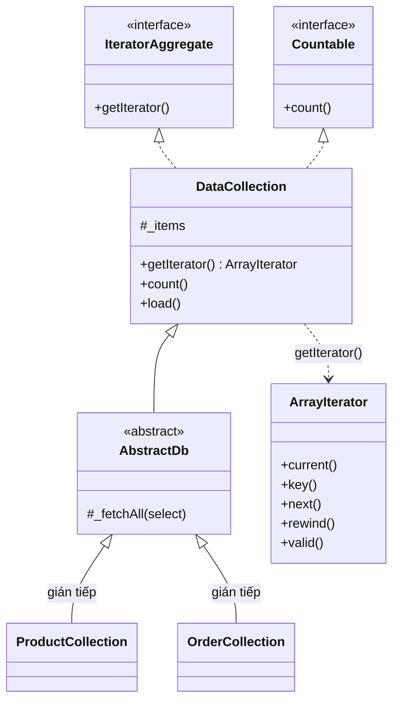

# Iterator Pattern

> **Techstack:** Magento 2.4.x (Adobe Commerce / Magento Open Source)

## 1. Định nghĩa

Mô hình Iterator là một mẫu thiết kế thuộc nhóm behavioral design pattern. Mục đích chính của nó là cung cấp một cách thức để truy cập tuần tự các phần tử của một tập hợp (collection) mà không cần quan tâm đến cấu trúc bên trong của tập hợp đó. Nói cách khác, Iterator cho phép bạn duyệt qua một danh sách các đối tượng một cách có trật tự, mà không cần biết danh sách đó được lưu trữ như thế nào.

## 2. Cách thức hoạt động

Cách thức hoạt động của Iterator Pattern:

- **Iterator Interface:** Định nghĩa các phương thức để truy cập và duyệt qua các phần tử của một tập hợp. Các phương thức phổ biến bao gồm `hasNext()` (kiểm tra xem còn phần tử tiếp theo hay không), `next()` (lấy phần tử tiếp theo), và đôi khi có `current()` (lấy phần tử hiện tại), `rewind()` (đặt con trỏ về vị trí đầu tiên), ...
- **Concrete Iterator:** Implement interface IteratorInterface và chịu trách nhiệm duyệt qua các phần tử của một collection cụ thể. Nó sẽ theo dõi vị trí hiện tại và đảm bảo rằng việc duyệt qua các phần tử diễn ra một cách tuần tự.
- **Collection Interface:** Định nghĩa phương thức để trả về một iterator tương ứng với collection đó. Trong nhiều trường hợp, nó còn có thể có các phương thức để thêm, xóa, sửa đổi các phần tử của collection.
- **Concrete Collection:** Implement CollectionInterface và chứa danh sách các phần tử. Nó sẽ tạo ra các ConcreteIterator tương ứng khi được yêu cầu.
- **Client:** Sử dụng iterator để truy cập các phần tử của một collection mà không cần biết chi tiết về cách collection đó được tổ chức.

## 3. Lợi ích của Iterator Pattern

- **Đơn giản hóa việc duyệt:** Bạn có thể duyệt qua các phần tử của một collection mà không cần quan tâm đến cấu trúc bên trong của nó.
- **Tách biệt logic duyệt:** Logic duyệt được tách ra khỏi collection, giúp code dễ bảo trì và tái sử dụng.
- **Hỗ trợ nhiều kiểu duyệt:** Một collection có thể có nhiều iterator khác nhau, mỗi iterator sẽ thực hiện việc duyệt theo một cách thức khác nhau.
- **Tính mở rộng:** Bạn có thể dễ dàng thêm các collection và iterator mới mà không cần sửa đổi code cũ.
- **Truy cập tuần tự:** đảm bảo việc truy cập các phần tử trong một tập hợp được thực hiện một cách tuần tự.

## 4. Ứng dụng của Iterator Pattern trong Magento

Magento không tự viết Iterator interface riêng mà dùng interface built-in của PHP (`\Iterator`, `\IteratorAggregate`) – client chỉ cần `foreach`. Một số chỗ áp dụng trong source:

- **Duyệt qua các Collection:** `Magento\Framework\Data\Collection` implement `\IteratorAggregate` và `\Countable`; mọi collection (sản phẩm, đơn hàng…) kế thừa nó nên được duyệt nhất quán bằng `foreach`, không phụ thuộc vào cách dữ liệu được load (xem Hình 1).
- **Duyệt qua các file config của Module:** Khi đọc `di.xml`, `events.xml`… của mọi module, `Magento\Framework\App\Config\FileResolver::get()` trả về `Magento\Framework\Config\FileIterator` (implement `\Iterator`, `\Countable`) để reader `foreach` qua từng file.
- **Duyệt qua các phần tử trong Composite Pattern:** Khi các đối tượng được tổ chức theo dạng cấu trúc cây phân cấp, bạn có thể dùng iterator để duyệt các phần tử trong cấu trúc này, ví dụ `Magento\Framework\Data\Tree\Node::getChildren()` trả về `Magento\Framework\Data\Tree\Node\Collection` (implement `\IteratorAggregate`).

> [!NOTE]
> Cây block của Layout **không** dùng Iterator: `Magento\Framework\View\Layout\Data\Structure` (kế thừa `Magento\Framework\Data\Structure`) lưu bằng mảng và được duyệt qua `Magento\Framework\View\Layout::getChildNames()`.



*Hình 1: Iterator trong collection của Magento – `Magento\Framework\Data\Collection` implement `\IteratorAggregate`; `getIterator()` gọi `load()` rồi trả về `\ArrayIterator($this->_items)`, nên client chỉ cần `foreach ($collection as $item)` với collection sản phẩm hay đơn hàng*

## 5. Ví dụ

Hãy tưởng tượng bạn có một giỏ hàng (collection) chứa các sản phẩm. Bạn muốn duyệt qua từng sản phẩm trong giỏ hàng để hiển thị chúng. Thay vì phải biết cách giỏ hàng được lưu trữ như thế nào (ví dụ, một mảng, một danh sách liên kết), bạn có thể sử dụng một iterator để truy cập tuần tự từng sản phẩm một.

### Ví dụ PHP – Iterator (Refactoring.Guru)

Conceptual example của [Refactoring.Guru – Iterator in PHP](https://refactoring.guru/design-patterns/iterator/php/example) (© Alexander Shvets, CC BY-NC-ND 4.0). Dùng interface có sẵn của PHP: `WordsCollection implements \IteratorAggregate` (giống `Magento\Framework\Data\Collection`), còn `AlphabeticalOrderIterator implements \Iterator` giữ vị trí duyệt; client chỉ cần `foreach`.

```php
<?php

namespace RefactoringGuru\Iterator\Conceptual;

use Iterator;

/**
 * PHP has a built-in Iterator interface that provides a very convenient
 * integration with foreach loops. Here's how the interface looks like:
 *
 * @link http://php.net/manual/en/class.iterator.php
 *
 *     interface Iterator extends Traversable {
 *         // Return the current element
 *         public function current();
 *
 *         // Move forward to next element
 *         public function next();
 *
 *         // Return the key of the current element
 *         public function key();
 *
 *         // Checks if current position is valid
 *         public function valid();
 *
 *         // Rewind the Iterator to the first element
 *         public function rewind();
 *     }
 *
 * There's also a built-in interface for collections:
 *
 * @link http://php.net/manual/en/class.iteratoraggregate.php
 *
 *     interface IteratorAggregate extends Traversable {
 *         public getIterator(): Traversable;
 *     }
 */

/**
 * Concrete Iterators implement various traversal algorithms. These classes
 * store the current traversal position at all times.
 */
class AlphabeticalOrderIterator implements \Iterator
{
    /**
     * @var WordsCollection
     */
    private $collection;

    /**
     * @var int Stores the current traversal position. An iterator may have
     * a lot of other fields for storing iteration state, especially when it is
     * supposed to work with a particular kind of collection.
     */
    private $position = 0;

    /**
     * @var bool This variable indicates the traversal direction.
     */
    private $reverse = false;

    public function __construct($collection, $reverse = false)
    {
        $this->collection = $collection;
        $this->reverse = $reverse;
    }

    public function rewind()
    {
        $this->position = $this->reverse ?
            count($this->collection->getItems()) - 1 : 0;
    }

    public function current()
    {
        return $this->collection->getItems()[$this->position];
    }

    public function key()
    {
        return $this->position;
    }

    public function next()
    {
        $this->position = $this->position + ($this->reverse ? -1 : 1);
    }

    public function valid()
    {
        return isset($this->collection->getItems()[$this->position]);
    }
}

/**
 * Concrete Collections provide one or several methods for retrieving fresh
 * iterator instances, compatible with the collection class.
 */
class WordsCollection implements \IteratorAggregate
{
    private $items = [];

    public function getItems()
    {
        return $this->items;
    }

    public function addItem($item)
    {
        $this->items[] = $item;
    }

    public function getIterator(): Iterator
    {
        return new AlphabeticalOrderIterator($this);
    }

    public function getReverseIterator(): Iterator
    {
        return new AlphabeticalOrderIterator($this, true);
    }
}

/**
 * The client code may or may not know about the Concrete Iterator or
 * Collection classes, depending on the level of indirection you want to keep in
 * your program.
 */
$collection = new WordsCollection();
$collection->addItem("First");
$collection->addItem("Second");
$collection->addItem("Third");

echo "Straight traversal:\n";
foreach ($collection->getIterator() as $item) {
    echo $item . "\n";
}

echo "\n";
echo "Reverse traversal:\n";
foreach ($collection->getReverseIterator() as $item) {
    echo $item . "\n";
}
```

## Tham khảo

**Tài liệu chính thức**
- [Persistence layer](https://developer.adobe.com/commerce/php/architecture/layers/persistence) – model, resource model và collection
- [PHP Manual – IteratorAggregate](https://www.php.net/manual/en/class.iteratoraggregate.php)

**Source code**
- [`Magento\Framework\Data\Collection`](https://github.com/magento/magento2/blob/2.4-develop/lib/internal/Magento/Framework/Data/Collection.php)
- [`Magento\Framework\Data\Collection\AbstractDb`](https://github.com/magento/magento2/blob/2.4-develop/lib/internal/Magento/Framework/Data/Collection/AbstractDb.php)

**Bài viết khác**
- [Refactoring.Guru – Iterator](https://refactoring.guru/design-patterns/iterator)

**Bài liên quan trong Knowledge Base**
- [Iterator – duyệt dữ liệu lớn](../DB%20%26%20Data%20Object/iterator.md)
- [Composite Pattern](Composite%20Pattern.md)
