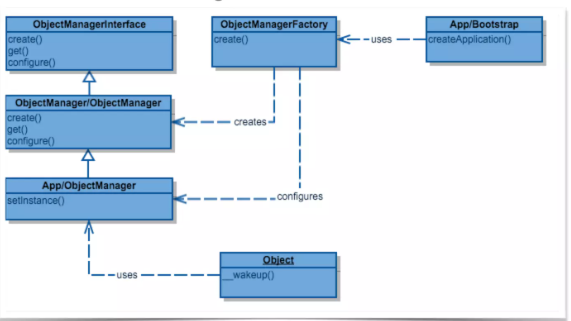
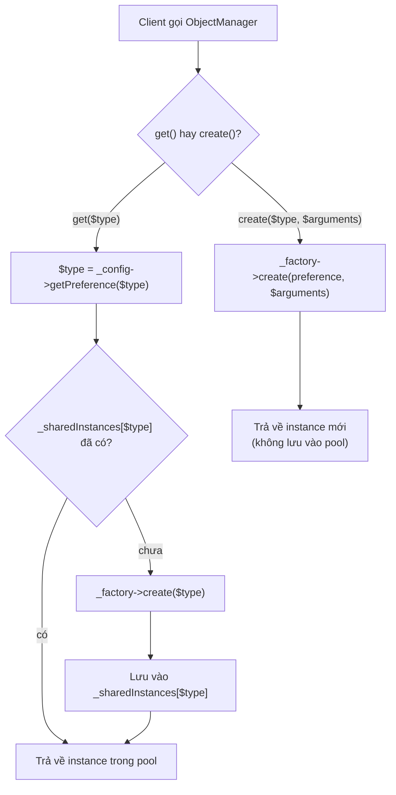

# Object Pool

> **Techstack:** Magento 2.4.x (Adobe Commerce / Magento Open Source)

## 1. Định nghĩa

Object pool pattern được sử dụng để quản lý và caching object. Object pool giúp tăng hiệu suất quá trình khởi tạo objects trong ứng dụng.

Object Pool giúp tái sử dụng các shared object như Config, Context…

Magento không có Object Pool đúng nghĩa; ObjectManager dùng ý tưởng gần giống (cache và tái sử dụng shared instance trong `$_sharedInstances`) – xem NOTE bên dưới.

> [!NOTE]
> Object Pool không phải pattern GoF. Theo [SourceMaking – Object Pool](https://sourcemaking.com/design_patterns/object_pool), client **acquire** một object từ pool, dùng riêng, rồi **release** trả lại pool để client khác dùng lại; pool có `acquire()`/`release()` và dọn object không dùng. `ObjectManager` của Magento không có acquire/release: `get()` trả về **cùng một** instance trong `$_sharedInstances` cho mọi client cùng lúc và không bao giờ trả lại – Adobe gọi đây là "implementing the singleton pattern by returning the same shared instance" ([ObjectManager](https://developer.adobe.com/commerce/php/development/components/object-manager/)). Vì vậy hiểu ObjectManager là một *cache/registry các shared instance* có ý tưởng giống pool (tái sử dụng object), chứ không phải Object Pool đúng nghĩa.

## 2. Object Pool trong Magento – ObjectManager

Object Manager trong M2 [\<xem tại\>](../Object%20Manager.md)

Trong magento, ObjectManager giúp điều hướng quá trình khởi tạo object (tạo một singleton object, tạo object với DI inject, tạo new object …)

### 2.1. Magento mô tả trách nhiệm của ObjectManager

- ObjectManager tạo object bên trong factory và proxy (class Factory/Proxy do code generator sinh ra, không phải ObjectManager): `Factory::create()` gọi `$this->_objectManager->create()`, Proxy gọi `get()` hoặc `create()`
- Tạo instance của singleton pattern nếu cùng chung một shared_instance
- Đúng vai trò như một Dependency management trong quá trình tạo preferred class
- Tự động tạo các parameters trong hàm constructors của class



*Hình 1: Quan hệ giữa `ObjectManagerInterface`, `ObjectManager\ObjectManager`, `App\ObjectManager`, `ObjectManagerFactory` và `App\Bootstrap`*

### 2.2. Khởi tạo và lấy object – `get()` / `create()`

ObjectManager sẽ trợ giúp quá trình khởi tạo Object, or lấy object trong shared

**Ví dụ:**

```php
$this->objectManager->get($classType)
$this->objectManager->create($classType);
```



*Hình 2: `Magento\Framework\ObjectManager\ObjectManager` – `get()` dùng mảng `$_sharedInstances` làm pool, `create()` luôn tạo instance mới*

Bên cạnh đó ObjectManager cũng xử lý Object tùy theo môi trường DI và theo area:

- `Magento\Framework\App\EnvironmentFactory` chọn `ObjectManager\Environment\Compiled` nếu đã có file `generated/metadata/global.php` (sinh bởi `bin/magento setup:di:compile`), ngược lại dùng `Environment\Developer` (đọc `di.xml` lúc runtime). Việc chọn dựa trên file metadata đã compile, không trực tiếp dựa trên deploy mode developer/production (dù production mode thường đã chạy `setup:di:compile`).
- Khi load area, `Magento\Framework\App\Area` / `Magento\Framework\App\Http` gọi `$this->_objectManager->configure($configLoader->load($areaCode))` để nạp thêm DI config của area đó (`etc/frontend/di.xml`, `etc/adminhtml/di.xml`…).

## Tham khảo

**Tài liệu chính thức**
- [ObjectManager](https://developer.adobe.com/commerce/php/development/components/object-manager/)
- [Dependency injection](https://developer.adobe.com/commerce/php/development/components/dependency-injection)

**Source code**
- [`Magento\Framework\ObjectManager\ObjectManager`](https://github.com/magento/magento2/blob/2.4-develop/lib/internal/Magento/Framework/ObjectManager/ObjectManager.php)
- [`Magento\Framework\App\ObjectManager`](https://github.com/magento/magento2/blob/2.4-develop/lib/internal/Magento/Framework/App/ObjectManager.php)
- [`Magento\Framework\App\ObjectManagerFactory`](https://github.com/magento/magento2/blob/2.4-develop/lib/internal/Magento/Framework/App/ObjectManagerFactory.php)

**Bài liên quan trong Knowledge Base**
- [ObjectManager trong Magento](../Object%20Manager.md)
- [Factories](Factories%20Patterns.md)
- [Proxy](Proxies.md)
