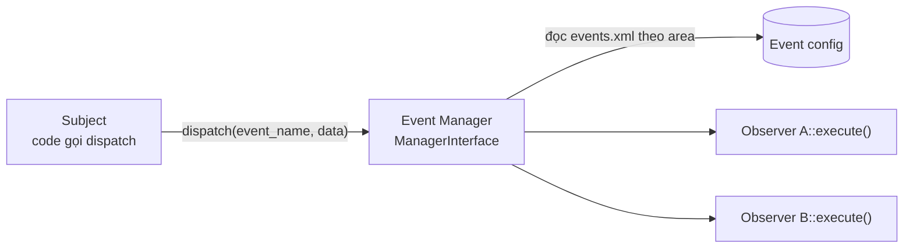
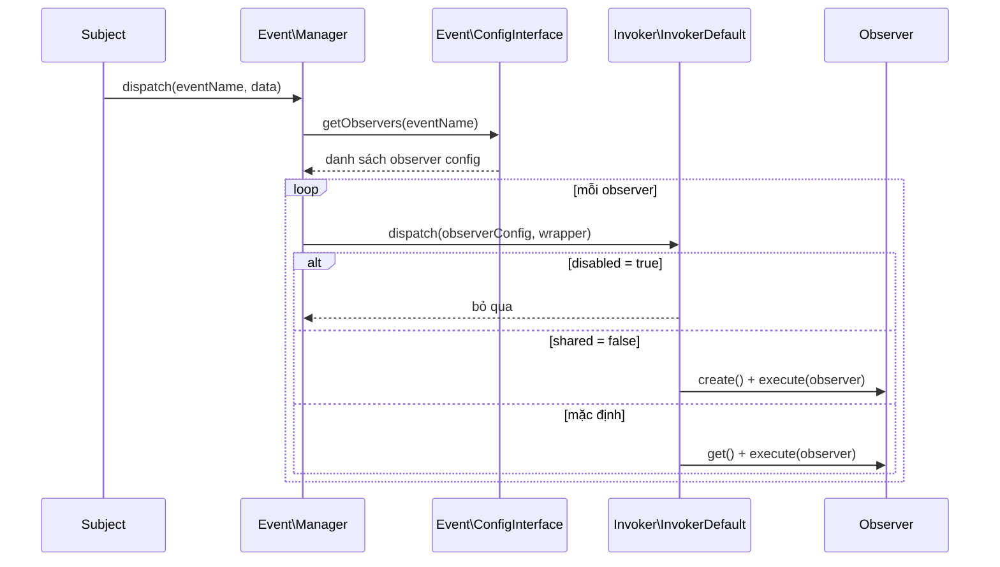

# Observer Pattern

> **Techstack:** Magento 2.4.x (Adobe Commerce / Magento Open Source)

## 1. Định nghĩa

**Observer** là behavioral design pattern định nghĩa quan hệ một-nhiều: khi **Subject** (publisher) thay đổi state hoặc xảy ra sự kiện, nó **thông báo** cho tất cả **Observer** (subscriber) đã đăng ký mà không cần biết cụ thể chúng là ai.

Trong Magento 2, pattern này được hiện thực bằng hệ thống **Events & Observers**: code core `dispatch` một event theo tên, các module đăng ký observer cho tên event đó trong `events.xml`.

## 2. Khi nào dùng / vấn đề giải quyết

- Module A cần "phản ứng" khi module B làm gì đó (đặt hàng, lưu sản phẩm, login…) mà **không sửa** code B và B không phụ thuộc A.
- Nhiều tác vụ phụ độc lập cho cùng một sự kiện: gửi dữ liệu sang ERP, ghi log, đánh dấu reindex, clear cache.
- Không phù hợp khi cần **thay đổi kết quả trả về** hoặc argument của method → dùng plugin.

## 3. Cấu trúc



*Hình 1: Cấu trúc Observer pattern trong Magento 2*

| Participant (GoF) | Magento 2 |
|---|---|
| Subject / Publisher | Class gọi `$this->eventManager->dispatch()` |
| Subscription list | `events.xml` (merge theo module + area) |
| Observer interface | `Magento\Framework\Event\ObserverInterface::execute(Observer $observer)` |
| Event payload | `Magento\Framework\Event\Observer` / `Magento\Framework\Event` (DataObject) |

### Ví dụ PHP – Observer (Refactoring.Guru)

Conceptual example của [Refactoring.Guru – Observer in PHP](https://refactoring.guru/design-patterns/observer/php/example) (© Alexander Shvets, CC BY-NC-ND 4.0). Dùng interface có sẵn của PHP `\SplSubject` / `\SplObserver`: `Subject` giữ danh sách observer (`attach()`/`detach()`) và gọi `notify()` khi state đổi. Magento không dùng hai interface này mà đi qua event manager (`events.xml` + `ObserverInterface`) như mục 4.

```php
<?php

namespace RefactoringGuru\Observer\Conceptual;

/**
 * PHP has a couple of built-in interfaces related to the Observer pattern.
 *
 * Here's what the Subject interface looks like:
 *
 * @link http://php.net/manual/en/class.splsubject.php
 *
 *     interface SplSubject
 *     {
 *         // Attach an observer to the subject.
 *         public function attach(SplObserver $observer);
 *
 *         // Detach an observer from the subject.
 *         public function detach(SplObserver $observer);
 *
 *         // Notify all observers about an event.
 *         public function notify();
 *     }
 *
 * There's also a built-in interface for Observers:
 *
 * @link http://php.net/manual/en/class.splobserver.php
 *
 *     interface SplObserver
 *     {
 *         public function update(SplSubject $subject);
 *     }
 */

/**
 * The Subject owns some important state and notifies observers when the
 * state changes.
 */
class Subject implements \SplSubject
{
    /**
     * @var int For the sake of simplicity, the Subject's state, essential
     * to all subscribers, is stored in this variable.
     */
    public $state;

    /**
     * @var \SplObjectStorage List of subscribers. In real life, the list of
     * subscribers can be stored more comprehensively (categorized by event
     * type, etc.).
     */
    private $observers;

    public function __construct()
    {
        $this->observers = new \SplObjectStorage();
    }

    /**
     * The subscription management methods.
     */
    public function attach(\SplObserver $observer): void
    {
        echo "Subject: Attached an observer.\n";
        $this->observers->attach($observer);
    }

    public function detach(\SplObserver $observer): void
    {
        $this->observers->detach($observer);
        echo "Subject: Detached an observer.\n";
    }

    /**
     * Trigger an update in each subscriber.
     */
    public function notify(): void
    {
        echo "Subject: Notifying observers...\n";
        foreach ($this->observers as $observer) {
            $observer->update($this);
        }
    }

    /**
     * Usually, the subscription logic is only a fraction of what a Subject
     * can really do. Subjects commonly hold some important business logic, that
     * triggers a notification method whenever something important is about to
     * happen (or after it).
     */
    public function someBusinessLogic(): void
    {
        echo "\nSubject: I'm doing something important.\n";
        $this->state = rand(0, 10);

        echo "Subject: My state has just changed to: {$this->state}\n";
        $this->notify();
    }
}

/**
 * Concrete Observers react to the updates issued by the Subject they had
 * been attached to.
 */
class ConcreteObserverA implements \SplObserver
{
    public function update(\SplSubject $subject): void
    {
        if ($subject->state < 3) {
            echo "ConcreteObserverA: Reacted to the event.\n";
        }
    }
}

class ConcreteObserverB implements \SplObserver
{
    public function update(\SplSubject $subject): void
    {
        if ($subject->state == 0 || $subject->state >= 2) {
            echo "ConcreteObserverB: Reacted to the event.\n";
        }
    }
}

/**
 * The client code.
 */

$subject = new Subject();

$o1 = new ConcreteObserverA();
$subject->attach($o1);

$o2 = new ConcreteObserverB();
$subject->attach($o2);

$subject->someBusinessLogic();
$subject->someBusinessLogic();

$subject->detach($o2);

$subject->someBusinessLogic();
```

## 4. Áp dụng trong Magento 2

### 4.1. Dispatch event

**Ví dụ:** dispatch event custom từ service của module

```php
$this->eventManager->dispatch('vendor_module_export_after', ['export' => $export, 'count' => $count]);
```

`Magento\Framework\Event\ManagerInterface::dispatch($eventName, array $data = [])`. Tên event nên có prefix vendor để tránh trùng.

Bên trong, `Magento\Framework\Event\Manager::dispatch()` lấy danh sách observer của event từ config, bọc `$data` vào `Magento\Framework\Event\Observer` rồi giao cho invoker `Magento\Framework\Event\Invoker\InvokerDefault` gọi từng observer, tuần tự trong cùng request:



*Hình 2: Luồng dispatch event – `Manager::dispatch()` → `InvokerDefault::dispatch()` → `ObserverInterface::execute()`*

### 4.2. Đăng ký observer – `events.xml` theo area

| File | Scope |
|---|---|
| `etc/events.xml` | global |
| `etc/frontend/events.xml` | storefront |
| `etc/adminhtml/events.xml` | admin |
| `etc/webapi_rest/events.xml`, `etc/webapi_soap/events.xml` | REST / SOAP |
| `etc/graphql/events.xml` | GraphQL |
| `etc/crontab/events.xml` | cron |

**Ví dụ:** đăng ký observer cho event `sales_order_place_after`

```xml
<!-- app/code/Vendor/Module/etc/events.xml -->
<config xmlns:xsi="http://www.w3.org/2001/XMLSchema-instance"
        xsi:noNamespaceSchemaLocation="urn:magento:framework:Event/etc/events.xsd">
    <event name="sales_order_place_after">
        <observer name="vendor_module_order_place_after" instance="Vendor\Module\Observer\SendOrderToErp"/>
    </event>
</config>
```

Thuộc tính `<observer>`:

- `name`: unique trong event; dùng để override/disable.
- `instance`: class implement `ObserverInterface`.
- `disabled="true"`: tắt observer (kể cả của module khác, cùng `event` + `name`).
- `shared="false"`: tạo instance mới mỗi lần dispatch (`Magento\Framework\Event\Invoker\InvokerDefault` gọi `create()` thay vì `get()`). Mặc định là shared.

### 4.3. Event tự động của model / collection

`Magento\Framework\Model\AbstractModel` tự dispatch event quanh load/save/delete, dùng `$_eventPrefix` (mặc định `core_abstract`) và `$_eventObject` (mặc định `object`):

- `model_save_before` / `{prefix}_save_before`
- `model_save_after` / `{prefix}_save_after`, `clean_cache_by_tags`
- `model_save_commit_after` / `{prefix}_save_commit_after` (sau khi transaction commit)
- `{prefix}_load_before` / `{prefix}_load_after`
- `{prefix}_delete_before` / `_delete_after` / `_delete_commit_after`

VD `Magento\Catalog\Model\Product`: `$_eventPrefix = 'catalog_product'`, `$_eventObject = 'product'` → event `catalog_product_save_after`, lấy data bằng `$observer->getEvent()->getProduct()`.

Với model custom, khai báo `protected $_eventPrefix = 'vendor_module_ticket'; protected $_eventObject = 'ticket';` để module khác có thể subscribe.

## 5. Ví dụ code

**Ví dụ:** observer đẩy order sang queue để đồng bộ ERP

```php
<?php
// app/code/Vendor/Module/Observer/SendOrderToErp.php
declare(strict_types=1);

namespace Vendor\Module\Observer;

use Magento\Framework\Event\Observer;
use Magento\Framework\Event\ObserverInterface;
use Magento\Framework\MessageQueue\PublisherInterface;
use Magento\Sales\Api\Data\OrderInterface;
use Psr\Log\LoggerInterface;

class SendOrderToErp implements ObserverInterface
{
    public function __construct(
        private readonly PublisherInterface $publisher,
        private readonly LoggerInterface $logger
    ) {
    }

    public function execute(Observer $observer): void
    {
        /** @var OrderInterface $order */
        $order = $observer->getEvent()->getData('order');
        if (!$order instanceof OrderInterface) {
            return;
        }

        try {
            // Không gọi ERP trực tiếp trong luồng checkout: đẩy vào queue
            $this->publisher->publish('vendor.erp.order.export', (string)$order->getIncrementId());
        } catch (\Throwable $e) {
            $this->logger->error('ERP export enqueue failed: ' . $e->getMessage());
        }
    }
}
```

> [!NOTE]
> `sales_order_place_after` được dispatch trong `Magento\Sales\Model\Order::place()`, **trước** khi order được lưu: `Magento\Sales\Model\Service\OrderService::place()` gọi `$order->place()` rồi mới `$this->orderRepository->save($order)`. Lúc observer chạy, order chưa có `entity_id` và việc save sau đó vẫn có thể fail → consumer phải chịu được trường hợp không tìm thấy order theo increment ID. Nếu cần chắc chắn order đã commit trong DB trước khi gửi sang hệ thống ngoài, dùng `sales_order_save_commit_after` (xem pitfalls ở mục 7).

Topic `vendor.erp.order.export` cần khai báo trong `communication.xml`, `queue_publisher.xml`, `queue_topology.xml`, `queue_consumer.xml` (xem ví dụ đầy đủ trong [Event-driven Architecture with Mage-OS](../Event%20%26%20Webhook/Event-driven%20Architecture%20with%20Mage-OS.md)).

## 6. Observer vs Plugin

| | Observer | Plugin |
|---|---|---|
| Gắn vào | Event được dispatch sẵn | Public method bất kỳ (trừ các trường hợp hạn chế) |
| Đổi return value | Không (chỉ sửa data object được truyền, nếu mutable) | Có (`after`/`around`) |
| Đổi argument | Không | Có (`before`) |
| Thứ tự | Không đảm bảo/không cấu hình được | `sortOrder` |
| Coupling | Lỏng: chỉ phụ thuộc tên event + payload | Phụ thuộc signature method |

Xem thêm: [So sánh overview về Event, Plugin & DI](../DI%20%26%20Interceptors/So%20sánh%20overview%20về%20Event,%20Plugin%20%26%20DI.md) · [Dependency injection configuration](../DI%20%26%20Interceptors/Dependency%20injection%20configuration.md)

## 7. Ưu / nhược điểm & pitfalls

**Ưu điểm**

- Open/Closed: thêm hành vi mà không sửa subject.
- Loose coupling giữa module.

**Nhược điểm & pitfalls**

- Observer chạy **đồng bộ** trong cùng request: observer chậm (gọi API ngoài, gửi mail) làm chậm checkout/save → đẩy sang message queue.
- Exception trong observer **lan ra** và có thể làm fail cả thao tác gốc (VD place order) → bắt exception khi tác vụ không quan trọng.
- Không đặt logic nghiệp vụ trong observer; observer chỉ nên gọi sang service class (dễ test, tái sử dụng).
- Không dựa vào thứ tự observer.
- `*_save_after` vẫn nằm trong transaction; nếu cần chắc chắn dữ liệu đã commit (gửi sang hệ thống ngoài), dùng `*_save_commit_after`.
- Đăng ký đúng area: observer ở `frontend/events.xml` sẽ không chạy khi order tạo qua REST/admin.
- Event `{prefix}_save_*` chỉ chạy khi save qua model/resource model; update bằng SQL trực tiếp hoặc một số mass action/import thì **không** có event.

> [!WARNING]
> Class observer **phải** implement `ObserverInterface`: ở developer mode sẽ throw `LogicException`, ở production chỉ log warning và observer **không chạy** (lỗi "im lặng").

> [!WARNING]
> Gọi `$object->save()` bên trong `*_save_after` của chính object đó → vòng lặp vô hạn / save trùng.

## Tham khảo

**Tài liệu chính thức**

- [Events and observers](https://developer.adobe.com/commerce/php/development/components/events-and-observers/)
- [Observers best practices](https://developer.adobe.com/commerce/php/best-practices/extensions/observers)
- [Event list](https://developer.adobe.com/commerce/php/development/components/events-and-observers/event-list)
- [Message queues](https://developer.adobe.com/commerce/php/development/components/message-queues/)
- [Message queue configuration files](https://developer.adobe.com/commerce/php/development/components/message-queues/configuration)

**Source code**

- [`Magento\Framework\Event\Manager`](https://github.com/magento/magento2/blob/2.4-develop/lib/internal/Magento/Framework/Event/Manager.php)
- [`Magento\Framework\Event\Invoker\InvokerDefault`](https://github.com/magento/magento2/blob/2.4-develop/lib/internal/Magento/Framework/Event/Invoker/InvokerDefault.php)
- [`Magento\Framework\Model\AbstractModel`](https://github.com/magento/magento2/blob/2.4-develop/lib/internal/Magento/Framework/Model/AbstractModel.php)

**Bài viết khác**

- [Refactoring.Guru – Observer](https://refactoring.guru/design-patterns/observer)

**Bài liên quan trong Knowledge Base**

- [So sánh overview về Event, Plugin & DI](../DI%20%26%20Interceptors/So%20sánh%20overview%20về%20Event,%20Plugin%20%26%20DI.md)
- [Dependency injection configuration](../DI%20%26%20Interceptors/Dependency%20injection%20configuration.md)
- [Event-driven Architecture with Mage-OS](../Event%20%26%20Webhook/Event-driven%20Architecture%20with%20Mage-OS.md)
- [CQRS - Command and Query Responsibility Segregation](CQRS%20-%20Command%20and%20Query%20Responsibility%20Segregation_.md)
