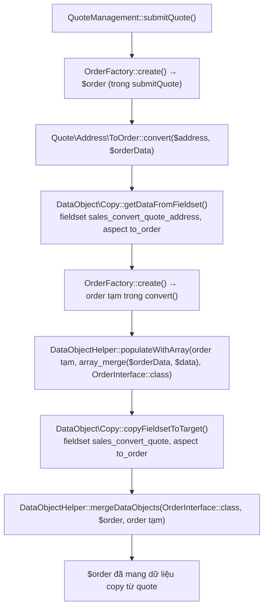

# Prototype Pattern

> **Techstack:** Magento 2.4.x (Adobe Commerce / Magento Open Source)

## 1. Định nghĩa

Prototype Pattern là một trong những Creational Pattern. Nó có nhiệm vụ khởi tạo một đối tượng bằng cách clone một đối tượng đã tồn tại thay vì khởi tạo với từ khóa `new`. Đối tượng mới là một bản sao có thể giống 100% với đối tượng gốc, và cũng có thể không cần giống hoàn toàn với đối tượng gốc.

Chúng ta có thể thay đổi dữ liệu của nó mà không ảnh hưởng đến đối tượng gốc.


*Hình 1: Sao chép một đối tượng từ bên ngoài rất khó – vì vậy Prototype giao việc clone cho chính đối tượng gốc*

## 2. Lợi ích của Prototype Pattern là gì?

- Cải thiện performance,
- Giảm chi phí tạo một đối tượng mới theo chuẩn giúp tăng hiệu suất phần mềm so với việc dùng từ khóa `new` để tạo đối tượng mới – chỉ đúng khi việc khởi tạo tốn kém (query DB, load config, tính toán nặng); với object đơn giản, `clone` không nhanh hơn `new` đáng kể. Refactoring.Guru nhấn mạnh lợi ích chính là clone mà không phụ thuộc vào concrete class và bỏ được code khởi tạo lặp lại.
- Giảm độ phức tạp cho việc khởi tạo đối tượng: do mỗi lớp chỉ implement cách clone của chính nó.
- Khởi tạo đối tượng mới bằng cách thay đổi một vài thuộc tính của object (hệ thống linh động sẽ để cho chúng ta tự định nghĩa một hành động nào đó thông qua sự kết hợp với một đối tượng thay vì là định nghĩa một object mới).

=> Theo [Refactoring.Guru](https://refactoring.guru/design-patterns/prototype), Prototype giao việc clone cho **chính đối tượng được clone** (Concrete Prototype tự implement method clone), không dùng một class bên ngoài. Trong PHP, đó là toán tử `clone` kết hợp magic method `__clone()` để deep-copy các thuộc tính là object. Một Utility Class copy dữ liệu giữa các object là cách tiếp cận khác (data mapping), chỉ có vai trò tương tự.

### Ví dụ PHP – Prototype (Refactoring.Guru)

Conceptual example của [Refactoring.Guru – Prototype in PHP](https://refactoring.guru/design-patterns/prototype/php/example) (© Alexander Shvets, CC BY-NC-ND 4.0). Trong PHP, Prototype chính là toán tử `clone` + magic method `__clone()`: `Prototype::__clone()` tự xử lý deep copy cho object lồng nhau và back reference – cùng cách `Quote\Item::__clone()` ở mục 3.3.

```php
<?php

namespace RefactoringGuru\Prototype\Conceptual;

/**
 * The example class that has cloning ability. We'll see how the values of
 * field with different types will be cloned.
 */
class Prototype
{
    public $primitive;
    public $component;
    public $circularReference;

    /**
     * PHP has built-in cloning support. You can `clone` an object without
     * defining any special methods as long as it has fields of primitive types.
     * Fields containing objects retain their references in a cloned object.
     * Therefore, in some cases, you might want to clone those referenced
     * objects as well. You can do this in a special `__clone()` method.
     */
    public function __clone()
    {
        $this->component = clone $this->component;

        // Cloning an object that has a nested object with backreference
        // requires special treatment. After the cloning is completed, the
        // nested object should point to the cloned object, instead of the
        // original object.
        $this->circularReference = clone $this->circularReference;
        $this->circularReference->prototype = $this;
    }
}

class ComponentWithBackReference
{
    public $prototype;

    /**
     * Note that the constructor won't be executed during cloning. If you
     * have complex logic inside the constructor, you may need to execute it in
     * the `__clone` method as well.
     */
    public function __construct(Prototype $prototype)
    {
        $this->prototype = $prototype;
    }
}

/**
 * The client code.
 */
function clientCode()
{
    $p1 = new Prototype();
    $p1->primitive = 245;
    $p1->component = new \DateTime();
    $p1->circularReference = new ComponentWithBackReference($p1);

    $p2 = clone $p1;
    if ($p1->primitive === $p2->primitive) {
        echo "Primitive field values have been carried over to a clone. Yay!\n";
    } else {
        echo "Primitive field values have not been copied. Booo!\n";
    }
    if ($p1->component === $p2->component) {
        echo "Simple component has not been cloned. Booo!\n";
    } else {
        echo "Simple component has been cloned. Yay!\n";
    }

    if ($p1->circularReference === $p2->circularReference) {
        echo "Component with back reference has not been cloned. Booo!\n";
    } else {
        echo "Component with back reference has been cloned. Yay!\n";
    }

    if ($p1->circularReference->prototype === $p2->circularReference->prototype) {
        echo "Component with back reference is linked to original object. Booo!\n";
    } else {
        echo "Component with back reference is linked to the clone. Yay!\n";
    }
}

clientCode();
```

## 3. Prototype Pattern được sử dụng trong Magento

Magento dùng Prototype ở dạng `clone` + `__clone()` (xem 3.3). Ngoài ra có một vài `Utility Class` với vai trò tương tự đó là

### 3.1. Utility class `Magento\Framework\DataObject\Copy`

`Magento\Framework\DataObject\Copy`

> Utility class for copying data sets between objects

Được thực thi để copy một phần or toàn phần Data Object, thay vì phải khởi tạo lại dữ liệu.

Thường thấy khi Magento copy Quote => Order, or convert QuoteAddress => OrderAddress…

**Source:** `Magento\Quote\Model\Quote\Address\ToOrder::convert()`

```php
\Magento\Framework\DataObject\Copy $objectCopyService,

$orderData = $this->objectCopyService->getDataFromFieldset(
    'sales_convert_quote_address',
    'to_order',
    $object
);
```

### 3.2. Utility class `Magento\Framework\Api\DataObjectHelper`

Và một `Utility Class` khác

`Magento\Framework\Api\DataObjectHelper`

**Source:** `Magento\Quote\Model\QuoteManagement::submitQuote()`

```php
// Magento\Quote\Model\QuoteManagement::submitQuote()
\Magento\Framework\Api\DataObjectHelper $dataObjectHelper,

if ($quote->isVirtual()) {
    $this->dataObjectHelper->mergeDataObjects(
        OrderInterface::class,
        $order,
        $this->quoteAddressToOrder->convert($quote->getBillingAddress(), $orderData)
    );
} else {
    $this->dataObjectHelper->mergeDataObjects(
        OrderInterface::class,
        $order,
        $this->quoteAddressToOrder->convert($quote->getShippingAddress(), $orderData)
    );
    // ...
}
```



*Hình 2: Luồng copy Quote → Order khi place order – `Copy` đọc danh sách field từ `fieldset.xml`, `DataObjectHelper` gán/merge dữ liệu vào `OrderInterface` thay vì khởi tạo lại từng field*

### 3.3. Toán tử `clone`

bên cạnh đó Magento cũng trực tiếp sử dụng toán tử clone để check, update info.

**Source:** `Magento\Quote\Model\Quote::merge()` – đây là Prototype đúng nghĩa: item chưa có trong quote đích được tạo bằng cách clone item nguồn, và `Magento\Quote\Model\Quote\Item::__clone()` (cùng `Quote\Item\AbstractItem::__clone()`) tự lo việc reset id/parent/children và clone từng option.

```php
// Magento\Quote\Model\Quote::merge()
if (!$found) {
    $newItem = clone $item;
    $this->addItem($newItem);
    if ($item->getHasChildren()) {
        foreach ($item->getChildren() as $child) {
            $newChild = clone $child;
            $newChild->setParentItem($newItem);
            $this->addItem($newChild);
        }
    }
}

// Magento\Quote\Model\Quote\Item::__clone()
public function __clone()
{
    parent::__clone();
    $options = $this->getOptions();
    $this->_quote = null;
    $this->_options = [];
    $this->_optionsByCode = [];
    foreach ($options as $option) {
        $this->addOption(clone $option);
    }
    return $this;
}
```

**Source:** `Magento\User\Model\User::performIdentityCheck()`

```php
// Check if lock information has been updated in observers
$clonedUser = clone($this);
$clonedUser->reload();
if ($clonedUser->getLockExpires()) {
    throw new \Magento\Framework\Exception\State\UserLockedException(
        __('Your account is temporarily disabled. Please try again later.')
    );
}
```

## Tham khảo

**Tài liệu chính thức**
- [PHP Manual – Object Cloning](https://www.php.net/manual/en/language.oop5.cloning.php)

**Source code**
- [`Magento\Framework\DataObject\Copy`](https://github.com/magento/magento2/blob/2.4-develop/lib/internal/Magento/Framework/DataObject/Copy.php)
- [`Magento\Framework\Api\DataObjectHelper`](https://github.com/magento/magento2/blob/2.4-develop/lib/internal/Magento/Framework/Api/DataObjectHelper.php)
- [`Magento\Quote\Model\Quote\Address\ToOrder`](https://github.com/magento/magento2/blob/2.4-develop/app/code/Magento/Quote/Model/Quote/Address/ToOrder.php)

**Bài viết khác**
- [Refactoring.Guru – Prototype](https://refactoring.guru/design-patterns/prototype)

**Bài liên quan trong Knowledge Base**
- [Factories](Factories%20Patterns.md)
- [Builder Design Pattern](Builder.md)
- [Tổng quan Design Pattern](T%E1%BB%95ng%20quan%20Design%20Pattern.md)
