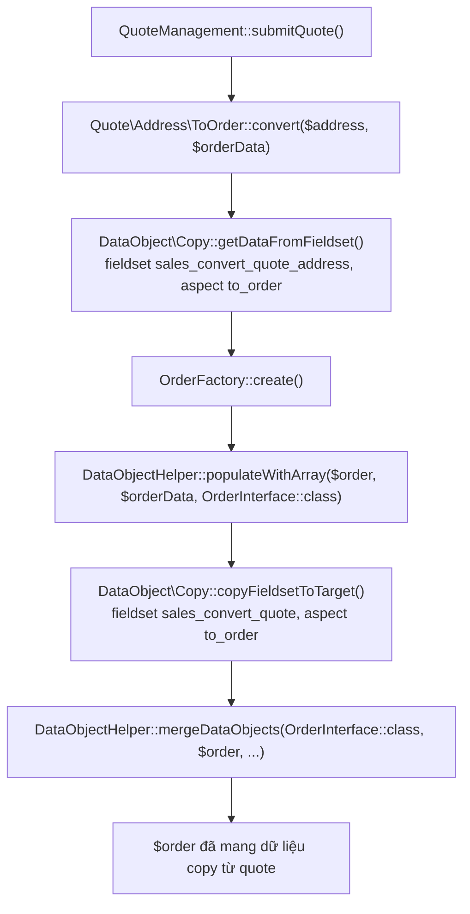

# Prototype Pattern

> **Techstack:** Magento 2.4.x (Adobe Commerce / Magento Open Source)

## 1. Định nghĩa

Prototype Pattern là một trong những Creational Pattern. Nó có nhiệm vụ khởi tạo một đối tượng bằng cách clone một đối tượng đã tồn tại thay vì khởi tạo với từ khóa `new`. Đối tượng mới là một bản sao có thể giống 100% với đối tượng gốc, và cũng có thể ko cần giống hoàn toàn với đối tượng gốc.

Chúng ta có thể thay đổi dữ liệu của nó mà không ảnh hưởng đến đối tượng gốc.


*Hình 1: Sao chép một đối tượng từ bên ngoài rất khó – vì vậy Prototype giao việc clone cho chính đối tượng gốc*

## 2. Lợi ích của Prototype Pattern là gì?

- Cải thiện performance,
- Giảm chi phí tạo một đối tượng mới theo chuẩn giúp tăng hiệu suất phần mềm so với việc dùng từ khóa `new` để tạo đối tượng mới.
- Giảm độ phức tạp cho việc khởi tạo đối tượng: do mỗi lớp chỉ implement cách clone của chính nó.
- Khởi tạo đối tượng mới bằng cách thay đổi một vài thuộc tính của object (hệ thống linh động sẽ để cho chúng ta tự định nghĩa một hành động nào đó thông qua sự kết hợp với một đối tượng thay vì là định nghĩa một object mới).

=> Để xây dựng Pattern này thường trong hệ thống sẽ build một Utility Class để clone toàn phần or một phần các object từ object ban đầu.

## 3. Prototype Pattern được sử dụng trong Magento

Magento ko hoàn thấy Pattern này được thực thi, nhưng có một vài `Utility Class` với vai trò tương tự đó là

### 3.1. Utility class `Magento\Framework\DataObject\Copy`

`Magento\Framework\DataObject\Copy`

> Utility class for copying data sets between objects

Được thực thi để copy một phần or toàn phần Data Object, thay vì phải khởi tạo lại dữ liệu.

Thường thấy khi Magento copy Quote => Order, or convert QuoteAddress => OrderAddress…

**Source:** `Magento\Quote\Model\Quote\Address\ToOrder::convert()`

```php
\Magento\Framework\DataObject\Copy $objectCopyService,

$orderData = $this->objectCopyService->getDataFromFieldset(
    'sales_convert_quote_address',
    'to_order',
    $object
);
```

### 3.2. Utility class `Magento\Framework\Api\DataObjectHelper`

Và một `Utility Class` khác

`Magento\Framework\Api\DataObjectHelper`

**Source:** `Magento\Quote\Model\QuoteManagement::submitQuote()`

```php
\Magento\Framework\Api\DataObjectHelper $dataObjectHelper,

$this->dataObjectHelper->mergeDataObjects(
    OrderInterface::class,
    $order,
    $this->quoteAddressToOrder->convert($quote->getBillingAddress(), $orderData)
);
```



*Hình 2: Luồng copy Quote → Order khi place order – `Copy` đọc danh sách field từ `fieldset.xml`, `DataObjectHelper` gán/merge dữ liệu vào `OrderInterface` thay vì khởi tạo lại từng field*

### 3.3. Toán tử `clone`

bên cạnh đó Magento cũng trực tiếp sử dụng toán tử clone để check, update info.

**Source:** `Magento\User\Model\User::performIdentityCheck()`

```php
// Check if lock information has been updated in observers
$clonedUser = clone($this);
$clonedUser->reload();
if ($clonedUser->getLockExpires()) {
    throw new \Magento\Framework\Exception\State\UserLockedException(
        __('Your account is temporarily disabled. Please try again later.')
    );
}
```

## Tham khảo

**Tài liệu chính thức**
- [PHP Manual – Object Cloning](https://www.php.net/manual/en/language.oop5.cloning.php)

**Source code**
- [`Magento\Framework\DataObject\Copy`](https://github.com/magento/magento2/blob/2.4-develop/lib/internal/Magento/Framework/DataObject/Copy.php)
- [`Magento\Framework\Api\DataObjectHelper`](https://github.com/magento/magento2/blob/2.4-develop/lib/internal/Magento/Framework/Api/DataObjectHelper.php)
- [`Magento\Quote\Model\Quote\Address\ToOrder`](https://github.com/magento/magento2/blob/2.4-develop/app/code/Magento/Quote/Model/Quote/Address/ToOrder.php)

**Bài viết khác**
- [Refactoring.Guru – Prototype](https://refactoring.guru/design-patterns/prototype)

**Bài liên quan trong Knowledge Base**
- [Factories](Factories%20Patterns.md)
- [Builder Design Pattern](Builder.md)
- [Tổng quan Design Pattern](T%E1%BB%95ng%20quan%20Design%20Pattern.md)
