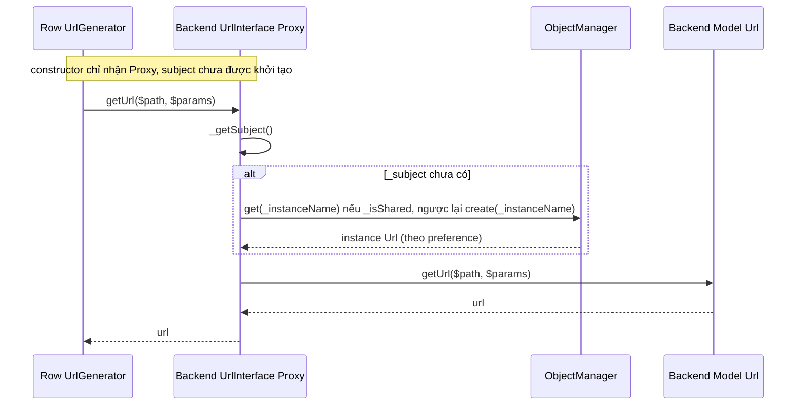

# Proxy

> **Techstack:** Magento 2.4.x (Adobe Commerce / Magento Open Source)

## 1. Định nghĩa

cơ bản Proxy giống như một đại diện của class chính đc ủy quyền trước khi logic chính của class được khởi tạo (các logic này thường được thực hiện chậm or phụ thuộc vào nhiều service khác).

Thay vì chờ tất cả các hành động của logic chính được khởi tạo hoàn thành, thì lớp ủy quyền (Proxy) sẽ được tạo ra các khai báo, khi cần sử dụng thì object chính sẽ tạo ra.


*Hình 1: Proxy như người trung gian – client (chú rể) không gọi trực tiếp đối tượng thật (cô dâu) mà đi qua proxy (người dì)*

> [!NOTE]
> Định nghĩa gốc ([refactoring.guru – Proxy](https://refactoring.guru/design-patterns/proxy)): Proxy là **structural** pattern cung cấp một *substitute/placeholder* cho object khác để **kiểm soát truy cập** tới object đó; proxy implement **cùng interface** với service nên client không phân biệt được. Lazy initialization (**virtual proxy**) chỉ là một dạng – ngoài ra còn protection, remote, logging, caching proxy và smart reference. Proxy do Magento generate thuộc dạng **virtual proxy**.

### Ví dụ PHP – Proxy (Refactoring.Guru)

Conceptual example của [Refactoring.Guru – Proxy in PHP](https://refactoring.guru/design-patterns/proxy/php/example) (© Alexander Shvets, CC BY-NC-ND 4.0). Ví dụ này là **protection/logging proxy**: `Proxy` implement cùng `Subject` interface với `RealSubject`, kiểm tra quyền (`checkAccess()`) trước và ghi log (`logAccess()`) sau khi chuyển tiếp `request()`. Proxy do Magento generate là **virtual proxy** – khác ở chỗ chỉ tạo `RealSubject` khi method đầu tiên được gọi (xem mục 2.2).

```php
<?php

namespace RefactoringGuru\Proxy\Conceptual;

/**
 * The Subject interface declares common operations for both RealSubject and
 * the Proxy. As long as the client works with RealSubject using this interface,
 * you'll be able to pass it a proxy instead of a real subject.
 */
interface Subject
{
    public function request(): void;
}

/**
 * The RealSubject contains some core business logic. Usually, RealSubjects
 * are capable of doing some useful work which may also be very slow or
 * sensitive - e.g. correcting input data. A Proxy can solve these issues
 * without any changes to the RealSubject's code.
 */
class RealSubject implements Subject
{
    public function request(): void
    {
        echo "RealSubject: Handling request.\n";
    }
}

/**
 * The Proxy has an interface identical to the RealSubject.
 */
class Proxy implements Subject
{
    /**
     * @var RealSubject
     */
    private $realSubject;

    /**
     * The Proxy maintains a reference to an object of the RealSubject
     * class. It can be either lazy-loaded or passed to the Proxy by the client.
     */
    public function __construct(RealSubject $realSubject)
    {
        $this->realSubject = $realSubject;
    }

    /**
     * The most common applications of the Proxy pattern are lazy loading,
     * caching, controlling the access, logging, etc. A Proxy can perform one of
     * these things and then, depending on the result, pass the execution to the
     * same method in a linked RealSubject object.
     */
    public function request(): void
    {
        if ($this->checkAccess()) {
            $this->realSubject->request();
            $this->logAccess();
        }
    }

    private function checkAccess(): bool
    {
        // Some real checks should go here.
        echo "Proxy: Checking access prior to firing a real request.\n";

        return true;
    }

    private function logAccess(): void
    {
        echo "Proxy: Logging the time of request.\n";
    }
}

/**
 * The client code is supposed to work with all objects (both subjects and
 * proxies) via the Subject interface in order to support both real subjects and
 * proxies. In real life, however, clients mostly work with their real subjects
 * directly. In this case, to implement the pattern more easily, you can extend
 * your proxy from the real subject's class.
 */
function clientCode(Subject $subject)
{
    // ...

    $subject->request();

    // ...
}

echo "Client: Executing the client code with a real subject:\n";
$realSubject = new RealSubject();
clientCode($realSubject);

echo "\n";

echo "Client: Executing the same client code with a proxy:\n";
$proxy = new Proxy($realSubject);
clientCode($proxy);
```

## 2. Magento Proxy Generator

Action sẽ được thực hiện:

`\Magento\Setup\Module\Di\App\Task\Operation\ProxyGenerator::doOperation()`

Proxy là một entity do code generator `\Magento\Framework\Code\Generator` sinh ra (item `proxy` trong argument `generatedEntities` của `app/etc/di.xml`); class thực hiện generate là `\Magento\Framework\ObjectManager\Code\Generator\Proxy`.

> [!NOTE]
> `ProxyGenerator::doOperation()` chỉ chạy trong `bin/magento setup:di:compile` (`DiCompileCommand` → `OperationFactory::PROXY_GENERATOR`). Ở developer/default mode, class `...\Proxy` được generate **on-demand** bởi `Magento\Framework\Code\Generator\Autoloader` lần đầu nó được autoload (Hình 2); ở production mode phải chạy `setup:di:compile` trước. Xem [Code generation](https://developer.adobe.com/commerce/php/development/components/code-generation).


*Hình 2: Autoloader của code generator – class như `myClassFactory` chưa tồn tại sẽ được generate trước khi autoload*

### 2.1. Scan các khai báo Proxy trong di.xml

Proxy generator sẽ scan tất cả các file di.xml trong project sau đấy thực hiện tìm kiếm các class được khai báo Proxy

Chúng ta có thể xem lại đoạn code:

```php
// setup/src/Magento/Setup/Module/Di/Code/Scanner/XmlScanner.php
// XmlScanner::collectEntities() gọi private scanProxies() cho từng file di.xml

$regex = '/^(\s+)?(.*)\\\(.*)Proxy(\s+)?$/';
$query = "/config/preference[ php:functionString('preg_match', '{$regex}', @type) > 0]/@type | " .
    "//argument[@xsi:type='object' and php:functionString('preg_match', '{$regex}', text()) > 0] |" .
    "//item[@xsi:type='object' and php:functionString('preg_match', '{$regex}', text()) > 0] |" .
    "/config/virtualType[ php:functionString('preg_match', '{$regex}', @type) > 0]/@type";
```

Vậy những config sau sẽ được generator

```xml
<!-- app/etc/di.xml -->
<preference for="Magento\Framework\Event\ManagerInterface" type="Magento\Framework\Event\Manager\Proxy" />
```

or —----

```xml
<!-- Magento/Backend/etc/di.xml -->
<type name="Magento\Backend\Model\Widget\Grid\Row\UrlGenerator">
    <arguments>
        <argument name="backendUrl" xsi:type="object">Magento\Backend\Model\UrlInterface\Proxy</argument>
    </arguments>
</type>
```

or —----

```xml
<!-- Magento/Directory/etc/di.xml -->
<virtualType name="DirectoryHelperDataProxy" type="Magento\Directory\Helper\Data\Proxy">
    <arguments>
        <argument name="instanceName" xsi:type="string">Magento\Directory\Helper\Data</argument>
    </arguments>
</virtualType>
```

### 2.2. Generate class Proxy qua Autoloader

Generated sẽ tạo ra các class Proxy, thông qua Autoloader

Xem lại đoạn mã sau chúng ta sẽ thấy Magento sẽ

**Source:** `Magento\Setup\Module\Di\App\Task\Operation\ProxyGenerator::doOperation()`

```php
// collect all proxy entities in di.xml
$proxies = $this->proxyScanner->collectEntities($files);
foreach ($proxies as $entityName) {
    class_exists($entityName);
}
```

Khi thực hiện check, M2 sẽ sử dụng autoloader

`Magento\Framework\Code\Generator\Autoloader`

**Source:** `Magento\Framework\Code\Generator\Autoloader::load()`

```php
public function load($className)
{
    if (! class_exists($className)) {
        try {
            $this->_generator->generateClass($className);
        } catch (\Exception $exception) {
            $this->tryToLogExceptionMessageIfNotDuplicate($exception);
        }
    }
}
```

`Magento\Framework\ObjectManager\Code\Generator\Proxy`

Trong này sẽ định nghĩa template của file, class, methods …. sẽ đc generate

**Kết quả:**

```text
path: generated/code/{subjectPath}/Proxy.php
=> subject là class:     class \{subjectClass}\Proxy extends \{subjectClass} implements \Magento\Framework\ObjectManager\NoninterceptableInterface
=> subject là interface: class \{subjectInterface}\Proxy implements \{subjectInterface}, \Magento\Framework\ObjectManager\NoninterceptableInterface
```

Theo `Proxy::_generateCode()` và `Proxy::_getClassMethods()`: constructor nhận `ObjectManagerInterface $objectManager, $instanceName = <subject>, $shared = true`; mỗi public method (trừ constructor, `final`, `static`) được generate thành `$this->_getSubject()->method(...)`; ngoài ra có `__sleep`, `__wakeup`, `__clone` (*Clone proxied instance*), `__debugInfo`.

## 3. Vậy Proxy là gì? Tại sao Magento lại generate các class này

Proxy của Magento được xây dựng trên proxy pattern, về cơ bản Proxy giống như một đại diện của class chính đc ủy quyền trước khi logic chính của class được khởi tạo (các logic này thường được thực hiện chậm or phụ thuộc vào nhiều service khác).

Thay vì chờ tất cả các hành động của logic chính được khởi tạo hoàn thành, thì lớp ủy quyền (Proxy) sẽ được tạo ra các khai báo, khi cần sử dụng thì object chính sẽ tạo ra.



*Hình 3: Lazy loading với `Magento\Backend\Model\UrlInterface\Proxy` – mọi method public của Proxy gọi `$this->_getSubject()->method(...)`, subject chỉ được tạo qua ObjectManager ở lần gọi đầu tiên*

## 4. Ưu điểm

- Lazy loading các hàm và hành động khởi tạo
- Tăng performance khi load
- Giảm thiểu lưu trữ vào bộ nhớ khi chưa cần sử dụng

Chúng ta có thể tham khảo thêm về proxy pattern tại [Proxy](https://refactoring.guru/design-patterns/proxy), và tìm hiểu kỹ hơn trong các bài viết về Proxy

## Tham khảo

**Tài liệu chính thức**
- [Proxies](https://developer.adobe.com/commerce/php/development/components/proxies)
- [Code generation](https://developer.adobe.com/commerce/php/development/components/code-generation)

**Source code**
- [`Magento\Framework\ObjectManager\Code\Generator\Proxy`](https://github.com/magento/magento2/blob/2.4-develop/lib/internal/Magento/Framework/ObjectManager/Code/Generator/Proxy.php)
- [`Magento\Framework\Code\Generator\Autoloader`](https://github.com/magento/magento2/blob/2.4-develop/lib/internal/Magento/Framework/Code/Generator/Autoloader.php)
- [`Magento\Setup\Module\Di\Code\Scanner\XmlScanner`](https://github.com/magento/magento2/blob/2.4-develop/setup/src/Magento/Setup/Module/Di/Code/Scanner/XmlScanner.php)
- [`Magento\Setup\Module\Di\App\Task\Operation\ProxyGenerator`](https://github.com/magento/magento2/blob/2.4-develop/setup/src/Magento/Setup/Module/Di/App/Task/Operation/ProxyGenerator.php)

**Bài viết khác**
- [Refactoring.Guru – Proxy](https://refactoring.guru/design-patterns/proxy)

**Bài liên quan trong Knowledge Base**
- [ObjectManager trong Magento](../Object%20Manager.md)
- [Dependency injection configuration (di.xml)](../DI%20%26%20Interceptors/Dependency%20injection%20configuration.md)
- [Code generation & Optimal development environment](../Code%20generation%20%26%20Optimal%20development%20environment.md)
- [Factories](Factories%20Patterns.md)
