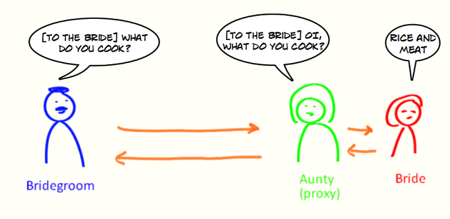
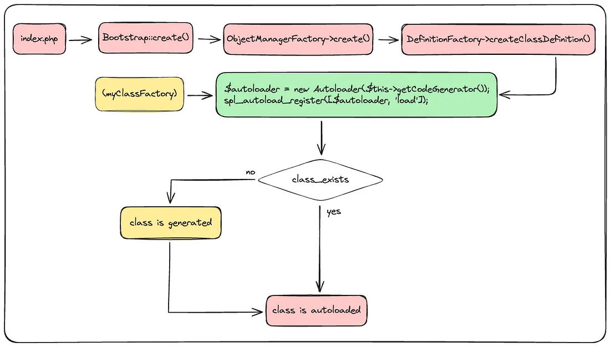
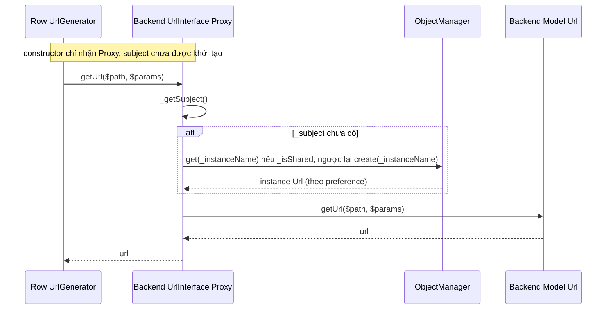

# Proxy

> **Techstack:** Magento 2.4.x (Adobe Commerce / Magento Open Source)

## 1. Định nghĩa

cơ bản Proxy giống như một đại diện của class chính đc ủy quyền trước khi logic chính của class được khởi tạo (các logic này thường được thực hiện chậm or phụ thuộc vào nhiều service khác).

Thay vì chờ tất cả các hành động của logic chính được khởi tạo hoàn thành, thì lớp ủy quyền (Proxy) sẽ được tạo ra các khai báo, khi cần sử dụng thì object chính sẽ tạo ra.



*Hình 1: Proxy như người trung gian – client (chú rể) không gọi trực tiếp đối tượng thật (cô dâu) mà đi qua proxy (người dì)*

## 2. Magento Proxy Generator

Action sẽ được thực hiện:

`\Magento\Setup\Module\Di\App\Task\Operation\ProxyGenerator::doOperation()`

Proxy là một code generator `\Magento\Framework\Code\Generator`



*Hình 2: Autoloader của code generator – class như `myClassFactory` chưa tồn tại sẽ được generate trước khi autoload*

### 2.1. Scan các khai báo Proxy trong di.xml

Proxy generator sẽ scan tất cả các file di.xml trong project sau đấy thực hiện tìm kiếm các class được khai báo Proxy

Chúng ta có thể xem lại đoạn code:

```php
// Magento\Setup\Module\Di\Code\Scanner\XmlScanner::collectEntities()

$regex = '/^(.*)\\\(.*)Proxy$/';
$query = "/config/preference[ php:functionString('preg_match', '{$regex}', @type) > 0]/@type | " .
    "//argument[@xsi:type='object' and php:functionString('preg_match', '{$regex}', text()) > 0] |" .
    "//item[@xsi:type='object' and php:functionString('preg_match', '{$regex}', text()) > 0] |" .
    "/config/virtualType[ php:functionString('preg_match', '{$regex}', @type) > 0]/@type";
```

Vậy những config sau sẽ được generator

```xml
<preference for="Magento\Framework\App\RequestInterface" type="Magento\Framework\App\Request\Http\Proxy" />
```

or —----

```xml
<type name="Magento\Backend\Model\Widget\Grid\Row\UrlGenerator">
    <arguments>
        <argument name="backendUrl" xsi:type="object">Magento\Backend\Model\UrlInterface\Proxy</argument>
    </arguments>
</type>
```

or —----

```xml
<virtualType name="DirectoryHelperDataProxy" type="Magento\Directory\Helper\Data\Proxy">
    <arguments>
        <argument name="instanceName" xsi:type="string">Magento\Directory\Helper\Data</argument>
    </arguments>
</virtualType>
```

### 2.2. Generate class Proxy qua Autoloader

Generated sẽ tạo ra các class Proxy, thông qua Autoloader

Xem lại đoạn mã sau chúng ta sẽ thấy Magento sẽ

**Source:** `Magento\Setup\Module\Di\App\Task\Operation\ProxyGenerator::doOperation()`

```php
// collect all proxy entities in di.xml
$proxies = $this->proxyScanner->collectEntities($files);
foreach ($proxies as $entityName) {
    class_exists($entityName);
}
```

Khi thực hiện check, M2 sẽ sử dụng autoloader

`Magento\Framework\Code\Generator\Autoloader`

**Source:** `Magento\Framework\Code\Generator\Autoloader::load()`

```php
public function load($className)
{
    if (! class_exists($className)) {
        try {
            $this->_generator->generateClass($className);
        } catch (\Exception $exception) {
            $this->tryToLogExceptionMessageIfNotDuplicate($exception);
        }
    }
}
```

`Magento\Framework\ObjectManager\Code\Generator\Proxy`

Trong này sẽ định nghĩa template của file, class, methods …. sẽ đc generate

**Kết quả:**

```text
/**
* Clone proxied instance
*/
path: code/{subjectPath}/Proxy.php
=> class: \{subjectClass}\Proxy extends \{subjectClass}
```

## 3. Vậy Proxy là gì? Tại sao Magento lại generate các class này

Proxy của Magento được xây dựng trên proxy pattern, về cơ bản Proxy giống như một đại diện của class chính đc ủy quyền trước khi logic chính của class được khởi tạo (các logic này thường được thực hiện chậm or phụ thuộc vào nhiều service khác).

Thay vì chờ tất cả các hành động của logic chính được khởi tạo hoàn thành, thì lớp ủy quyền (Proxy) sẽ được tạo ra các khai báo, khi cần sử dụng thì object chính sẽ tạo ra.



*Hình 3: Lazy loading với `Magento\Backend\Model\UrlInterface\Proxy` – mọi method public của Proxy gọi `$this->_getSubject()->method(...)`, subject chỉ được tạo qua ObjectManager ở lần gọi đầu tiên*

## 4. Ưu điểm

- Lazy loading các hàm và hành động khởi tạo
- Tăng performance khi load
- Giảm thiểu lưu trữ vào bộ nhớ khi chưa cần sử dụng

Chúng ta có thể tham khảo thêm về proxy pattern tại [Proxy](https://refactoring.guru/design-patterns/proxy), và tìm hiểu kỹ hơn trong các bài viết về Proxy

## Tham khảo

**Tài liệu chính thức**
- [Proxies](https://developer.adobe.com/commerce/php/development/components/proxies)
- [Code generation](https://developer.adobe.com/commerce/php/development/components/code-generation)

**Source code**
- [`Magento\Framework\ObjectManager\Code\Generator\Proxy`](https://github.com/magento/magento2/blob/2.4-develop/lib/internal/Magento/Framework/ObjectManager/Code/Generator/Proxy.php)
- [`Magento\Framework\Code\Generator\Autoloader`](https://github.com/magento/magento2/blob/2.4-develop/lib/internal/Magento/Framework/Code/Generator/Autoloader.php)
- [`Magento\Setup\Module\Di\Code\Scanner\XmlScanner`](https://github.com/magento/magento2/blob/2.4-develop/setup/src/Magento/Setup/Module/Di/Code/Scanner/XmlScanner.php)
- [`Magento\Setup\Module\Di\App\Task\Operation\ProxyGenerator`](https://github.com/magento/magento2/blob/2.4-develop/setup/src/Magento/Setup/Module/Di/App/Task/Operation/ProxyGenerator.php)

**Bài viết khác**
- [Refactoring.Guru – Proxy](https://refactoring.guru/design-patterns/proxy)

**Bài liên quan trong Knowledge Base**
- [ObjectManager trong Magento](../Object%20Manager.md)
- [Dependency injection configuration (di.xml)](../DI%20%26%20Interceptors/Dependency%20injection%20configuration.md)
- [Code generation & Optimal development environment](../Code%20generation%20%26%20Optimal%20development%20environment.md)
- [Factories](Factories%20Patterns.md)
