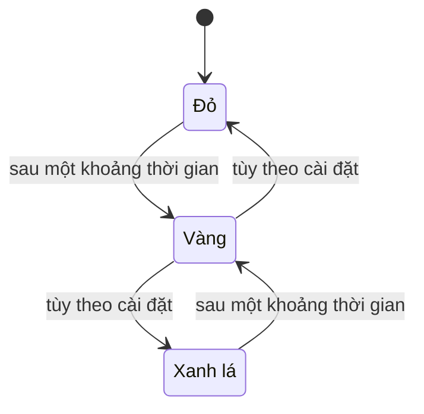

# State Design Pattern

> **Techstack:** Magento 2.4.x (Adobe Commerce / Magento Open Source)

## 1. Định nghĩa

State là một behavioral design pattern quan trọng trong lập trình hướng đối tượng. Nó cho phép một đối tượng thay đổi hành vi của nó khi trạng thái nội bộ của nó thay đổi. Nói cách khác, đối tượng sẽ "hành xử" khác nhau tùy thuộc vào "trạng thái" hiện tại của nó.

## 2. Tại sao cần mô hình State?

- **Tăng tính linh hoạt:** Dễ dàng thêm, xóa hoặc thay đổi các trạng thái mà không ảnh hưởng đến các phần khác của hệ thống.
- **Cải thiện khả năng đọc mã:** Mã nguồn trở nên rõ ràng hơn, dễ hiểu hơn khi tách biệt các hành vi khác nhau vào các trạng thái riêng biệt.
- **Giảm sự phức tạp:** Tránh việc sử dụng quá nhiều câu lệnh điều kiện (if-else) để kiểm tra trạng thái.

## 3. Các thành phần chính

- **Context:** Đối tượng chứa trạng thái hiện tại và các phương thức để thay đổi trạng thái.
- **State:** Giao diện chung định nghĩa các hành vi có thể thực hiện trong một trạng thái cụ thể.
- **ConcreteState:** Các lớp cụ thể triển khai giao diện State và định nghĩa hành vi cho từng trạng thái.

## 4. Ví dụ minh họa

Hãy tưởng tượng một chiếc đèn giao thông. Hành vi của đèn giao thông thay đổi tùy thuộc vào trạng thái hiện tại của nó (đỏ, vàng, xanh lá).

- **Context:** Đèn giao thông
- **States:** Đỏ, Vàng, Xanh lá
- **Hành vi:**
  - **Đỏ:** Đèn đỏ sáng, sau một khoảng thời gian chuyển sang vàng.
  - **Vàng:** Đèn vàng sáng, sau một khoảng thời gian chuyển sang xanh lá hoặc đỏ (tùy theo cài đặt).
  - **Xanh lá:** Đèn xanh lá sáng, sau một khoảng thời gian chuyển sang vàng.



*Hình 1: Đèn giao thông (Context) chuyển giữa các trạng thái Đỏ, Vàng, Xanh lá – mỗi trạng thái tự quyết định trạng thái kế tiếp*

### Ví dụ PHP – State (Refactoring.Guru)

Conceptual example của [Refactoring.Guru – State in PHP](https://refactoring.guru/design-patterns/state/php/example) (© Alexander Shvets, CC BY-NC-ND 4.0). `Context` ủy thác `request1()`/`request2()` cho state hiện tại; mỗi `ConcreteState` giữ back reference tới `Context` và tự gọi `transitionTo()` để chuyển sang state kế tiếp.

> [!NOTE]
> Magento core không implement State pattern theo đúng GoF cho order: trạng thái là hằng `Order::STATE_*` (`Magento\Sales\Model\Order`), hành vi theo trạng thái nằm trong if-else của `Order::canInvoice()` / `canCancel()` / `canHold()`, và trạng thái kế tiếp do `Magento\Sales\Model\Order\StateResolver` quyết định. Các class trong `Magento\Sales\Model\Order\Payment\State\` (`AuthorizeCommand`, `CaptureCommand`…) là Command pattern, không phải ConcreteState.

```php
<?php

namespace RefactoringGuru\State\Conceptual;

/**
 * The Context defines the interface of interest to clients. It also
 * maintains a reference to an instance of a State subclass, which represents
 * the current state of the Context.
 */
class Context
{
    /**
     * @var State A reference to the current state of the Context.
     */
    private $state;

    public function __construct(State $state)
    {
        $this->transitionTo($state);
    }

    /**
     * The Context allows changing the State object at runtime.
     */
    public function transitionTo(State $state): void
    {
        echo "Context: Transition to " . get_class($state) . ".\n";
        $this->state = $state;
        $this->state->setContext($this);
    }

    /**
     * The Context delegates part of its behavior to the current State
     * object.
     */
    public function request1(): void
    {
        $this->state->handle1();
    }

    public function request2(): void
    {
        $this->state->handle2();
    }
}

/**
 * The base State class declares methods that all Concrete State should
 * implement and also provides a backreference to the Context object, associated
 * with the State. This backreference can be used by States to transition the
 * Context to another State.
 */
abstract class State
{
    /**
     * @var Context
     */
    protected $context;

    public function setContext(Context $context)
    {
        $this->context = $context;
    }

    abstract public function handle1(): void;

    abstract public function handle2(): void;
}

/**
 * Concrete States implement various behaviors, associated with a state of
 * the Context.
 */
class ConcreteStateA extends State
{
    public function handle1(): void
    {
        echo "ConcreteStateA handles request1.\n";
        echo "ConcreteStateA wants to change the state of the context.\n";
        $this->context->transitionTo(new ConcreteStateB());
    }

    public function handle2(): void
    {
        echo "ConcreteStateA handles request2.\n";
    }
}

class ConcreteStateB extends State
{
    public function handle1(): void
    {
        echo "ConcreteStateB handles request1.\n";
    }

    public function handle2(): void
    {
        echo "ConcreteStateB handles request2.\n";
        echo "ConcreteStateB wants to change the state of the context.\n";
        $this->context->transitionTo(new ConcreteStateA());
    }
}

/**
 * The client code.
 */
$context = new Context(new ConcreteStateA());
$context->request1();
$context->request2();
```

## 5. Cách hoạt động

1. **Context** lưu trữ một tham chiếu đến đối tượng **State** hiện tại.
2. Khi trạng thái của **Context** thay đổi, nó sẽ cập nhật tham chiếu đến một đối tượng **State** khác.
3. Các yêu cầu gửi đến **Context** sẽ được chuyển tiếp đến đối tượng **State** hiện tại để xử lý.

## 6. Ứng dụng thực tế

- **Game:** Quản lý các trạng thái của nhân vật (sống, chết, tấn công, phòng thủ).
- **Giao diện người dùng:** Quản lý các trạng thái của một nút bấm (bình thường, nhấn, vô hiệu).
- **Công cụ soạn thảo:** Quản lý các chế độ soạn thảo (chèn văn bản, vẽ hình).

## 7. Ưu / nhược điểm

### 7.1. Ưu điểm

- **SRP:** Tách code của từng trạng thái ra class riêng, giúp code dễ bảo trì và mở rộng.
- **OCP:** Thêm state mới mà không phải sửa state cũ hay Context.
- **Bớt điều kiện:** Loại bỏ chuỗi if-else/switch theo trạng thái trong Context.

### 7.2. Nhược điểm

- **Overkill:** Áp dụng pattern có thể thừa nếu state machine chỉ có vài trạng thái hoặc hiếm khi thay đổi ([refactoring.guru – State](https://refactoring.guru/design-patterns/state#pros-cons)); mỗi trạng thái là một class nên số class tăng theo số trạng thái.
## Tham khảo

**Bài viết khác**
- [Refactoring.Guru – State](https://refactoring.guru/design-patterns/state)

**Bài liên quan trong Knowledge Base**
- [Strategy Design Pattern](Strategy%20Design%20Pattern.md)
- [Command Design Pattern](Command%20Design%20Pattern.md)
- [Tổng quan Design Pattern](T%E1%BB%95ng%20quan%20Design%20Pattern.md)
