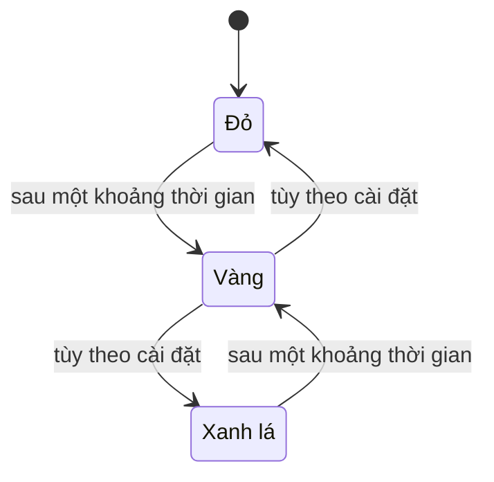

# State Design Pattern

> **Techstack:** Magento 2.4.x (Adobe Commerce / Magento Open Source)

## 1. Định nghĩa

State cũng là một mẫu behavioral design pattern.

quan trọng trong lập trình hướng đối tượng. Nó cho phép một đối tượng thay đổi hành vi của nó khi trạng thái nội bộ của nó thay đổi. Nói cách khác, đối tượng sẽ "hành xử" khác nhau tùy thuộc vào "trạng thái" hiện tại của nó.

## 2. Tại sao cần mô hình State?

- **Tăng tính linh hoạt:** Dễ dàng thêm, xóa hoặc thay đổi các trạng thái mà không ảnh hưởng đến các phần khác của hệ thống.
- **Cải thiện khả năng đọc mã:** Mã nguồn trở nên rõ ràng hơn, dễ hiểu hơn khi tách biệt các hành vi khác nhau vào các trạng thái riêng biệt.
- **Giảm sự phức tạp:** Tránh việc sử dụng quá nhiều câu lệnh điều kiện (if-else) để kiểm tra trạng thái.

## 3. Các thành phần chính

- **Context:** Đối tượng chứa trạng thái hiện tại và các phương thức để thay đổi trạng thái.
- **State:** Giao diện chung định nghĩa các hành vi có thể thực hiện trong một trạng thái cụ thể.
- **ConcreteState:** Các lớp cụ thể triển khai giao diện State và định nghĩa hành vi cho từng trạng thái.

## 4. Ví dụ minh họa

Hãy tưởng tượng một chiếc đèn giao thông. Hành vi của đèn giao thông thay đổi tùy thuộc vào trạng thái hiện tại của nó (đỏ, vàng, xanh lá).

- **Context:** Đèn giao thông
- **States:** Đỏ, Vàng, Xanh lá
- **Hành vi:**
  - **Đỏ:** Đèn đỏ sáng, sau một khoảng thời gian chuyển sang vàng.
  - **Vàng:** Đèn vàng sáng, sau một khoảng thời gian chuyển sang xanh lá hoặc đỏ (tùy theo cài đặt).
  - **Xanh lá:** Đèn xanh lá sáng, sau một khoảng thời gian chuyển sang vàng.

*Hình 1: Đèn giao thông (Context) chuyển giữa các trạng thái Đỏ, Vàng, Xanh lá – mỗi trạng thái tự quyết định trạng thái kế tiếp*

## 5. Cách hoạt động

1. **Context** lưu trữ một tham chiếu đến đối tượng **State** hiện tại.
2. Khi trạng thái của **Context** thay đổi, nó sẽ cập nhật tham chiếu đến một đối tượng **State** khác.
3. Các yêu cầu gửi đến **Context** sẽ được chuyển tiếp đến đối tượng **State** hiện tại để xử lý.

## 6. Ứng dụng thực tế

- **Game:** Quản lý các trạng thái của nhân vật (sống, chết, tấn công, phòng thủ).
- **Giao diện người dùng:** Quản lý các trạng thái của một nút bấm (bình thường, nhấn, vô hiệu).
- **Công cụ soạn thảo:** Quản lý các chế độ soạn thảo (chèn văn bản, vẽ hình).

## 7. Ưu / nhược điểm

### 7.1. Ưu điểm

- **Tách biệt mối quan tâm:** Mỗi trạng thái có trách nhiệm riêng, giúp code dễ bảo trì và mở rộng.
- **Linh hoạt:** Dễ dàng thêm các trạng thái mới mà không ảnh hưởng đến các trạng thái khác.
- **Hiệu suất:** Có thể tối ưu hóa hiệu năng bằng cách sử dụng các kỹ thuật như flyweight pattern.

### 7.2. Nhược điểm

- **Phức tạp:** Có thể làm cho code phức tạp hơn nếu có quá nhiều trạng thái.
- **Khó kiểm thử:** Việc kiểm thử các tương tác giữa các trạng thái có thể khó khăn.

## Tham khảo

**Bài viết khác**
- [Refactoring.Guru – State](https://refactoring.guru/design-patterns/state)

**Bài liên quan trong Knowledge Base**
- [Strategy Design Pattern](Strategy%20Design%20Pattern.md)
- [Command Design Pattern](Command%20Design%20Pattern.md)
- [Tổng quan Design Pattern](T%E1%BB%95ng%20quan%20Design%20Pattern.md)
