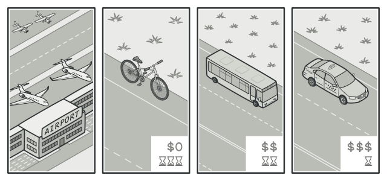
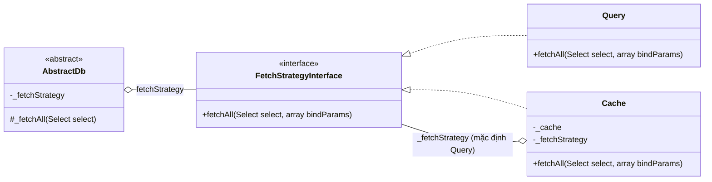

# Strategy Design Pattern

> **Techstack:** Magento 2.4.x (Adobe Commerce / Magento Open Source)

## 1. Định nghĩa

Strategy pattern là một mẫu thiết kế để xử lý hành vi (Behavioral Design Patterns), khi tập hợp các objects có thể thực hiện hoán đổi cho nhau để xử lý một action nào đấy. Khi đó bạn dễ dàng thay đổi hành vi của đối tượng ban đầu

Strategy giúp tách riêng hành động thành riêng biệt, không ảnh hưởng đến chương trình gốc.

**Ví dụ:**

- Auth => AuthStrategyByPassword, AuthStrategyByToken
- Payment => PaymentStrategyByPaypal, PaymentStrategyByCredit …..



*Hình 1: Các strategy di chuyển tới sân bay – cùng một mục tiêu, có thể hoán đổi phương án theo chi phí và thời gian*

> [!NOTE]
> **Behavioral Design Patterns:** Là tập hợp các patterns liên quan đến việc xử lý công việc, phân công trách nhiệm giữa các objects.

### Ví dụ PHP – Strategy (Refactoring.Guru)

Conceptual example của [Refactoring.Guru – Strategy in PHP](https://refactoring.guru/design-patterns/strategy/php/example) (© Alexander Shvets, CC BY-NC-ND 4.0). `Context` giữ một `Strategy` và có thể đổi lúc runtime qua `setStrategy()`; `ConcreteStrategyA/B` cài đặt cùng thuật toán theo hai cách (sắp xếp xuôi / ngược). Trong Magento (mục 2): `Context` ↔ `AbstractDb`, `Strategy` ↔ `FetchStrategyInterface`, `ConcreteStrategyA/B` ↔ `FetchStrategy\Query` / `FetchStrategy\Cache`; strategy được đổi bằng argument `fetchStrategy` trong di.xml thay vì `setStrategy()`.

```php
<?php

namespace RefactoringGuru\Strategy\Conceptual;

/**
 * The Context defines the interface of interest to clients.
 */
class Context
{
    /**
     * @var Strategy The Context maintains a reference to one of the
     * Strategy objects. The Context does not know the concrete class of a
     * strategy. It should work with all strategies via the Strategy interface.
     */
    private $strategy;

    /**
     * Usually, the Context accepts a strategy through the constructor, but
     * also provides a setter to change it at runtime.
     */
    public function __construct(Strategy $strategy)
    {
        $this->strategy = $strategy;
    }

    /**
     * Usually, the Context allows replacing a Strategy object at runtime.
     */
    public function setStrategy(Strategy $strategy)
    {
        $this->strategy = $strategy;
    }

    /**
     * The Context delegates some work to the Strategy object instead of
     * implementing multiple versions of the algorithm on its own.
     */
    public function doSomeBusinessLogic(): void
    {
        // ...

        echo "Context: Sorting data using the strategy (not sure how it'll do it)\n";
        $result = $this->strategy->doAlgorithm(["a", "b", "c", "d", "e"]);
        echo implode(",", $result) . "\n";

        // ...
    }
}

/**
 * The Strategy interface declares operations common to all supported
 * versions of some algorithm.
 *
 * The Context uses this interface to call the algorithm defined by Concrete
 * Strategies.
 */
interface Strategy
{
    public function doAlgorithm(array $data): array;
}

/**
 * Concrete Strategies implement the algorithm while following the base
 * Strategy interface. The interface makes them interchangeable in the Context.
 */
class ConcreteStrategyA implements Strategy
{
    public function doAlgorithm(array $data): array
    {
        sort($data);

        return $data;
    }
}

class ConcreteStrategyB implements Strategy
{
    public function doAlgorithm(array $data): array
    {
        rsort($data);

        return $data;
    }
}

/**
 * The client code picks a concrete strategy and passes it to the context.
 * The client should be aware of the differences between strategies in order to
 * make the right choice.
 */
$context = new Context(new ConcreteStrategyA());
echo "Client: Strategy is set to normal sorting.\n";
$context->doSomeBusinessLogic();

echo "\n";

echo "Client: Strategy is set to reverse sorting.\n";
$context->setStrategy(new ConcreteStrategyB());
$context->doSomeBusinessLogic();
```

## 2. Implement trong Magento

- Collection fetch data: interface `Magento\Framework\Data\Collection\Db\FetchStrategyInterface` với 2 strategy `Magento\Framework\Data\Collection\Db\FetchStrategy\Query` và `Magento\Framework\Data\Collection\Db\FetchStrategy\Cache`



*Hình 2: Strategy trong `Magento\Framework\Data\Collection\AbstractDb` – collection gọi `$this->_fetchStrategy->fetchAll()`; `app/etc/di.xml` chọn mặc định `FetchStrategy\Query`, còn virtualType (vd. `Magento\Store\Model\ResourceModel\Group\Collection\FetchStrategy`) dùng `FetchStrategy\Cache` để đọc từ cache trước khi query DB. `FetchStrategy\Cache` bọc một strategy khác (mặc định `Query`): cache miss thì gọi strategy bên trong rồi lưu kết quả vào cache – Strategy kết hợp Decorator*

## Tham khảo

**Tài liệu chính thức**
- [Dependency injection](https://developer.adobe.com/commerce/php/development/components/dependency-injection) – đổi strategy bằng preference / argument trong di.xml

**Source code**
- [`Magento\Framework\Data\Collection\Db\FetchStrategyInterface`](https://github.com/magento/magento2/blob/2.4-develop/lib/internal/Magento/Framework/Data/Collection/Db/FetchStrategyInterface.php)
- [`Magento\Framework\Data\Collection\Db\FetchStrategy\Query`](https://github.com/magento/magento2/blob/2.4-develop/lib/internal/Magento/Framework/Data/Collection/Db/FetchStrategy/Query.php)
- [`Magento\Framework\Data\Collection\Db\FetchStrategy\Cache`](https://github.com/magento/magento2/blob/2.4-develop/lib/internal/Magento/Framework/Data/Collection/Db/FetchStrategy/Cache.php)

**Bài viết khác**
- [Strategy Pattern](https://refactoring.guru/design-patterns/strategy)

**Bài liên quan trong Knowledge Base**
- [State Design Pattern](State%20Design%20Pattern.md)
- [Dependency injection configuration (di.xml)](../DI%20%26%20Interceptors/Dependency%20injection%20configuration.md)
- [Magento Cache](../Magento%20Cache.md)
