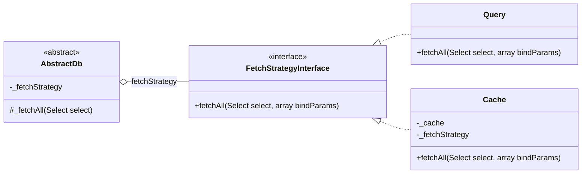

# Strategy Design Pattern

> **Techstack:** Magento 2.4.x (Adobe Commerce / Magento Open Source)

## 1. Định nghĩa

Strategy pattern là một mẫu thiết kế để xử lý hành vi (Behavioral Design Patterns), khi tập hợp các objects có thể thực hiện hoán đổi cho nhau để xử lý một action nào đấy. Khi đó bạn dễ dàng thay đổi hành vi của đối tượng ban đầu

Strategy giúp tách riêng hành động thành riêng biệt, ko ảnh hưởng đến chương trình gốc.

**Ví dụ:**

- Auth => AuthStrategyByPassword, AuthStrategyByToken
- Payment => PaymentStrategyByPaypal, PaymentStrategyByCredit …..

*Hình 1: Các strategy di chuyển tới sân bay – cùng một mục tiêu, có thể hoán đổi phương án theo chi phí và thời gian*

> [!NOTE]
> **Behavioral Design Patterns:** Là tập hợp các patterns liên quan đến việc xử lý công việc, phân công trách nhiệm giữa các objects.

## 2. Implement trong Magento

- Collection fetch data: `FetchStrategyByCache`, `FetchStrategyByQuery`

*Hình 2: Strategy trong `Magento\Framework\Data\Collection\AbstractDb` – collection gọi `$this->_fetchStrategy->fetchAll()`; `app/etc/di.xml` chọn mặc định `FetchStrategy\Query`, còn virtualType (vd. `Magento\Store\Model\ResourceModel\Group\Collection\FetchStrategy`) dùng `FetchStrategy\Cache` để đọc từ cache trước khi query DB*

## Tham khảo

**Tài liệu chính thức**
- [Dependency injection](https://developer.adobe.com/commerce/php/development/components/dependency-injection) – đổi strategy bằng preference / argument trong di.xml

**Source code**
- [`Magento\Framework\Data\Collection\Db\FetchStrategyInterface`](https://github.com/magento/magento2/blob/2.4-develop/lib/internal/Magento/Framework/Data/Collection/Db/FetchStrategyInterface.php)
- [`Magento\Framework\Data\Collection\Db\FetchStrategy\Query`](https://github.com/magento/magento2/blob/2.4-develop/lib/internal/Magento/Framework/Data/Collection/Db/FetchStrategy/Query.php)
- [`Magento\Framework\Data\Collection\Db\FetchStrategy\Cache`](https://github.com/magento/magento2/blob/2.4-develop/lib/internal/Magento/Framework/Data/Collection/Db/FetchStrategy/Cache.php)

**Bài viết khác**
- [Strategy Pattern](https://refactoring.guru/design-patterns/strategy)

**Bài liên quan trong Knowledge Base**
- [State Design Pattern](State%20Design%20Pattern.md)
- [Dependency injection configuration (di.xml)](../DI%20%26%20Interceptors/Dependency%20injection%20configuration.md)
- [Magento Cache](../Magento%20Cache.md)
