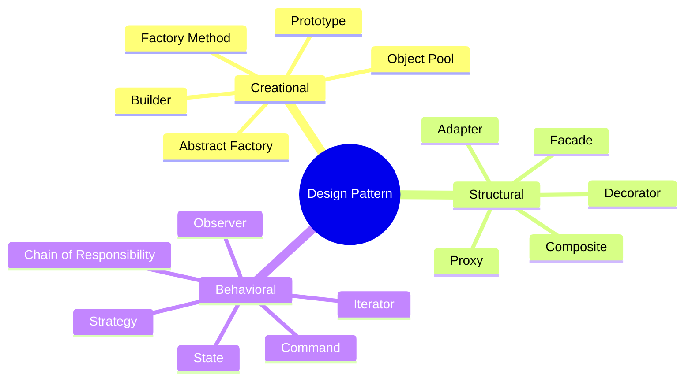

# Tổng quan Design Pattern

> **Techstack:** Magento 2.4.x (Adobe Commerce / Magento Open Source)

## 1. SOLID principles

**SOLID** là từ viết tắt của 5 nguyên tắc:

- **S - Single Responsibility Principle (Nguyên tắc trách nhiệm duy nhất):** Mỗi lớp chỉ nên có một lý do duy nhất để thay đổi. Nói cách khác, một lớp chỉ nên chịu trách nhiệm cho một phần chức năng cụ thể. Điều này giúp code dễ hiểu, dễ bảo trì và giảm thiểu rủi ro khi thay đổi.
- **O - Open/Closed Principle (Nguyên tắc mở rộng, đóng sửa đổi):** Các phần mềm (lớp, module) nên mở để mở rộng nhưng đóng để sửa đổi. Điều này có nghĩa là bạn có thể thêm tính năng mới vào hệ thống mà không cần thay đổi code cũ.
- **L - Liskov Substitution Principle (Nguyên tắc thay thế Liskov):** Các đối tượng con có thể thay thế được cho đối tượng cha của chúng. Điều này đảm bảo rằng các lớp con không làm hỏng hành vi của lớp cha.
- **I - Interface Segregation Principle (Nguyên tắc phân tách giao diện):** Một client không nên bị ép buộc phải phụ thuộc vào các phương thức mà nó không sử dụng. Điều này giúp giảm sự phụ thuộc giữa các lớp và làm cho code linh hoạt hơn.
- **D - Dependency Inversion Principle (Nguyên tắc đảo ngược phụ thuộc):** Các module cấp cao không nên phụ thuộc vào các module cấp thấp. Cả hai đều nên phụ thuộc vào các trừu tượng. Các trừu tượng không nên phụ thuộc vào các chi tiết. Các chi tiết nên phụ thuộc vào các trừu tượng. Điều này giúp giảm sự kết hợp chặt chẽ giữa các lớp và làm cho code dễ thay đổi hơn.

## 2. Design Pattern

Các design pattern có thể được phân loại thành ba nhóm chính:

- Creational Patterns (mẫu khởi tạo),
- Structural Patterns (mẫu cấu trúc),
- và Behavioral Patterns (mẫu hành vi).

Mỗi nhóm có mục đích và cách tiếp cận riêng để giải quyết các vấn đề thiết kế phần mềm.

*Hình 1: Ba nhóm design pattern và các pattern được đề cập trong bài*

### 2.1. Creational Patterns (Mẫu Khởi Tạo)

**Mục đích:** Các mẫu thuộc nhóm Creational tập trung vào việc khởi tạo các đối tượng một cách linh hoạt và kiểm soát được. Thay vì tạo trực tiếp đối tượng bằng toán tử `new`, các mẫu này cung cấp các cơ chế khác nhau để tạo đối tượng, giúp code trở nên mềm dẻo và dễ bảo trì hơn.

Các mẫu phổ biến:

- **Builder:** Xây dựng các đối tượng phức tạp từng bước, cho phép tạo ra các cấu hình đối tượng khác nhau. Ví dụ trong Magento: `Magento\Framework\Api\SearchCriteriaBuilder`.
- **Factory Method:** Định nghĩa một interface cho việc tạo đối tượng, nhưng để lớp con quyết định lớp nào sẽ được khởi tạo.
- **Abstract Factory:** Tạo ra các factory để tạo ra các đối tượng liên quan, giúp tạo các họ (family) đối tượng mà không cần chỉ định lớp cụ thể.
- **Prototype:** Tạo đối tượng mới bằng cách sao chép một đối tượng đã có; việc clone được giao cho chính object đó. Ví dụ trong Magento: `Magento\Quote\Model\Quote::merge()` dùng `clone $item`, còn `Magento\Quote\Model\Quote\Item::__clone()` tự quyết định cách sao chép (reset id, clone lại các option).
- **Object Pool:** Quản lý và tái sử dụng các đối tượng đã được tạo, giúp giảm chi phí khởi tạo. Object Manager trong Magento có ý tưởng gần giống: `ObjectManager::get()` cache instance theo type trong `$_sharedInstances` để tái sử dụng (shared/singleton object), còn `create()` luôn tạo object mới theo DI.

> [!NOTE]
> Các class `*Factory` auto-generate trong Magento (vd. `Magento\Catalog\Model\ProductFactory`) chỉ tạo **một** loại object qua `ObjectManagerInterface::create($this->_instanceName, $data)` (template `Magento\Framework\ObjectManager\Code\Generator\Factory`), không tạo một *họ* object liên quan, nên chúng gần với Simple Factory hơn là Abstract Factory theo GoF — xem [Factories](Factories%20Patterns.md).
>
> `Magento\Framework\DataObject\Copy` (hay được nhắc khi nói về Prototype) là utility copy dữ liệu theo `fieldset.xml` sang một target **đã có** (`copyFieldsetToTarget()`, `getDataFromFieldset()`), không clone object.
>
> Object Pool không nằm trong 23 pattern của GoF. Object Pool kinh điển có bước *acquire/release* (client trả object về pool để dùng lại); `ObjectManager` không có bước release, `$_sharedInstances` giữ instance suốt request.

### 2.2. Structural Patterns (Mẫu Cấu Trúc)

**Mục đích:** Các mẫu thuộc nhóm Structural tập trung vào việc xây dựng mối quan hệ giữa các đối tượng và các lớp để tạo ra các cấu trúc phức tạp hơn. Các mẫu này thường liên quan đến cách thức các đối tượng được kết hợp để tạo ra các cấu trúc lớn hơn, dễ quản lý hơn.

Các mẫu phổ biến:

- **Adapter:** Cho phép các lớp có interface không tương thích làm việc cùng nhau bằng cách chuyển đổi interface. Ví dụ trong Magento: `Magento\Framework\Image\Adapter\AdapterInterface`.
- **Composite:** Cho phép xử lý các đối tượng đơn lẻ và các nhóm đối tượng một cách thống nhất thông qua cấu trúc cây (tree): client làm việc với một node lá hay một nhóm node con qua cùng một interface.
- **Decorator:** Gắn thêm hành vi cho một object một cách động bằng cách bọc nó trong một object khác có cùng interface, thay vì tạo lớp con.
- **Facade:** Cung cấp một interface đơn giản để tương tác với một hệ thống phức tạp. Facade giúp che giấu sự phức tạp bên trong và giúp client dễ sử dụng hơn. Facade có thể được sử dụng trong API Gateway hoặc Service Layer.
- **Proxy:** Cung cấp một đối tượng đại diện để kiểm soát việc truy cập đến một đối tượng khác. Ví dụ trong Magento: các class Proxy được tạo ra để lazy loading object.

### 2.3. Behavioral Patterns (Mẫu Hành Vi)

**Mục đích:** Các mẫu thuộc nhóm Behavioral tập trung vào việc xử lý các tương tác và trách nhiệm giữa các đối tượng. Các mẫu này giúp làm cho các đối tượng linh hoạt hơn và dễ dàng thay đổi hành vi mà không làm ảnh hưởng đến cấu trúc của chúng.

Các mẫu phổ biến:

- **Chain of Responsibility:** Chuyển yêu cầu dọc theo một chuỗi các handler cho đến khi có một handler xử lý được yêu cầu. Ví dụ trong Magento: `Magento\Framework\App\FrontController::dispatch()` lần lượt gọi `match()` trên từng router trong `RouterListInterface`, router đầu tiên trả về action thì dừng chuỗi.
- **Command:** Đóng gói một yêu cầu thành một object, cho phép truyền yêu cầu như tham số, xếp hàng, ghi log hoặc undo.
- **Iterator:** Cung cấp cách truy cập tuần tự các phần tử của một tập hợp mà không cần biết cấu trúc bên trong của tập hợp đó. Ví dụ trong Magento: `Magento\Framework\Data\Collection` implement `\IteratorAggregate`, nên có thể `foreach ($collection as $item)`; Iterator cũng hay dùng để duyệt các phần tử của Composite Pattern.
- **State:** Cho phép một object thay đổi hành vi khi trạng thái bên trong của nó thay đổi; mỗi trạng thái được tách thành một class riêng.
- **Strategy:** Định nghĩa một họ các thuật toán và cho phép các thuật toán này được lựa chọn và sử dụng một cách linh hoạt.
- **Observer:** Cho phép các đối tượng thông báo cho các đối tượng khác về sự thay đổi trạng thái. Magento sử dụng mẫu này trong hệ thống event.

### 2.4. So sánh

- **Creational Patterns:** Tập trung vào cách tạo object. Các pattern này giúp tách biệt logic tạo object khỏi logic sử dụng object, và đảm bảo object được tạo ra một cách nhất quán và hiệu quả.
- **Structural Patterns:** Tập trung vào cách các đối tượng và lớp liên kết với nhau để tạo ra các cấu trúc lớn hơn. Các pattern này giúp tạo ra các hệ thống dễ quản lý và mở rộng.
- **Behavioral Patterns:** Tập trung vào cách các đối tượng tương tác với nhau và cách phân công trách nhiệm. Các pattern này giúp tạo ra các hệ thống linh hoạt, có thể thay đổi hành vi mà không làm ảnh hưởng đến cấu trúc.

## Tham khảo

**Tài liệu chính thức**
- [Service contract design patterns](https://developer.adobe.com/commerce/php/development/components/service-contracts/design-patterns)
- [Dependency injection](https://developer.adobe.com/commerce/php/development/components/dependency-injection) – áp dụng Dependency Inversion Principle trong Magento

**Bài viết khác**
- [Refactoring.Guru – Catalog of Design Patterns](https://refactoring.guru/design-patterns/catalog)

**Bài liên quan trong Knowledge Base**
- [Builder](Builder.md)
- [Factories](Factories%20Patterns.md)
- [Prototype](Prototype%20Pattern.md)
- [Object Pool](Object%20Pool_.md)
- [Adapter](Adapter%20Pattern_.md)
- [Composite](Composite%20Pattern.md)
- [Decorator](Decorator%20Pattern.md)
- [Facade](Facade%20Pattern.md)
- [Proxy](Proxies.md)
- [Chain of Responsibility](Chain%20of%20Responsibility.md)
- [Command](Command%20Design%20Pattern.md)
- [Iterator](Iterator%20Design%20Pattern.md)
- [State](State%20Design%20Pattern.md)
- [Strategy](Strategy%20Design%20Pattern.md)
- [Observer](Observer.md)
- [CQRS](CQRS%20-%20Command%20and%20Query%20Responsibility%20Segregation_.md)
