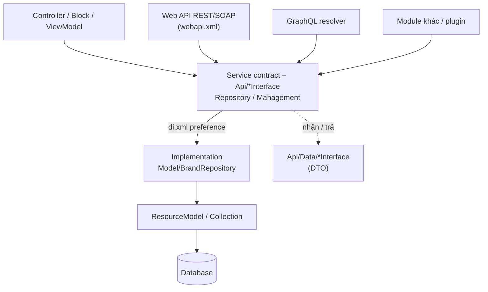
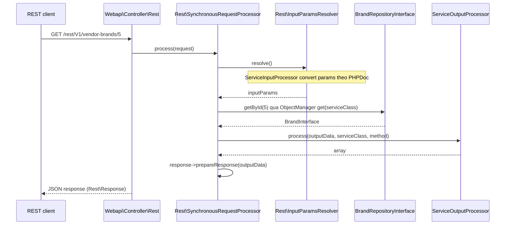

# Service contracts

> **Techstack:** Magento 2.4.x (Adobe Commerce / Magento Open Source)

## 1. Tổng quan

Service contract là **tập hợp các PHP interface** mà một module công bố ra ngoài, gồm:

- **Data interfaces** (`Api/Data/*Interface`): mô tả dữ liệu (DTO) – getter/setter, không chứa business logic.
- **Service interfaces** (`Api/*Interface`): mô tả nghiệp vụ – Repository, Management, Metadata.

Các module khác, controller, plugin, Web API (REST/SOAP), GraphQL resolver… chỉ nên phụ thuộc vào interface này, **không phụ thuộc vào Model/ResourceModel/Collection** bên trong.



*Hình 1: Phân lớp service contract – mọi client chỉ phụ thuộc interface trong `Api/`, implementation và persistence nằm sau `<preference>`*

Vì sao Magento đưa ra service contracts:

- **Backward compatibility (BC)**: interface đánh dấu `@api` được Adobe **cố gắng giữ BC trong các bản patch (2.4.x)**; ngoại lệ có thể có thay đổi phá vỡ BC vì lý do bảo mật/compliance (luôn được liệt kê ở trang [Backward-incompatible changes](https://developer.adobe.com/commerce/php/development/backward-incompatible-changes/highlights/) của từng release). Bản minor (VD 2.4 → 2.5) có thể có thay đổi phá vỡ BC, kèm deprecation trước → extension ít vỡ khi upgrade.
- **Ẩn chi tiết lưu trữ**: một entity có thể nằm trên nhiều bảng EAV, nhưng data interface chỉ phơi ra một model đơn giản.
- **Expose Web API gần như miễn phí**: khai báo `webapi.xml` trỏ tới service interface là có REST + SOAP endpoint (xem [REST](API%20Rest%2C%20Soap%20%26%20Graphql/REST.md)).
- **Thay thế implementation dễ dàng** qua `di.xml` `<preference>` (xem [Object Manager](Object%20Manager.md)).

Tham khảo: [Service contracts – Adobe Commerce PHP Developer Guide](https://developer.adobe.com/commerce/php/development/components/service-contracts/).

## 2. Thành phần chính

### 2.1. Cấu trúc thư mục

- `Vendor/Module/`
  - `Api/`
    - `Data/`
      - `BrandInterface.php`: data interface
      - `BrandSearchResultsInterface.php`: search results
    - `BrandRepositoryInterface.php`: repository
    - `BrandManagementInterface.php`: management (nghiệp vụ)
  - `Model/`: implementation (không phải API)
  - `etc/`
    - `di.xml`: preference interface → class
    - `webapi.xml`: expose REST/SOAP
    - `extension_attributes.xml`: mở rộng data interface của module khác

### 2.2. Data interfaces

- Đặt trong `Api/Data`, chỉ có getter/setter + hằng số tên field.
- Nếu muốn module khác mở rộng được → extend `Magento\Framework\Api\ExtensibleDataInterface` và khai báo `getExtensionAttributes()` / `setExtensionAttributes()`.
- Implementation thường extend `Magento\Framework\Model\AbstractExtensibleModel` (hoặc `AbstractModel` nếu không extensible).
- Web API dùng **reflection trên PHPDoc** của getter/setter để serialize/deserialize → kiểu trả về trong docblock phải chính xác.

### 2.3. Repository

Repository = "collection-like" API cho một entity: CRUD + tìm kiếm.

| Method | Ý nghĩa |
|---|---|
| `save(DataInterface $entity)` | Tạo/cập nhật |
| `getById($id)` | Lấy 1 entity, throw `NoSuchEntityException` nếu không tồn tại |
| `getList(SearchCriteriaInterface $criteria)` | Tìm kiếm, trả về `SearchResultsInterface` |
| `delete(DataInterface $entity)` / `deleteById($id)` | Xoá |

Các class framework liên quan:

- `Magento\Framework\Api\SearchCriteriaInterface`, `Magento\Framework\Api\SearchCriteriaBuilder`
- `Magento\Framework\Api\FilterBuilder`, `Magento\Framework\Api\Search\FilterGroupBuilder`, `Magento\Framework\Api\SortOrderBuilder`
- `Magento\Framework\Api\SearchResultsInterface`, `Magento\Framework\Api\SearchResults`
- `Magento\Framework\Api\SearchCriteria\CollectionProcessorInterface` – áp SearchCriteria lên collection

> [!NOTE]
> Quy tắc filter: các filter trong **cùng một filter group** được nối bằng **OR**, các filter group nối với nhau bằng **AND**.

### 2.4. Management & Metadata interfaces

- **Management**: nghiệp vụ không phải CRUD, VD `Magento\Customer\Api\AccountManagementInterface` (createAccount, authenticate…), `Magento\Quote\Api\CartManagementInterface` (placeOrder…).
- **Metadata**: thông tin về cấu trúc entity, VD `Magento\Customer\Api\CustomerMetadataInterface`.

### 2.5. Extension attributes

Cho phép module khác "gắn thêm" dữ liệu vào data interface mà không sửa interface gốc.

**Ví dụ:** thêm extension attribute `brand` cho product

```xml
<!-- app/code/Vendor/Module/etc/extension_attributes.xml -->
<config xmlns:xsi="http://www.w3.org/2001/XMLSchema-instance"
        xsi:noNamespaceSchemaLocation="urn:magento:framework:Api/etc/extension_attributes.xsd">
    <extension_attributes for="Magento\Catalog\Api\Data\ProductInterface">
        <attribute code="brand" type="Vendor\Module\Api\Data\BrandInterface"/>
    </extension_attributes>
</config>
```

Magento generate `ProductExtensionInterface` / `ProductExtension` (thư mục `generated/`). Việc **load/save** giá trị phải tự làm, thường bằng plugin `afterGet` / `afterGetList` / `afterSave` trên repository.

### 2.6. Annotation `@api`

- Interface/class có `@api` là **public API** của module → được bảo đảm BC theo [backward compatibility policy](https://developer.adobe.com/commerce/contributor/guides/code-contributions/backward-compatibility-policy).
- Code không có `@api` có thể thay đổi bất kỳ lúc nào → hạn chế plugin/preference vào đó.
- Với module của chúng ta: đánh `@api` cho những gì muốn cam kết với module/khách hàng khác.

## 3. Ví dụ code

Module `Vendor_Module` quản lý entity Brand (bảng `vendor_brand`).

**Ví dụ:** data interface `BrandInterface`

```php
<?php
// app/code/Vendor/Module/Api/Data/BrandInterface.php
declare(strict_types=1);

namespace Vendor\Module\Api\Data;

/**
 * @api
 */
interface BrandInterface
{
    public const BRAND_ID = 'brand_id';
    public const NAME = 'name';

    /**
     * @return int|null
     */
    public function getBrandId(): ?int;

    /**
     * @param int $brandId
     * @return $this
     */
    public function setBrandId(int $brandId): self;

    /**
     * @return string
     */
    public function getName(): string;

    /**
     * @param string $name
     * @return $this
     */
    public function setName(string $name): self;
}
```

**Ví dụ:** search results interface

```php
<?php
// app/code/Vendor/Module/Api/Data/BrandSearchResultsInterface.php
declare(strict_types=1);

namespace Vendor\Module\Api\Data;

use Magento\Framework\Api\SearchResultsInterface;

/**
 * @api
 */
interface BrandSearchResultsInterface extends SearchResultsInterface
{
    /**
     * @return \Vendor\Module\Api\Data\BrandInterface[]
     */
    public function getItems();

    /**
     * @param \Vendor\Module\Api\Data\BrandInterface[] $items
     * @return $this
     */
    public function setItems(array $items);
}
```

**Ví dụ:** repository interface

```php
<?php
// app/code/Vendor/Module/Api/BrandRepositoryInterface.php
declare(strict_types=1);

namespace Vendor\Module\Api;

use Magento\Framework\Api\SearchCriteriaInterface;
use Vendor\Module\Api\Data\BrandInterface;
use Vendor\Module\Api\Data\BrandSearchResultsInterface;

/**
 * @api
 */
interface BrandRepositoryInterface
{
    /**
     * @param \Vendor\Module\Api\Data\BrandInterface $brand
     * @return \Vendor\Module\Api\Data\BrandInterface
     * @throws \Magento\Framework\Exception\CouldNotSaveException
     */
    public function save(BrandInterface $brand): BrandInterface;

    /**
     * @param int $brandId
     * @return \Vendor\Module\Api\Data\BrandInterface
     * @throws \Magento\Framework\Exception\NoSuchEntityException
     */
    public function getById(int $brandId): BrandInterface;

    /**
     * @param \Magento\Framework\Api\SearchCriteriaInterface $searchCriteria
     * @return \Vendor\Module\Api\Data\BrandSearchResultsInterface
     */
    public function getList(SearchCriteriaInterface $searchCriteria): BrandSearchResultsInterface;

    /**
     * @param int $brandId
     * @return bool
     * @throws \Magento\Framework\Exception\CouldNotDeleteException
     */
    public function deleteById(int $brandId): bool;
}
```

**Ví dụ:** repository implementation

```php
<?php
// app/code/Vendor/Module/Model/BrandRepository.php
declare(strict_types=1);

namespace Vendor\Module\Model;

use Magento\Framework\Api\SearchCriteria\CollectionProcessorInterface;
use Magento\Framework\Api\SearchCriteriaInterface;
use Magento\Framework\Exception\CouldNotDeleteException;
use Magento\Framework\Exception\CouldNotSaveException;
use Magento\Framework\Exception\NoSuchEntityException;
use Vendor\Module\Api\BrandRepositoryInterface;
use Vendor\Module\Api\Data\BrandInterface;
use Vendor\Module\Api\Data\BrandSearchResultsInterface;
use Vendor\Module\Api\Data\BrandSearchResultsInterfaceFactory;
use Vendor\Module\Model\ResourceModel\Brand as BrandResource;
use Vendor\Module\Model\ResourceModel\Brand\CollectionFactory;

class BrandRepository implements BrandRepositoryInterface
{
    public function __construct(
        private readonly BrandResource $resource,
        private readonly BrandFactory $brandFactory,
        private readonly CollectionFactory $collectionFactory,
        private readonly CollectionProcessorInterface $collectionProcessor,
        private readonly BrandSearchResultsInterfaceFactory $searchResultsFactory
    ) {
    }

    public function save(BrandInterface $brand): BrandInterface
    {
        try {
            $this->resource->save($brand);
        } catch (\Exception $e) {
            throw new CouldNotSaveException(__('Could not save brand: %1', $e->getMessage()), $e);
        }
        return $brand;
    }

    public function getById(int $brandId): BrandInterface
    {
        $brand = $this->brandFactory->create();
        $this->resource->load($brand, $brandId);
        if (!$brand->getBrandId()) {
            throw new NoSuchEntityException(__('Brand with id "%1" does not exist.', $brandId));
        }
        return $brand;
    }

    public function getList(SearchCriteriaInterface $searchCriteria): BrandSearchResultsInterface
    {
        $collection = $this->collectionFactory->create();
        $this->collectionProcessor->process($searchCriteria, $collection);

        $searchResults = $this->searchResultsFactory->create();
        $searchResults->setSearchCriteria($searchCriteria);
        $searchResults->setItems($collection->getItems());
        $searchResults->setTotalCount($collection->getSize());
        return $searchResults;
    }

    public function deleteById(int $brandId): bool
    {
        try {
            $this->resource->delete($this->getById($brandId));
        } catch (NoSuchEntityException $e) {
            throw $e;
        } catch (\Exception $e) {
            throw new CouldNotDeleteException(__('Could not delete brand: %1', $e->getMessage()), $e);
        }
        return true;
    }
}
```

> [!NOTE]
> `Model\Brand` extend `Magento\Framework\Model\AbstractModel` và implement `BrandInterface`; `BrandFactory` / `BrandSearchResultsInterfaceFactory` được Magento auto-generate.
>
> Vì `BrandInterface` khai báo native return type (`?int`, `string`) còn `getData()` trả về string từ DB (hoặc `null` với entity mới), implementation phải cast kiểu, VD `return $this->getData(self::BRAND_ID) === null ? null : (int)$this->getData(self::BRAND_ID);` và `return (string)$this->getData(self::NAME);` – nếu không, `strict_types` sẽ ném `TypeError`.

**Ví dụ:** `preference` interface → implementation

```xml
<?xml version="1.0"?>
<!-- app/code/Vendor/Module/etc/di.xml -->
<config xmlns:xsi="http://www.w3.org/2001/XMLSchema-instance"
        xsi:noNamespaceSchemaLocation="urn:magento:framework:ObjectManager/etc/config.xsd">
    <preference for="Vendor\Module\Api\Data\BrandInterface" type="Vendor\Module\Model\Brand"/>
    <preference for="Vendor\Module\Api\BrandRepositoryInterface" type="Vendor\Module\Model\BrandRepository"/>
    <preference for="Vendor\Module\Api\Data\BrandSearchResultsInterface"
                type="Vendor\Module\Model\BrandSearchResults"/>
</config>
```

`BrandSearchResultsInterfaceFactory::create()` chỉ gọi `ObjectManager::create()` và không kiểm tra kiểu, nên nếu preference thẳng sang `Magento\Framework\Api\SearchResults` (chỉ implement `SearchResultsInterface`) thì `getList(): BrandSearchResultsInterface` sẽ ném `TypeError`. Cần một class riêng, theo cách core làm (xem `Magento\Cms\Model\BlockSearchResults`):

```php
<?php
// app/code/Vendor/Module/Model/BrandSearchResults.php
declare(strict_types=1);

namespace Vendor\Module\Model;

use Magento\Framework\Api\SearchResults;
use Vendor\Module\Api\Data\BrandSearchResultsInterface;

class BrandSearchResults extends SearchResults implements BrandSearchResultsInterface
{
}
```

**Ví dụ:** expose REST/SOAP qua `webapi.xml`

```xml
<?xml version="1.0"?>
<!-- app/code/Vendor/Module/etc/webapi.xml -->
<routes xmlns:xsi="http://www.w3.org/2001/XMLSchema-instance"
        xsi:noNamespaceSchemaLocation="urn:magento:module:Magento_Webapi:etc/webapi.xsd">
    <route url="/V1/vendor-brands/:brandId" method="GET">
        <service class="Vendor\Module\Api\BrandRepositoryInterface" method="getById"/>
        <resources>
            <resource ref="Vendor_Module::brand"/>
        </resources>
    </route>
    <route url="/V1/vendor-brands" method="GET">
        <service class="Vendor\Module\Api\BrandRepositoryInterface" method="getList"/>
        <resources>
            <resource ref="Vendor_Module::brand"/>
        </resources>
    </route>
</routes>
```

Khi gọi `GET /rest/V1/vendor-brands/:brandId`, tầng Web API chỉ biết service interface khai báo trong `webapi.xml`:



*Hình 2: REST request gọi service contract – `SynchronousRequestProcessor` resolve input, gọi interface và serialize output*

> [!NOTE]
> Sơ đồ đã giản lược: trước khi tới processor, `Rest::dispatch()` gọi `requestValidator->validate()` rồi mới lấy processor qua `requestProcessorPool->getProcessor()->process()`.

**Ví dụ:** sử dụng repository + SearchCriteria trong code khác

```php
use Magento\Framework\Api\SearchCriteriaBuilder;
use Magento\Framework\Api\SortOrderBuilder;
use Vendor\Module\Api\BrandRepositoryInterface;

public function __construct(
    private readonly BrandRepositoryInterface $brandRepository,
    private readonly SearchCriteriaBuilder $searchCriteriaBuilder,
    private readonly SortOrderBuilder $sortOrderBuilder
) {
}

public function getBrandsByName(string $keyword): array
{
    $criteria = $this->searchCriteriaBuilder
        ->addFilter('name', '%' . $keyword . '%', 'like')
        ->addSortOrder($this->sortOrderBuilder->setField('name')->setAscendingDirection()->create())
        ->setPageSize(20)
        ->setCurrentPage(1)
        ->create();

    return $this->brandRepository->getList($criteria)->getItems();
}
```

**Ví dụ:** gọi REST `getList` với SearchCriteria

```bash
curl -H "Authorization: Bearer <admin_token>" \
  "https://example.com/rest/V1/vendor-brands?searchCriteria[filter_groups][0][filters][0][field]=name&searchCriteria[filter_groups][0][filters][0][value]=%25nike%25&searchCriteria[filter_groups][0][filters][0][condition_type]=like"
```

## 4. Best practices & lưu ý

- Code ngoài module (controller, plugin, module khác) **inject interface**, không inject Model/ResourceModel/Collection.
- PHPDoc `@param` / `@return` của service/data interface là nguồn type cho Web API (`Magento\Framework\Reflection\TypeProcessor`) → phải chính xác, kiểu mảng ghi dạng `\Vendor\Module\Api\Data\BrandInterface[]`. Kiểu trong `@return` của getter **bắt buộc** ghi FQCN (`\Vendor\Module\Api\Data\BrandInterface`) vì `TypeProcessor` chỉ resolve alias `use` cho `@param`, không resolve cho `@return` → cứ ghi **FQCN đầy đủ** cho cả hai như convention của core.
- Repository không nên chứa nghiệp vụ phức tạp → tách sang `*ManagementInterface`.
- `getById()` throw `NoSuchEntityException` thay vì trả `null` (Web API map thành HTTP 404).
- Không dùng `$model->load()` / `save()` trực tiếp từ bên ngoài (deprecated pattern) – dùng repository.
- Mở rộng entity của core bằng **extension attributes** + plugin repository, không sửa interface / không preference đè cả Model.
- Ưu tiên plugin trên service interface `@api` vì chúng ổn định hơn class nội bộ (xem [So sánh Event, Plugin & DI](DI%20%26%20Interceptors/So%20s%C3%A1nh%20overview%20v%E1%BB%81%20Event%2C%20Plugin%20%26%20DI.md)).
- Repository của core có thể cache instance (VD `ProductRepository` cache theo SKU/ID) → cẩn thận khi load-modify-save nhiều lần trong một request.
- Service contract cũng là nền cho GraphQL (resolver gọi repository) và async/bulk API (`/rest/async/V1/...` gọi service interface qua message queue).

## Tham khảo

**Tài liệu chính thức**

- [Service contracts](https://developer.adobe.com/commerce/php/development/components/service-contracts/)
- [Service contract design patterns (data & service interfaces)](https://developer.adobe.com/commerce/php/development/components/service-contracts/design-patterns)
- [Service layer](https://developer.adobe.com/commerce/php/architecture/layers/service)
- [Searching with repositories (SearchCriteria, SearchResults)](https://developer.adobe.com/commerce/php/development/components/searching-with-repositories)
- [Extension attributes](https://developer.adobe.com/commerce/php/development/components/add-attributes)
- [Configure services as Web APIs](https://developer.adobe.com/commerce/php/development/components/web-api/services)
- [Backward compatibility policy](https://developer.adobe.com/commerce/contributor/guides/code-contributions/backward-compatibility-policy)

**Source code**

- [`Magento\Webapi\Controller\Rest\SynchronousRequestProcessor`](https://github.com/magento/magento2/blob/2.4-develop/app/code/Magento/Webapi/Controller/Rest/SynchronousRequestProcessor.php)
- [`Magento\Framework\Webapi\ServiceInputProcessor`](https://github.com/magento/magento2/blob/2.4-develop/lib/internal/Magento/Framework/Webapi/ServiceInputProcessor.php)
- [`Magento\Framework\Api\SearchCriteria\CollectionProcessor`](https://github.com/magento/magento2/blob/2.4-develop/lib/internal/Magento/Framework/Api/SearchCriteria/CollectionProcessor.php)
- [`Magento\Catalog\Api\ProductRepositoryInterface`](https://github.com/magento/magento2/blob/2.4-develop/app/code/Magento/Catalog/Api/ProductRepositoryInterface.php)

**Bài liên quan trong Knowledge Base**

- [REST](API%20Rest%2C%20Soap%20%26%20Graphql/REST.md)
- [Object Manager](Object%20Manager.md)
- [So sánh overview về Event, Plugin & DI](DI%20%26%20Interceptors/So%20s%C3%A1nh%20overview%20v%E1%BB%81%20Event%2C%20Plugin%20%26%20DI.md)
- [CQRS - Command and Query Responsibility Segregation](SOLID%20principles%20%26%20Patterns%20in%20Magento/CQRS%20-%20Command%20and%20Query%20Responsibility%20Segregation_.md)
