# Expedio cho Magento – báo cáo đánh giá

> Nghiên cứu chung: Nam (benchmark trên store sạch) & Long (PoC trên site thật posh.co.uk) · Review & approve: tandv · 30/10/2026

> **Kết luận: Chưa nên áp dụng cho site đang chạy.** Expedio tăng tốc thật, nhưng chỉ ở những lượt server phải **dựng lại** trang PLP/PDP, và rõ nhất trên Luma (nhanh gấp 1,9–3,1 lần). Trang đã có trong Full Page Cache thì **không nhanh hơn**; sau khi xoá cache còn **chậm hơn 1,5–2 lần**. Với site thực tế dùng theme/module bên thứ ba (Porto, Amasty…), cài xong cả 6 trang đều lỗi, phải sửa 4 chỗ mới chạy và vẫn vỡ giao diện. Chỉ đáng cân nhắc tiếp cho **site Luma có PLP/PDP chậm và FPC hay bị miss**.

| | |
|---|---|
| Magento | **2.4.8-p5** |
| Expedio | **2.2.0** (bản Free cuối) |
| Theme test | **Luma · Hyvä 1.5.2 · Porto** |
| Tổng đo | **4.840 request** benchmark + PoC 6 trang |
| Script & kết quả | repo **namdp/mgtfe-expedio-research** |

## 1 · Expedio là gì

- Bộ module thay cách server dựng HTML cho **4 loại trang: PLP, PDP, Search, CMS**. Không đụng cart, checkout, tài khoản, admin — các phần đó vẫn là Magento nguyên bản.
- Magento gốc build layout XML rồi render từng block `.phtml`, mỗi block tự query dữ liệu. Expedio bỏ bước build layout, render bằng template **Liquid** (cùng ngôn ngữ template với Shopify): dữ liệu cả trang được **Loader** tải sẵn một lần, template chỉ in ra — "Templates render. They never fetch."
- Có cache riêng (`expedio_liquid`) cache dữ liệu và mảnh HTML theo từng phần (product card, menu…), invalidate theo cùng cache tag với FPC. Khi Varnish/Cloudflare miss, Expedio lắp lại trang từ các phần này thay vì render lại từ đầu.
- Block chưa có template Liquid: Expedio dựng layout Magento riêng cho block đó (vẫn chậm) hoặc bỏ qua. Gặp lỗi không xử lý được, nó **trả cả trang về Magento render mà không báo gì**.
- Chỉ giảm TTFB phía server; CSS, JS, ảnh không đổi. Bật/tắt bằng cách đổi theme.

## 2 · Khác gì so với Magento hiện tại

| | Magento | Expedio |
|---|---|---|
| Lấy dữ liệu | Mỗi block `.phtml` tự lấy, lặp lại cho từng sản phẩm | Loader tải cho cả danh sách một lần, template chỉ in ra |
| Query trên PLP (12 sản phẩm) | 142 query, nhiều câu lặp theo từng product card | 75 query, hết lặp |
| Template | `.phtml` (PHP) | `.liquid`, không gọi được PHP |
| Làm mới khi sửa dữ liệu | Xoá cache theo tag | Tăng version của tag, chỉ build lại phần liên quan; đổi giá hiển thị ngay không cần flush |
| Full Page Cache / Varnish | Như cũ — Expedio không thay thế, không can thiệp | |
| Kiểm tra lỗi | Lỗi lộ ra khi khách mở trang | Static deploy compile và chặn template/loader lỗi |
| Khi không xử lý được | — | Trả cả trang về Magento render, **không báo lỗi** |

## 3 · Đã test thế nào

### A · Benchmark store sạch

- Magento 2.4.8-p5, 2.040 sản phẩm mẫu, Docker local; chỉ đổi theme: Luma gốc ↔ `Expedio/luma`, Hyvä 1.5.2 ↔ `Expedio/hyva`.
- TTFB (p50, p95) của PLP và PDP ở 3 trạng thái: **dựng lại trang** (không có trong FPC, 300 lượt), **FPC hit** (300 lượt), **sau khi xoá cache** (5 lượt).
- Đếm SQL query bằng `dev:query-log`; 9 test chức năng (add to cart, mini-cart, tìm kiếm, lọc, phân trang, đăng nhập) + so nội dung 7 trang với bản gốc — đạt hết.
- Tổng 4.840 request, 0 lỗi. Script và kết quả trong repo.

### B · PoC site thật (posh.co.uk)

- Bản sao posh.co.uk chạy local: theme **Porto** (nền Luma) + các module Amasty, Mirasvit…
- Cài `expedio/theme-luma` 2.2.0 (kèm 33 module), gán Porto theme cha là `Expedio/luma`.
- TTFB đo bằng curl, median 20 lần mỗi trang, FPC tắt; đo thêm với URL mới (query param chưa dùng, giống Varnish miss trên prod) và cache trống.
- Chụp Lighthouse và giao diện trước/sau làm bằng chứng (ảnh bên dưới).

> Hai môi trường bổ trợ nhau: store sạch đo **mức nhanh tối đa** Expedio đạt được trong điều kiện lý tưởng; site thật đo **cái giá phải trả** khi áp vào theme/module bên thứ ba. Mọi số đo đều trên local.

## 4 · Kết quả benchmark (store sạch, p50)

#### Dựng lại trang · PLP — chỗ Expedio mạnh nhất

| Cấu hình | TTFB (p50) | So sánh |
|---|---:|---|
| Luma gốc | 221 ms | — |
| Luma + Expedio | 72 ms | **nhanh gấp 3,1** |
| Hyvä gốc | 200 ms | — |
| Hyvä + Expedio | 114 ms | **nhanh gấp 1,8** |

#### Dựng lại trang · PDP

| Cấu hình | TTFB (p50) | So sánh |
|---|---:|---|
| Luma gốc | 178 ms | — |
| Luma + Expedio | 94 ms | **nhanh gấp 1,9** |
| Hyvä gốc | 191 ms | — |
| Hyvä + Expedio | 138 ms | **nhanh gấp 1,4** |

#### Trang lấy từ Full Page Cache — không đổi

Luma 33 ↔ 33 ms, Hyvä 35 ↔ 34 ms. **Lượt xem đã có FPC/Varnish phục vụ thì Expedio không giúp gì.**

#### Lần đầu load sau khi xoá cache — chậm hơn

| Trang | TTFB | So sánh |
|---|---:|---|
| PLP · Luma gốc | 866 ms | — |
| PLP · Luma + Exp. | 1317 ms | **chậm hơn 1,5 lần** |
| PDP · Hyvä gốc | 912 ms | — |
| PDP · Hyvä + Exp. | 1775 ms | **chậm hơn 1,9 lần** |

Lý do: Expedio phải compile template, chạy mọi loader rồi ghi rất nhiều phần vào cache. Site hay deploy / hay xoá cache sẽ thấy rõ.

#### SQL query và lúc chậm nhất (p95), khi dựng lại trang

| | Luma gốc → + Expedio | Hyvä gốc → + Expedio |
|---|---|---|
| SQL query · PLP | 142 → 75 | 73 → 16 |
| SQL query · PDP | 76 → 70 | 83 → 29 |
| p95 · PLP | 242 → 107 ms (−56%) | 222 → 144 ms (−35%) |
| p95 · PDP | 195 → 110 ms (−44%) | 213 → 162 ms (−24%) |

**Vì sao Hyvä lợi ít hơn Luma:** HTML Hyvä lớn gấp 2,5–4 lần Luma nên phần ghép và trả HTML không giảm, trong khi SQL trên PDP Hyvä chỉ chiếm ~29/191 ms. Giảm query vì thế không kéo được tổng thời gian xuống nhiều.

## 5 · Kết quả trên site thật (posh.co.uk, FPC tắt, median 20 lần)

| Trang | Trước | Sau | Thay đổi |
|---|---:|---:|---:|
| Search | 2.46s | 0.98s | x2.5 |
| Home | 0.78s | 0.33s | x2.3 |
| Category | 1.61s | 1.24s | x1.3 |
| PDP configurable | 0.78s | 0.68s | x1.1 |
| Category + filter | 1.36s | 1.24s | x1.1 |
| PDP simple | 0.57s | 0.54s | x1.1 |

Trên site thật, Expedio chỉ nhanh rõ ở Home và Search (~x2); Category và PDP gần như không đổi — vì phần lớn block của Porto và module bên thứ ba **chưa có template Liquid**, Expedio phải dựng layout Magento riêng cho chúng (vẫn chậm). Đo thêm với URL mới và cache trống: kết quả tương tự hoặc kém hơn.

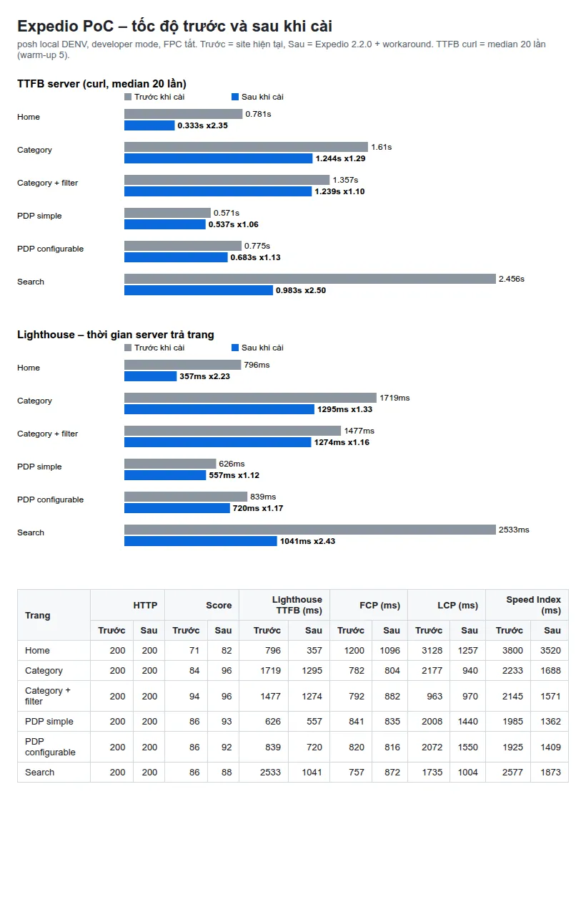
*TTFB trước (xám) và sau khi cài (xanh), đo bằng curl và Lighthouse. Thanh càng ngắn càng nhanh.*

> Điểm Lighthouse sau khi cài có tăng (ảnh ở phụ lục) nhưng **không có ý nghĩa**: tăng chủ yếu vì trang nhẹ đi do mất header/footer, không phải vì nhanh hơn.

## 6 · Cái giá khi áp vào theme/module bên thứ ba

**Không chạy được ngay sau khi cài:** cả 6 trang lỗi (5 trang HTTP 500; Home trả 200 nhưng hiện trang exception, mất 21,6s). Phải sửa 4 chỗ (cộng 1 bước gán theme cha) mới chạy:

1. Tắt Amasty Color Swatches.
2. Sửa 1 bug của chính Expedio.
3. Override layout PDP của Porto.
4. Thêm module vá cho widget danh sách sản phẩm trong CMS (Home).

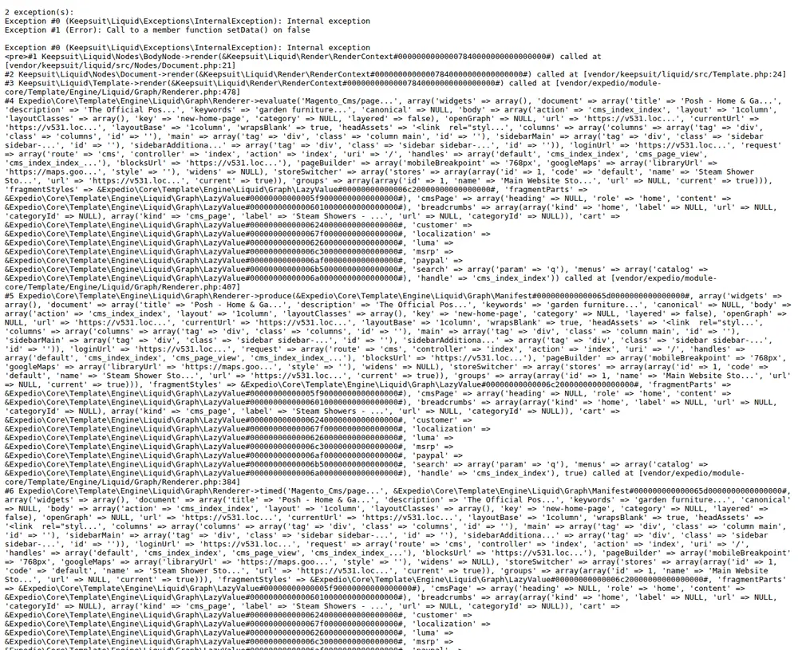
***Home** · HTTP 200 · 21.6s — Expedio render widget CMS lỗi (`setData() on false`)*

***Category** · HTTP 500 · 10.7s — Amasty Color Swatches lỗi `strpos(null)`*

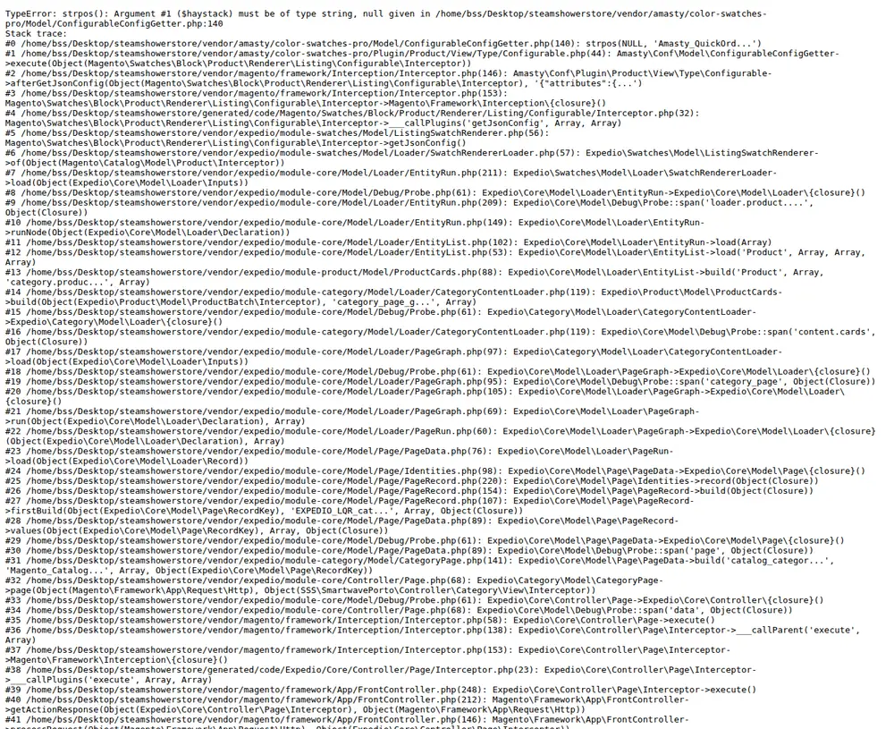
***Category + filter** · HTTP 500 · 1.0s — Amasty Color Swatches lỗi `strpos(null)`*

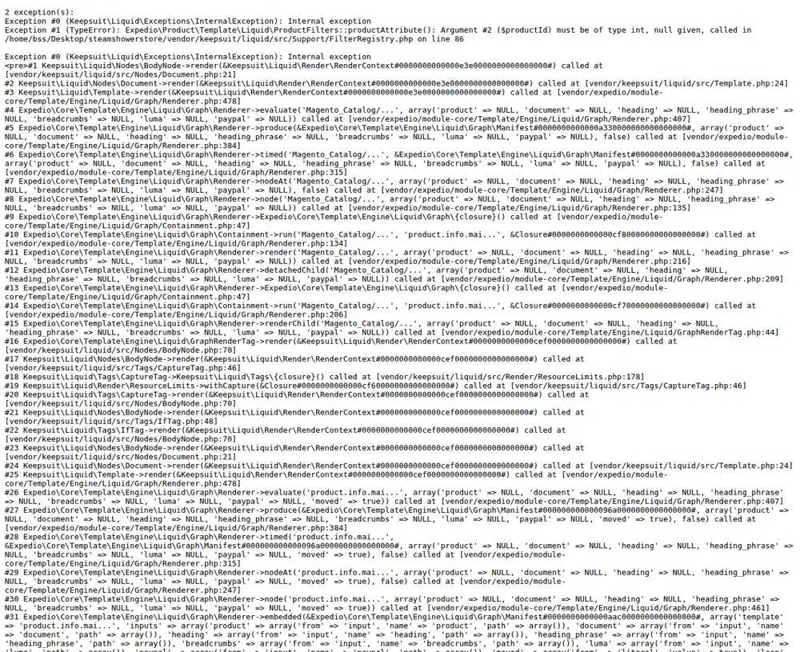
***PDP simple** · HTTP 500 · 7.3s — Porto move block làm Expedio mất `product` (`productId null`)*

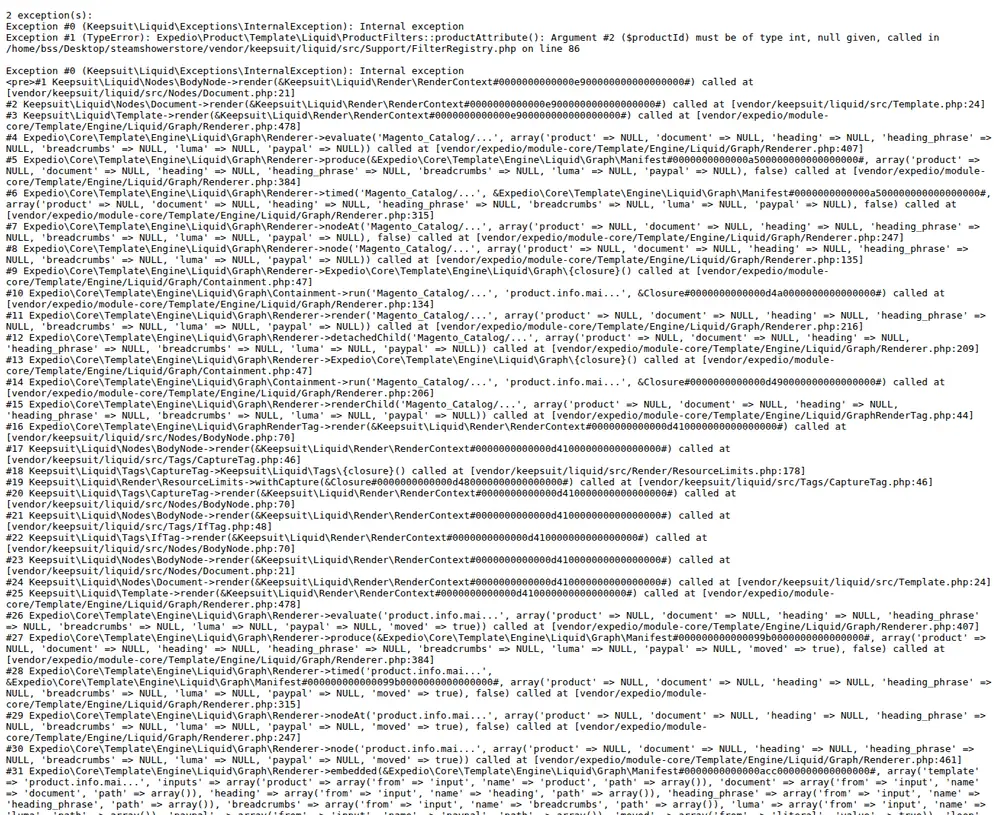
***PDP configurable** · HTTP 500 · 0.5s — Porto move block làm Expedio mất `product` (`productId null`)*

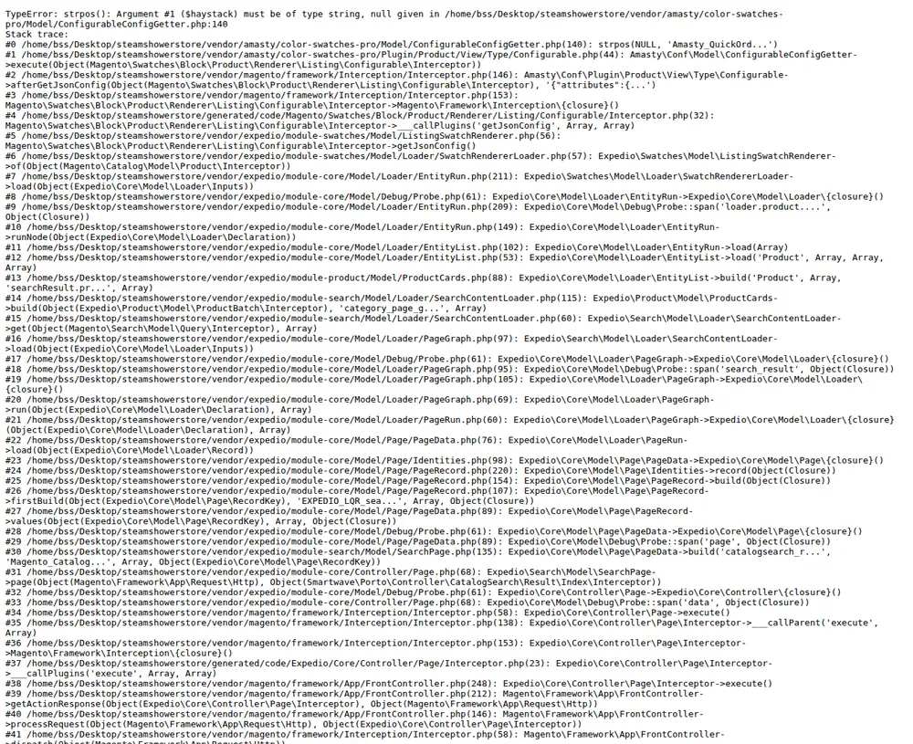
***Search** · HTTP 500 · 1.1s — Amasty Color Swatches lỗi `strpos(null)`*

### Vỡ giao diện sau khi sửa xong lỗi

Header chuyển sang kiểu Luma: mất tìm kiếm, số điện thoại, icon account/wishlist/giỏ hàng của Porto; **footer mất hoàn toàn**. Ảnh full trang (desktop), trái là trước khi cài, phải là sau khi cài.

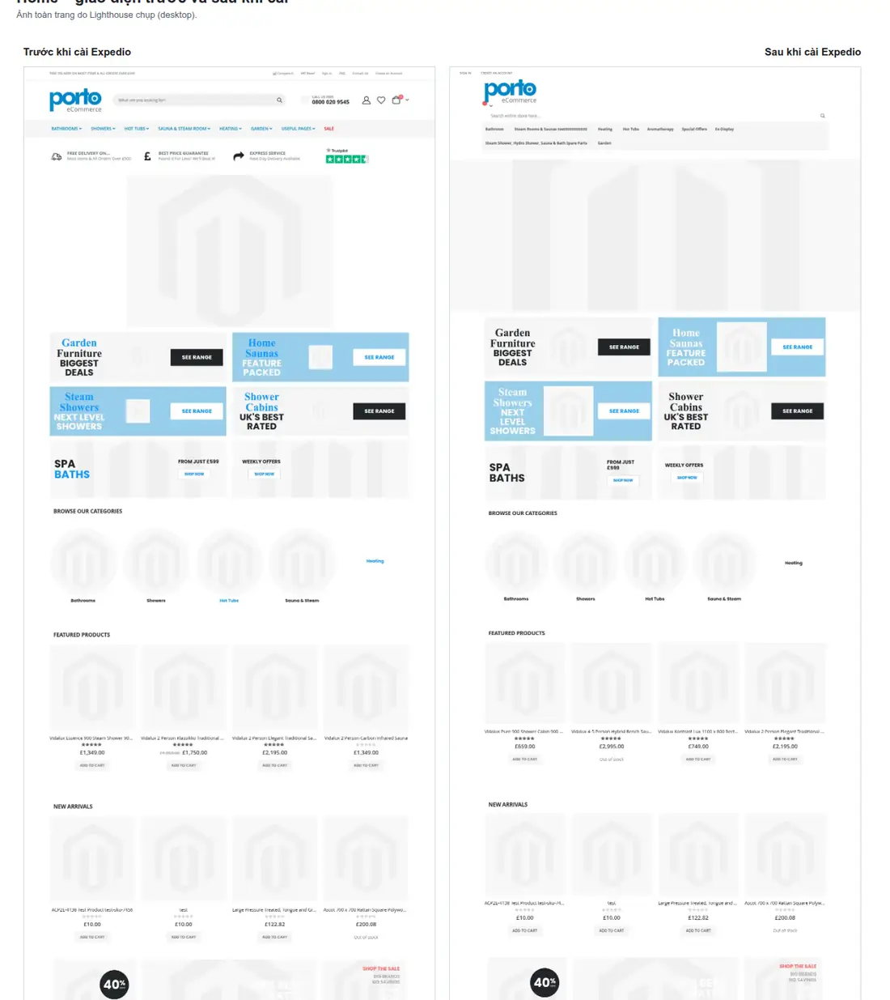
***Home**: trái trước khi cài · phải sau khi cài*

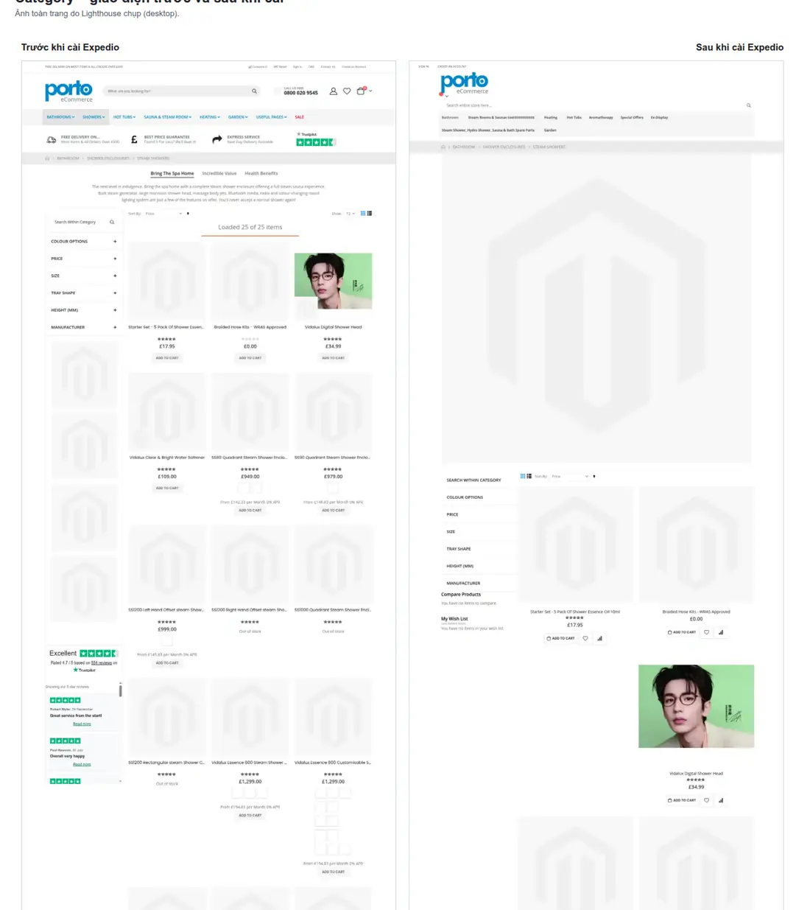
***Category**: trái trước khi cài · phải sau khi cài*

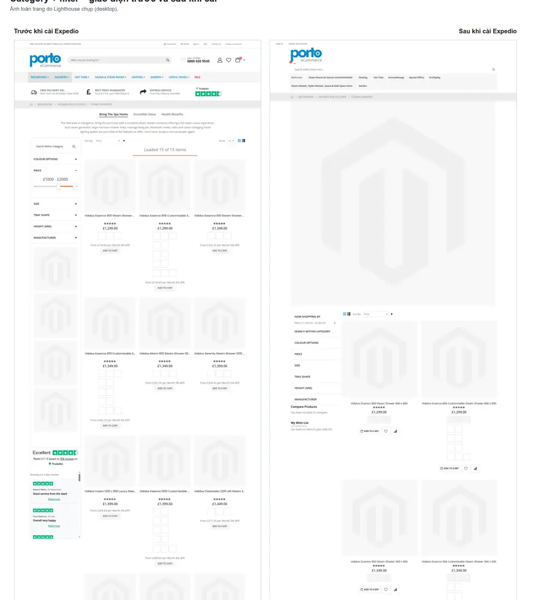
***Category + filter**: trái trước khi cài · phải sau khi cài*

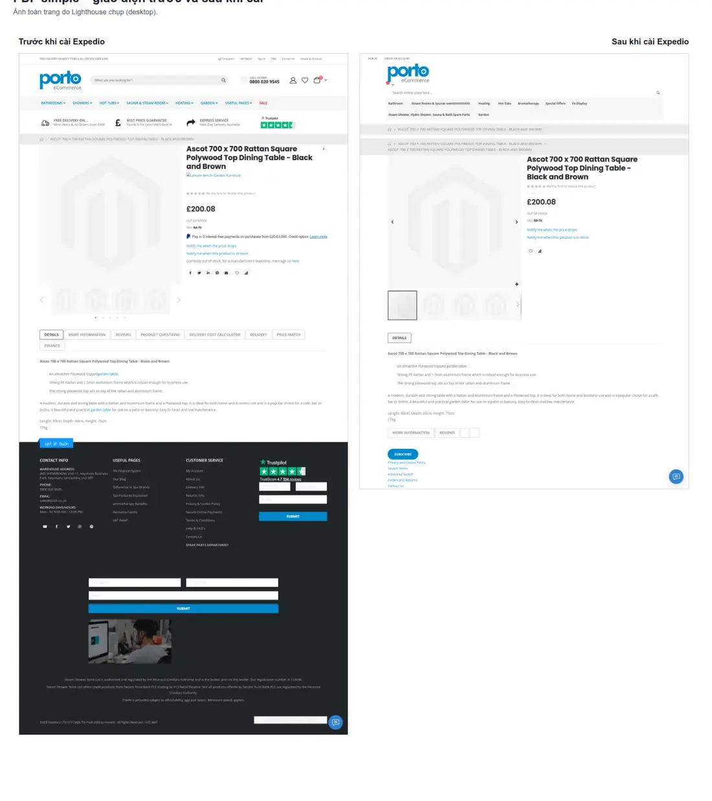
***PDP simple**: trái trước khi cài · phải sau khi cài*

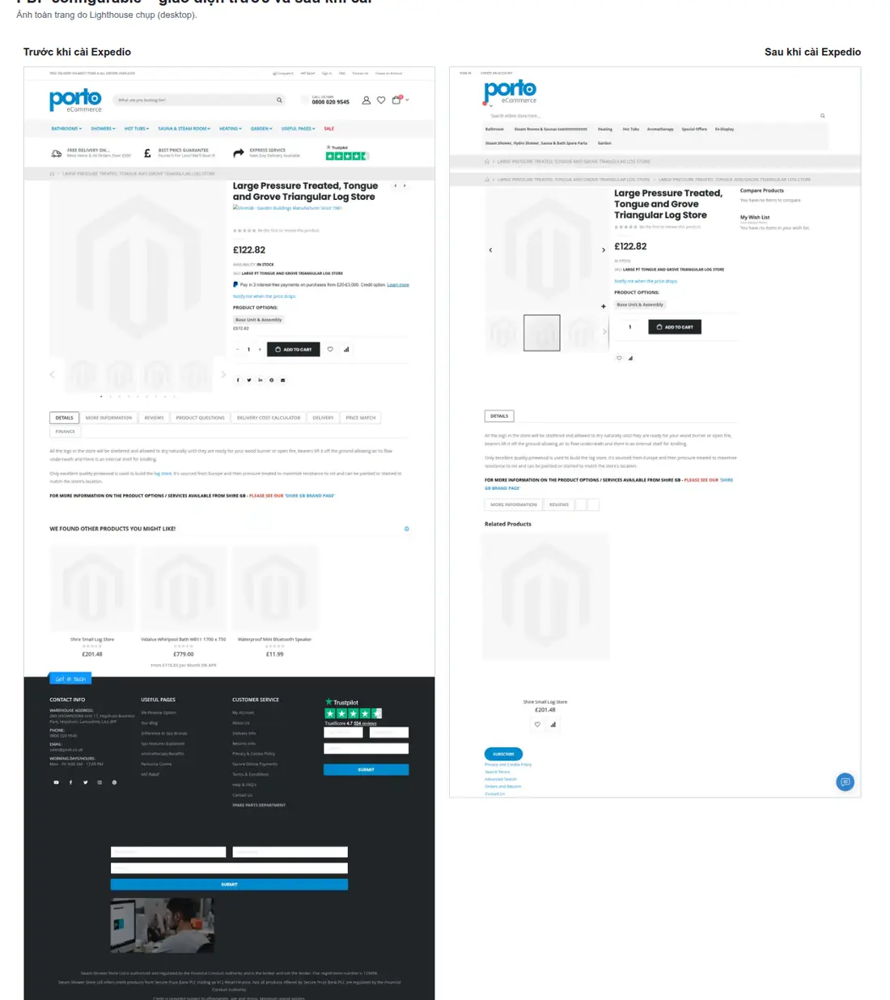
***PDP configurable**: trái trước khi cài · phải sau khi cài*

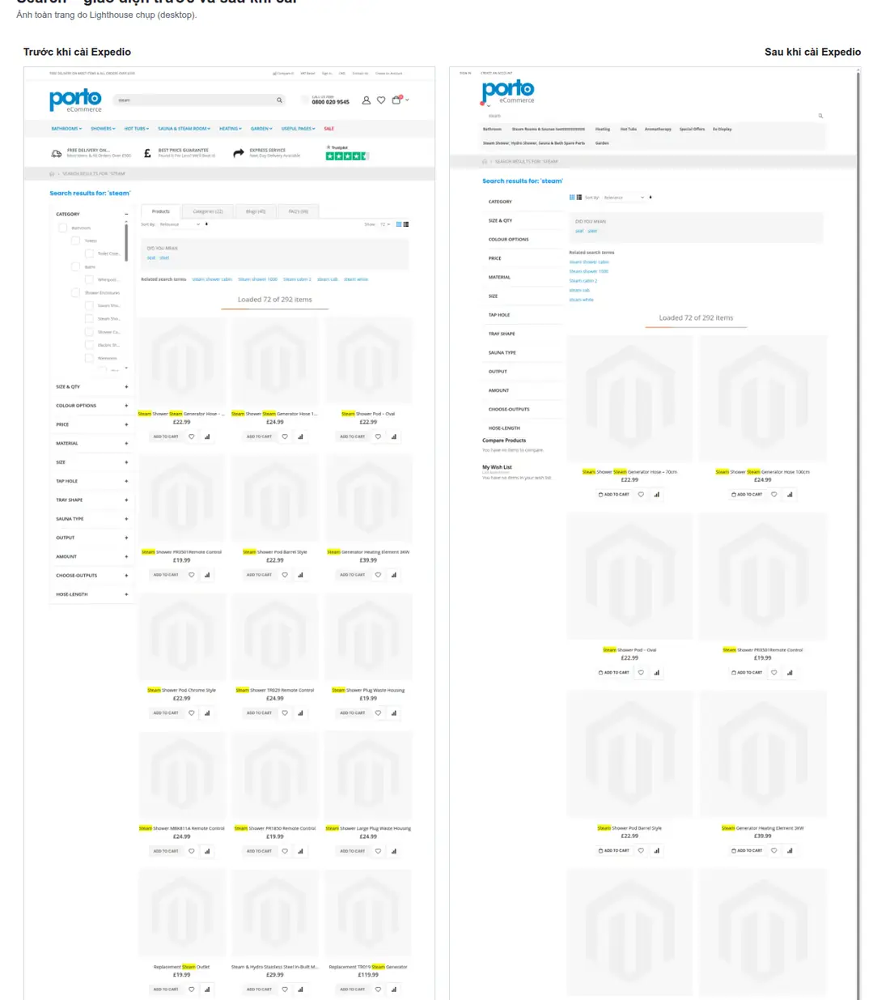
***Search**: trái trước khi cài · phải sau khi cài*

> **Telemetry:** module Expedio gửi base URL và thông tin server về scandiweb mỗi ngày — phải tắt nếu dùng.

## 7 · Nếu muốn dùng thật, phải làm gì

### Điều kiện

- Magento ≥ 2.4.8, PHP 8.2–8.5. Hyvä chỉ hỗ trợ 1.5.0–1.5.2. Bản Free dừng ở Expedio 2.2.0 (licence Self-managed, đăng ký theo store).
- Theme của site phải dựa trên `Magento/luma` hoặc `Hyva/default`.

### Khối lượng việc

- Cài qua Composer, `setup:upgrade`, deploy, đổi theme (hoặc parent của theme riêng), gán lại widget kể cả `layout_link`.
- Mỗi template `.phtml` custom trên PLP/PDP/Search/CMS phải viết lại thành `.liquid`, phần lấy dữ liệu viết thành loader. Header, footer phải giữ 2 bản song song.
- Mỗi module bên thứ ba hiển thị trên các trang này cần bản compat (loader + template); module demo trên Luma cần 3 loader, 2 layout, 2 template; trên Hyvä thêm 1 module compat và 1 theme con để build Tailwind. Mỗi lần module ra bản mới phải kiểm tra lại.
- **Không** cần sửa: module chỉ chạy ở admin, cron, API, checkout; nội dung CMS, Page Builder.

### Rủi ro vận hành

- Trang có thể **âm thầm quay về Magento render** (mất toàn bộ lợi ích) mà không báo lỗi — đã gặp trên Hyvä do một widget đặt sai container; phải kiểm tra bằng profiler `expedio:fallback`.
- Sửa `expedio.xml` thẳng trên server có thể làm PLP lỗi 500 (đã gặp khi test); chỉ nên release qua static deploy — khi đó lỗi khai báo/template được chặn lúc deploy.
- Nâng cấp Magento/Hyvä sau này bị phụ thuộc vào việc Expedio hỗ trợ kịp.

## 8 · Khi nào nên / không nên dùng

### Nên cân nhắc khi

- Site Luma (hoặc gần default) và chưa có ý định lên Hyvä.
- Catalog lớn, PLP nặng, nhiều sản phẩm configurable.
- FPC hay bị miss: nhiều sort/filter, customer group, currency, store view, hoặc catalog cập nhật liên tục.
- PHP đang quá tải ở PLP/PDP.

### Không nên khi

- Varnish/CDN đã phục vụ phần lớn lượt xem — lượt FPC hit không nhanh hơn.
- Chỗ chậm là checkout, giỏ hàng, API, ảnh hoặc JS — Expedio không đụng tới.
- Theme custom nặng / nhiều extension hiển thị trên PLP/PDP (như Porto ở PoC trên) — chi phí compat vượt lợi ích.
- Site PWA/headless; site Hyvä mà chỗ chậm là PDP.
- Hay deploy / hay xoá cache — lần đầu load chậm hơn 1,5–2 lần.

## 9 · Kết luận

Cơ chế của Expedio có hiệu quả thật — đã kiểm chứng bằng 4.840 request trên store sạch: dựng lại PLP/PDP nhanh gấp 1,4–3,1 lần, SQL giảm gần một nửa, 9 test chức năng và nội dung trang đều đạt. Nhưng lợi ích chỉ nằm ở **lượt server phải dựng lại trang**, trong khi site production đã có Varnish/Cloudflare phục vụ phần lớn lượt xem; và PoC trên posh.co.uk cho thấy với theme/module bên thứ ba, chi phí viết lại template + rủi ro vỡ giao diện là rất lớn.

**Khuyến nghị:** chưa dùng cho các site hiện tại. Chỉ thử tiếp nếu một site thoả nhóm "nên cân nhắc" ở mục 8, và trước đó phải **đo tỷ lệ FPC miss thực tế trên production** — chỉ số quyết định lợi ích mà cả hai nghiên cứu (đều đo local) chưa có.

## Phụ lục · Lighthouse trước/sau (posh.co.uk)

Khung đỏ là mục Document request latency; dòng "Server respond… (observed X ms)" chính là TTFB. Điểm tăng chủ yếu vì trang nhẹ đi (mất header/footer) — xem lưu ý ở mục 5.

### Home

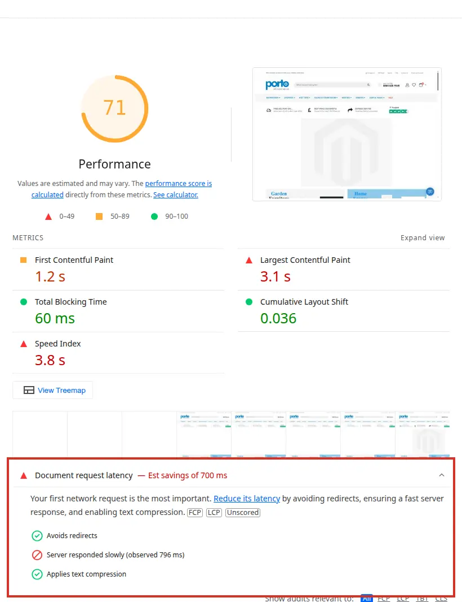
*Trước khi cài · điểm 71 · TTFB 796 ms*

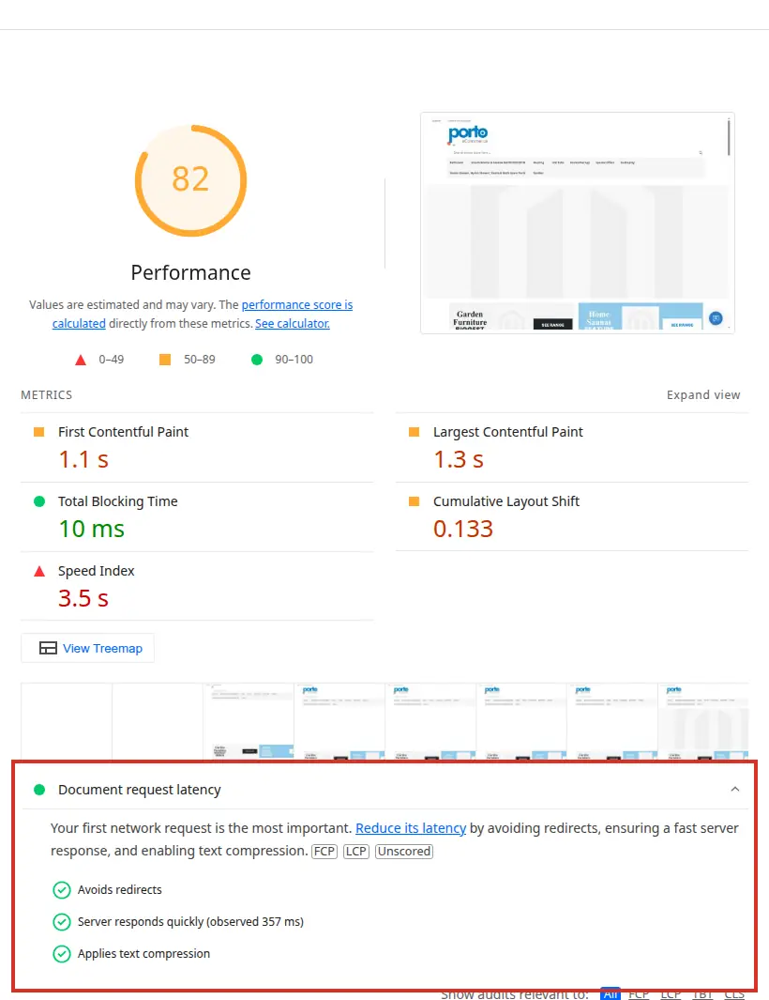
*Sau khi cài · điểm 82 · TTFB 357 ms*

### Category

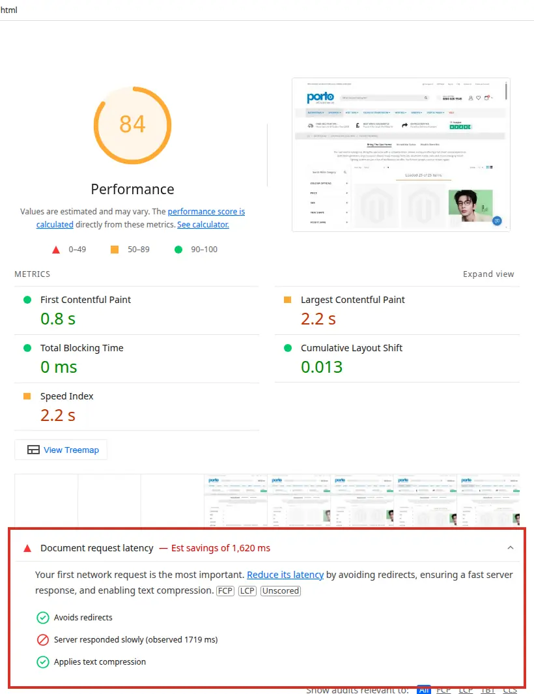
*Trước khi cài · điểm 84 · TTFB 1719 ms*

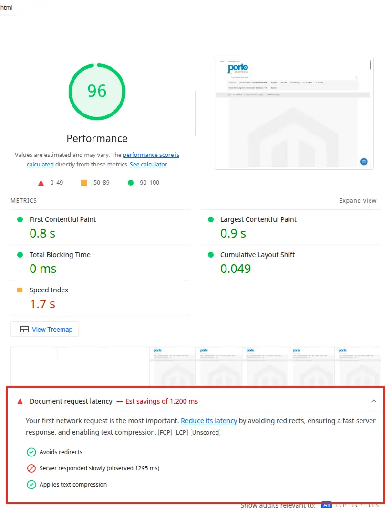
*Sau khi cài · điểm 96 · TTFB 1295 ms*

### Category + filter

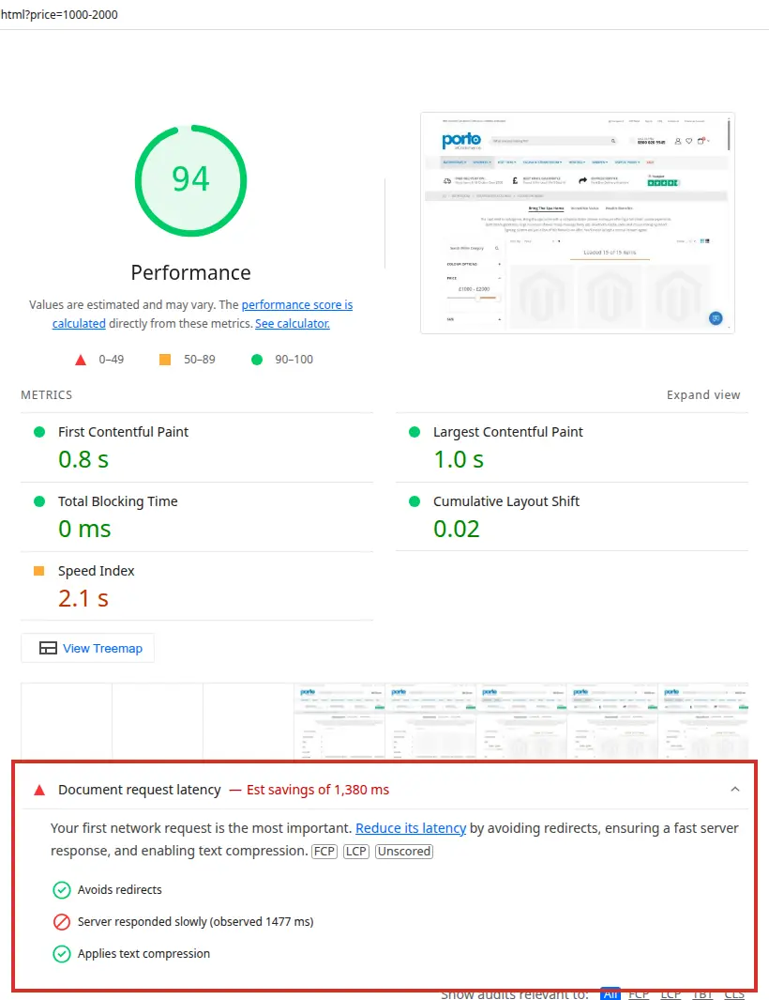
*Trước khi cài · điểm 94 · TTFB 1477 ms*

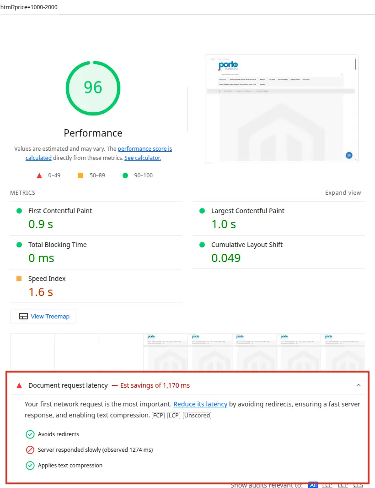
*Sau khi cài · điểm 96 · TTFB 1274 ms*

### PDP simple

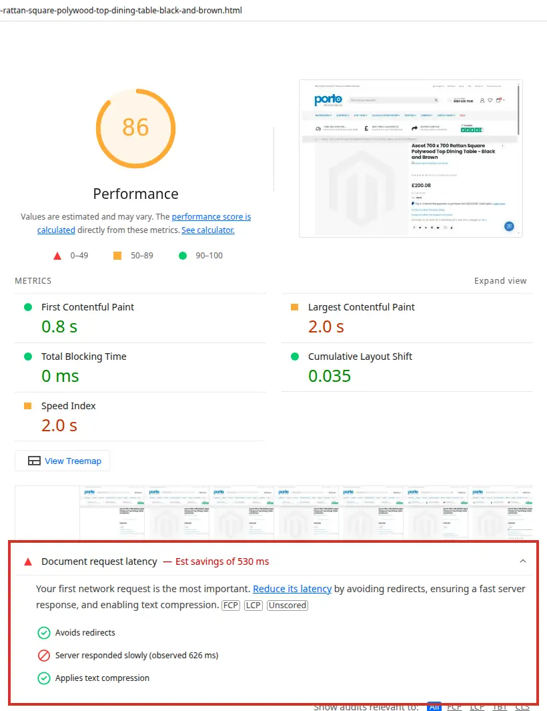
*Trước khi cài · điểm 86 · TTFB 626 ms*

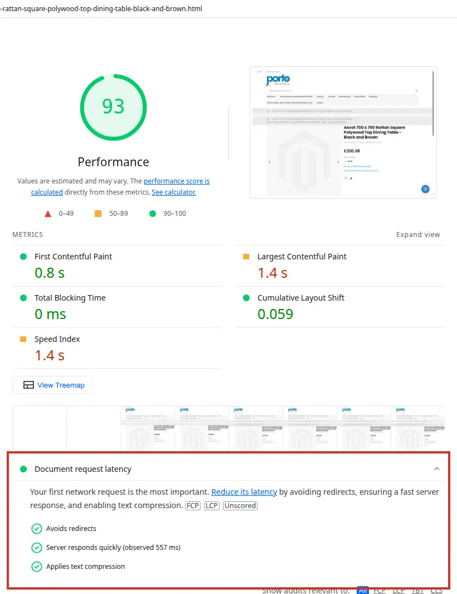
*Sau khi cài · điểm 93 · TTFB 557 ms*

### PDP configurable

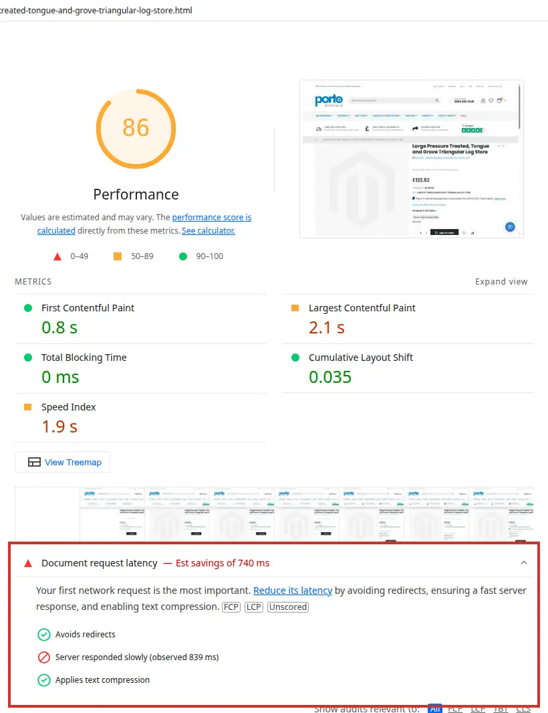
*Trước khi cài · điểm 86 · TTFB 839 ms*

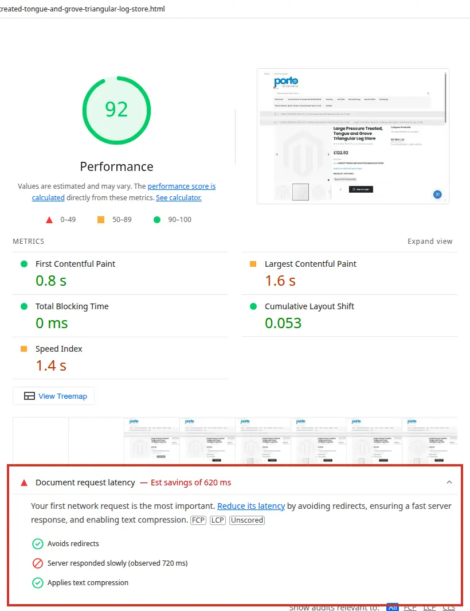
*Sau khi cài · điểm 92 · TTFB 720 ms*

### Search

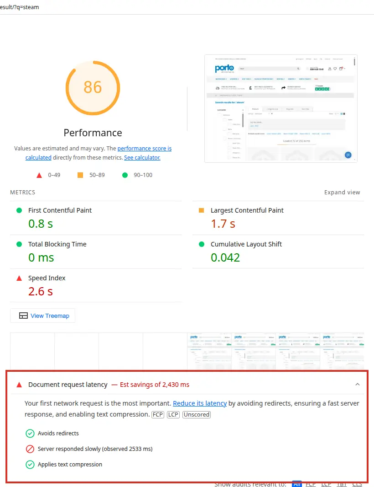
*Trước khi cài · điểm 86 · TTFB 2533 ms*

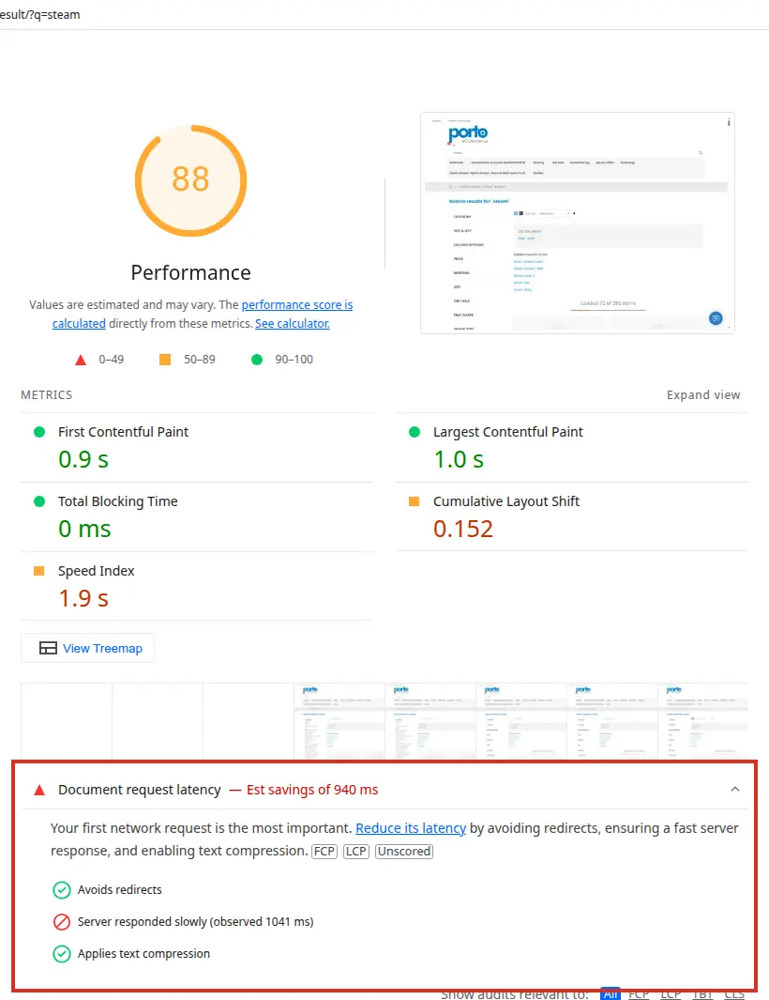
*Sau khi cài · điểm 88 · TTFB 1041 ms*

## Nguồn

- Benchmark store sạch: script + kết quả đầy đủ trong repo `namdp/mgtfe-expedio-research`.
- PoC posh.co.uk: báo cáo gốc `sum-expedio-review-30-10-Long.html` (ảnh trong báo cáo này lấy từ đó).
