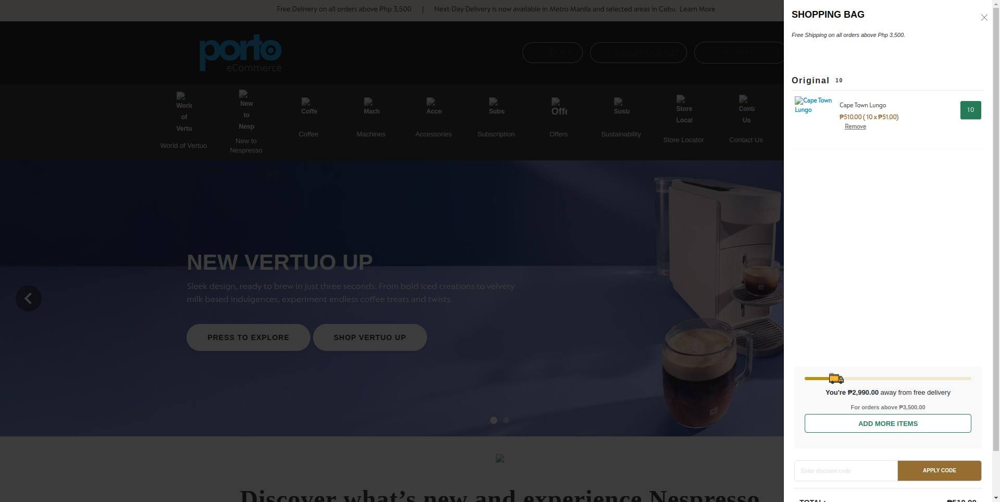
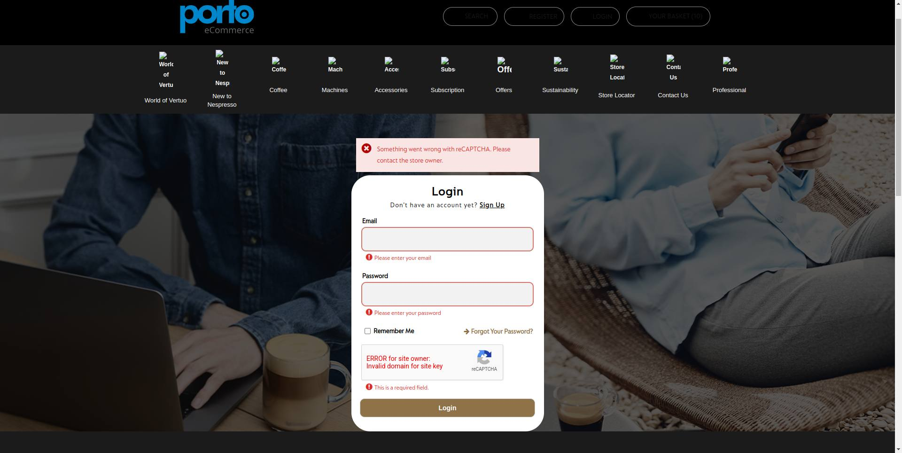
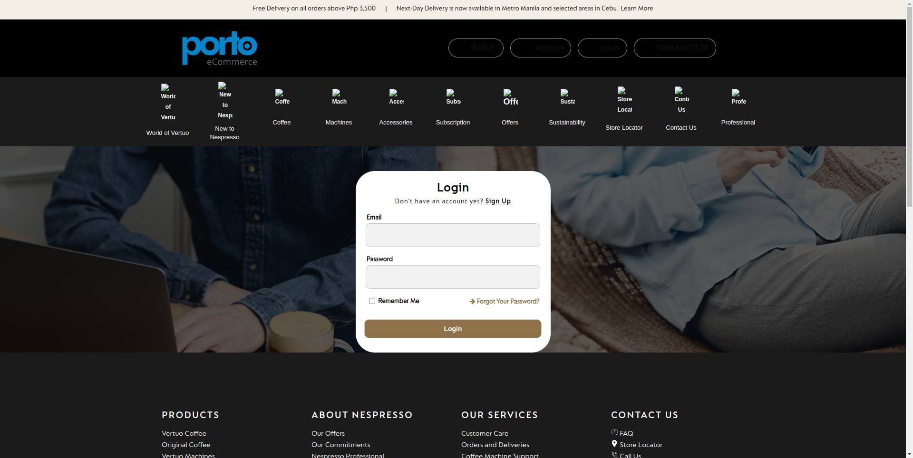
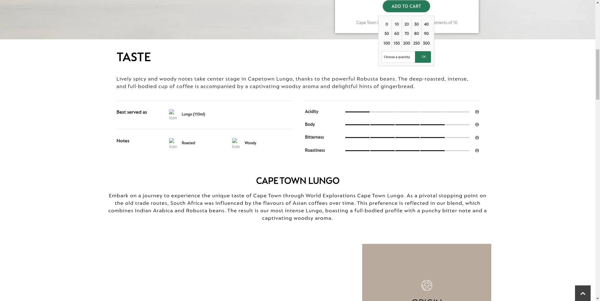
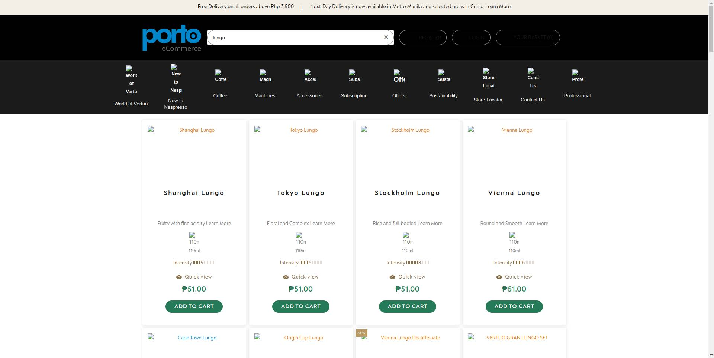
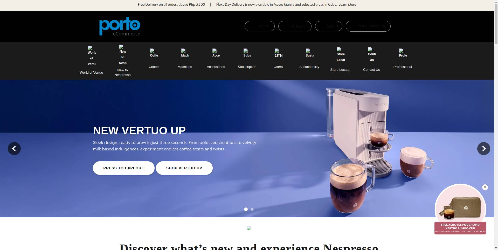
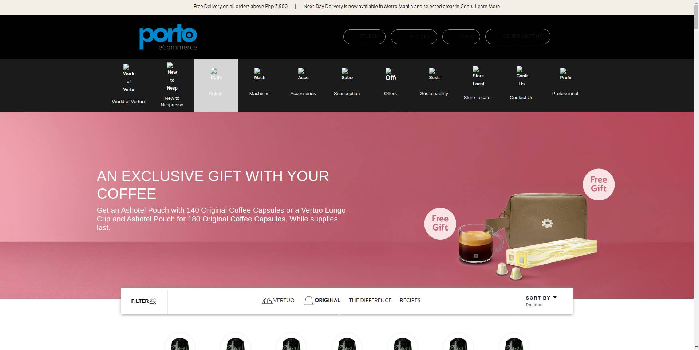

# Đánh giá module `oocscommerce/module-requirejs-optimize`

> Trọng tâm: module có ảnh hưởng hoạt động của function trên web không (core / 3rd-party / custom) — và tốc độ cải thiện ra sao.

Test trên V551 (Nespresso) · Magento 2.4.6-p15 · PHP 8.2.28 · Theme Porto (Luma) · 07/11/2026 · Module v1.2.0 (MIT)

## 1 · Module là gì

Gộp hàng trăm file JS RequireJS của theme Luma thành vài "chunk" theo từng loại trang — bằng **phân tích tĩnh** (đọc layout/template/PHP, không cần crawl browser, giống Vite).

- **Vấn đề giải quyết:** theme Luma mỗi trang nạp 200+ request JS lẻ → nhiều round-trip, chặn render, hại điểm tốc độ.
- **Yêu cầu:** Magento 2.4+, **production mode**, **Node 18+** trên máy build, tắt `enable_js_bundling`. Chỉ dùng cho theme **Luma/RequireJS** — vô dụng với Hyvä.

## 2 · Cơ chế — vì sao không đổi chức năng

Đọc source cho thấy 4 "bảo chứng" khiến bundling chỉ đổi **cách giao file**, không đổi **code chạy**:

| Bảo chứng | Cách làm |
|---|---|
| Giữ nguyên module ID | `define()` vô danh → đặt tên đúng ID gốc → mọi `require()` vẫn trỏ đúng module. |
| Xử lý mixin riêng | Không dùng `require.config({bundles})` (vốn phá mixin); gộp mixin vào cùng chunk module đích → mixin vẫn apply. |
| Tôn trọng map/paths | Giữ override đường dẫn của extension 3rd-party. |
| Fallback an toàn | Chunk lỗi → tự tải lại file lẻ → trang không vỡ. |

> Code không phân tích được (JS nhét runtime, Page Builder, KO path động) → tải lẻ như cũ: không tối ưu nhưng vẫn chạy.

## 3 · Progressive mode — là gì & test cả 2 case (OFF/ON)

**Là gì:** tính năng riêng của module (không phải chuẩn Magento). Bình thường chunk tải xong thì tất cả module `init` một lượt → "khựng" main thread. Bật progressive → module init theo lát **~15ms**, nhường main thread → giảm **TBT (Total Blocking Time)**. TBT chính là "điểm" hay nhắc tới: chiếm ~30% điểm Lighthouse Performance + ảnh hưởng INP/độ mượt.

**Đánh đổi:** đổi **thứ tự/thời điểm thực thi** → có thể lộ race. **Mặc định TẮT.**

### Kết quả đo TBT — OFF vs ON (giả lập mobile, CPU throttle 6×)

| Trang | OFF — TBT | ON — TBT | Task dài nhất (OFF→ON) | Thay đổi |
|---|---|---|---|---|
| Trang chủ | ~1700ms | ~1850ms | ~450 → ~470ms | ≈ không đổi |
| Sản phẩm (nặng JS) | ~1967ms | ~1290ms | 628 → ~360ms | −34% TBT, −43% task |

> Trên **desktop không throttle**, TBT đã ~0–70ms ở cả 2 case → **progressive gần như vô tác dụng** (không có task dài để cắt). Nó chỉ "ăn điểm" trên **trang nặng JS + máy chậm/mobile**: trang sản phẩm giảm TBT **−34%** và task dài nhất **−43%** → tốt cho Lighthouse mobile & INP. Trang chủ (bị 3rd-party chi phối) thì không đổi.

> ⚠️ **An toàn khi bật ON:** test thực tế — 0 module kẹt, add-to-cart popin vẫn chạy, 0 lỗi JS mới. Trên site này **không thấy vỡ**. Nhưng vì ON đổi thứ tự thực thi, vẫn phải regression-test từng site trước khi bật.

**Khuyến nghị:** để **OFF mặc định** (an toàn, đủ tốt). Chỉ bật **ON** khi mục tiêu là điểm Lighthouse mobile / INP, và sau khi đã test chức năng kỹ trên chính site đó.

### Chunk đang nặng bao nhiêu? & cần gạt `maxChunk`

Size thật từng chunk trên V551 (raw / gzip — gzip là cái tải thật):

| Chunk | Raw | Gzip | Nạp ở |
|---|---|---|---|
| **common.js** | **2.5 MB** | **547 KB** | MỌI trang ⚠️ |
| checkout.js | 757 KB | 138 KB | checkout |
| cart_checkout.js | 362 KB | 63 KB | cart + checkout |
| swatch-renderer.js | 126 KB | 26 KB | product |
| product.js | 119 KB | 21 KB | product |
| cart.js | 71 KB | 12 KB | cart |
| (còn lại) | ≤48 KB | — | — |

> ⚠️ **`common.js` 2.5MB (547KB gzip) nạp trên mọi trang** = nguồn TBT chính (parse + init 2.5MB trong 1 task). Đây là điểm yếu lớn nhất về main-thread hiện tại.

**`maxChunk N`** (field trong `static-optimize.json`, mặc định `0` = không tách): chunk nào source > N KB thì **tách thành nhiều file tải cùng lúc** — mỗi file parse trong 1 task main-thread ngắn hơn → **giảm TBT**, đổi lại thêm vài request.

**3 cần gạt giảm TBT, khác tầng:** `maxChunk` cắt lúc **parse** (tách file nặng) · `progressive` cắt lúc **execute** (slice init ~15ms) · dùng chung được.

> **Với V551, `maxChunk` đáng giá hơn progressive** — vì long-task chủ yếu đến từ parse `common` 2.5MB. Ví dụ `maxChunk: 500` → tách common thành ~5 file → mỗi task parse ngắn hơn → giảm TBT. *(Mới phân tích theo size; chưa đo TBT thực tế cho maxChunk.)*

## 4 · Kết quả test tốc độ

### 4.1 Số request JS — cải thiện rõ & chắc chắn

| Trang | Trước | Sau | Thay đổi |
|---|---:|---:|---:|
| Trang chủ | 243 | 31 | **−87%** |
| Sản phẩm | 251 | 36 | **−86%** |
| Giỏ hàng | 244 | 32 | **−87%** |
| File JS Magento (gộp) | ~225 | 18 | — |

> **Lưu ý trung thực:** tổng **dung lượng code JS gần như không đổi (~3MB)** — module **nối** các module lại chứ không xoá bớt. Lợi ích là giảm **số request/round-trip** và overhead nạp, không phải giảm bytes.

### 4.2 Core Web Vitals (LCP/CLS) — đo bằng Chrome DevTools

| Trang | LCP trước | LCP sau | CLS |
|---|---|---|---|
| Trang chủ | 3.0s | 3.4s – 4.2s (dao động) | 0.00 → 0.00 |
| Sản phẩm | 4.1s | ~4s | 0.01 → 0.00 |

> ⚠️ **Kết luận CWV phải nói thẳng:** trên denv này **LCP không cải thiện rõ** và dao động mạnh, vì LCP bị chi phối bởi **script 3rd-party nặng** (GTM, GA, Emarsys, Scarab, Glassbox) + ảnh hero — không phải local JS. Module gộp JS Magento nên **giảm request & main-thread**, nhưng trên site nhiều tag như Nespresso, điều đó **không dời được kim LCP**. CLS ổn định 0.00.

> Trên site **ít tag hơn**, việc giảm mạnh request JS chặn-render thường giúp FCP/LCP/TBT tốt lên rõ hơn. Muốn biết chính xác cho từng site thì phải đo riêng.

## 5 · Kết quả test chức năng (JS)

Mọi trang chạy **RequireJS health probe** (đếm module nạp / module kẹt). **0 module kẹt ở mọi trang.** Đã **tắt reCaptcha trên local** để test được luồng login/giỏ hàng.

| Chức năng | Nhóm | Module/pending | KQ |
|---|---|---|---|
| Trang chủ: carousel, megamenu, modal tự bật | core + custom | 326 / 0 | ĐẠT |
| Tìm kiếm: grid KQ, Quick view | Mageplaza | 341 / 0 | ĐẠT |
| Danh mục: 469 sản phẩm, megamenu | core + Ves | 370 / 0 | ĐẠT |
| Sản phẩm: popin chọn số lượng (custom) | custom Nespresso | 0 pending | ĐẠT |
| **Add-to-cart → minicart 10 món, ₱510, thanh free-ship** | core KO + custom | — | ĐẠT |
| **Đăng nhập account** (sau khi tắt reCaptcha) | core auth | — | ĐẠT |
| Form validation (hiện đúng 6 lỗi) | core + mixin | 329 / 0 | ĐẠT |
| Checkout: 26 lazy payment chunk + loader/fallback build sẵn | checkout + payment | infra | Infra OK* |

> \* Không vào được bước render payment vì site Nespresso có **custom gate "hoàn tất profile"** (redirect server-side) — ràng buộc của site, không phải module. Mixin thật đều nạp đúng: `customer-data`, `reCaptcha`, `sidebar`, `megamenu`.

> **Kiểm tra chức năng ở cả 2 chế độ progressive:** bảng trên đo ở **progressive OFF** (mặc định). Lặp lại smoke test với **progressive ON**: **333 module, 0 pending, add-to-cart popin chạy, 0 lỗi JS mới**. → **Chức năng ĐẠT ở cả OFF và ON** (progressive chỉ đổi thời điểm thực thi, không làm vỡ chức năng trên site này). Chi tiết số liệu TBT 2 case ở mục 3.

### 5.1 Hình ảnh chứng minh

***Add-to-cart & minicart hoạt động** — SHOPPING BAG: Cape Town Lungo × 10 = ₱510.00, thanh "₱2,990 away from free delivery", ô mã giảm giá. KO minicart + custom JS chạy đúng sau khi gộp.*

***Form validation chạy** — 6 lỗi "required". (Ảnh này reCaptcha còn BẬT → báo lỗi domain.)*

***Sau khi TẮT reCaptcha** — form login sạch, không còn widget reCaptcha → login thành công.*

***Custom code** — popin QuantitySelector của Nespresso bật đúng khi Add to cart.*

***3rd-party** — Mageplaza search: grid KQ, Quick view, megamenu.*

***Trang chủ** — carousel, megamenu. 326 module, 0 pending.*

***Danh mục** — 469 sản phẩm render, megamenu. 370 module, 0 pending.*

### 5.2 Console errors

Mọi lỗi console đều là **môi trường/3rd-party**, **không có lỗi nạp JS module**: 404 ảnh/media (thiếu media denv), `font-face.css` MIME, `localhost:8300` CSP, `bssminicart/getvoucherguide` 500 (controller Bss lỗi server-side). Không liên quan bundling.

## 6 · Nhược điểm & issue tiềm ẩn

| # | Vấn đề | Mức | Giảm thiểu |
|---|---|---|---|
| 1 | **Độ chín thấp**: module mới ~1 tuần, 0 dependent, version nhảy 1.0→1.2 trong 1 ngày. | Cao | Chưa battle-tested. Không pin thẳng nhiều site live. |
| 2 | **Progressive mode** đổi thứ tự thực thi → có thể lộ race. | TB | Mặc định TẮT; chỉ bật khi đã test kỹ. |
| 3 | **Mixin gán nhầm chunk** → sai hành vi mà **không báo lỗi** (bug im lặng). | Thấp | Xác suất thấp; test đã thấy mixin OK. Vẫn phải test từng site. |
| 4 | **Vận hành**: quên `static:optimize:run` sau SCD → vỡ loader. | TB | Nhét vào pipeline deploy + fail-check. |
| 5 | Page Builder / JS runtime / KO path động không gộp. | Thấp | Vẫn chạy, chỉ không tối ưu. |
| 6 | LCP không cải thiện trên site nhiều 3rd-party tag. | Lưu ý | Lợi ích thật là request count; đừng kỳ vọng LCP giảm mạnh. |

## 7 · Kết luận

### ✅ Site Luma/RequireJS: NÊN dùng — có điều kiện

Module **không làm đổi hoạt động function** (đã chứng minh qua source + test thực tế: 0 module kẹt, login/add-to-cart/minicart/validation/custom popin đều chạy). Giảm ~87% request JS. Điều kiện: **pilot staging ≥1–2 tuần**, giữ **progressive OFF**, chuẩn hoá pipeline (`optimize:run` sau SCD), và **chờ module chín thêm** trước khi dùng cho site doanh thu cao.

### ❌ Site Hyvä: KHÔNG dùng

Hyvä không dùng RequireJS. Module này chỉ dành cho **các site Luma còn lại**.

> 🔴 **Rủi ro lớn nhất không phải kỹ thuật mà là độ chín** — mới 1 tuần, 0 dependent. Nếu cần chắc chắn tuyệt đối cho site lớn: đợi 2–3 tháng hoặc fork & tự review engine Node.

---

*Test thực tế trên denv V551 (Nespresso) ngày 07/11/2026. Sau test: env đã trả về developer mode, gỡ module, khôi phục reCaptcha, xoá customer test.*

**Nguồn:** [GitHub](https://github.com/oocscommerce/module-requirejs-optimize) · [Packagist](https://packagist.org/packages/oocscommerce/module-requirejs-optimize)
