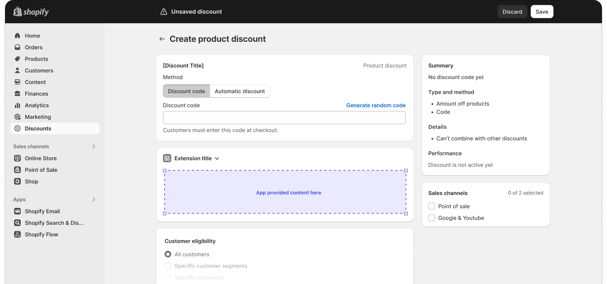
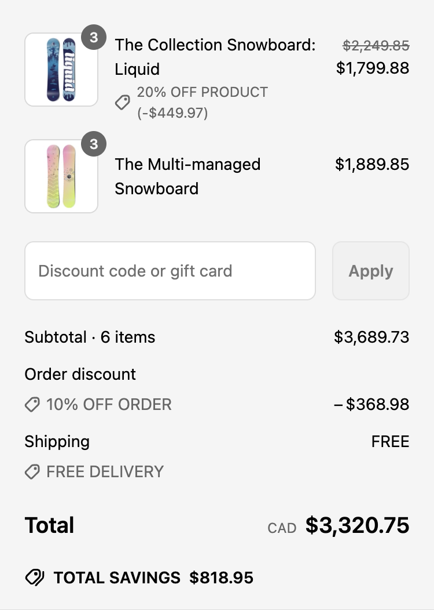

# SPF Custom App Solution Library 1.1 — Discount

| Field | Value |
| :---- | :---- |
| Owner | Bắc PV — NodeJS BE Dev Lead |
| Audience | Dev (NodeJS BE) |
| Last reviewed | 2026-11-18 |
| Review cadence | Quarterly |
| Version | v1.0 |
| Linked from | Ref_Dev_spf-custom-app-solution-library_v1.0, Ref_Dev_s1.2_spf-solution-pricing_v1.0 |
| Status | Live |

Doc này là mục 1.1 của [SPF Custom App Solution Library](Ref_Dev_spf-custom-app-solution-library_v1.0.md), nghiệp vụ discount. Doc nêu tính năng mặc định của Shopify, các yêu cầu tùy chỉnh kèm giải pháp, và ràng buộc kỹ thuật. Cách đọc các cột và điều kiện chung nằm ở [doc index](Ref_Dev_spf-custom-app-solution-library_v1.0.md).

## 1. Tính năng mặc định

| Tính năng | Mô tả | Giới hạn |
| :---- | :---- | :---- |
| Loại discount | Amount off theo % hoặc số tiền cố định, trên product, collection hoặc cả đơn. Buy X get Y. Free shipping | Một code vừa giảm % vừa free shipping thì cần app |
| Cách áp dụng | Code do khách nhập ở checkout. Automatic discount tự áp ở cart và checkout | Tối đa 25 automatic discount đang bật mỗi store, tính cả discount của app |
| Đối tượng | Mọi khách, khách cụ thể, customer segment, hoặc market. Mỗi discount chỉ chọn một loại | Tối đa 5 segment cho automatic discount, 100 segment cho code |
| Khách mua lần đầu | Segment `number_of_orders = 0`, kết hợp giới hạn một lần mỗi khách trên code | Nhận diện khách bằng email hoặc số điện thoại ở checkout |
| Theo tag khách | Segment `customer_tags CONTAINS 'vip'` | Mỗi discount chỉ có một mức giảm |
| Điều kiện tối thiểu | Minimum purchase amount (chỉ tính giá sản phẩm) hoặc minimum quantity | Mỗi discount chỉ có một ngưỡng |
| Giới hạn sử dụng | Với code: tổng số lần dùng, một lần mỗi khách | Giới hạn lượt dùng cho automatic discount: chưa xác nhận |
| Buy X get Y | Mua đủ số lượng hoặc số tiền, nhận sản phẩm với mức giảm %, giảm tiền hoặc miễn phí. Khi nhóm mua và nhóm tặng trùng nhau, món giá thấp hơn được giảm | Quà không tự thêm vào cart, khách phải tự thêm |
| Free shipping | Chọn theo quốc gia, loại trừ rate trên một mức, có minimum purchase hoặc quantity | Một đơn chỉ có một shipping discount |
| Kết hợp discount | 3 class: product, order, shipping. Phải bật kết hợp trên từng discount. Thứ tự áp: product, order, shipping | Nhiều product discount trên cùng một line chỉ có trên Plus. Sản phẩm trong Buy X get Y trên store không phải Plus không nhận thêm product discount |
| Số code mỗi đơn | 5 code product hoặc order và 1 code shipping | Không tăng được |
| Số code mỗi store | 20.000.000 code. Tạo hàng loạt 250 code mỗi lần gọi `discountRedeemCodeBulkAdd` | Mỗi code gắn tối đa 100 khách, product, variant cụ thể |
| POS | Code dùng được cả online và POS | Automatic discount và Buy X get Y trên POS cần POS Pro |

## 2. Yêu cầu tùy chỉnh

Các giải pháp dùng Discount Function trong bảng có chung cấu hình:

- Discount Function với target `cart.lines.discounts.generate.run`.
- Cấu hình lưu ở metafield `$app:function-configuration` của discount.
- Trang cài đặt trong admin là Admin UI extension, target `admin.discount-details.function-settings.render`.
- Tạo discount bằng `discountAutomaticAppCreate` hoặc `discountCodeAppCreate`, scope `write_discounts`.

Discount Function trong custom app chỉ chạy trên store Plus. Cột "Ràng buộc / fallback" ghi phương án cho store non-Plus.

| Yêu cầu | Giới hạn mặc định | Giải pháp | Ràng buộc / fallback | Public app |
| :---- | :---- | :---- | :---- | :---- |
| Giảm theo bậc số lượng, gộp nhiều sản phẩm (mua 3 giảm 10%, mua 5 giảm 15%, mua 10 giảm 20%) | 1 ngưỡng, 1 mức giảm mỗi discount. Mỗi bậc chiếm 1 trong 25 slot automatic discount. Price break: chỉ B2B, theo từng product | Discount Function: cộng số lượng các line, lọc bằng `product.inAnyCollection` hoặc `hasAnyTag` → `productDiscountsAdd` | List trong input query: tối đa 100 phần tử. Non-Plus: mỗi bậc 1 automatic discount, Shopify áp mức tốt nhất | [G: Volume Discounts & Bundles](https://apps.shopify.com/g-volume-discounts). [Kaching Bundles](https://apps.shopify.com/bundle-deals) (một phần: không ghi tính gộp nhiều sản phẩm) |
| Giảm theo tag khách hoặc hạng thành viên, mỗi hạng 1 mức | Segment chỉ quyết định ai được giảm. 1 mức giảm mỗi discount. Automatic discount: tối đa 5 segment | Discount Function đọc `buyerIdentity.customer.hasAnyTag` hoặc `customer.metafield`. Bảng hạng: lưu trong cấu hình | Khách chưa đăng nhập: `customer` null. Non-Plus: mỗi hạng 1 discount gắn segment | [BSS B2B Wholesale Pricing](https://apps.shopify.com/b2b-solution-custom-pricing). [Hulk Volume Discount Bundles](https://apps.shopify.com/volume-discount-by-hulkapps) |
| Giảm theo phương thức thanh toán | Không có điều kiện này. Discount Function chạy trước bước chọn thanh toán, input không có phương thức thanh toán | Không có giải pháp đầy đủ. Workaround: khách chọn phương thức ở cart → lưu cart attribute → Function đọc `cart.attribute`. Payment Customization Function ẩn phương thức còn lại | Chưa xác nhận Payment Customization đọc được cart attribute. Accelerated checkout bỏ qua cart attribute | [Scala Payment Method Discount](https://apps.shopify.com/scala-desconto-pix-e-boleto). [Discount Genie](https://apps.shopify.com/discount-genie). Cả hai không ghi hỗ trợ VNPay, MoMo |
| Mua 2 tặng món rẻ nhất, có rule chọn nhóm riêng | Trường hợp cơ bản: có sẵn trong Buy X get Y. Thiếu: rule nhóm, nhiều bậc trong 1 rule, cộng thêm product discount trên store không phải Plus | Discount Function: sắp xếp line theo `cost.amountPerQuantity` → giảm 100% cho `cartLine {id, quantity}` | Non-Plus: Buy X get Y có sẵn | [BOGOS](https://apps.shopify.com/freegifts). [Bony Automatic Discount](https://apps.shopify.com/bony-order-shipping-discount) |
| Tự thêm quà tặng vào cart khi đủ điều kiện | Buy X get Y không tự thêm quà. Cart Transform không có thao tác thêm line | Theme app extension gọi `/cart/add.js` thêm quà. Buy X get Y có sẵn hoặc Function làm quà miễn phí. Validation Function chặn gian lận nếu cần | Thêm quà ngay trong checkout: `applyCartLinesChange`, không chạy với accelerated checkout, cần Plus. Non-Plus: theme JS và Buy X get Y | [BOGOS](https://apps.shopify.com/freegifts). [Kite](https://apps.shopify.com/kite-free-gift) (tặng quà trong checkout chỉ Plus) |
| Giảm giá, loại trừ hàng đang sale | Trang tạo discount không có lựa chọn loại trừ | Function đọc `cost.compareAtAmountPerQuantity`. Order discount: `orderSubtotal.excludedCartLineIds` | Non-Plus: automated collection điều kiện "Compare at price is not set", discount nhắm vào collection đó. Cách này chỉ dùng cho product discount | [GetSale Bulk Discounts & Sales](https://apps.shopify.com/instant-bulk-discount-sales). [Alpha: Sale & Discount Manager](https://apps.shopify.com/al-bulk-discount-manager) |
| Cộng dồn nhiều khuyến mãi mà mặc định chặn | Nhiều product discount trên 1 line: chỉ Plus. Tối đa 5 code và 1 code shipping | Plus: bật kết hợp bằng tag có sẵn. Non-Plus: 1 Function tính tổng mức giảm → trả về 1 discount | Function không sửa được discount có sẵn, discount app khác. Giới hạn 5 code: không nâng được | [AIOD Automatic Discount & Gift](https://apps.shopify.com/pro-automatic-discounts). [Stack Discounts Pro](https://apps.shopify.com/stack-discounts-pg) |
| Giảm cho đơn đầu tiên | Có sẵn một phần: segment `number_of_orders = 0`, giới hạn 1 lần mỗi khách. Phụ thuộc nhận diện email, số điện thoại | Function đọc `customer.numberOfOrders`, `createdAt` (từ API `2026-10`) | Guest không có `customer`. Non-Plus: segment và code có sẵn | [Bony Automatic Discount](https://apps.shopify.com/bony-order-shipping-discount) (một phần: điều kiện theo số đơn của khách). [DiscountOS](https://apps.shopify.com/remix-discount) (một phần) |
| Giảm theo cart attribute, line item property hoặc metafield | Điều kiện có sẵn: chỉ khách, segment, market, product, collection | Function đọc `cart.attribute`, `lines.attribute`, `product.metafield`, `variant.metafield`, `customer.metafield`, `shop.metafield`, `shop.metaobject` | Metafield lớn hơn 10.000 byte: không trả về. Non-Plus: cần public app | [SMART Functions Creator](https://apps.shopify.com/functions-creator) (một phần: rule theo metafield). [Function Studio](https://apps.shopify.com/easylogic-functions-studio) (một phần: metafield, cart attribute) |
| Free shipping theo ngưỡng đơn hàng, khác nhau từng vùng | Có sẵn phần lớn: free shipping discount theo quốc gia kèm minimum, hoặc rate miễn phí theo shipping zone. Thiếu: chia theo tỉnh, bậc, nhóm sản phẩm | Discount Function target `cart.delivery-options.discounts.generate.run`: đọc `deliveryGroups.deliveryAddress` → thao tác `deliveryDiscountsAdd` | Delivery Customization không đổi được giá rate. Non-Plus: lựa chọn có sẵn | [Free Shipping Discounts ‑ SC](https://apps.shopify.com/etp-shipping-discount-offer) (một phần: theo quốc gia, không ghi theo tỉnh). [Octolize Shipping Discounts](https://apps.shopify.com/shipping-discounts) (một phần) |
| Dùng coupon phát từ hệ thống loyalty hoặc ERP bên ngoài | Code phải tồn tại trong Shopify | Cách 1, mọi plan: đồng bộ code vào Shopify bằng `discountCodeBasicCreate` và `discountRedeemCodeBulkAdd`. Cách 2: Function có fetch target `cart.lines.discounts.generate.fetch` → `enteredDiscountCodesAccept` hoặc `enteredDiscountCodesReject` | Cách 2: cần custom app trên Shopify for enterprise, Shopify phải bật, không chạy trên dev store và draft order. Điểm thưởng cũng trả được bằng store credit | [Matrixify](https://apps.shopify.com/excel-export-import) (một phần: import discount code từ file). [Bulk Discount Code Bot](https://apps.shopify.com/bulk-discount-generator) (một phần) |
| Giảm % có mức trần (giảm 20% tối đa 100.000đ) | Trang amount off không có mức trần | Function trả về order discount `fixedAmount` bằng giá trị nhỏ hơn giữa mức % và mức trần | Non-Plus: không có cách tương đương có sẵn, cần public app | [Steppun Discount](https://apps.shopify.com/steppun-discount). [Bony Automatic Discount](https://apps.shopify.com/bony-order-shipping-discount) |
| Giảm riêng theo kênh bán hoặc cửa hàng POS | Không có điều kiện theo kênh. Retail location market: có sẵn | Function đọc `cart.retailLocation` (id, handle, metafield) | Input Function không cho biết sales channel. Automatic discount trên POS: cần POS Pro | [Discounty](https://apps.shopify.com/discounty-bulk-discount-sales) (một phần: theo kênh Online, POS). [AIOD Automatic Discount & Gift](https://apps.shopify.com/pro-automatic-discounts) (một phần: theo location) |
| 1 code vừa giảm % vừa free shipping | Shopify ghi rõ: trường hợp này cần app | 1 Function khai báo `discountClasses: [PRODUCT, ORDER, SHIPPING]` với cả 2 run target, tạo bằng `discountCodeAppCreate` | Non-Plus: 2 code có sẵn, bật kết hợp | [Discounty](https://apps.shopify.com/discounty-bulk-discount-sales). [Discount Mix](https://apps.shopify.com/discount-mix) |
| Bảng giá theo số lượng cho khách lẻ, hiện trên trang product | Volume pricing: chỉ ghi cho đơn B2B | Function giảm theo bậc như dòng đầu, kèm theme app block hiện bảng bậc giá | Như dòng đầu | [Dealeasy: Volume Discounts](https://apps.shopify.com/volume-discounts-dealeasy). [Alpha: Sale & Discount Manager](https://apps.shopify.com/al-bulk-discount-manager) |

Hình 1. Block cài đặt của Discount Function trong trang tạo discount. Nguồn: [Build a discounts UI with admin UI extensions](https://shopify.dev/docs/apps/build/discounts/build-ui-extension).

Hình 2. Checkout áp cùng lúc product, order và shipping discount. Nguồn: [Build a Discount Function](https://shopify.dev/docs/apps/build/discounts/build-discount-function).

## 3. Ràng buộc kỹ thuật

Discount Function API ở version `2026-10`:

- Run target: `cart.lines.discounts.generate.run` cho product và order, `cart.delivery-options.discounts.generate.run` cho shipping.
- Thao tác trả về: `productDiscountsAdd`, `orderDiscountsAdd`, `deliveryDiscountsAdd`, `enteredDiscountCodesAccept`, `enteredDiscountCodesReject`.
- Giá trị giảm: `percentage`, hoặc `fixedAmount {amount, appliesToEachItem}`.
- Input đọc được cart attribute, line attribute, giá và compare-at của line, tag và metafield của customer, tag, collection và metafield của product, `shop.localTime`, `retailLocation`.

Giới hạn của Function:

- Input query tối đa 3000 byte, query cost tối đa 30, list tối đa 100 phần tử.
- Với cart đến 200 line: 11 triệu instruction, input 128 kB, output 40 kB.
- File Wasm tối đa 256 KiB. Function không có random và không đọc được đồng hồ, chỉ có `shop.localTime` trong input.
- Mỗi store bật tối đa 25 discount function.

Hành vi runtime:

- Thứ tự chạy ở checkout: Cart Transform, discount cho line, fulfillment, delivery method, discount cho delivery, payment method, validation.
- Các discount function chạy song song và không biết kết quả của nhau. Function lỗi thì discount bị bỏ, checkout vẫn chạy tiếp.
- Function chỉ điều khiển discount của chính nó. Việc kết hợp với discount có sẵn theo `combinesWith` trên từng discount.
- Không hỗ trợ: Create Order API, sửa đơn trong admin, pre-order và try-before-you-buy. Draft order chạy được nhưng không có network access.
- Network access (fetch) chỉ có cho custom app trên Shopify for enterprise, Shopify phải bật, không có trên dev store.
- Shopify Scripts đã ngừng từ 2026-06-30.

Function không hỗ trợ:

- Đổi giá trực tiếp. Ghi đè giá là `lineUpdate` của Cart Transform, chỉ có trên Plus và dev store.
- Đọc phương thức thanh toán hoặc sales channel.
- Thêm line vào cart.
- Tăng phí ship hoặc thêm phụ phí.
- Hiện giá trên trang product. Đây là việc của theme.

## References

- [Discount Function API](https://shopify.dev/docs/api/functions/latest/discount)
- [Build a discount function](https://shopify.dev/docs/apps/build/discounts/build-discount-function) và [UI extension cho discount](https://shopify.dev/docs/apps/build/discounts/build-ui-extension)
- [Giới hạn của Shopify Functions](https://shopify.dev/docs/api/functions/current)
- [Network access cho discount function](https://shopify.dev/docs/apps/build/discounts/network-access)
- [Discount combinations](https://help.shopify.com/en/manual/discounts/discount-combinations)
- [Managing discounts](https://help.shopify.com/en/manual/discounts/managing-discounts)

## Changelog

| Date | Version | Change | By |
| :---- | :---- | :---- | :---- |
| 2026-11-18 | v1.0 | Bản đầu tiên. Owner duyệt trong chat ngày 2026-11-18. | Bắc PV |
