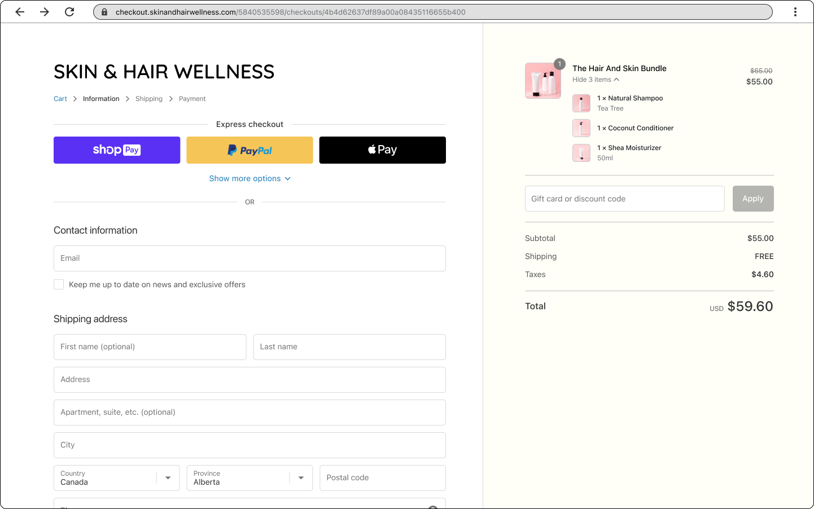

# SPF Custom App Solution Library 1.2 — Giá bán

| Field | Value |
| :---- | :---- |
| Owner | Bắc PV — NodeJS BE Dev Lead |
| Audience | Dev (NodeJS BE) |
| Last reviewed | 2026-11-18 |
| Review cadence | Quarterly |
| Version | v1.0 |
| Linked from | Ref_Dev_spf-custom-app-solution-library_v1.0 |
| Status | Live |

Doc này là mục 1.2 của [SPF Custom App Solution Library](Ref_Dev_spf-custom-app-solution-library_v1.0.md), nghiệp vụ giá bán, combo và giá theo khách. Doc nêu tính năng mặc định của Shopify, các yêu cầu tùy chỉnh kèm giải pháp, và ràng buộc kỹ thuật. Cách đọc các cột và điều kiện chung nằm ở [doc index](Ref_Dev_spf-custom-app-solution-library_v1.0.md).

## 1. Tính năng mặc định

| Tính năng | Mô tả | Giới hạn |
| :---- | :---- | :---- |
| Giá sale | Compare-at price cao hơn price | Trang product và collection không tự hiện mức tiết kiệm của discount |
| B2B | Có trên Basic, Grow, Advanced, Plus. Catalog có % adjustment và fixed price. Quantity rules, tối đa 10 price break mỗi product | 3 catalog đang gán trên Basic, Grow, Advanced; không giới hạn trên Plus. Giá theo ngữ cảnh ở storefront và checkout chỉ có trên Advanced, Plus |
| Markets | Catalog theo market với % adjustment và fixed price theo product | Rounding tự động, không tùy chỉnh được rule. Discount số tiền cố định chỉ tạo bằng tiền tệ mặc định của store |
| Draft order | Giá tùy chỉnh từng line, custom item, custom discount theo line và theo đơn | Không đặt giá tùy chỉnh cho sản phẩm subscription |
| Gift card, store credit | Gift card có trên mọi plan. Store credit dùng trên online store, POS, Shop | Store credit không dùng với legacy customer accounts, không dùng trên draft order, chỉ áp toàn bộ số dư |
| Shopify Bundles | Fixed bundle tối đa 30 component, giá đặt tay | Không dùng với subscription. Custom bundle qua API cần Plus |

## 2. Yêu cầu tùy chỉnh

Cấu hình chung của Discount Function ghi ở [Solution Library 1.1](Ref_Dev_s1.1_spf-solution-discounts_v1.0.md), mục 2. Discount Function trong custom app chỉ chạy trên store Plus. Cột "Ràng buộc / fallback" ghi phương án cho store non-Plus.

| Yêu cầu | Giới hạn mặc định | Giải pháp | Ràng buộc / fallback | Public app |
| :---- | :---- | :---- | :---- | :---- |
| Giá combo: chọn 3 món bất kỳ trong collection giá X, hoặc A+B+C giá cố định | Shopify Bundles: chỉ fixed bundle, dạng 1 product riêng | Cart Transform Function `cart.transform.run`, thao tác `linesMerge` hoặc `lineExpand` kèm điều chỉnh giá. Hoặc Discount Function giảm số tiền cố định, chia trên các line | Mỗi app chỉ 1 cart transform function trên 1 store. Tối đa 150 item sau expand. Line có selling plan: bị từ chối. Non-Plus: Shopify Bundles, hoặc discount theo minimum quantity trên collection | [Bundler](https://apps.shopify.com/bundler-product-bundles). [Shopify Bundles](https://apps.shopify.com/shopify-bundles) (một phần: chỉ fixed bundle, rating 2.9/5, 565 review) |
| Giá sỉ riêng từng khách trên store không phải Plus | B2B có trên Basic, Grow, Advanced. Chỉ 3 catalog đang gán, không gán catalog trực tiếp cho company | Tối đa 3 mức giá: B2B catalog có sẵn. Nhiều hơn: Function theo tag hoặc metafield khách, kèm theme block hiện giá. Hoặc tạo đơn bằng `draftOrderCreate` với `priceOverride` | `lineUpdate` ghi đè giá: chỉ Plus và dev store. Giá theo ngữ cảnh ở storefront: chỉ Advanced, Plus | [BSS B2B Wholesale Pricing](https://apps.shopify.com/b2b-solution-custom-pricing). [Sami B2B Wholesale Pricing](https://apps.shopify.com/wholesale-sami) |
| Làm tròn giá sau giảm (kết thúc bằng ,000) | Rounding: chỉ giá quy đổi theo market, không tùy chỉnh được | Function tính `fixedAmount` để giá sau giảm rơi đúng số tròn. Hoặc đặt fixed price bằng `priceListFixedPricesAdd` | Cách dùng `fixedAmount`: suy ra từ kiểu giá trị API, Shopify không ghi thành tính năng. Cần PoC | [SA Bulk Product Editor & Price](https://apps.shopify.com/bulk-price-editor-sami) (một phần: làm tròn giá khi sửa hàng loạt, không làm tròn kết quả discount) |
| Hiện giá thành viên trên trang product và collection | Theme chỉ hiện discount ở cart. Hiện mức tiết kiệm trên trang product: cần app hoặc code riêng | Theme app extension block dùng Liquid `customer.tags`, `customer.metafields`, `customer.b2b?`. Giá thật vẫn áp bằng Function hoặc discount gắn segment | Block chỉ hiển thị, giá đổi ở cart qua discount. Chưa đăng nhập: `customer` nil | [Regios Automatic Discounts](https://apps.shopify.com/regios-automatic-discounts). [Yagi Automatic Discount Helper](https://apps.shopify.com/yagi-automatic-discount-helper) (một phần) |

Hình 1. Bundle hiển thị ở checkout kèm các component. Nguồn: [About product bundles](https://shopify.dev/docs/apps/build/product-merchandising/bundles).

## 3. Ràng buộc kỹ thuật

Giới hạn và hành vi runtime của Function ghi ở [Solution Library 1.1](Ref_Dev_s1.1_spf-solution-discounts_v1.0.md), mục 3. Các điểm riêng cho giá bán:

- Function không đổi giá trực tiếp. Ghi đè giá là `lineUpdate` của Cart Transform, chỉ có trên Plus và dev store.
- Cart Transform chạy trước discount cho line ở checkout.
- Cart Transform không có giao diện cho merchant. App bật bằng `cartTransformCreate`, mỗi app một function trên mỗi store.
- Form cấu hình bundle ở trang product và variant: target `admin.product-details.configuration.render`, `admin.product-variant-details.configuration.render`.
- Function không hiện giá trên trang product. Đây là việc của theme.

## References

- [Discount Function API](https://shopify.dev/docs/api/functions/latest/discount)
- [Cart Transform Function API](https://shopify.dev/docs/api/functions/latest/cart-transform)
- [B2B plan features](https://help.shopify.com/en/manual/b2b/getting-started/plan-features)

## Changelog

| Date | Version | Change | By |
| :---- | :---- | :---- | :---- |
| 2026-11-18 | v1.0 | Mục 3 thêm cách bật Cart Transform và target cấu hình bundle. Owner duyệt trong chat ngày 2026-11-18. | Bắc PV |
| 2026-11-18 | v1.0 | Bản đầu tiên. Owner duyệt trong chat ngày 2026-11-18. | Bắc PV |
