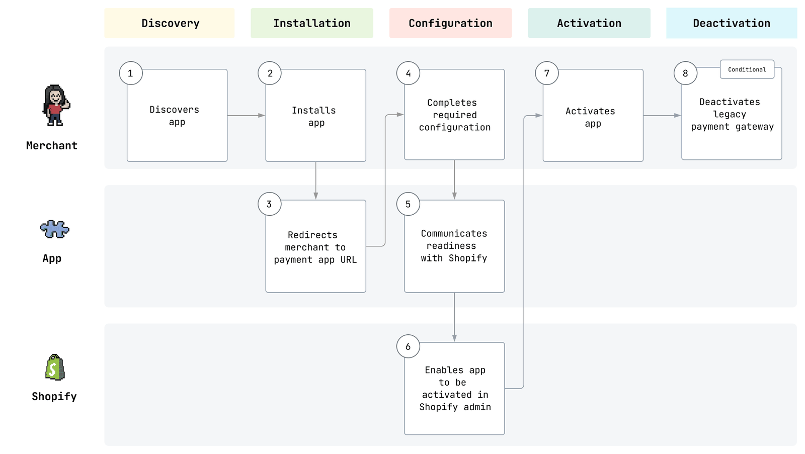
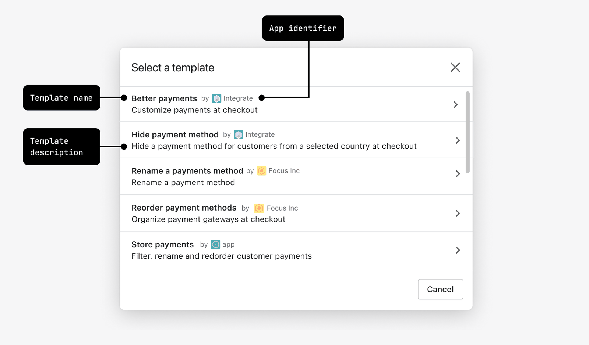
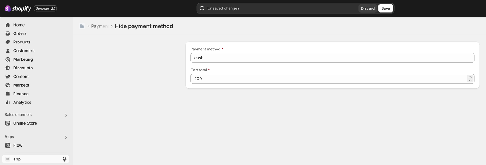

# SPF Custom App Solution Library 2.1 — Phương thức thanh toán

| Field | Value |
| :---- | :---- |
| Owner | Bắc PV — NodeJS BE Dev Lead |
| Audience | Dev (NodeJS BE) |
| Last reviewed | 2026-11-18 |
| Review cadence | Quarterly |
| Version | v1.0 |
| Linked from | Ref_Dev_spf-custom-app-solution-library_v1.0 |
| Status | Live |

Doc này là mục 2.1 của [SPF Custom App Solution Library](Ref_Dev_spf-custom-app-solution-library_v1.0.md), nghiệp vụ phương thức thanh toán, phí và đặt cọc. Doc nêu tính năng mặc định của Shopify, các yêu cầu tùy chỉnh kèm giải pháp, và ràng buộc kỹ thuật. Cách đọc các cột và điều kiện chung nằm ở [doc index](Ref_Dev_spf-custom-app-solution-library_v1.0.md).

## 1. Tính năng mặc định

| Tính năng | Mô tả | Giới hạn / plan |
| :---- | :---- | :---- |
| Thanh toán thủ công | COD, bank deposit, money order, custom. Cài tên, mô tả hiện ở checkout, hướng dẫn hiện ở trang xác nhận | Đơn ở trạng thái chưa thanh toán cho tới khi đánh dấu đã trả. Không có điều kiện hiển thị, không có phí |
| Ẩn, đổi tên, sắp xếp phương thức thanh toán | Không có sẵn, cần app | Custom app dùng Function: chỉ Plus |
| Shopify Payments | Có ở 41 quốc gia | Việt Nam không có trong danh sách |
| Additional fees | Phí cố định theo product, variant hoặc collection, tối đa 100 phí đang bật | Early access. Không theo phương thức thanh toán, không theo %, không theo cả đơn |
| Trả một phần, đặt cọc | Partial payment trên đơn có payment terms, đặt cọc % trên draft order | Chỉ Plus, thao tác trong admin |
| Trả góp | Shop Pay Installments | Chỉ có ở Mỹ, Canada, Anh, Úc. Cần Shopify Payments |
| Draft order | Custom item (kể cả phí), giá tùy chỉnh, gửi invoice kèm link checkout | Mọi plan |

## 2. Yêu cầu tùy chỉnh

Ràng buộc chung, áp cho mọi dòng trong bảng:

- **R1.** Checkout UI extension ở bước information, shipping, payment chỉ có trên Plus. Target ở Thank you, Order status và customer account chạy từ Basic trở lên.
- **R2.** Custom app chứa Function chỉ chạy trên Plus. Public app chứa Function chạy trên mọi plan nhưng phải qua duyệt của Shopify. Vì vậy "public app" là hướng thay thế cho mọi dòng dùng Function.
- **R3.** Extension không ghi được dữ liệu (`applyMetafieldChange`, `applyCartLinesChange`, `applyDiscountCodeChange`) khi khách dùng Apple Pay hoặc Google Pay. Trong Shop Pay, extension chỉ hiện khi merchant bật `Include app in Shop Pay`.

| Yêu cầu | Giới hạn mặc định | Giải pháp (Plus) | Ràng buộc | Fallback (non-Plus) | Public app |
| :---- | :---- | :---- | :---- | :---- | :---- |
| Ẩn COD khi đơn trên một mức, theo tỉnh hoặc theo sản phẩm | Phương thức thủ công: không có điều kiện hiển thị | Payment Customization Function: `paymentMethodHide`, đọc `cart.cost.totalAmount`, `deliveryAddress.provinceCode`, `hasAnyTag`, `inAnyCollection`. Không code: Checkout Blocks | Tối đa 25 payment customization mỗi store. Rule theo địa chỉ: chỉ khớp sau khi khách nhập địa chỉ | Public app | [ACOD: Cash On Delivery COD Fee](https://apps.shopify.com/etp-cod-cash-on-delivery-fee). [Checkout Blocks](https://apps.shopify.com/checkout-blocks) (chỉ Plus) |
| Đổi tên, sắp xếp lại phương thức thanh toán | Cần app | `paymentMethodRename`, `paymentMethodMove` | Không đổi tên được: phương thức hiện bằng logo, wallet, field gift card. Không sắp xếp lại được: wallet | Public app | [HidePay](https://apps.shopify.com/hidepay). [Checkout Blocks](https://apps.shopify.com/checkout-blocks) (chỉ Plus) |
| Thu phí COD | Phương thức thủ công: không có phí. Additional fees: không theo phương thức thanh toán | Shopify không có công cụ chính thức. Cách 1: shipping rate riêng đã cộng phí, Payment Customization chỉ hiện COD khi `selectedDeliveryOption` là rate đó. Cách 2: extension ở `purchase.checkout.payment-method-list.render-after` đọc `selectedPaymentOptions` → thêm sản phẩm phí bằng `applyCartLinesChange` | Cả hai cách: chưa build thử. Cách 2 không ép buộc được: Validation Function không biết phương thức thanh toán đã chọn. R3 | Cách 1 qua public app, hoặc draft order có custom item là phí | [Releasit COD Fee](https://apps.shopify.com/cash-on-delivery-fee). [ACOD: Cash On Delivery COD Fee](https://apps.shopify.com/etp-cod-cash-on-delivery-fee) |
| Đặt cọc, trả một phần | Partial payment, đặt cọc trên draft order: chỉ Plus, thao tác trong admin | `paymentTermsSet` có deposit, hoặc deferred purchase option thu một phần ở checkout | Deferred purchase option: chỉ hỗ trợ Shopify Payments, PayPal Express, Adyen, một phần Stripe. Việt Nam không có Shopify Payments | Bán 1 sản phẩm đặt cọc → draft order cho phần còn lại | [Downpay: Partial Pay & Deposit](https://apps.shopify.com/downpay) (cần Shopify Payments, Stripe, PayPal Express hoặc Adyen). [SPD Split Payment & Deposit](https://apps.shopify.com/split-partial-payments) |
| Hiện thông tin trả góp | Shop Pay Installments: không có ở Việt Nam. Extension không đọc được tên nhà cung cấp, kỳ hạn | Extension chỉ hiện thông tin gần danh sách thanh toán. Trả góp thật: cần payments extension của chính cổng thanh toán | Chỉ hiển thị | Theme block ở trang product hoặc cart | [Fundiin – Buy Now Pay Later](https://apps.shopify.com/fundiin-buy-now-pay-later) (một phần: trả góp tại Việt Nam, chưa có review). [Scala Parcelamento Installment](https://apps.shopify.com/scala-app-parcelamento) (một phần: chỉ hiện ở trang product) |
| Tích hợp cổng thanh toán nội địa: VNPay, MoMo, ZaloPay | Chưa xác nhận các cổng này có sẵn cho store Việt Nam hay chưa | Tự build: cần payments extension. Chỉ Payments Partner được duyệt build được. Chương trình theo lời mời, có thỏa thuận chia doanh thu | Không báo giá như custom app thông thường | Phương thức thủ công, kèm giải pháp VietQR ở dòng dưới | [ZaloPay Payment GateWay](https://apps.shopify.com/zalopay-payment-gateway) (app của ZaloPay: thẻ ATM, QR, ví ZaloPay; chưa có review). [M‑Pay Vietnam Payments](https://apps.shopify.com/mpay-vn) (một phần: kênh thanh toán Việt Nam của 2C2P, không ghi tên ví, chưa có review). Không tìm thấy app VNPay, MoMo |
| Chuyển khoản bằng VietQR, tự xác nhận đã thanh toán | Bank deposit: chỉ hiện hướng dẫn tĩnh, đơn ở trạng thái chưa thanh toán | Phương thức thủ công tùy chỉnh. Block ở Thank you hiện `s-qr-code` kèm mã đơn. Block ở Order status. Thông báo từ ngân hàng → backend → `orderMarkAsPaid`, scope `write_orders` | Extension chỉ biết loại thanh toán, không biết tên phương thức. Dịch vụ báo giao dịch ngân hàng: ngoài Shopify, chưa khảo sát | Từ Basic | Không tìm thấy |
| Ẩn nút express checkout | Không có sẵn | Payment Customization, ẩn theo placement | Chỉ Plus. Shopify cảnh báo: có thể giảm conversion | Không có | [HidePay](https://apps.shopify.com/hidepay). [Payfy: Hide Payment Rules](https://apps.shopify.com/payfy-conditional-payments) |

Hình 1. Vòng đời của payments app, từ cài đặt tới kích hoạt. Nguồn: [Extensions for payments](https://shopify.dev/docs/apps/build/payments).

Hình 2. Hộp thoại chọn Function khi merchant bấm Add a customization ở Settings > Payments. Nguồn: [shopify.dev](https://shopify.dev/docs/apps/build/checkout/payments/ux-for-payments).

Hình 3. Trang cấu hình payment customization của app, mở theo `[extensions.ui.paths]`. Nguồn: [shopify.dev](https://shopify.dev/docs/apps/build/checkout/payments/build-ui).
## 3. Ràng buộc kỹ thuật

Payment Customization Function:

- Thao tác: `paymentMethodHide`, `paymentMethodMove`, `paymentMethodRename`, `paymentTermsSet`, `orderReviewAdd`.
- Chỉ Plus: `paymentTermsSet`, `orderReviewAdd`, ẩn theo placement.
- Input không có discount code khách đã nhập.
- Merchant tạo ở Settings > Payments > Payment customizations > Add a customization. Shopify liệt kê Function của app.
- Bấm vào Function thì mở trang của app theo `[extensions.ui.paths]` (`create`, `details`). Scope `write_payment_customizations`.

Giới hạn của Checkout UI extension và Validation Function ghi ở [Solution Library 2.2](Ref_Dev_s2.2_spf-solution-checkout-fields-validation_v1.0.md), mục 3.

Không hỗ trợ:

- Thêm hoặc sửa phương thức thanh toán từ extension.
- Thu phí theo phương thức thanh toán bằng công cụ chính thức.
- Ghi dữ liệu từ extension khi khách dùng Apple Pay, Google Pay.

## References

- [Payment Customization Function API](https://shopify.dev/docs/api/functions/latest/payment-customization)
- [Payments extensions](https://shopify.dev/docs/apps/build/payments)
- [Manual payments](https://help.shopify.com/en/manual/payments/manual-payments)
- [Checkout UI extensions](https://shopify.dev/docs/api/checkout-ui-extensions/latest) và [danh sách target](https://shopify.dev/docs/api/checkout-ui-extensions/latest/targets)

## Changelog

| Date | Version | Change | By |
| :---- | :---- | :---- | :---- |
| 2026-11-18 | v1.0 | Thêm 2 hình về chỗ merchant cấu hình extension của app. Owner duyệt trong chat ngày 2026-11-18. | Bắc PV |
| 2026-11-18 | v1.0 | Mục 3 thêm chỗ merchant tạo payment customization trong admin. Owner duyệt trong chat ngày 2026-11-18. | Bắc PV |
| 2026-11-18 | v1.0 | Bản đầu tiên. Owner duyệt trong chat ngày 2026-11-18. | Bắc PV |
