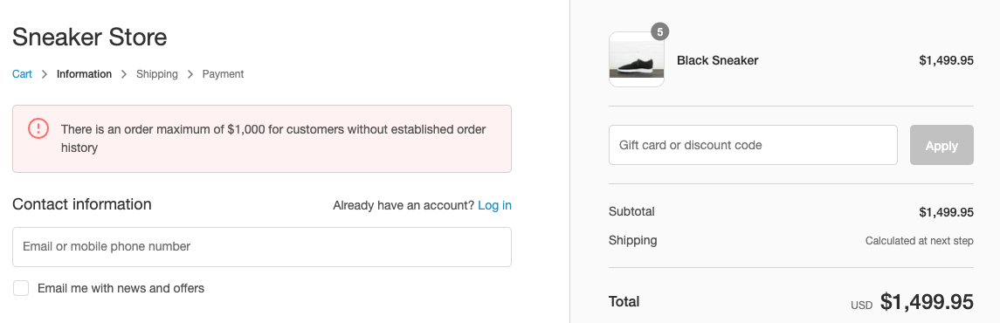
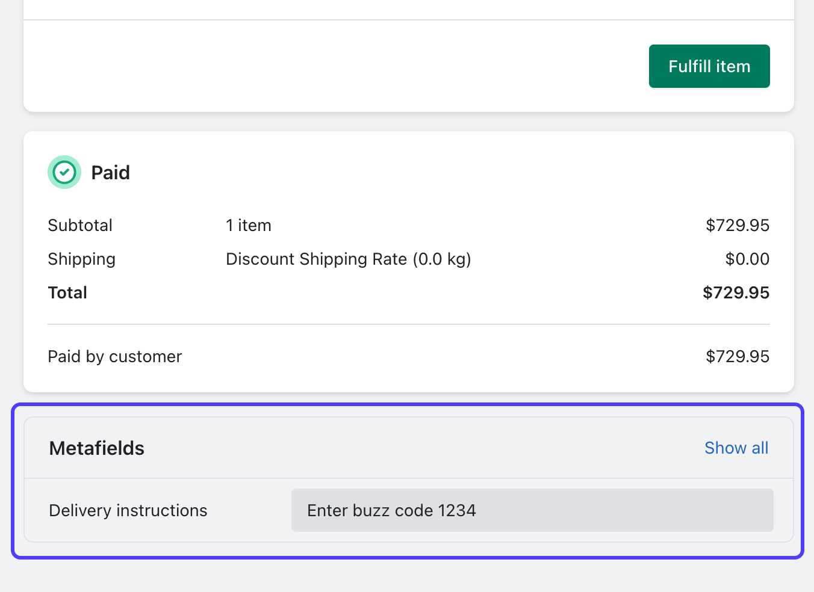
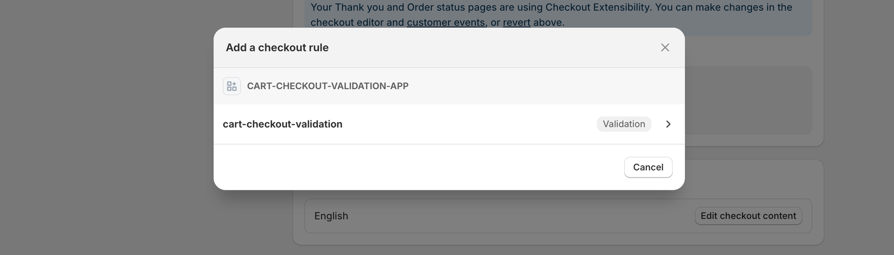
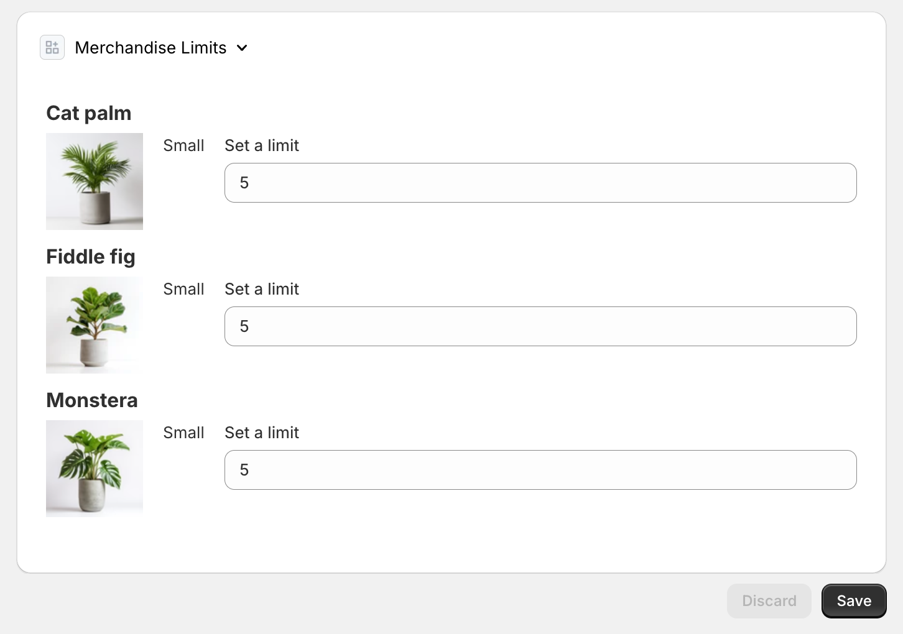

# SPF Custom App Solution Library 2.2 — Field và rule trong checkout

| Field | Value |
| :---- | :---- |
| Owner | Bắc PV — NodeJS BE Dev Lead |
| Audience | Dev (NodeJS BE) |
| Last reviewed | 2026-11-18 |
| Review cadence | Quarterly |
| Version | v1.0 |
| Linked from | Ref_Dev_spf-custom-app-solution-library_v1.0, Ref_Dev_s2.1_spf-solution-payment_v1.0, Ref_Dev_s2.3_spf-solution-checkout-content_v1.0 |
| Status | Live |

Doc này là mục 2.2 của [SPF Custom App Solution Library](Ref_Dev_spf-custom-app-solution-library_v1.0.md), nghiệp vụ field nhập liệu và rule chặn checkout. Doc nêu tính năng mặc định của Shopify, các yêu cầu tùy chỉnh kèm giải pháp, và ràng buộc kỹ thuật. Cách đọc các cột và điều kiện chung nằm ở [doc index](Ref_Dev_spf-custom-app-solution-library_v1.0.md).

## 1. Tính năng mặc định

| Tính năng | Mô tả | Giới hạn / plan |
| :---- | :---- | :---- |
| Thông tin liên hệ | Chọn `Phone number or email` hoặc chỉ `Email` | Bật yêu cầu đăng nhập thì chỉ còn email |
| Yêu cầu đăng nhập | Bật bắt buộc đăng nhập trước khi checkout | Áp cho mọi đơn, không chọn theo sản phẩm hay khách. Nút accelerated checkout biến mất khỏi cart |
| Field địa chỉ | Company, address line 2, số điện thoại giao hàng: ẩn, tùy chọn hoặc bắt buộc | Một cài đặt cho mọi quốc gia. Field theo từng quốc gia cần app và Plus |
| Custom field trong checkout | Text, text area, choice list, date, checkbox, lưu vào order metafield | Mọi loại field: chỉ Plus. Plan khác chỉ có Delivery instructions và Gift message, và hai field này không bắt buộc được |
| Order note | Chỉ có ở trang cart, bật bằng theme setting | — |
| Cart attribute | Input `name="attributes[...]"` trong theme hoặc Ajax `/cart/update.js`. Hiện trên order là `customAttributes` | Checkout bắt đầu từ trang product bỏ qua cart attribute |
| Tipping | Tối đa 3 mức % và một mức tự nhập | — |
| Giới hạn số lượng | Add-to-cart limit: một số tối đa cho mỗi variant trong một cart | Không có giá trị đơn tối thiểu, không giới hạn theo khách |
| Checkout Blocks (app miễn phí của Shopify) | Custom field, payment và delivery customization, giới hạn giá trị đơn, chặn địa chỉ, content block | Đủ tính năng: chỉ Plus. Basic trở lên chỉ có content block ở Thank you và Order status |
| Mã số thuế ở checkout | Shopify tự quyết danh sách quốc gia có field tax ID | Việt Nam không có trong danh sách |

## 2. Yêu cầu tùy chỉnh

Ràng buộc chung, áp cho mọi dòng trong bảng:

- **R1.** Checkout UI extension ở bước information, shipping, payment chỉ có trên Plus. Target ở Thank you, Order status và customer account chạy từ Basic trở lên.
- **R2.** Custom app chứa Function chỉ chạy trên Plus. Public app chứa Function chạy trên mọi plan nhưng phải qua duyệt của Shopify. Vì vậy "public app" là hướng thay thế cho mọi dòng dùng Function.
- **R3.** Extension không ghi được dữ liệu (`applyMetafieldChange`, `applyCartLinesChange`, `applyDiscountCodeChange`) khi khách dùng Apple Pay hoặc Google Pay. Trong Shop Pay, extension chỉ hiện khi merchant bật `Include app in Shop Pay`.
- **R4.** Chặn checkout bằng Validation Function. `useBuyerJourneyIntercept` và `block_progress` đã deprecated từ `2026-07`.
- **R5.** Lưu dữ liệu vào cart metafield, khai báo order metafield definition có `cartToOrderCopyable` để Shopify tự copy sang order. `applyAttributeChange` đã deprecated.

| Yêu cầu | Giới hạn mặc định | Giải pháp (Plus) | Ràng buộc | Fallback (non-Plus) | Public app |
| :---- | :---- | :---- | :---- | :---- | :---- |
| Field xuất hóa đơn VAT: tên công ty, địa chỉ, mã số thuế có kiểm tra | Company name: có sẵn. Field mã số thuế cho Việt Nam: không có, extension không thêm được localized field. Text field có sẵn: chỉ Plus | Extension ở `purchase.checkout.block.render` hoặc `purchase.checkout.contact.render-after`, ghi bằng `applyMetafieldChange` (R5). Validation Function đọc `cart.metafield`, kiểm tra định dạng | Lỗi validation: chỉ gắn vào field có sẵn hoặc `$.cart`. Function không gọi được API ngoài → tra cứu mã số thuế chỉ chạy từ extension qua `network_access`, không chặn được | Theme app block ở trang cart ghi cart attribute. Hoặc block ở Thank you → backend → ghi order metafield | [Fiscal ID: B2B VAT & Tax ID](https://apps.shopify.com/fiscal-id) (một phần: không ghi Việt Nam, field ở checkout chỉ Plus, chưa có review). [Checkout Blocks](https://apps.shopify.com/checkout-blocks) (một phần: chỉ Plus, không kiểm tra mã số thuế) |
| Chọn ngày giao, khung giờ giao | Date field có sẵn: chỉ Plus, không có logic giới hạn số đơn mỗi khung | Extension ở `purchase.checkout.shipping-option-list.render-after`, date picker, lưu theo R5. Giới hạn số đơn mỗi khung: cần backend, gọi qua `network_access` | Bundle extension: tối đa 64 KB. R3 | Theme block ở trang cart, lưu cart attribute | [Zapiet ‑ Pickup + Delivery](https://apps.shopify.com/click-and-collect). [Pickeasy](https://apps.shopify.com/order-delivery-date-time) (widget ở checkout là add-on) |
| Lời nhắn quà tặng, bắt buộc nhập | Gift message có sẵn: mọi plan, không bắt buộc được | Field riêng trong extension, kèm Validation Function | R3 | Field có sẵn, không bắt buộc | [Magical Custom Fields & Upload](https://apps.shopify.com/magical-custom-fields) (field ở checkout: chỉ Plus). [Giftnote](https://apps.shopify.com/giftnote) (một phần: không ghi bắt buộc) |
| Giá trị đơn tối thiểu | Không có sẵn | Checkout Blocks, hoặc Validation Function đọc `cart.cost.subtotalAmount` | Tối đa 25 validation mỗi store. Có chạy: express checkout. Không chạy: đơn subscription định kỳ, POS, Order Edit | Public app | [Melon Minimum Order Quantity](https://apps.shopify.com/watermelon). [Checkout Blocks](https://apps.shopify.com/checkout-blocks) |
| Giới hạn số lượng theo sản phẩm hoặc theo khách | Giới hạn có sẵn: 1 số cho mỗi variant trong 1 cart, không theo khách | Validation Function đọc `lines.quantity`. Mức giới hạn: product metafield. Lịch sử mua: customer metafield, cập nhật bằng webhook `orders/create` | Function không gọi được API ngoài. Guest không có lịch sử, cần bật yêu cầu đăng nhập | Public app | [Avada Order Limits Quantity](https://apps.shopify.com/avada-order-limit). [Melon Minimum Order Quantity](https://apps.shopify.com/watermelon) |
| Chặn mua chung một số sản phẩm | Không có rule sẵn | Validation Function với `hasAnyTag`, `inAnyCollection` | Như dòng giá trị đơn tối thiểu | Public app | [CartGate: Checkout Rules](https://apps.shopify.com/cart-gate) |
| Chặn địa chỉ không hợp lệ, số điện thoại sai | Chỉ kiểm tra ở mức field | Validation Function, lỗi gắn vào `$.cart.deliveryGroups[0].deliveryAddress.address1`, `.phone` hoặc `$.cart.buyerIdentity.phone`. Checkout Blocks: có Address blocker | — | Public app | [King Checkout Validation](https://apps.shopify.com/king-checkout-validation). [Checkout Blocks](https://apps.shopify.com/checkout-blocks) (một phần: chỉ địa chỉ, chỉ Plus) |
| Xác minh tuổi | Không có sẵn. Checkbox có sẵn: không bắt buộc được | Extension có date field hoặc checkbox, lưu theo R5, kèm Validation Function | R3 | App embed block làm age gate ở storefront | [Blockify Age Verification 18+](https://apps.shopify.com/blockify-age-verification) (xác minh ở checkout: chỉ Plus). [NA Age Verification](https://apps.shopify.com/age-checker-3) |
| Bắt đăng nhập chỉ với một số sản phẩm hoặc nhóm khách | Cài đặt có sẵn: áp mọi đơn | Validation Function đọc `buyerIdentity.isAuthenticated`, `customer.hasAnyTag` | — | Cài đặt có sẵn, toàn store | [BSS B2B Lock, Login & Password](https://apps.shopify.com/login-to-access-pages) (chặn checkout: chỉ Plus). [Sami B2B Lock](https://apps.shopify.com/b2b-wholesale-lock-hide-price) (một phần: chỉ khóa ở storefront) |
| Checkbox đồng ý điều khoản, bắt buộc | Checkbox có sẵn: chỉ Plus, không bắt buộc được | Checkbox ở `purchase.checkout.actions.render-before`, lưu theo R5. Validation Function trả lỗi ở `$.cart` | R3, R4 | Checkbox ở trang cart. Checkout bắt đầu từ trang product: bỏ qua checkbox | [TN Term and Condition Checkbox](https://apps.shopify.com/terms-and-conditions-checkbox). [Checkout Blocks](https://apps.shopify.com/checkout-blocks) (chỉ Plus) |
| Custom field lưu vào order metafield | Field có sẵn: chỉ Plus | Field có sẵn, hoặc extension theo R5 | Order metafield definition phải trùng namespace, key với cart metafield | Cart attribute → webhook `orders/create` → backend ghi order metafield | [Checkout Blocks](https://apps.shopify.com/checkout-blocks) (một phần: chỉ Plus). [Magical Custom Fields & Upload](https://apps.shopify.com/magical-custom-fields) (một phần: field ở checkout chỉ Plus) |

Hình 1. Lỗi của Validation Function hiện ở đầu checkout. Nguồn: [Create checkout validation](https://shopify.dev/docs/apps/build/checkout/cart-checkout-validation/create-checkout-validation).

Hình 2. Giá trị custom field lưu thành metafield ở trang order. Nguồn: [Add a field to checkout](https://shopify.dev/docs/apps/build/checkout/fields-banners/add-field).

Hình 3. Hộp thoại Add a checkout rule ở Settings > Checkout. Nguồn: [shopify.dev](https://shopify.dev/docs/apps/build/checkout/cart-checkout-validation/create-admin-ui-validation).

Hình 4. Form cài đặt của Validation Function ở target `admin.settings.validation.render`. Nguồn: [shopify.dev](https://shopify.dev/docs/apps/build/checkout/cart-checkout-validation/create-admin-ui-validation).
## 3. Ràng buộc kỹ thuật

Checkout UI extension ở version `2026-10`:

- Chạy trong Web Worker, không có DOM, không đọc được HTML của checkout và dữ liệu thanh toán. Chỉ render component do Shopify cung cấp, không ghi đè CSS.
- UI dùng Polaris web components, code mẫu import `@shopify/ui-extensions/preact`.
- Bundle tối đa 64 KB, kiểm tra lúc deploy.
- Gọi API ngoài cần `network_access = true` và xin trong Dev Dashboard, được duyệt tự động. Server phải cho phép CORS từ mọi origin.
- Block target do merchant tự đặt vị trí, tối đa 3 mỗi vùng: `purchase.checkout.block.render`, `purchase.thank-you.block.render`, `customer-account.order-status.block.render`.
- Static target gắn cố định vào một phần của checkout. Phần đó bị ẩn thì extension không render.
- `applyMetafieldChange` ghi cart metafield, chỉ dùng được ở target `purchase.checkout`.
- Khai báo `owner_type` cho metafield trong TOML là bắt buộc từ `2027-01`.
- `[extensions.settings]`: tối đa 20 setting, merchant cấu hình trong checkout editor.

Validation Function:

- Tối đa 25 mỗi store. Function lỗi thì checkout vẫn chạy tiếp, trừ khi đặt `blockOnFailure`.
- Lỗi hiện ở field có sẵn được chỉ định hoặc ở `$.cart`. Không gắn lỗi vào custom field được.
- Form cài đặt là Admin UI extension, target `admin.settings.validation.render`, nối với Function bằng `[extensions.ui] handle`.
- Merchant thêm rule ở Settings > Checkout > Checkout rules > Add rule.
- Chạy với Shop Pay, PayPal, Google Pay, Apple Pay và draft order. Không chạy với đơn subscription định kỳ, pre-order, POS, Create Order API, Order Edit.

Lịch deprecation:

- `checkout.liquid` ở bước information, shipping, payment ngừng từ 2024-08-13.
- `checkout.liquid` và additional scripts ở Thank you, Order status ngừng từ 2025-08-28. Hạn nâng cấp cho store không phải Plus là 2026-08-26.

Checkout không hỗ trợ:

- CSS, HTML tùy ý hoặc truy cập DOM.
- Thêm field tax ID kiểu localized field.
- Ghi dữ liệu từ extension khi khách dùng Apple Pay, Google Pay.

## References

- [Checkout UI extensions](https://shopify.dev/docs/api/checkout-ui-extensions/latest) và [danh sách target](https://shopify.dev/docs/api/checkout-ui-extensions/latest/targets)
- [Checkout capabilities](https://shopify.dev/docs/apps/build/checkout/capabilities)
- [Cart and Checkout Validation Function API](https://shopify.dev/docs/api/functions/latest/cart-and-checkout-validation)
- [Metafield capabilities](https://shopify.dev/docs/apps/build/metafields/use-metafield-capabilities)
- [Checkout custom fields](https://help.shopify.com/en/manual/checkout-settings/customize-checkout-configurations/custom-fields)
- [Checkout Blocks](https://help.shopify.com/en/manual/checkout-settings/checkout-blocks)

## Changelog

| Date | Version | Change | By |
| :---- | :---- | :---- | :---- |
| 2026-11-18 | v1.0 | Thêm 2 hình về chỗ merchant cấu hình extension của app. Owner duyệt trong chat ngày 2026-11-18. | Bắc PV |
| 2026-11-18 | v1.0 | Mục 3 thêm setting của Checkout UI extension và form cài đặt của Validation Function. Owner duyệt trong chat ngày 2026-11-18. | Bắc PV |
| 2026-11-18 | v1.0 | Bản đầu tiên. Owner duyệt trong chat ngày 2026-11-18. | Bắc PV |
