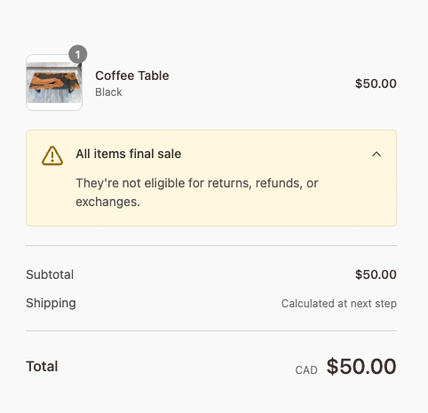
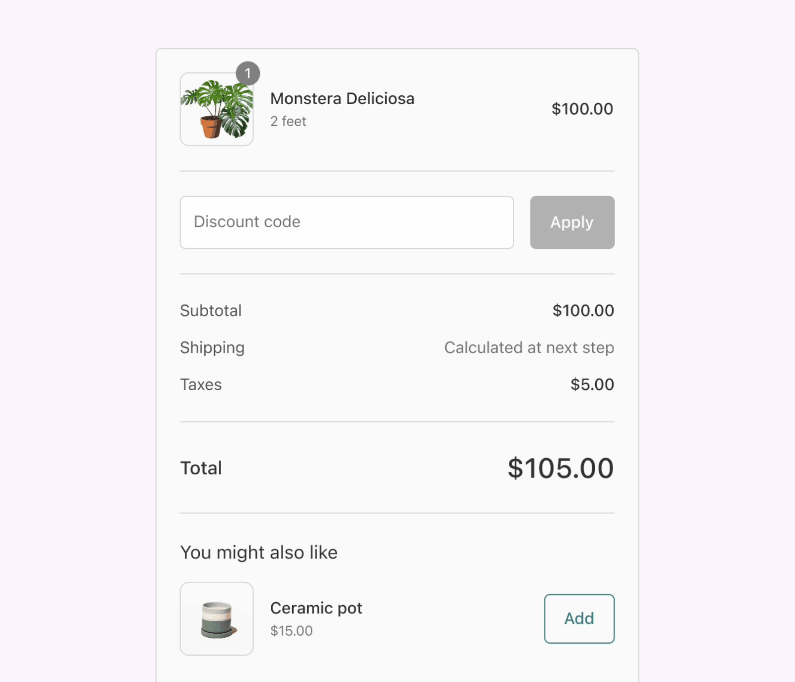
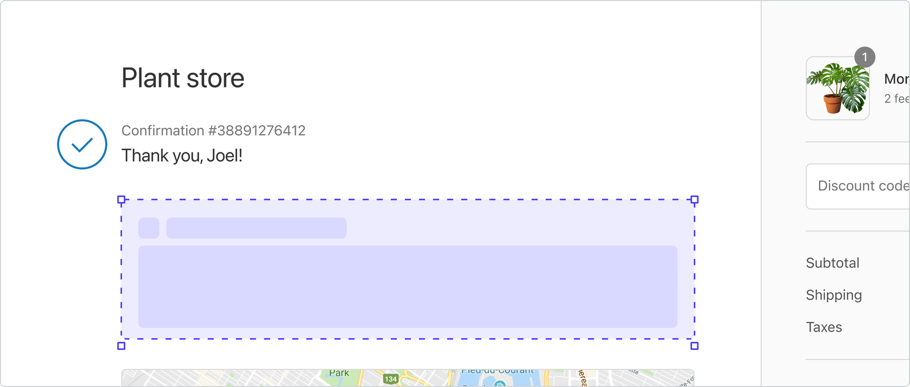

# SPF Custom App Solution Library 2.3 — Nội dung checkout và trang Thank you

| Field | Value |
| :---- | :---- |
| Owner | Bắc PV — NodeJS BE Dev Lead |
| Audience | Dev (NodeJS BE) |
| Last reviewed | 2026-11-18 |
| Review cadence | Quarterly |
| Version | v1.0 |
| Linked from | Ref_Dev_spf-custom-app-solution-library_v1.0 |
| Status | Live |

Doc này là mục 2.3 của [SPF Custom App Solution Library](Ref_Dev_spf-custom-app-solution-library_v1.0.md), nghiệp vụ upsell, nội dung trong checkout và trang Thank you, Order status. Doc nêu tính năng mặc định của Shopify, các yêu cầu tùy chỉnh kèm giải pháp, và ràng buộc kỹ thuật. Cách đọc các cột và điều kiện chung nằm ở [doc index](Ref_Dev_spf-custom-app-solution-library_v1.0.md).

## 1. Tính năng mặc định

| Tính năng | Mô tả | Giới hạn / plan |
| :---- | :---- | :---- |
| Giao diện checkout | Logo, màu, font, layout một trang hoặc ba trang | Corner radius, custom font, favicon chỉnh qua API, chỉ Plus. Không có CSS hay HTML tùy ý |
| App trong checkout | Bước information, shipping, payment | Chỉ Plus |
| App ở Thank you, Order status | Tối đa 3 app mỗi vùng | Basic trở lên |
| Thank you, Order status | Branding, nút Buy again, app block | Basic trở lên |

## 2. Yêu cầu tùy chỉnh

Ràng buộc chung, áp cho mọi dòng trong bảng:

- **R1.** Checkout UI extension ở bước information, shipping, payment chỉ có trên Plus. Target ở Thank you, Order status và customer account chạy từ Basic trở lên.
- **R2.** Custom app chứa Function chỉ chạy trên Plus. Public app chứa Function chạy trên mọi plan nhưng phải qua duyệt của Shopify. Vì vậy "public app" là hướng thay thế cho mọi dòng dùng Function.
- **R3.** Extension không ghi được dữ liệu (`applyMetafieldChange`, `applyCartLinesChange`, `applyDiscountCodeChange`) khi khách dùng Apple Pay hoặc Google Pay. Trong Shop Pay, extension chỉ hiện khi merchant bật `Include app in Shop Pay`.

| Yêu cầu | Giới hạn mặc định | Giải pháp (Plus) | Ràng buộc | Fallback (non-Plus) | Public app |
| :---- | :---- | :---- | :---- | :---- | :---- |
| Upsell, cross-sell trong checkout | Không có block sẵn | Extension ở `purchase.checkout.block.render` hoặc `purchase.checkout.cart-line-list.render-after`. Thêm sản phẩm: `applyCartLinesChange`. Lấy sản phẩm: Storefront API qua `api_access` | Không ghi đè giá được. R3. Post-purchase extension, lựa chọn khác trên Plus: beta, phải xin quyền, không hiện với COD, chuyển khoản | Block ở trang Thank you. Post-purchase extension trong custom app: chỉ cài được trên Plus | [One Click Upsell ‑ Zipify OCU](https://apps.shopify.com/zipify-oneclickupsell). [UpsellPlus](https://apps.shopify.com/upsellpluscheckout). Upsell trong checkout: chỉ Plus |
| Cho khách chọn quà tặng | Không có sẵn | Extension thêm variant khách chọn → Discount Function làm quà miễn phí | R3 | Theme block ở trang cart | [EG Auto Add to Cart Free Gift](https://apps.shopify.com/gifter-cart-auto-include). [Monk Free Gift with Purchase](https://apps.shopify.com/monk-free-gift-with-purchase) |
| Banner, trust badge, ghi chú vận chuyển trong checkout | Editor: chỉ logo, màu, font | Static target như `purchase.checkout.header.render-after`, `purchase.checkout.shipping-option-list.render-before` | Tối đa 3 app mỗi vùng. Không ghi đè CSS | Content block Checkout Blocks ở Thank you, Order status | [Checkout Blocks](https://apps.shopify.com/checkout-blocks) (block trong checkout: chỉ Plus). [SMART Checkout Upsells & Rules](https://apps.shopify.com/smart-checkout-rules) (một phần) |
| Đổi điểm thưởng ở checkout | Không có sẵn | Extension ở `purchase.checkout.reductions.render-after` → backend tạo discount code → `applyDiscountCodeChange` | R3 | Đổi điểm ở trang cart hoặc trang tài khoản, nhận discount code | [BON Loyalty](https://apps.shopify.com/bon-loyalty-rewards). [Joy Loyalty](https://apps.shopify.com/joyio). Đổi điểm trong checkout: chỉ Plus hoặc gói cao nhất |
| Khảo sát ở trang Thank you | Không có sẵn | Target `purchase.thank-you.block.render`, `customer-account.order-status.block.render`. Câu trả lời: lưu backend hoặc metafield | Thank you: order có thể chưa tạo xong, chỉ có ID | Từ Basic | [Grapevine Post Purchase Survey](https://apps.shopify.com/grapevine). [SEA Post Purchase Survey Quiz](https://apps.shopify.com/sea-survey) |
| Tải hóa đơn ở trang Order status | Buy again: có sẵn. Tải hóa đơn: không có sẵn | Target `customer-account.order.action.menu-item.render` kèm `customer-account.order.action.render`, hoặc `customer-account.order-status.block.render`. Backend tạo file PDF | Bundle: tối đa 64 KB | Từ Basic | [MS Order Printer ‑ PDF Invoice](https://apps.shopify.com/ms-order-printers). [Account & Checkout Blocks](https://apps.shopify.com/surecust-extensions-blocks) (một phần) |
| Đổi giao diện checkout nhiều hơn editor | Chỉ lựa chọn của editor | `checkoutAndAccountsConfigurationUpdate`, scope `write_checkout_and_accounts_configurations` | Không CSS, HTML tùy ý. Không style riêng từng trang | Không có | [Checkout Plus](https://apps.shopify.com/checkoutplus) (một phần: chỉ Plus). [Checkout Extensions Pro](https://apps.shopify.com/checkout-extensions-pro) (một phần: chỉ Plus) |

Hình 1. Banner tùy chỉnh trong checkout. Nguồn: [About custom banners and fields](https://shopify.dev/docs/apps/build/checkout/fields-banners).

Hình 2. Block gợi ý sản phẩm trong checkout. Nguồn: [Build a pre-purchase product offer checkout UI extension](https://shopify.dev/docs/apps/build/checkout/product-offers/build-a-pre-purchase-offer).

Hình 3. Vị trí block khảo sát ở trang Thank you. Nguồn: [Add a survey to Thank you and Order status pages](https://shopify.dev/docs/apps/build/checkout/thank-you-order-status/add-survey).

## 3. Ràng buộc kỹ thuật

Giới hạn của Checkout UI extension ghi ở [Solution Library 2.2](Ref_Dev_s2.2_spf-solution-checkout-fields-validation_v1.0.md), mục 3.

Không hỗ trợ:

- CSS, HTML tùy ý hoặc truy cập DOM.
- Sửa order từ extension ở Thank you, Order status.
- Dùng theme app extension trong checkout.

## References

- [Checkout UI extensions](https://shopify.dev/docs/api/checkout-ui-extensions/latest) và [danh sách target](https://shopify.dev/docs/api/checkout-ui-extensions/latest/targets)
- [Thank you và Order status](https://shopify.dev/docs/apps/build/checkout/thank-you-order-status)
- [Checkout capabilities](https://shopify.dev/docs/apps/build/checkout/capabilities)

## Changelog

| Date | Version | Change | By |
| :---- | :---- | :---- | :---- |
| 2026-11-18 | v1.0 | Bản đầu tiên. Owner duyệt trong chat ngày 2026-11-18. | Bắc PV |
