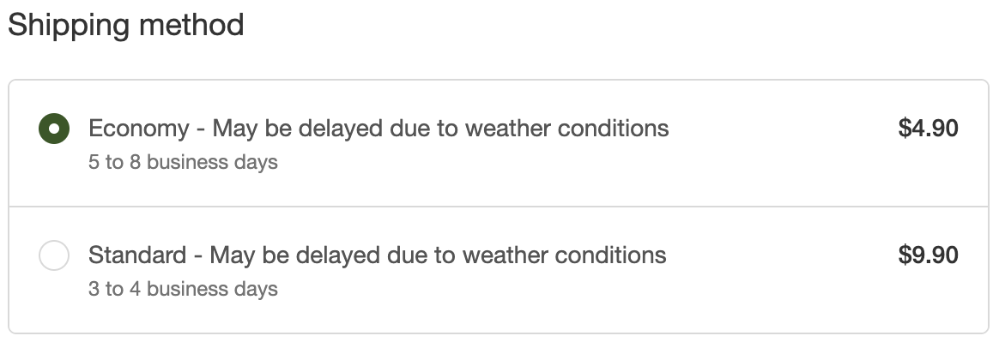
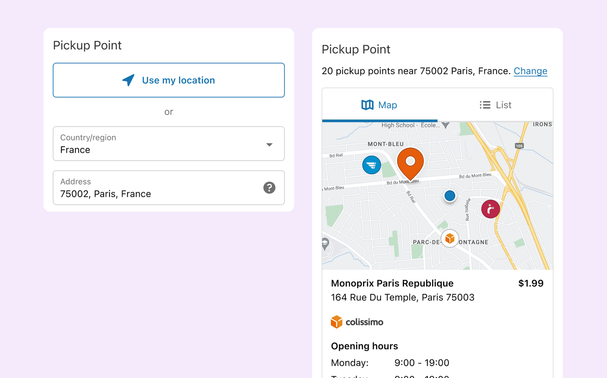
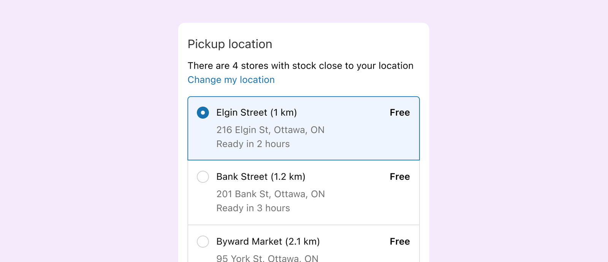

# SPF Custom App Solution Library 3.1 — Phí ship và phương thức giao

| Field | Value |
| :---- | :---- |
| Owner | Bắc PV — NodeJS BE Dev Lead |
| Audience | Dev (NodeJS BE) |
| Last reviewed | 2026-11-18 |
| Review cadence | Quarterly |
| Version | v1.0 |
| Linked from | Ref_Dev_spf-custom-app-solution-library_v1.0 |
| Status | Live |

Doc này là mục 3.1 của [SPF Custom App Solution Library](Ref_Dev_spf-custom-app-solution-library_v1.0.md), nghiệp vụ phí ship, phương thức giao và địa chỉ. Doc nêu tính năng mặc định của Shopify, các yêu cầu tùy chỉnh kèm giải pháp, và ràng buộc kỹ thuật. Cách đọc các cột và điều kiện chung nằm ở [doc index](Ref_Dev_spf-custom-app-solution-library_v1.0.md).

## 1. Tính năng mặc định

| Tính năng | Mô tả | Giới hạn / plan |
| :---- | :---- | :---- |
| Shipping zone | Nhóm quốc gia hoặc vùng. Qua API, zone gồm quốc gia và tỉnh | Không chia tới quận, phường hay postal code. Một vùng chỉ thuộc một zone |
| Shipping profile | Một profile chung và các profile riêng. Loại được một location khỏi profile | Tối đa 99 profile riêng. Một product hoặc variant chỉ thuộc một profile |
| Rate | Flat rate, bậc theo giá trị đơn, bậc theo cân nặng. Miễn phí là rate giá 0 | Cart có sản phẩm từ nhiều profile: rate cùng tên được cộng lại |
| Carrier-calculated shipping (CCS) | Rate thời gian thực từ tài khoản hãng vận chuyển hoặc carrier service của app | Advanced và Plus. Grow phải trả thêm phí hoặc trả theo năm |
| Backup rate | Hiện khi mọi rate từ app, hãng vận chuyển đều lỗi | — |
| Local delivery | Theo bán kính hoặc danh sách postal code của từng location, có giá trị đơn tối thiểu | Bán kính tối đa 160 km. 10 zone mỗi location. Cả cart phải xuất từ một location. Không dùng cho B2B |
| Local pickup | Bật theo location, có thời gian chuẩn bị hàng | Không có chọn khung giờ. Cả đơn phải có hàng tại location đó |
| Pickup point | Có sẵn cho một số hãng ở châu Âu | Trường hợp khác chỉ làm được bằng custom app trên Plus |
| Ngày giao dự kiến | Ngày tự động hoặc ngày đặt tay, hiện ở checkout | Chỉ có ở một số nước, không có Việt Nam. Không hiện cho rate của app bên thứ ba |
| Free shipping | Rate giá 0, hoặc free shipping discount theo quốc gia, giá trị tối thiểu, segment | — |
| Ẩn, đổi tên, sắp xếp phương thức giao | Qua app Checkout Blocks, 27 loại rule gồm tổng cart, tag khách, tỉnh, giờ của store | Chỉ Plus. Tối đa 25 customization đang bật tính trên mọi app |
| Form địa chỉ | Autocomplete ở 23 nước, validation ở 20 nước | Việt Nam không có trong các danh sách này. Địa chỉ không có field quận, phường |

## 2. Yêu cầu tùy chỉnh

Custom app chứa Function chỉ chạy trên Plus. Carrier Service API không phải Function, nên chạy trên mọi store có CCS.

| Yêu cầu | Giới hạn mặc định | Giải pháp | Ràng buộc / fallback | Public app |
| :---- | :---- | :---- | :---- | :---- |
| Phí ship thời gian thực từ GHN, GHTK, Viettel Post, J&T theo quận, phường | Zone: chỉ chia tới tỉnh. Shopify không hỗ trợ sẵn hãng Việt Nam | Carrier Service API: callback app → API tính phí hãng | Cần CCS. Callback chỉ nhận `address1`, `address2`, `city`, `zip`, `province`, `country` → quận, phường phải tách từ field đó. Không có CCS: flat rate theo tỉnh | Không tìm thấy |
| Bảng phí ship theo tỉnh, quận | Theo tỉnh: có sẵn. Theo quận: không | Carrier Service đọc bảng phí app | Không có CCS: nhiều flat rate, Delivery Customization ẩn rate không khớp. Chưa xác nhận Function nhận được địa chỉ khi dùng rate có sẵn | [SMART Shipping Rates & Rules](https://apps.shopify.com/smart-shipping-rates-rules) (một phần: rate theo zip, zone theo tỉnh, cần CCS). [ShipX](https://apps.shopify.com/shipping-rates) (một phần: theo postcode, city, khoảng cách) |
| Ẩn, đổi tên, sắp xếp phương thức giao theo sản phẩm, tag khách, tổng đơn, địa chỉ | Rate có sẵn: chỉ điều kiện theo giá, cân nặng | Delivery Customization Function, bật bằng `deliveryCustomizationCreate`. Trên Plus: Checkout Blocks, không cần code | Tối đa 25 đang bật. Không đổi được giá. Có CCS: carrier service chỉ trả rate được phép, request có tag khách, tổng đơn | [Checkout Blocks](https://apps.shopify.com/checkout-blocks) (chỉ Plus). [Shipy](https://apps.shopify.com/shipfy-delivery-customization) |
| Ẩn giao nhanh với hàng cồng kềnh | Như dòng trên | Delivery Customization đọc cân nặng hoặc metafield product | Mọi plan: shipping profile riêng cho hàng cồng kềnh, chỉ rate thường | [Shipy](https://apps.shopify.com/shipfy-delivery-customization). [ShipX](https://apps.shopify.com/shipping-rates) |
| Free shipping chỉ cho thành viên | Có sẵn một phần: automatic free shipping discount gắn segment | Rule phức tạp hơn: Discount Function target `cart.delivery-options.discounts.generate.run` | Non-Plus: discount gắn segment, hoặc carrier service trả giá 0 cho khách có tag | [Free Shipping Discounts ‑ SC](https://apps.shopify.com/etp-shipping-discount-offer). [RM: Advanced Free Shipping](https://apps.shopify.com/better-free-shipping) |
| Chọn ngày giao, khung giờ, giới hạn số đơn mỗi khung | Ngày giao: chỉ hiển thị | Plus: Checkout UI extension ở `purchase.checkout.shipping-option-list.render-after` → lưu bằng `applyMetafieldChange`. Số đơn mỗi khung: quản lý ở backend app | Function không gọi được API ngoài → không ép được giới hạn trong Function. Non-Plus: theme app extension ở trang cart ghi cart attribute | [Zapiet ‑ Pickup + Delivery](https://apps.shopify.com/click-and-collect). [Pickeasy](https://apps.shopify.com/order-delivery-date-time) (giới hạn đơn mỗi khung giờ; widget ở checkout là add-on) |
| Giờ chốt đơn giao trong ngày | Không có sẵn | Delivery Customization ẩn lựa chọn giao trong ngày bằng `shop.localTime.timeAfter`. Trên Plus: Checkout Blocks có rule theo giờ store | Function không đọc được giờ bằng cách khác | [Zapiet ‑ Pickup + Delivery](https://apps.shopify.com/click-and-collect). [Pickeasy](https://apps.shopify.com/order-delivery-date-time) (một phần: cut-off time, không ghi same-day) |
| Nhận tại cửa hàng có đặt khung giờ | Chỉ có thời gian chuẩn bị hàng | Plus: Checkout UI extension ở `purchase.checkout.pickup-location-list.render-after`. Thu phí pickup: Local Pickup Delivery Option Generator | Generator này: chỉ API `unstable`, chỉ custom app trên Plus. Non-Plus: chọn khung giờ ở trang cart | [Zapiet ‑ Pickup + Delivery](https://apps.shopify.com/click-and-collect). [Pickeasy](https://apps.shopify.com/order-delivery-date-time) |
| Nhận hàng tại locker, điểm nhận hãng vận chuyển | Hãng có sẵn: chỉ châu Âu | Pickup Point Delivery Option Generator có fetch target | Chỉ API `unstable`, chỉ custom app trên Plus hoặc dev store. Non-Plus: không làm được trong checkout | [Globe Pickup Points & Shipping](https://apps.shopify.com/globe) (một phần: không có hãng Việt Nam; chọn trong checkout chỉ Plus). [PickupBird](https://apps.shopify.com/pickupbird-pickup-delivery) (một phần: chỉ hãng châu Âu) |
| Phụ phí vùng xa, hàng dễ vỡ | Không Function nào tăng được phí ship | Carrier Service cộng phụ phí vào `total_price` | Không có CCS: shipping profile riêng cho hàng dễ vỡ với rate cao hơn, hoặc zone theo tỉnh với rate cao hơn | [ShipX](https://apps.shopify.com/shipping-rates) (rule nâng cao cần CCS). [Upcharge](https://apps.shopify.com/product-fees) (một phần: phí theo shipping method chỉ Plus) |
| Chặn giao tới một số khu vực | Bỏ tỉnh khỏi mọi zone → chặn được tỉnh đó, không chia nhỏ hơn | Validation Function trả lỗi ở field địa chỉ giao. Hoặc carrier service trả mảng rỗng | Carrier service: chạy trên Advanced, Grow có CCS | [DS Address Validation / Block](https://apps.shopify.com/validify). [Shipy](https://apps.shopify.com/shipfy-delivery-customization) (một phần) |
| Dropdown tỉnh, quận, phường, chuẩn hóa địa chỉ Việt Nam | `MailingAddress` không có field quận, phường | Plus: Checkout UI extension ở `purchase.checkout.delivery-address.render-before` → ghi bằng `applyShippingAddressChange`. Kèm Validation Function kiểm tra định dạng | Cần protected customer data level 2. Không ghi được địa chỉ khi khách dùng Apple Pay, Google Pay. Non-Plus: dropdown ở trang cart lưu cart attribute | [Viecheckout: Vietnam Address](https://apps.shopify.com/meowcart-checkout-local) (2 review). [Vietnam Address Assistant](https://apps.shopify.com/vietnam-address-assistant) (một phần: xác nhận ở trang Thank you, chưa có review) |
| Hiện ngày giao dự kiến trên trang product | Ngày giao: chỉ hiện ở checkout | App block của theme app extension gọi backend app | Mọi plan | [Essent Estimated Delivery Date](https://apps.shopify.com/essential-estimated-delivery). [S Estimated Delivery Date Plus](https://apps.shopify.com/omega-estimated-shipping-date) |

Hình 1. Delivery Customization đổi tên phương thức giao. Nguồn: [Build the delivery options function](https://shopify.dev/docs/apps/build/checkout/delivery-shipping/delivery-options/build-function).

Hình 2. Khách chọn pickup point ở checkout. Nguồn: [About delivery and shipping functions](https://shopify.dev/docs/apps/build/checkout/delivery-shipping).

Hình 3. Khách chọn cửa hàng nhận hàng ở checkout. Nguồn: [About delivery and shipping functions](https://shopify.dev/docs/apps/build/checkout/delivery-shipping).

## 3. Ràng buộc kỹ thuật

Carrier Service API:

- Đăng ký bằng `carrierServiceCreate`, scope `write_shipping`.
- Từ API `2026-10`, tạo carrier service chỉ đăng ký service. Rate phải được thêm vào shipping profile bằng tay hoặc bằng `deliveryProfileUpdate`.
- Request gồm origin, destination, danh sách item (`grams`, `price`, `sku`, `properties`), tiền tệ, tổng đơn, `customer.id` và `customer.tags`. Không có cart attribute.
- Shopify gửi request riêng cho từng location xuất hàng hoặc từng shipping profile.
- Response trả `rates[]` với `service_name`, `service_code`, `currency`, `total_price`. `total_price` tính theo đơn vị nhỏ nhất, nhân 100 kể cả với tiền tệ không có đơn vị lẻ. Áp dụng điều này cho VND là suy luận, cần thử.
- Mảng rỗng nghĩa là service không có rate. Lỗi 4xx, 5xx thì Shopify dùng backup rate, không retry.
- Timeout theo số request mỗi phút của shop: dưới 1.500 là 10 giây, 1.500–3.000 là 5 giây, trên 3.000 là 3 giây.
- Shopify cache kết quả 15 phút khi thành công, 30 giây khi lỗi. Cache key không gồm tag khách và tổng đơn.

Delivery Customization Function:

- Target `cart.delivery-options.transform.run`. Thao tác `deliveryOptionHide`, `deliveryOptionMove`, `deliveryOptionRename`.
- Scope `write_delivery_customizations`. Tối đa 25 đang bật mỗi store.
- Không đổi được giá, không thêm được lựa chọn.
- Apple Pay, Google Pay chỉ cung cấp quốc gia, tỉnh, thành phố, zip trước khi khách xác nhận.
- Không chạy với đơn subscription định kỳ và draft order tạo trong admin.

Thay đổi sắp tới:

- "Shipping options by market" thay cho profile và rate, mở cho merchant tự bật từ 2026-10-01, áp cho mọi shop từ 2027-07-01. Khi shop đã chuyển, zone và rate trong delivery profile cũ bị bỏ qua ở checkout. Kiểm tra `shop.features.marketDrivenShipping`.

## References

- [DeliveryCarrierService](https://shopify.dev/docs/api/admin-graphql/latest/objects/DeliveryCarrierService)
- [Delivery Customization Function API](https://shopify.dev/docs/api/functions/latest/delivery-customization)
- [Delivery và shipping trong checkout](https://shopify.dev/docs/apps/build/checkout/delivery-shipping)
- [Carrier service không còn tự thêm vào shipping profile](https://shopify.dev/changelog/posts/carrier-services-will-no-longer-be-automatically-added-to-the-default-shipping-profile)
- [Third-party carrier-calculated shipping](https://help.shopify.com/en/manual/fulfillment/setup/shipping-rates/third-party-carrier-calculated-shipping)
- [Shipping profiles](https://help.shopify.com/en/manual/fulfillment/setup/shipping-profiles)

## Changelog

| Date | Version | Change | By |
| :---- | :---- | :---- | :---- |
| 2026-11-18 | v1.0 | Bản đầu tiên. Owner duyệt trong chat ngày 2026-11-18. | Bắc PV |
