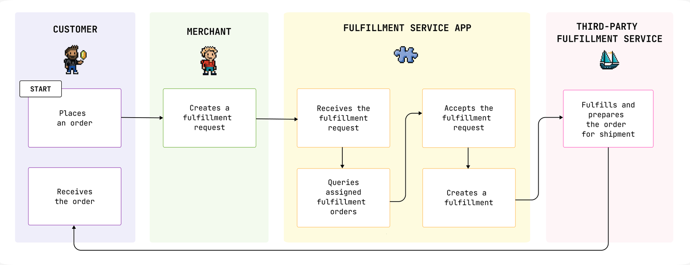
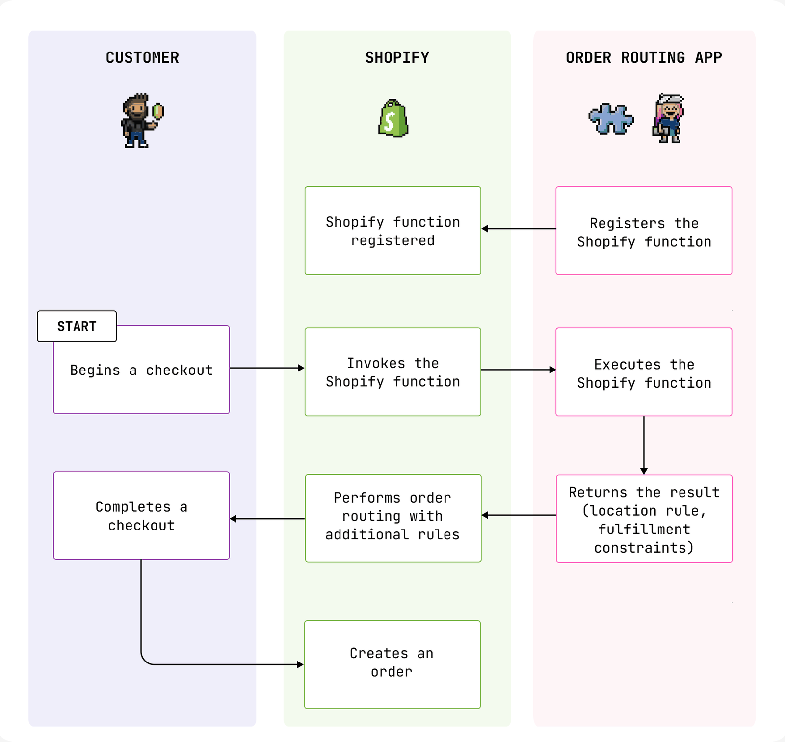

# SPF Custom App Solution Library 3.2 — Fulfillment và kho

| Field | Value |
| :---- | :---- |
| Owner | Bắc PV — NodeJS BE Dev Lead |
| Audience | Dev (NodeJS BE) |
| Last reviewed | 2026-11-18 |
| Review cadence | Quarterly |
| Version | v1.0 |
| Linked from | Ref_Dev_spf-custom-app-solution-library_v1.0 |
| Status | Live |

Doc này là mục 3.2 của [SPF Custom App Solution Library](Ref_Dev_spf-custom-app-solution-library_v1.0.md), nghiệp vụ fulfillment, chọn kho và vận đơn. Doc nêu tính năng mặc định của Shopify, các yêu cầu tùy chỉnh kèm giải pháp, và ràng buộc kỹ thuật. Cách đọc các cột và điều kiện chung nằm ở [doc index](Ref_Dev_spf-custom-app-solution-library_v1.0.md).

## 1. Tính năng mặc định

| Tính năng | Mô tả | Giới hạn / plan |
| :---- | :---- | :---- |
| Location | Tồn kho nhiều location | Starter 2, Basic đến Advanced 10, Plus 200 |
| Order routing | Rule mặc định: ít tách đơn nhất, trong market đích, location gần nhất. Tùy chọn: xếp hạng location, theo metafield của location | Rule riêng từ app: chỉ Plus, early access |
| Fulfillment | Thủ công, tự động, fulfill một phần, tách fulfillment, đổi location | Fulfill tự động không áp cho đơn pickup |
| Shipping label | Mua trong admin | Location phải ở Mỹ, Canada, Úc, Anh và một số nước châu Âu. Không có Việt Nam |
| Tách shipment ở checkout | Shopify tự tách theo location, profile, pre-order | Khách không chọn được cách tách |

## 2. Yêu cầu tùy chỉnh

Custom app chứa Function chỉ chạy trên Plus. Carrier Service API không phải Function, nên chạy trên mọi store có CCS.

| Yêu cầu | Giới hạn mặc định | Giải pháp | Ràng buộc / fallback | Public app |
| :---- | :---- | :---- | :---- | :---- |
| Chọn kho xuất theo rule riêng | Có sẵn: location gần nhất, xếp hạng ưu tiên, rule theo metafield location | Kho theo sản phẩm: loại location khỏi shipping profile, hoặc Fulfillment Constraints `deliverableLinesMustFulfillFromAdd`. Location Rule Function: chỉ Plus, phải xin | Mọi plan: webhook `fulfillment_orders/order_routing_complete` → gọi `fulfillmentOrderMove`. Cách này không đổi phí ship khách đã trả | [AFR Advanced Fulfillment Rules](https://apps.shopify.com/advanced-fulfillment-rules) (8 review). [Order Fulfillment Guru](https://apps.shopify.com/order-fulfillment) (một phần) |
| Buộc các món xuất từ cùng một kho | Không có sẵn | Fulfillment Constraints Function. API chỉ hai thao tác: phải xuất từ location chỉ định, phải xuất từ cùng một location | Tối đa 25 đang bật. Constraint không thỏa → checkout không có rate, bị chặn. Không có thao tác "không được giao chung" | [AFR Advanced Fulfillment Rules](https://apps.shopify.com/advanced-fulfillment-rules) (một phần: bật, tắt việc tách đơn, 8 review) |
| Tạo vận đơn với hãng nội địa, đẩy tracking về Shopify | Shopify không bán label cho Việt Nam | Webhook → gọi API hãng → `fulfillmentCreate` kèm tracking. Cập nhật trạng thái: `fulfillmentEventCreate` | Hãng Việt Nam không có trong danh sách tracking company → phải truyền `url`. Mọi plan | [Meowship](https://apps.shopify.com/meowship) (một phần: GHN, GHTK, Ahamove, Grab; không có Viettel Post, J&T, 4 review) |
| Tự fulfill, đồng bộ tracking từ 3PL, WMS | Fulfill thủ công | Fulfillment service tạo bằng `fulfillmentServiceCreate`, hoặc app quản lý fulfillment order của location merchant | Mọi plan. Chi tiết: [Solution Library 4.1](Ref_Dev_s4.1_spf-solution-integration_v1.0.md), mục 2 | [Upatra: Bulk Fulfill CSV](https://apps.shopify.com/bulk-fulfill). [syncX: Fulfill Tracking Bulk](https://apps.shopify.com/fulfill-tracking) |
| Gửi số tiền COD cho hãng vận chuyển | Đơn thanh toán thủ công: trạng thái chưa thanh toán, Shopify không nối với hãng | Đọc `Order.totalOutstandingSet` → gửi hãng → hãng đối soát → gọi `orderMarkAsPaid` | Mọi plan | [Cash On Delivery Finance](https://apps.shopify.com/cash-on-delivery-app) (một phần: đánh dấu đã trả từ file đối soát của hãng, không đẩy sang hãng, 6 review) |
| Tách một đơn thành nhiều lần giao | Có sẵn: fulfill một phần, tách fulfillment trong admin | `fulfillmentOrderSplit`, hoặc gọi `fulfillmentCreate` nhiều lần cho một fulfillment order | Không điều khiển được cách Shopify tách shipment ở checkout | [OrderSplit Pro](https://apps.shopify.com/ordersplit-pro). [Order Fulfillment Guru](https://apps.shopify.com/order-fulfillment) |

Hình 1. Luồng fulfill đơn qua fulfillment service app. Nguồn: [About fulfillment services](https://shopify.dev/docs/apps/build/orders-fulfillment/fulfillment-service-apps).

Hình 2. Luồng order routing app chạy Function lúc checkout. Nguồn: [Apps in orders and fulfillment](https://shopify.dev/docs/apps/build/orders-fulfillment).

## 3. Ràng buộc kỹ thuật

Order routing:

- Location Rule Function: target `cart.fulfillment-groups.location-rankings.generate.run`, beta, phải xin, chỉ Plus.
- Fulfillment Constraints Function: target `cart.fulfillment-constraints.generate.run`, tối đa 25 đang bật, kết quả cache 15 phút.
- Location Rule: form cài đặt là Admin UI extension, target `admin.settings.order-routing-rule.render`, nằm trong phần order routing của Settings.
- Fulfillment Constraints không có giao diện cho merchant. App đăng ký bằng `fulfillmentConstraintRuleCreate`, scope `write_fulfillment_constraint_rules`.

Fulfillment order:

- Shopify tạo fulfillment order, app không tạo được. Một đơn có thể có nhiều fulfillment order.
- Scope theo loại location: `merchant_managed_fulfillment_orders`, `assigned_fulfillment_orders`, `third_party_fulfillment_orders`.
- `fulfillmentOrderMove` lỗi khi request đang ở trạng thái submitted hoặc accepted.
- Tracking URL chỉ tự sinh cho các hãng trong danh sách của Shopify, không có hãng Việt Nam.

## References

- [Fulfillment Constraints Function API](https://shopify.dev/docs/api/functions/latest/fulfillment-constraints)
- [Order Routing Location Rule Function API](https://shopify.dev/docs/api/functions/latest/order-routing-location-rule)
- [Build fulfillment solutions](https://shopify.dev/docs/apps/build/orders-fulfillment/order-management-apps/build-fulfillment-solutions)

## Changelog

| Date | Version | Change | By |
| :---- | :---- | :---- | :---- |
| 2026-11-18 | v1.0 | Mục 3 thêm form cài đặt của Location Rule và cách đăng ký Fulfillment Constraints. Owner duyệt trong chat ngày 2026-11-18. | Bắc PV |
| 2026-11-18 | v1.0 | Bản đầu tiên. Owner duyệt trong chat ngày 2026-11-18. | Bắc PV |
