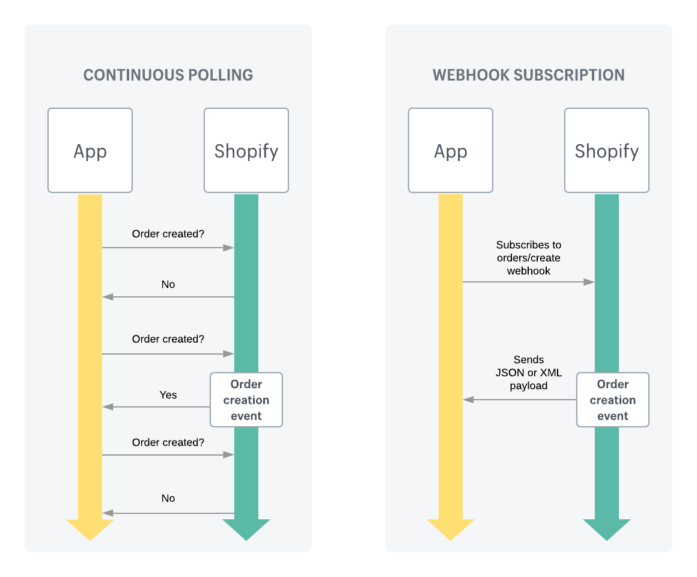
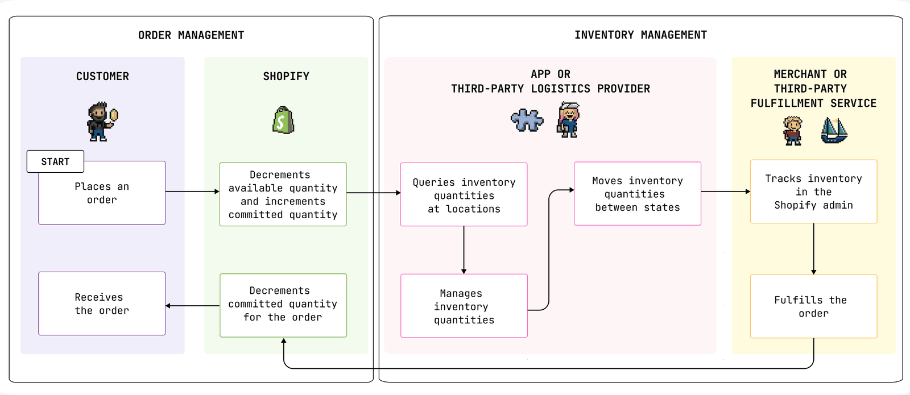

# SPF Custom App Solution Library 4.1 — Tích hợp với hệ thống ngoài

| Field | Value |
| :---- | :---- |
| Owner | Bắc PV — NodeJS BE Dev Lead |
| Audience | Dev (NodeJS BE) |
| Last reviewed | 2026-11-18 |
| Review cadence | Quarterly |
| Version | v1.0 |
| Linked from | Ref_Dev_spf-custom-app-solution-library_v1.0, Ref_Dev_s3.2_spf-solution-fulfillment-inventory_v1.0, Ref_Dev_s4.2_spf-solution-admin-operations_v1.0 |
| Status | Live |

Doc này là mục 4.1 của [SPF Custom App Solution Library](Ref_Dev_spf-custom-app-solution-library_v1.0.md), nghiệp vụ tích hợp với ERP, WMS, hóa đơn điện tử và ngân hàng. Doc nêu tính năng mặc định của Shopify, các yêu cầu tùy chỉnh kèm giải pháp, và ràng buộc kỹ thuật. Cách đọc các cột và điều kiện chung nằm ở [doc index](Ref_Dev_spf-custom-app-solution-library_v1.0.md).

## 1. Tính năng mặc định

| Tính năng | Mô tả | Giới hạn / plan |
| :---- | :---- | :---- |
| CSV | Import và export product, customer, inventory. Order chỉ export | File tối đa 15 MB. Import product khớp theo handle, không hủy được giữa chừng. Export order không có automatic discount trong cột Discount Code |
| Tồn kho | Trạng thái On hand, Available, Committed, Unavailable, Incoming. Transfer, purchase order | Location: Starter 2, Basic đến Advanced 10, Plus 200. Lịch sử điều chỉnh 180 ngày mỗi variant |
| Hóa đơn, thuế | Shopify Tax cho Mỹ, EU, Anh, Canada. VAT invoice cho đơn giao tới EU, Anh | Không có hóa đơn điện tử Việt Nam |
| Thanh toán thủ công | COD, chuyển khoản. Đơn ở trạng thái chưa thanh toán tới khi nhân viên đánh dấu | Không tự hủy đơn quá hạn |
| Mã đơn | Sửa được prefix và suffix | Bắt đầu từ 1001, không đổi được số bắt đầu |

## 2. Yêu cầu tùy chỉnh

Scope `read_orders`, `write_orders` chỉ đọc được đơn trong 60 ngày gần nhất. Đơn cũ hơn cần `read_all_orders`.

| Yêu cầu | Giới hạn mặc định | Giải pháp | Ràng buộc | Public app |
| :---- | :---- | :---- | :---- | :---- |
| Đồng bộ 2 chiều product, giá, tồn kho, đơn với ERP hoặc phần mềm bán hàng (KiotViet, Sapo, MISA, SAP B1, Odoo) | Chỉ import, export CSV thủ công | Chiều vào Shopify: `productSet`, `productVariantsBulkUpdate`, `inventorySetQuantities`. Khối lượng lớn: `stagedUploadsCreate` và `bulkOperationRunMutation`. Chiều ra: webhook `orders/create`, `orders/paid`, `orders/updated`, `orders/cancelled`, `refunds/create`, `products/update`, `inventory_levels/update`. Job đối soát lọc theo `updated_at`. Mã bên ERP: lưu metafield bằng `metafieldsSet` | `productSet` xóa phần tử list không có trong input. Không có webhook khi tồn kho trạng thái committed, reserved thay đổi. Mọi plan, tốc độ khác nhau theo plan | [Odoo Integration](https://apps.shopify.com/odoo) (app của Odoo: chỉ Odoo, chưa có review). [TM Odoo Integration](https://apps.shopify.com/odoo-integrator) (chỉ Odoo). [SAP Business One Integration](https://apps.shopify.com/sap-business-one-integration) (chỉ SAP B1, một chiều, 2 review). Không tìm thấy app cho KiotViet, Sapo, MISA |
| Đẩy đơn sang WMS, nhận trạng thái fulfill, tracking | Fulfill thủ công trong admin | Cách 1, WMS là fulfillment service: `fulfillmentServiceCreate` kèm `callbackUrl` → Shopify gọi `/fulfillment_order_notification` → app nhận bằng `fulfillmentOrderAcceptFulfillmentRequest` → `fulfillmentCreate` kèm `trackingInfo`. Cách 2, location của merchant: webhook `fulfillment_orders/order_routing_complete` → đẩy sang WMS → `fulfillmentCreate` | Không fulfill trước khi request được chấp nhận. SKU phân biệt hoa thường. Fulfillment order mỗi lần gọi: cùng order, cùng location. Scope cách 1: `write_fulfillments`, `write_assigned_fulfillment_orders`. Cách 2: `write_merchant_managed_fulfillment_orders` | [Exportify](https://apps.shopify.com/exportify) (chiều ra: file đơn qua FTP, SFTP). [syncX: Fulfill Tracking Bulk](https://apps.shopify.com/fulfill-tracking) (chiều vào: import tracking, fulfill) |
| Tự xuất hóa đơn điện tử khi đơn thanh toán hoặc fulfill, gắn link vào đơn | VAT invoice: chỉ đơn giao tới EU, Anh | Webhook `orders/paid` hoặc `orders/fulfilled` → backend gọi nhà cung cấp hóa đơn → `metafieldsSet` lưu số, link. Hiển thị: `admin.order-details.block.render`. Xuất lại, hủy: `admin.order-details.action.render`. Hóa đơn điều chỉnh: `refunds/create` | Chống xuất trùng (2 lần) bằng `X-Shopify-Webhook-Id`. API nhà cung cấp hóa đơn: chưa khảo sát. Cần protected customer data level 2 | Không tìm thấy |
| Mã đơn theo quy tắc riêng, ánh xạ mã đơn ERP | Số bắt đầu cố định, chỉ có prefix, suffix. `orderUpdate`: không có field name | Mã ERP: lưu order metafield hoặc `poNumber`, hiện bằng admin block. Đơn import bằng `orderCreate`: đặt được `name` | Tên đơn: không đổi được sau khi tạo | Không tìm thấy |
| Đối soát chuyển khoản ngân hàng | Nhân viên đánh dấu đã thanh toán bằng tay | Backend nhận thông báo từ ngân hàng hoặc cổng thanh toán → khớp theo tên đơn → `orderMarkAsPaid`. Trả một phần: `orderCreateManualPayment`. Giao dịch không khớp: liệt kê ở trang app | `orderMarkAsPaid` ghi nhận toàn bộ số còn nợ. Field `amount` của `orderCreateManualPayment`: chỉ Plus. Dịch vụ báo giao dịch ngân hàng: chưa khảo sát | [Cleero: Auto Payment Matching](https://apps.shopify.com/cleero-payment-matching) (một phần: ngân hàng EU, CH, GB, AU, NZ; không có ngân hàng Việt Nam, VietQR) |
| Cập nhật thông tin sản phẩm từ feed nhà cung cấp | CSV thủ công | Job định kỳ gọi `productSet` chế độ bất đồng bộ, hoặc bulk mutation. Thông số kỹ thuật: lưu metafield | 2.048 variant mỗi product. Store từ 500.000 variant: chỉ tạo thêm 10.000 variant mỗi ngày, Plus được miễn | [syncX: Stock Inventory Sync](https://apps.shopify.com/stock-sync). [Sync Master: Product Import](https://apps.shopify.com/sync-master) |
| Đồng bộ nhiều store (tồn kho, product) | Shopify không đồng bộ giữa các store | App cài trên từng store, hub khớp theo SKU. Webhook `inventory_levels/update` → `inventorySetQuantities` ở các store còn lại. Tránh vòng lặp: đánh dấu thay đổi do app ghi bằng `referenceDocumentUri` | 1 custom app cài trên nhiều store: chỉ khi các store thuộc cùng 1 Plus organization. Store ngoài organization của app: cần IP allowlist từ 2026-11-20 | [Multi Store Sync Power](https://apps.shopify.com/multi-store-inventory-sync). [Inventory Sync, Multi store TP](https://apps.shopify.com/multi-store-sync-tipo) |

Hình 1. Polling liên tục so với đăng ký webhook. Nguồn: [About webhooks](https://shopify.dev/docs/apps/build/webhooks).

Hình 2. Luồng quản lý tồn kho giữa Shopify, app và 3PL. Nguồn: [Apps in inventory management](https://shopify.dev/docs/apps/build/inventory-management-apps).

## 3. Ràng buộc kỹ thuật

Webhook:

- Shopify không đảm bảo thứ tự và không đảm bảo gửi đủ. Sắp xếp theo `X-Shopify-Triggered-At` hoặc `updated_at`, và luôn có job đối soát.
- HTTPS: timeout kết nối 1 giây, tổng 5 giây. Lỗi thì Shopify retry 8 lần trong 4 giờ.
- Sau 8 lần lỗi liên tiếp, subscription tạo qua Admin API bị xóa. Subscription khai báo trong TOML không bị xóa.
- Chống trùng bằng `X-Shopify-Webhook-Id`.
- Kiểm tra HMAC cần raw body.
- Đích nhận có HTTPS, Google Pub/Sub, Amazon EventBridge. Shopify khuyên dùng Pub/Sub.
- `filter` lọc event theo điều kiện, `include_fields` cắt bớt payload. Field sai trong `filter` làm subscription không nhận event nào.

Bulk operation:

- Mỗi app chạy 5 bulk query và 5 bulk mutation cùng lúc trên một shop, từ API `2026-01`.
- Bulk query: tối đa 5 connection, lồng 2 cấp. URL kết quả JSONL hết hạn sau một tuần.
- Bulk mutation: file JSONL tối đa 100 MB, giới hạn 24 giờ.
- App tạo trong Dev Dashboard phải bật từng loại bulk ở Settings > Access requests.

Rate limit Admin GraphQL: Standard 100, Advanced 200, Plus 1.000, Enterprise 2.000 point mỗi giây. Một query tối đa 1.000 point. Phân trang dừng ở 25.000 object.

Inventory API:

- `inventorySetQuantities` đặt `on_hand` hoặc `available`. `inventoryAdjustQuantities` cộng trừ. `inventoryMoveQuantities` chuyển giữa các trạng thái.
- Trạng thái `committed` không sửa được qua API.
- Từ API `2026-04`, set và adjust bắt buộc có `@idempotent(key:)` và `changeFromQuantity`.
- Purchase order chỉ đọc được qua API từ `2026-10`, không có mutation.

Metafield, metaobject:

- 256 definition mỗi loại resource cho mỗi app.
- Giá trị tối đa 64 KB với phần lớn kiểu, `json` 128 KB.
- `metafieldsSet` ghi 25 metafield mỗi request, có `compareDigest` để tránh ghi đè.
- Metaobject: 128 definition mỗi app, 40 field, 1.000.000 entry mỗi definition.

## References

- [Webhooks](https://shopify.dev/docs/apps/build/webhooks) và [HTTPS delivery](https://shopify.dev/docs/apps/build/webhooks/subscribe/https)
- [Bulk operation query](https://shopify.dev/docs/api/usage/bulk-operations/queries) và [bulk import](https://shopify.dev/docs/api/usage/bulk-operations/imports)
- [Inventory management apps](https://shopify.dev/docs/apps/build/orders-fulfillment/inventory-management-apps)
- [Fulfillment service apps](https://shopify.dev/docs/apps/build/orders-fulfillment/fulfillment-service-apps)
- [Metafield limits](https://shopify.dev/docs/apps/build/custom-data/metafields/metafield-limits)

## Changelog

| Date | Version | Change | By |
| :---- | :---- | :---- | :---- |
| 2026-11-18 | v1.0 | Bản đầu tiên. Owner duyệt trong chat ngày 2026-11-18. | Bắc PV |
