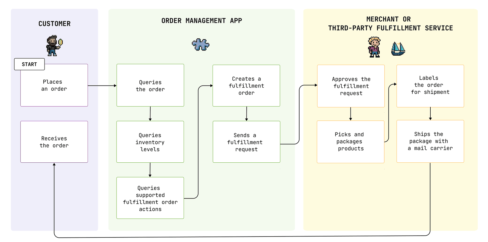
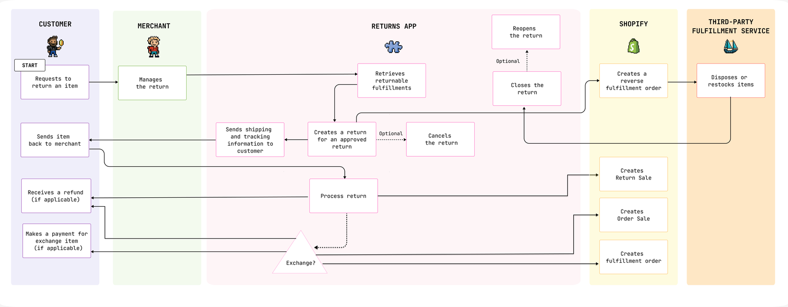
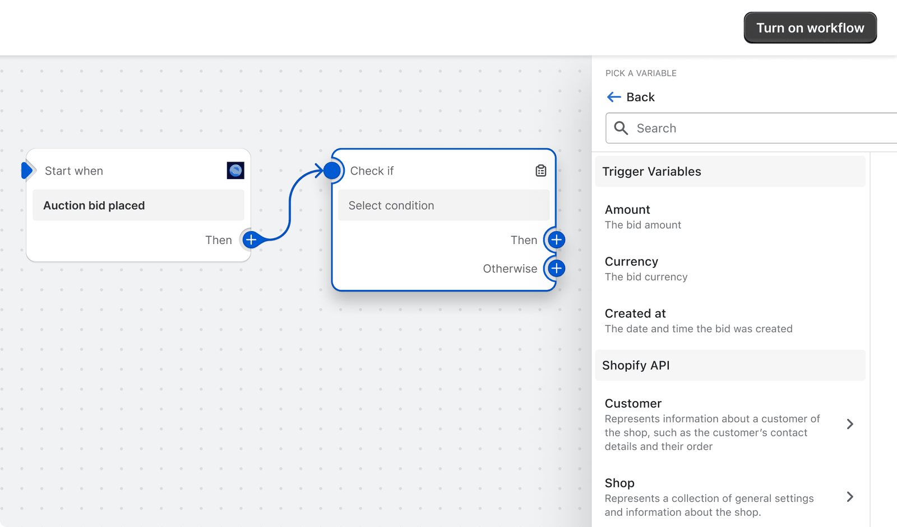
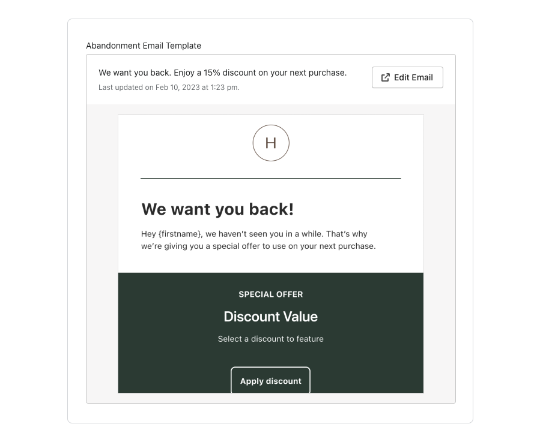

# SPF Custom App Solution Library 4.2 — Vận hành trong admin

| Field | Value |
| :---- | :---- |
| Owner | Bắc PV — NodeJS BE Dev Lead |
| Audience | Dev (NodeJS BE) |
| Last reviewed | 2026-11-18 |
| Review cadence | Quarterly |
| Version | v1.0 |
| Linked from | Ref_Dev_spf-custom-app-solution-library_v1.0 |
| Status | Live |

Doc này là mục 4.2 của [SPF Custom App Solution Library](Ref_Dev_spf-custom-app-solution-library_v1.0.md), nghiệp vụ vận hành đơn hàng, tồn kho và nhân viên trong admin. Doc nêu tính năng mặc định của Shopify, các yêu cầu tùy chỉnh kèm giải pháp, và ràng buộc kỹ thuật. Cách đọc các cột và điều kiện chung nằm ở [doc index](Ref_Dev_spf-custom-app-solution-library_v1.0.md).

## 1. Tính năng mặc định

| Tính năng | Mô tả | Giới hạn / plan |
| :---- | :---- | :---- |
| Sửa đơn | Thêm, bớt sản phẩm, đổi số lượng, sửa phí ship, thêm discount thủ công, gửi invoice cập nhật | Không sửa được item đã fulfill. Không thêm, sửa discount code và automatic discount. Shipping rate không tính lại. Đơn local delivery không sửa được |
| Draft order | Đơn đặt qua điện thoại, giá và item tùy chỉnh, invoice kèm link checkout, giữ hàng tới ngày chọn, payment terms | Draft tạo từ 2025-04-01 tự xóa sau 1 năm không hoạt động. Đặt cọc chỉ có trên Plus |
| Tag, note, timeline | Tag trên order, draft order, customer, product. Timeline có comment nội bộ | 250 tag mỗi bản ghi, tag của order dài tối đa 55 ký tự. Tự gắn tag chỉ làm được qua Flow |
| Trạng thái đơn | Order: Open, Archived, Canceled. Payment: 10 trạng thái. Fulfillment: 7 trạng thái | Không có trạng thái tùy chỉnh |
| Trả hàng, hoàn tiền, đổi hàng | Tạo return, hoàn tiền sau khi kiểm hàng, thêm item đổi, khách tự gửi yêu cầu từ trang Order status. Return rule: thời hạn, phí ship trả, restocking fee, final sale | Phí trả hàng không tự trừ. Nhãn trả hàng của Shopify chỉ có ở Mỹ, Canada |
| In ấn | Packing slip in từng đơn hoặc hàng loạt, một template Liquid. App Order Printer: invoice, packing slip, pick list | Order Printer in tối đa 50 đơn mỗi lần |
| Bulk editor | Product, variant, collection, customer, inventory | Không có cho order |
| Report | Analytics trên mọi plan, custom report, ShopifyQL editor | Màn hình hiện tối đa 1.000 dòng. Không ghép được dữ liệu ngoài |
| Flow | Miễn phí trên Basic, Grow, Advanced, Plus. 84 trigger và 111 action. Connector có Slack, Google Sheets | Send HTTP request cần Grow trở lên. Task của custom app chỉ dùng trên Plus. Scheduled time tối thiểu 10 phút. Run code: 5 giây, không gọi HTTP |
| Nhân viên | Phân quyền theo từng chức năng. Activity log | Số admin user: Grow 5, Advanced 15, Plus không giới hạn. Activity log giữ 18 tháng, không export được |
| Thông báo | Email cho khách theo template Liquid, thông báo cho nhân viên, webhook trong Settings | SMS chỉ có xác nhận đơn, 12 quốc gia, không có Việt Nam |
| Hẹn giờ đổi giá | Launchpad đổi giá sản phẩm lúc bắt đầu và kết thúc sự kiện | Chỉ Plus |

## 2. Yêu cầu tùy chỉnh

Scope `read_orders`, `write_orders` chỉ đọc được đơn trong 60 ngày gần nhất. Đơn cũ hơn cần `read_all_orders`.

| Yêu cầu | Giới hạn mặc định | Giải pháp | Ràng buộc | Public app |
| :---- | :---- | :---- | :---- | :---- |
| Duyệt đơn trước khi fulfill | Không có trạng thái duyệt | Flow: Order created → action "Hold fulfillment order". Hoặc webhook `orders/create` → app gọi `fulfillmentOrderHold` → duyệt bằng admin action → bỏ hold | Mỗi app: tối đa 10 hold đang bật trên 1 fulfillment order | [SampleGuard ‑ Order Approval](https://apps.shopify.com/sampleguard) (5 review). [Order Automator](https://apps.shopify.com/order-automator) (một phần: rule hold đơn, không ghi bước duyệt) |
| Tự gắn tag cho đơn, khách theo rule | Chỉ qua Flow | Flow: "Add order tags", "Add customer tags". Rule cần dữ liệu ngoài: webhook → `tagsAdd` | 250 tag mỗi bản ghi. Trigger, action Flow của custom app: chỉ Plus | [Shopify Flow](https://apps.shopify.com/flow). [SC AI Order Taggers](https://apps.shopify.com/ordertagger) |
| Tự hủy đơn chuyển khoản chưa thanh toán sau N giờ | Đơn ở trạng thái chưa thanh toán vô thời hạn | Flow: Order created → Wait → Cancel order. Hoặc job định kỳ của app gọi `orderCancel` | Hủy đơn: không hoàn tác được, chạy bất đồng bộ, lỗi khi đơn có authorization đang chờ hoặc return đang mở | [Kindly: Payment Reminder Pro](https://apps.shopify.com/kindly-payment-reminder). [GO Rescue Payments](https://apps.shopify.com/go-rescue) (4 review) |
| Mẫu in riêng (phiếu giao hàng, hóa đơn VAT, nhãn) | 1 template packing slip. Order Printer: in 50 đơn mỗi lần | Admin print action: `admin.order-details.print-action.render`, `admin.order-index.selection-print-action.render`, `admin.product-details.print-action.render`. Route của app trả HTML, PDF hoặc ảnh | HTML phải tĩnh, không script. Cần CORS header. Đơn cũ hơn 60 ngày: cần `read_all_orders` | [Order Printer Pro](https://apps.shopify.com/order-printer-pro). [Vify Order Printer](https://apps.shopify.com/vify-order-printer). Cả hai không ghi in nhãn |
| Panel dữ liệu thêm ở trang order, product, customer (trạng thái ERP, bảo hành) | Admin chỉ hiện dữ liệu Shopify, metafield đã pin | Admin block: `admin.order-details.block.render`, `admin.product-details.block.render`, `admin.customer-details.block.render`. Block gọi backend của app bằng `fetch()` hoặc gọi thẳng Admin API | Merchant phải tự thêm, pin block. Bundle tối đa 64 KB. Không có target ở trang inventory | Không tìm thấy |
| Cập nhật giá, metafield hàng loạt từ file Excel | CSV product: tối đa 15 MB, khớp theo handle, không hủy được | Upload ở trang app. Ghi bằng `productVariantsBulkUpdate`, `metafieldsSet`, hoặc JSONL qua `stagedUploadsCreate` và `bulkOperationRunMutation` → nhận kết quả ở webhook `bulk_operations/finish` | `metafieldsSet`: tối đa 25 metafield mỗi request. File JSONL: tối đa 100 MB | [Matrixify](https://apps.shopify.com/excel-export-import). [Ablestar Bulk Product Edit](https://apps.shopify.com/bulk-product-editor) |
| Hẹn giờ đổi giá | Launchpad: chỉ Plus | App lưu lịch. Job định kỳ áp giá, trả giá cũ bằng `productVariantsBulkUpdate` | Mọi plan | [Ablestar Bulk Product Edit](https://apps.shopify.com/bulk-product-editor). [Shopify Launchpad](https://apps.shopify.com/launchpad) (chỉ Plus, không ghi đổi giá, rating 2.7/5, 32 review) |
| Thao tác hàng loạt trên đơn đã chọn (đẩy sang hãng vận chuyển, in theo lô) | Thao tác hàng loạt có sẵn: chỉ in packing slip, export CSV | Target `admin.order-index.selection-action.render`, `admin.order-index.selection-print-action.render`. Backend đặt đơn với hãng vận chuyển → `fulfillmentCreate` kèm tracking | Số đơn chọn tối đa mỗi lần: chưa xác nhận | [Meowship](https://apps.shopify.com/meowship) (GHN, GHTK, Ahamove, Grab, 4 review). [Order Printer Pro](https://apps.shopify.com/order-printer-pro) (phần in theo lô) |
| Report doanh thu, hoa hồng theo mẫu riêng, ghép dữ liệu ngoài | Màn hình hiện 1.000 dòng, không ghép dữ liệu ngoài | `bulkOperationRunQuery` kéo dữ liệu về database của app → ghép với giá vốn từ ERP. Số tổng hợp: `shopifyqlQuery`. Dashboard ở trang app | `shopifyqlQuery`: cần `read_reports`, protected customer data level 2. Phân trang dừng ở 25.000 object | [Report Pundit](https://apps.shopify.com/report-pundit). [Report Toaster](https://apps.shopify.com/report-toaster). Cả hai không ghi báo cáo hoa hồng |
| Cảnh báo tồn kho thấp, bất thường qua Slack, Zalo, email | Chỉ qua Flow. Connector không có Zalo | Slack, email: Flow. Zalo: Flow Send HTTP request, hoặc app nghe `inventory_levels/update` | Send HTTP request: từ Grow, timeout 30 giây. API Zalo: chưa khảo sát | [iAlert ‑ Low Stock Alert](https://apps.shopify.com/low-stock-notifier) (email, Slack). Không tìm thấy app gửi qua Zalo |
| Giữ hàng, pre-order, backorder | Giữ hàng: chỉ draft order | `sellingPlanGroupCreate` loại `PRE_ORDER`. `inventoryMoveQuantities` chuyển từ `available` sang `reserved`. `reserveInventoryUntil` trên `draftOrderCreate` | Pre-order không chạy trên POS, draft order, B2B, phương thức thanh toán nội địa | [Notify Me! Back in Stock Alert](https://apps.shopify.com/preorder-back-in-stock) (pre-order, backorder). [Cart Reserve](https://apps.shopify.com/cart-reserve) (giữ hàng khi add to cart, 4 review) |
| Quản lý serial, IMEI, lô hàng | Tồn kho chỉ là số lượng theo trạng thái, location | Mỗi serial 1 metaobject. Gán serial cho đơn: `admin.order-details.action.render`. Serial của đơn: lưu dạng list metaobject reference | 1.000.000 entry mỗi metaobject definition. List reference: tối đa 1.024 phần tử | [SerializeIt](https://apps.shopify.com/serializeit) (3 review). [SeriaLogic](https://apps.shopify.com/serial-number-manager) (một phần: không ghi IMEI, lô) |
| Đăng ký, tra cứu bảo hành | Không có đối tượng bảo hành | Metaobject "warranty" nối với serial, order, customer, tạo ở webhook `orders/fulfilled`. Admin block ở trang order, customer. Trang tra cứu cho khách: [Solution Library 6](Ref_Dev_s6_spf-solution-storefront-catalog_v1.0.md), mục 2 | — | [My Product Registration](https://apps.shopify.com/product-registration-1). [Warranty Registration & Claims](https://apps.shopify.com/dyrect-warranty-registrations) |
| KPI nhân viên, ghi nhận người bán | Ghi nhận người bán: chỉ location POS Pro | Lưu người bán ở order metafield hoặc tag qua admin action. Report ở trang app | Đọc `StaffMember`: cần `read_users`, chỉ Plus hoặc Advanced, Shopify Support phải bật | [CSS Sales Team: Rep Portal](https://apps.shopify.com/sales-rep). [Easyteam](https://apps.shopify.com/staffy) (chỉ POS) |
| Sửa đơn sau khi đặt, tính lại giá | Sửa đơn trong admin: không tính lại shipping, discount | `orderEditBegin`, `orderEditAddVariant`, `orderEditSetQuantity`, `orderEditAddLineItemDiscount`, `orderEditAddShippingLine`, `orderEditCommit`. Nghe webhook `orders/edited` | Chỉ sửa line chưa fulfill, đơn dùng tiền tệ của store. Scope `write_order_edits` | [AE: Order Editing & Upsell](https://apps.shopify.com/account-editor). [OrderEditing.com](https://apps.shopify.com/order-editing) |
| Cổng trả hàng, đổi hàng với rule riêng | Rule có sẵn: chỉ thời hạn, phí ship, restocking fee, final sale | `returnRequest`, `returnApproveRequest` hoặc `returnDeclineRequest`, `returnCreate` kèm `exchangeLineItems`, `returnProcess`, `returnClose`. Webhook `returns/request`, `returns/approve` | Chỉ GraphQL. Chỉ item đã fulfill. Approve, decline: không hoàn tác được. Scope `read_returns`, `write_returns` | [AfterShip Returns & Exchanges](https://apps.shopify.com/returns-center-by-aftership). [CWILL Returns & Exchanges](https://apps.shopify.com/parcel-panel-returns-exchanges) |
| Audit log thay đổi dữ liệu | Activity log không export được. Lịch sử tồn kho: 180 ngày | Webhook update → lưu snapshot, diff vào database của app. Query `events` lấy lại dữ liệu cũ, giữ 1 năm | Webhook có cho biết người thao tác hay không: chưa xác nhận | [Logify: Activity & Staff Logs](https://apps.shopify.com/activity-logs) (8 review). [Loggr Product History & Revert](https://apps.shopify.com/loggr-product-history-revert) (chỉ product) |

Hình 1. Luồng fulfill đơn qua order management app. Nguồn: [Apps in orders and fulfillment](https://shopify.dev/docs/apps/build/orders-fulfillment).

Hình 2. Vòng đời của một return. Nguồn: [Apps in returns](https://shopify.dev/docs/apps/build/orders-fulfillment/returns-apps).

Hình 3. Field của trigger hiện thành biến trong Flow editor. Nguồn: [shopify.dev](https://shopify.dev/docs/apps/build/flow/triggers/reference).

Hình 4. Preview trang cấu hình riêng của Flow action. Nguồn: [shopify.dev](https://shopify.dev/docs/apps/build/flow/actions/build-config-ui).
## 3. Ràng buộc kỹ thuật

Giới hạn của webhook, bulk operation, Inventory API và metafield ghi ở [Solution Library 4.1](Ref_Dev_s4.1_spf-solution-integration_v1.0.md), mục 3.

Admin UI extension:

- Có target ở trang order, draft order, product, variant, customer, collection, company, discount. Không có target ở trang inventory.
- Bundle tối đa 64 KB.

Flow extension của app:

- App thêm được trigger, action, template. Với custom app, chỉ dùng được trên store Plus.
- Action: Shopify chờ 10 giây, retry tới 36 giờ khi nhận 202, 429, 5XX. `action_run_id` dùng làm idempotency key.
- Field của trigger và action khai báo bằng `[[settings.fields]]`, hiện trong panel cấu hình của Flow editor.
- Action có thể có trang cấu hình riêng, khai báo bằng `config_page_url` và `config_page_preview_url`.

Admin API không hỗ trợ:

- `orderUpdate` chỉ sửa custom attribute, email, phone, note, tag, PO number, địa chỉ giao, metafield.
- Đổi tên đơn sau khi tạo.
- Đánh dấu thanh toán một phần trên store không phải Plus.
- Hoàn tác `orderCancel`.

## References

- [Edit orders](https://shopify.dev/docs/apps/build/orders-fulfillment/order-management-apps/edit-orders)
- [Returns apps](https://shopify.dev/docs/apps/build/orders-fulfillment/returns-apps)
- [Admin UI extension targets](https://shopify.dev/docs/api/admin-extensions/2026-10/targets)
- [Flow extensions](https://shopify.dev/docs/apps/build/flow)
- [Shopify Flow](https://help.shopify.com/en/manual/shopify-flow)

## Changelog

| Date | Version | Change | By |
| :---- | :---- | :---- | :---- |
| 2026-11-18 | v1.0 | Thêm 2 hình về chỗ merchant cấu hình extension của app. Owner duyệt trong chat ngày 2026-11-18. | Bắc PV |
| 2026-11-18 | v1.0 | Mục 3 thêm field cấu hình của Flow trigger và action. Owner duyệt trong chat ngày 2026-11-18. | Bắc PV |
| 2026-11-18 | v1.0 | Bản đầu tiên. Owner duyệt trong chat ngày 2026-11-18. | Bắc PV |
