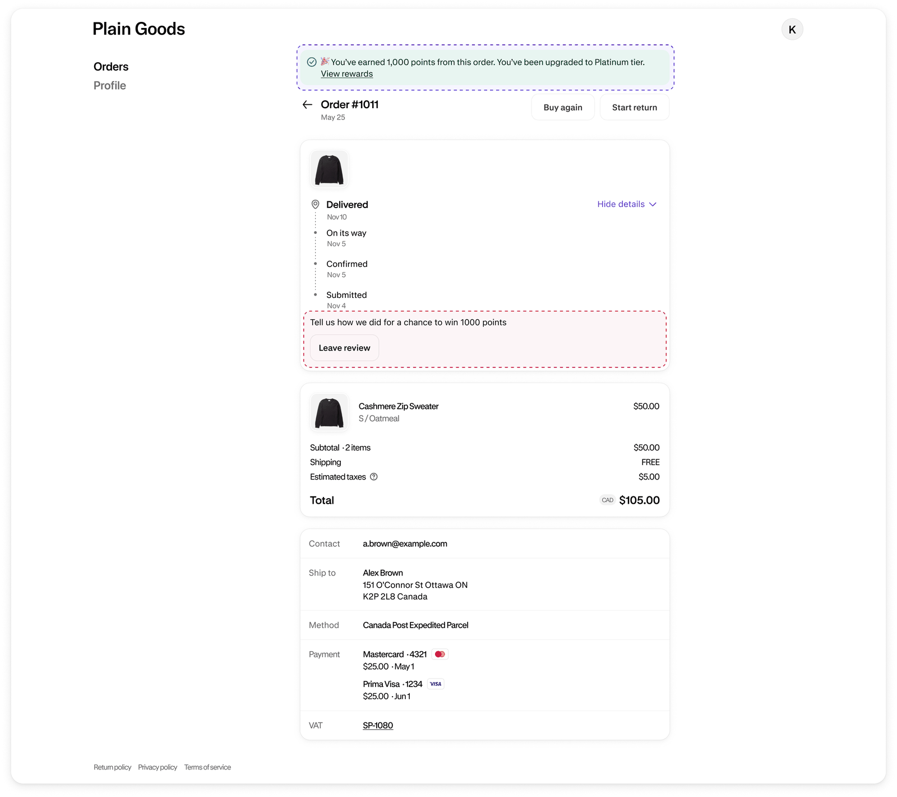
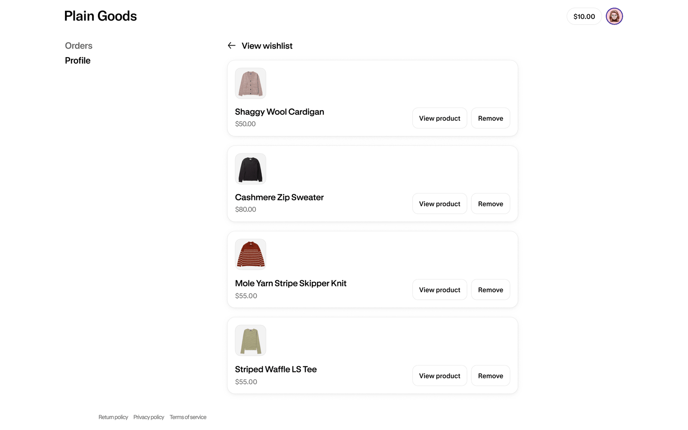
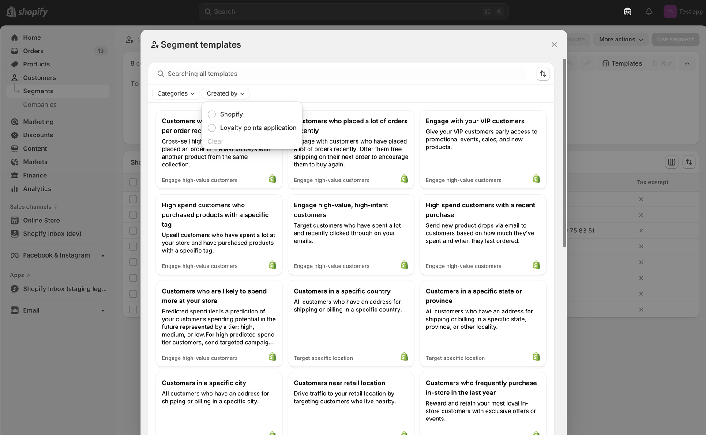

# SPF Custom App Solution Library 5.1 — Tài khoản khách và loyalty

| Field | Value |
| :---- | :---- |
| Owner | Bắc PV — NodeJS BE Dev Lead |
| Audience | Dev (NodeJS BE) |
| Last reviewed | 2026-11-18 |
| Review cadence | Quarterly |
| Version | v1.0 |
| Linked from | Ref_Dev_spf-custom-app-solution-library_v1.0, Ref_Dev_s5.2_spf-solution-b2b-subscription_v1.0 |
| Status | Live |

Doc này là mục 5.1 của [SPF Custom App Solution Library](Ref_Dev_spf-custom-app-solution-library_v1.0.md), nghiệp vụ tài khoản khách, loyalty và đồng bộ khách hàng. Doc nêu tính năng mặc định của Shopify, các yêu cầu tùy chỉnh kèm giải pháp, và ràng buộc kỹ thuật. Cách đọc các cột và điều kiện chung nằm ở [doc index](Ref_Dev_spf-custom-app-solution-library_v1.0.md).

## 1. Tính năng mặc định

| Tính năng | Mô tả | Giới hạn / plan |
| :---- | :---- | :---- |
| Đăng nhập customer accounts mới | Email và mã 6 số dùng một lần, không có password. Đăng nhập bằng Shop, Google, Facebook. Tài khoản tự tạo ở lần đăng nhập đầu | Trang đăng nhập không nhận extension block. Không có đăng nhập bằng số điện thoại hay Zalo |
| Trang tài khoản | Orders, Order status, Profile. App thêm được trang riêng và link trên menu | Tùy chỉnh theo market cần Advanced hoặc Plus |
| Khách tự làm được | Xem đơn và tracking, yêu cầu trả hàng, hủy đơn, mua lại, sửa tên, email, địa chỉ, xem store credit, quản lý subscription | Lưu phương thức thanh toán chỉ có ở gói Enterprise |
| Thu thêm thông tin lúc đăng ký | Lần đăng nhập đầu chỉ hỏi email | Không có form đăng ký. Khách chỉ sửa được tên, email, địa chỉ |
| Legacy customer accounts | Đã deprecate từ 2026-02-26, không còn cho store mới | Chưa có ngày sunset. B2B không dùng được legacy accounts |
| Segment | Danh sách động viết bằng filter ShopifyQL, lọc được theo customer metafield. Dùng làm điều kiện cho discount | Chỉ lọc được metafield kiểu date, number, text, boolean |
| Tag, metafield của khách | Tag tự do. Tối đa 256 metafield definition mỗi loại resource | Tối đa 250 tag mỗi khách |
| Store credit | Cấp trong admin, khi refund, hoặc qua API. Dùng ở checkout khi khách đăng nhập bằng accounts mới hoặc Shop Pay, và trên POS | Chỉ áp toàn bộ số dư. Dưới 15.000 USD mỗi khách. Không dùng trên draft order và đơn subscription định kỳ |
| Gift card | Bán như sản phẩm hoặc cấp từ admin | Mọi plan. Dùng ở checkout B2B cần Plus |
| SSO bằng identity provider riêng | OIDC provider thay cho đăng nhập mặc định. Email phải là định danh duy nhất và đã xác minh | Chỉ Plus. Multipass cũng chỉ Plus và không còn cho store mới |
| Trả hàng tự phục vụ | Khách gửi yêu cầu trả hàng từ tài khoản. Rule: thời hạn, phí ship, restocking fee, final sale | Không đặt được rule riêng theo loại đơn hay theo khách |

## 2. Yêu cầu tùy chỉnh

Các giải pháp dưới đây dùng customer account UI extension, chạy từ Basic trở lên và cần customer accounts mới. Viết tắt trong bảng:

- **PAGE**: full-page extension, target `customer-account.page.render`.
- **CAAPI**: gọi Customer Account API từ extension.
- **BACKEND**: extension gọi server của app, bật `network_access` và gửi session token.

| Yêu cầu | Giới hạn mặc định | Giải pháp | Ràng buộc / fallback | Public app |
| :---- | :---- | :---- | :---- | :---- |
| Tích điểm theo đơn, đổi điểm, xem điểm trong tài khoản | Không có tính năng điểm. Gần nhất: store credit | Sổ điểm lưu ở database app và customer metafield. Hiển thị: `customer-account.profile.block.render`, `customer-account.order-index.block.render` hoặc PAGE. Đổi điểm: `storeCreditAccountCredit`, hoặc Discount Function đọc metafield | Scope `write_store_credit_account_transactions`. Store credit chỉ áp toàn bộ số dư. Non-Plus: store credit, không cần Function | [Smile: Loyalty Program Rewards](https://apps.shopify.com/smile-io). [BON Loyalty](https://apps.shopify.com/bon-loyalty-rewards). Đổi điểm trong checkout: chỉ Plus |
| Hạng thành viên (bạc, vàng) có giá hoặc quyền lợi riêng | Không có khái niệm hạng. Catalog: chỉ gán cho B2B | App gắn tag hoặc metafield bằng `tagsAdd`, `customerUpdate`. Discount Function đọc `hasAnyTag`. Hiển thị hạng: extension. Ở storefront: theme app block đọc `customer.tags` | Kết quả: 1 discount, giá niêm yết không đổi. Non-Plus: mỗi hạng 1 automatic discount gắn segment | [Smile: Loyalty Program Rewards](https://apps.shopify.com/smile-io) (một phần: VIP tier, không có giá theo hạng). [BON Loyalty](https://apps.shopify.com/bon-loyalty-rewards) (một phần) |
| Chương trình giới thiệu bạn bè | Không có sẵn | Mã giới thiệu lưu ở customer metafield. Trang chia sẻ: app proxy hoặc theme app block. Thưởng: `storeCreditAccountCredit`. Nhận biết khách mới: webhook `customers/create`, `customers/enable` | App proxy không có cookie. Mọi plan | [Smile: Loyalty Program Rewards](https://apps.shopify.com/smile-io). [UpPromote](https://apps.shopify.com/affliate-by-secomapp) (một phần) |
| Quà sinh nhật | Lần đăng nhập đầu chỉ thu email | Block ở Profile có date field, ghi bằng CAAPI `metafieldsSet` → segment lọc theo metafield ngày sinh → job hoặc Flow cấp store credit | Scope `customer_read_customers`, `customer_write_customers`. Definition phải cho customer account quyền read_write | [BON Loyalty](https://apps.shopify.com/bon-loyalty-rewards). [Joy Loyalty](https://apps.shopify.com/joyio) |
| Wishlist, lưu để mua sau | Không có sẵn | Nút: theme app block. Dữ liệu lưu ở database app hoặc metafield. PAGE liệt kê sản phẩm bằng Storefront API qua `api_access` | Tutorial full-page Shopify chính là wishlist. Mọi plan | [Growave: Loyalty & Wishlist](https://apps.shopify.com/growave). [Swish ‑ Wishlist & Accounts](https://apps.shopify.com/wishlist-king) |
| Mua lại bằng 1 nút, theo luồng riêng | Phần lớn đã có: Buy again ở accounts mới | Chỉ làm khi cần luồng khác: `customer-account.order.action.menu-item.render` kèm `customer-account.order.action.render` | Mọi plan | [Reorder Buy Again Repeat Order](https://apps.shopify.com/simple-reorder). [Custlo](https://apps.shopify.com/customer-dashboard-pro) (một phần) |
| Field hồ sơ thêm: mã số thuế, ngày sinh, giới tính, công ty | Không có form đăng ký. Khách chỉ sửa được tên, email, địa chỉ | Block ở Profile ghi bằng `metafieldsSet`. Nhắc khách điền sau lần đăng nhập đầu: webhook `customers/enable` → hiện `customer-account.profile.announcement.render` | Chỉ ghi được metafield trên Customer, Order, Company, CompanyLocation. 25 metafield mỗi lần gọi | [Custlo](https://apps.shopify.com/customer-dashboard-pro). [C:Hub Customer Accounts](https://apps.shopify.com/customerhub) |
| Đăng ký, tra cứu bảo hành trong tài khoản | Không có sẵn | `customer-account.order.action.menu-item.render` mở modal hoặc `customer-account.order.page.render`. Dữ liệu: database app hoặc metaobject | Customer Account API có scope `customer_read_metaobjects` | [My Product Registration](https://apps.shopify.com/product-registration-1). [Warranty Registration & Claims](https://apps.shopify.com/dyrect-warranty-registrations) |
| Tải hóa đơn, hóa đơn điện tử trong tài khoản | Không có sẵn | `customer-account.order-status.block.render` hoặc order action → BACKEND trả link file | Trang Order status mở từ email chưa đăng nhập đầy đủ: không đọc được dữ liệu khách, order action yêu cầu đăng nhập | [Order Printer Pro](https://apps.shopify.com/order-printer-pro) (một phần: gửi PDF invoice cho khách). [Vify Order Printer](https://apps.shopify.com/vify-order-printer) (một phần). Không có hóa đơn điện tử Việt Nam |
| Yêu cầu trả, đổi hàng theo rule riêng | Rule có sẵn: không chia theo loại đơn hay theo khách | Order action kèm form ở `customer-account.order.page.render` → CAAPI `orderRequestReturn` → duyệt bằng `returnApproveRequest`. Hiển thị trạng thái: `customer-account.order-status.return-details.render-after` | Scope `write_returns` | [AfterShip Returns & Exchanges](https://apps.shopify.com/returns-center-by-aftership). [CWILL Returns & Exchanges](https://apps.shopify.com/parcel-panel-returns-exchanges). Cả hai không ghi rule theo loại đơn, theo khách |
| Trang theo dõi đơn có lịch trình hãng vận chuyển | Cập nhật vị trí: chỉ hãng được hỗ trợ, hãng khác chỉ có link. Hãng Việt Nam: chưa xác nhận | `customer-account.order-status.fulfillment-details.render-after` → BACKEND → hãng vận chuyển. Trang công khai: app proxy | Mọi plan | [CWILL Order Tracking](https://apps.shopify.com/parcelpanel). [AfterShip Order Tracking](https://apps.shopify.com/aftership). Cả hai không ghi tên hãng Việt Nam |
| Đăng nhập bằng số điện thoại OTP, Zalo | Không có trong các cách đăng nhập. Facebook, Google: có sẵn | Plus: tự dựng OIDC provider hỗ trợ các cách đó. Provider vẫn phải cung cấp email đã xác minh | Non-Plus: không có cách | [Lucent ‑ OTP Login & Notify](https://apps.shopify.com/simply-otp-login) (phần OTP). [Meow Engage: Zalo Integrate](https://apps.shopify.com/meow-engage) (phần Zalo: chỉ Plus, chưa có review) |
| SSO với hệ thống thành viên có sẵn | Identity provider, Multipass: chỉ Plus | Plus: OIDC provider. Headless: OAuth Customer Account API | Non-Plus: không có SSO, khớp theo email, đồng bộ dữ liệu bằng Admin API | [miniOrange Single Sign On‑SSO](https://apps.shopify.com/single-sign-onsso) |
| Đồng bộ khách hàng với CRM: HubSpot, Zalo OA | Chưa xác nhận có connector sẵn | Webhook `customers/create`, `customers/update`, `customers/delete`, `customers/merge`, `customers_marketing_consent/update`. Ghi ngược: `customerUpdate`, `customerEmailMarketingConsentUpdate` | Cần protected customer data level 2 cho email, phone, tên | [HubSpot](https://apps.shopify.com/hubspot-2) (app của HubSpot: phần HubSpot, rating 1.0/5, 8 review). [Meow Engage: Zalo Integrate](https://apps.shopify.com/meow-engage) (phần Zalo OA: gửi ZNS, không đồng bộ contact, chưa có review) |
| Phân nhóm khách theo dữ liệu ngoài | Segment chỉ thấy dữ liệu Shopify và metafield | Backend ghi customer metafield → segment lọc theo `metafields.namespace.key` → đọc thành viên bằng `customerSegmentMembers` | Chỉ 4 kiểu metafield lọc được | [Shopify Flow](https://apps.shopify.com/flow) (một phần). [Matrixify](https://apps.shopify.com/excel-export-import) (một phần: import khách theo lịch) |
| Trang dashboard tài khoản có nội dung riêng | Trang cố định. Editor chỉ có branding, block, menu | PAGE kèm link menu do merchant thêm. Block ở order index, profile | Không có HTML tùy ý. Bundle full-page: tối đa 128 KB | [C:Hub Customer Accounts](https://apps.shopify.com/customerhub). [Customer Account Blocks ‑ SCD](https://apps.shopify.com/account-blocks) |

Hình 1. Banner điểm thưởng của app ở trang Order status. Nguồn: [About inline UI extensions](https://shopify.dev/docs/apps/build/customer-accounts/inline-extensions).

Hình 2. Trang wishlist dạng full-page extension. Nguồn: [Build new pages in customer accounts](https://shopify.dev/docs/apps/build/customer-accounts/full-page-extensions/build-new-pages).

Hình 3. Customer segment template của app trong segment editor. Nguồn: [shopify.dev](https://shopify.dev/docs/apps/build/marketing/customer-segments/build-a-template-extension).
## 3. Ràng buộc kỹ thuật

Customer account UI extension ở version `2026-10`:

- Chạy bằng Preact với web component `s-`, trong Web Worker, không có DOM và HTML tùy ý.
- Bundle tối đa 64 KB, full-page tối đa 128 KB. Tối đa 20 setting. `handle` không đổi được sau khi deploy.
- Target chính: `customer-account.order-index.block.render`, `customer-account.order-status.block.render`, `customer-account.order.action.menu-item.render`, `customer-account.page.render`, `customer-account.order.page.render`, `customer-account.profile.block.render`.
- Trang Order status có 3 trạng thái: chưa đăng nhập thì không có extension, mở từ email thì chỉ đọc được field cho phép, đăng nhập đầy đủ thì không hạn chế.
- Session token là JWT sống 5 phút. `sub` (customer ID) chỉ có khi khách đã đăng nhập và app có `read_customers`.
- Metafield của app cần khai báo `access.customer_account = "read_write"` trong `shopify.app.toml`.
- Setting khai báo bằng `[extensions.settings]`, merchant cấu hình trong checkout and accounts editor.

Customer Account API:

- Endpoint `https://{shop}/customer/api/2026-10/graphql`, xác thực OAuth 2.0.
- Rate limit: 7.500 cost point cho mỗi bộ app, store, khách. 3.000 request mỗi phút cho một khách.
- Mutation đã xác nhận: `customerUpdate`, `customerAddressUpdate`, `metafieldsSet`, `orderRequestReturn`, `subscriptionContractPause`, `subscriptionBillingCycleSkip`.

Protected customer data: custom app tạo trong Dev Dashboard có sẵn level 1 và 2. Public app phải qua review.

Customer segment template: target `admin.customers.segmentation-templates.data`, hiện trong phần template của segment editor.

Từ 2026-10-17, lần đăng nhập đầu vào accounts mới đặt `Customer.state` thành ENABLED và gửi webhook `customers/enable`.

Không hỗ trợ:

- Tùy chỉnh trang đăng nhập.
- Thêm field vào bước đăng ký.
- Vô hiệu hóa một tài khoản riêng lẻ.
- SSO trên store không phải Plus.

## References

- [Customer account UI extensions](https://shopify.dev/docs/api/customer-account-ui-extensions/latest) và [danh sách target](https://shopify.dev/docs/api/customer-account-ui-extensions/latest/targets)
- [Build cho customer accounts](https://shopify.dev/docs/apps/build/customer-accounts)
- [Customer Account API](https://shopify.dev/docs/api/customer)
- [Protected customer data](https://shopify.dev/docs/apps/launch/protected-customer-data)
- [Customer accounts](https://help.shopify.com/en/manual/customers/customer-accounts)
- [Store credit](https://help.shopify.com/en/manual/customers/store-credit)

## Changelog

| Date | Version | Change | By |
| :---- | :---- | :---- | :---- |
| 2026-11-18 | v1.0 | Thêm 1 hình về chỗ merchant cấu hình extension của app. Owner duyệt trong chat ngày 2026-11-18. | Bắc PV |
| 2026-11-18 | v1.0 | Mục 3 thêm setting của extension và target customer segment template. Owner duyệt trong chat ngày 2026-11-18. | Bắc PV |
| 2026-11-18 | v1.0 | Bản đầu tiên. Owner duyệt trong chat ngày 2026-11-18. | Bắc PV |
