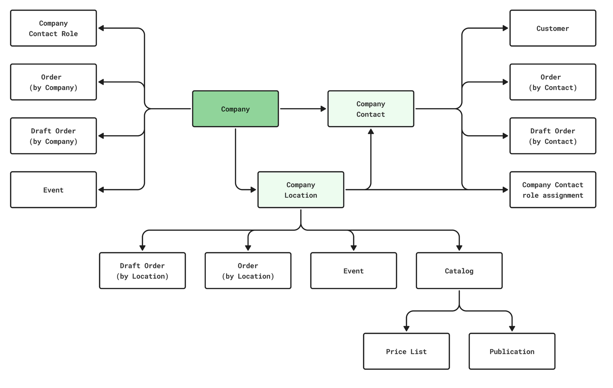
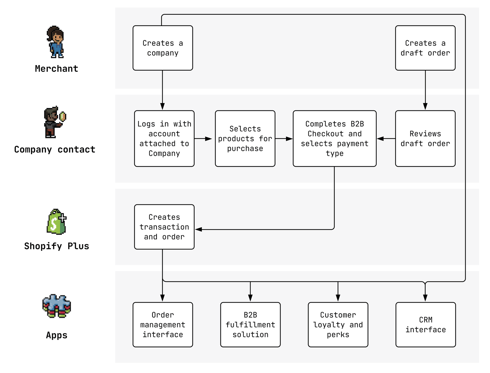
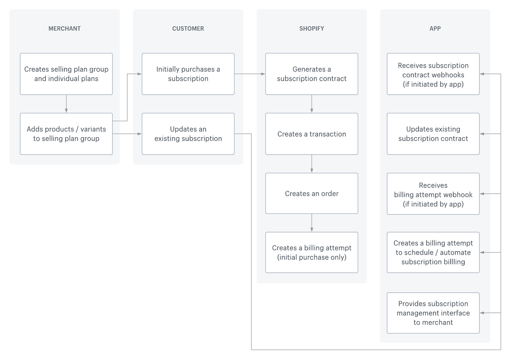

# SPF Custom App Solution Library 5.2 — B2B và subscription

| Field | Value |
| :---- | :---- |
| Owner | Bắc PV — NodeJS BE Dev Lead |
| Audience | Dev (NodeJS BE) |
| Last reviewed | 2026-11-18 |
| Review cadence | Quarterly |
| Version | v1.0 |
| Linked from | Ref_Dev_spf-custom-app-solution-library_v1.0 |
| Status | Live |

Doc này là mục 5.2 của [SPF Custom App Solution Library](Ref_Dev_spf-custom-app-solution-library_v1.0.md), nghiệp vụ B2B, bán sỉ và subscription. Doc nêu tính năng mặc định của Shopify, các yêu cầu tùy chỉnh kèm giải pháp, và ràng buộc kỹ thuật. Cách đọc các cột và điều kiện chung nằm ở [doc index](Ref_Dev_spf-custom-app-solution-library_v1.0.md).

## 1. Tính năng mặc định

B2B có trên Basic, Grow, Advanced, Plus. Không có trên Starter và Retail.

| Tính năng B2B | Basic | Grow | Advanced | Plus |
| :---- | :---- | :---- | :---- | :---- |
| Company, company location, role (Location admin, Ordering only) | Có | Có | Có | Có |
| Số catalog đang gán cho B2B market | 3 | 3 | 3 | Không giới hạn |
| Gán catalog trực tiếp cho company location | Không | Không | Không | Có |
| Quantity rules, volume pricing (tối đa 10 price break) | Có | Có | Có | Có |
| Net terms, nhắc thanh toán, vaulted card, PO number | Có | Có | Có | Có |
| Đặt cọc, trả một phần | Không | Không | Không | Có |
| Checkout thành draft order, đặt lại nhanh | Có | Có | Có | Có |
| Phân quyền sales staff | Không | Có | Có | Có |
| Theme Trade, quick order list | Có | Có | Có | Có |
| Storefront và checkout theo ngữ cảnh qua Markets | Không | Không | Có | Có |

- Store B2B có hai kiểu: blended (chung B2B và D2C) hoặc dedicated. Chỉ dedicated store mới khóa được cho riêng khách B2B.
- Giới hạn: 25 catalog mỗi location, 10.000 khách mỗi company, một khách thuộc một company.
- Payment terms: net 7, 15, 30, 45, 60, 90, hoặc khi fulfill. Hết hạn Shopify không tự thu tiền.
- B2B không hỗ trợ subscription, pre-order, try-before-you-buy.
- Vaulted card cần Shopify Payments.

| Tính năng | Mô tả | Giới hạn / plan |
| :---- | :---- | :---- |
| App Shopify Subscriptions | Plan theo tuần, tháng, năm. Giảm %, giảm tiền hoặc giá cố định. Khách tự skip, pause, resume, cancel | Không dùng với bundle. Cổng thanh toán hỗ trợ: Shopify Payments, PayPal Express, Authorize.net, Adyen, một phần Stripe. Prepaid và đổi sản phẩm: chưa xác nhận |

## 2. Yêu cầu tùy chỉnh

Các giải pháp dưới đây dùng customer account UI extension, chạy từ Basic trở lên và cần customer accounts mới. Viết tắt trong bảng:

- **PAGE**: full-page extension, target `customer-account.page.render`.
- **CAAPI**: gọi Customer Account API từ extension.
- **BACKEND**: extension gọi server của app, bật `network_access` và gửi session token.

### 2.1 B2B và bán sỉ

| Yêu cầu | Giới hạn mặc định | Giải pháp | Ràng buộc / fallback | Public app |
| :---- | :---- | :---- | :---- | :---- |
| Bảng giá riêng từng khách, không dùng B2B | Catalog không gán được cho 1 khách lẻ hay 1 segment | Discount Function đọc customer metafield. Hoặc chuyển khách thành company → `catalogCreate`, `priceListFixedPricesAdd` | Scope `write_products`. Dưới Plus chỉ 3 catalog đang gán. Non-Plus: discount có sẵn cho khách cụ thể hoặc segment | [BSS B2B Wholesale Pricing](https://apps.shopify.com/b2b-solution-custom-pricing). [Sami B2B Wholesale Pricing](https://apps.shopify.com/wholesale-sami) |
| Form đăng ký đại lý, có bước duyệt | Phần lớn đã có: form Shopify Forms tạo company chờ duyệt. Thiếu: không xin vào company có sẵn, khách chưa đăng nhập không mở được form ở store đã khóa | Form riêng bằng theme app block hoặc app proxy → `companyCreate`, `companyAssignCustomerAsContact`, `companyContactAssignRole`. Giấy tờ lưu ở company metafield | Scope `write_customers` hoặc `write_companies`. Docs có chỗ ghi B2B Admin API chỉ mở cho dev store và Plus, cần thử trên store Basic thật | [BSS B2B Wholesale Pricing](https://apps.shopify.com/b2b-solution-custom-pricing). [Shopify Forms](https://apps.shopify.com/shopify-forms) (một phần: không có bước duyệt) |
| Ẩn giá, chặn mua tới khi được duyệt | Chỉ dedicated B2B store khóa được. Theme Trade ẩn được giá với khách chưa đăng nhập | Điều kiện Liquid trên `customer`, `customer.b2b?`, `customer.tags`. Chặn cứng: Validation Function theo tag hoặc metafield | Ẩn bằng Liquid: chưa chắc ẩn được giá ở endpoint khác của storefront. Non-Plus: chỉ ẩn ở theme, dùng bước duyệt company có sẵn | [BSS B2B Lock, Login & Password](https://apps.shopify.com/login-to-access-pages) (chặn checkout: chỉ Plus). [Sami B2B Lock](https://apps.shopify.com/b2b-wholesale-lock-hide-price) |
| Đặt nhanh theo SKU hoặc upload CSV | Quick order list: section ở trang product, không nhập SKU, không có CSV | Trang app proxy hoặc theme app block có lưới SKU, đọc CSV. B2B: tạo đơn phía server bằng `draftOrderCreate` kèm `purchasingEntity` | Scope `write_draft_orders`. Mọi plan | [Upro B2B Credit Limit](https://apps.shopify.com/upro-credit-limit-b2b-and-wholesale). [B2Bridge](https://apps.shopify.com/b2bridge-b2b-all-in-one) (không ghi nhập SKU) |
| Công nợ: net terms kèm kiểm tra hạn mức | Payment terms: mọi plan B2B. Không có hạn mức công nợ | Hạn mức, dư nợ lưu ở metafield company location. Validation Function đọc `purchasingCompany` và metafield. Payment Customization Function đặt terms | Function không gọi được API ngoài, dư nợ phải đồng bộ sẵn. Non-Plus: buộc location gửi đơn dạng draft để duyệt | [Upro B2B Credit Limit](https://apps.shopify.com/upro-credit-limit-b2b-and-wholesale). [BSS B2B Wholesale Pricing](https://apps.shopify.com/b2b-solution-custom-pricing) (credit limit là add-on) |
| Sales đặt hàng thay khách | Nhân viên tạo draft order, gửi invoice. Giới hạn nhân viên theo location: từ Grow | App trong admin hoặc portal dùng `draftOrderCreate` kèm `purchasingEntity`, `companyLocationAssignStaffMembers` | Basic không có phân quyền sales staff | [SparkLayer B2B & Wholesale](https://apps.shopify.com/sparklayer). [CSS Sales Team: Rep Portal](https://apps.shopify.com/sales-rep) |
| Yêu cầu báo giá (RFQ) | Checkout thành draft: chỉ company location B2B, không có cho khách lẻ | Theme app block gửi yêu cầu → backend `draftOrderCreate` → khách xem draft qua CAAPI `customer.draftOrders` trong PAGE | Scope `write_draft_orders`, `customer_read_draft_orders`. Mọi plan | [QS Request a Quote, Hide Price](https://apps.shopify.com/request-for-quote-by-omega). [SA Request a Quote, Hide Price](https://apps.shopify.com/request-for-quote) |
| Company nhiều cấp, nhiều người mua, duyệt nội bộ | Role: chỉ Location admin và Ordering only. Không có duyệt phía người mua, không có hạn mức chi | Rule duyệt trong app. Validation Function chặn checkout trực tiếp với người mua bị đánh dấu. UI duyệt: PAGE | Non-Plus: merchant duyệt qua checkout thành draft | [SparkLayer B2B & Wholesale](https://apps.shopify.com/sparklayer) (một phần: order approval workflow). [Onboard B2B](https://apps.shopify.com/onboard-b2b) (một phần) |

Hình 1. Quan hệ giữa company, company location và catalog. Nguồn: [Apps and B2B](https://shopify.dev/docs/apps/build/b2b).

Hình 2. Luồng đặt hàng B2B. Nguồn: [Apps and B2B](https://shopify.dev/docs/apps/build/b2b).

### 2.2 Subscription

| Yêu cầu | Giới hạn mặc định | Giải pháp | Ràng buộc | Public app |
| :---- | :---- | :---- | :---- | :---- |
| Subscription box có skip, pause, đổi sản phẩm | Skip, pause, resume, cancel: có sẵn. Đổi sản phẩm: không thấy ghi. Không dùng với bundle | `sellingPlanGroupCreate`, `subscriptionContractAtomicCreate`. App tự kích hoạt từng kỳ thu bằng `subscriptionBillingAttemptCreate`. Portal: PAGE với CAAPI `subscriptionContractPause`, `subscriptionBillingCycleSkip` | Scope subscription và `read_customer_payment_methods` cần Shopify duyệt, tới 7 ngày làm việc. Contract bị hủy 48 giờ sau khi gỡ app. Phụ thuộc cổng thanh toán được hỗ trợ | [Seal Subscriptions](https://apps.shopify.com/seal-subscriptions). [Shopify Subscriptions](https://apps.shopify.com/shopify-subscriptions) (một phần: không ghi đổi sản phẩm, box, rating 3.8/5, 912 review) |
| Gói trả trước | App Shopify Subscriptions: chưa xác nhận | API mô tả prepaid: trả 1 lần, giao nhiều kỳ. Billing policy, delivery policy tách riêng | Như dòng trên | [Appstle Subscriptions](https://apps.shopify.com/subscriptions-by-appstle). [Seal Subscriptions](https://apps.shopify.com/seal-subscriptions) |

Hình 3. Vòng đời subscription giữa merchant, khách, Shopify và app. Nguồn: [Model a subscriptions solution](https://shopify.dev/docs/apps/build/purchase-options/subscriptions/model-subscriptions-solution).

## 3. Ràng buộc kỹ thuật

Giới hạn của customer account UI extension và Customer Account API ghi ở [Solution Library 5.1](Ref_Dev_s5.1_spf-solution-customer-accounts-loyalty_v1.0.md), mục 3.

Target riêng cho B2B:

- `customer-account.profile.company-details.render-after`, `customer-account.profile.company-location-staff.render-after`.

Subscription API:

- App chỉ thấy contract của chính nó.
- App phải tự kích hoạt mọi kỳ gia hạn, kèm idempotency key.
- Webhook: `subscription_contracts/create`, `subscription_contracts/update`, `subscription_billing_attempts/success`, `subscription_billing_attempts/failure`.

## References

- [B2B cho app](https://shopify.dev/docs/apps/build/b2b)
- [Subscription contracts](https://shopify.dev/docs/apps/build/purchase-options/subscriptions/contracts)
- [B2B plan features](https://help.shopify.com/en/manual/b2b/getting-started/plan-features)
- [Customer account UI extensions](https://shopify.dev/docs/api/customer-account-ui-extensions/latest) và [danh sách target](https://shopify.dev/docs/api/customer-account-ui-extensions/latest/targets)

## Changelog

| Date | Version | Change | By |
| :---- | :---- | :---- | :---- |
| 2026-11-18 | v1.0 | Bản đầu tiên. Owner duyệt trong chat ngày 2026-11-18. | Bắc PV |
