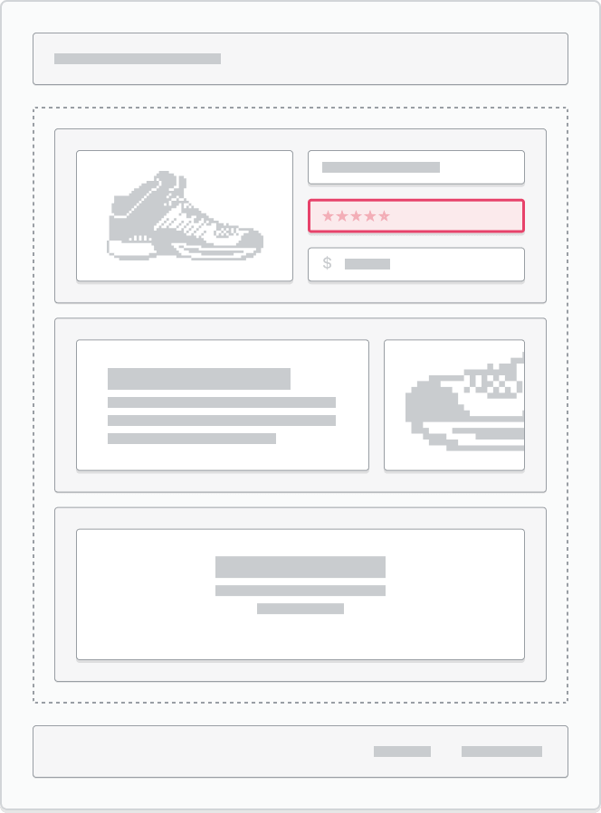

# SPF Custom App Solution Library 6 — Storefront và catalog

| Field | Value |
| :---- | :---- |
| Owner | Bắc PV — NodeJS BE Dev Lead |
| Audience | Dev (NodeJS BE) |
| Last reviewed | 2026-11-18 |
| Review cadence | Quarterly |
| Version | v1.0 |
| Linked from | Ref_Dev_spf-custom-app-solution-library_v1.0, Ref_Dev_s4.2_spf-solution-admin-operations_v1.0 |
| Status | Live |

Doc này là mục 6 của [SPF Custom App Solution Library](Ref_Dev_spf-custom-app-solution-library_v1.0.md), nghiệp vụ storefront và catalog. Doc nêu tính năng mặc định của Shopify, các yêu cầu tùy chỉnh kèm giải pháp, và ràng buộc kỹ thuật. Cách đọc các cột và điều kiện chung nằm ở [doc index](Ref_Dev_spf-custom-app-solution-library_v1.0.md).

## 1. Tính năng mặc định

| Tính năng | Mô tả | Giới hạn / plan |
| :---- | :---- | :---- |
| Section, block của theme | JSON template và section group | 25 section mỗi template, 50 block mỗi section, 1.000 JSON template mỗi theme |
| Metafield, metaobject trong theme | Gắn qua dynamic source trong theme editor hoặc Liquid | 50 dynamic source mỗi text setting, 100 mỗi template |
| Variant, option | 2.048 variant và 3 option mỗi product | Một số theme bên thứ ba không hỗ trợ quá 100 variant. 250 media mỗi product |
| Combined listings | App Shopify Combined Listings | Chỉ Plus và enterprise. 60 product con |
| Bundle | App Shopify Bundles, miễn phí, mọi plan: fixed bundle và multipack | 30 component. Tồn kho tính chung, không theo location. Không ghi có mix-and-match |
| Tìm kiếm, filter | Predictive search. App Search & Discovery: filter theo giá, tag, vendor, option, metafield | 25 filter mỗi store, 100 giá trị mỗi filter. Collection trên 5.000 product không có filter |
| Gợi ý sản phẩm | Related (tự sinh) và complementary (chọn tay) | 10 sản phẩm mỗi loại cho một product |
| Pre-order | Không có sẵn, cần app | Cổng thanh toán hỗ trợ: Shopify Payments, PayPal Express, Adyen, một phần Stripe |
| Báo có hàng lại | Không có tính năng cho khách. Flow có trigger "Product variant back in stock" dùng nội bộ | — |
| Review sản phẩm | Chỉ có review trên app Shop | Không có widget review cho online store |
| Shopify Forms | App miễn phí, form popup và inline, nối được với Flow | 31 field mỗi form, một file upload tối đa 20 MB |
| Shopify Inbox | Chat trên online store | Không ghi có Zalo, Messenger |
| Markets, ngôn ngữ | Market theo vùng trên mọi plan. 20 ngôn ngữ, 30 trên Plus | Multi-currency cần Shopify Payments hoặc Adyen. Tùy chỉnh theme theo market cần Advanced trở lên |
| Translate & Adapt | Dịch tay và dịch tự động | Dịch tự động 2 ngôn ngữ với store ngoài danh sách quốc gia ưu tiên. Việt Nam không có trong danh sách |
| Flow | Miễn phí trên Basic, Grow, Advanced, Plus | Send HTTP Request cần Grow trở lên |

## 2. Yêu cầu tùy chỉnh

Giải pháp dùng Function trong custom app chỉ chạy trên Plus. Các giải pháp còn lại dùng theme app extension, app proxy và webhook, chạy trên mọi plan.

| Yêu cầu | Giới hạn mặc định | Giải pháp | Ràng buộc / fallback | Public app |
| :---- | :---- | :---- | :---- | :---- |
| Cá nhân hóa sản phẩm: khắc chữ, upload ảnh, tính thêm tiền | Line item property: chỉ lưu nội dung khách nhập, không đổi giá | App block có input → `/cart/add.js` với `properties`. Ảnh: upload về backend app, lưu URL vào property. Cộng tiền: Cart Transform `lineUpdate` | `lineUpdate`: chỉ Plus và dev store. Non-Plus: phí là 1 variant riêng, thêm dạng nested cart line gắn với sản phẩm chính | [Globo Product Options](https://apps.shopify.com/product-options-pro). [Easify Custom Product Options](https://apps.shopify.com/easify-product-options) |
| Hơn 3 option, option có điều kiện, option cộng giá | Tối đa 3 option, 2.048 variant | Cấu hình option: lưu ở metafield hoặc metaobject. App block render, giá trị lưu thành line item property. Giá cộng thêm: như dòng trên | Như dòng trên | [Globo Product Options](https://apps.shopify.com/product-options-pro). [Easify Custom Product Options](https://apps.shopify.com/easify-product-options) |
| Bảng size, gợi ý size | Metafield: chỉ hiện dữ liệu | Mỗi bảng size 1 metaobject, hiện bằng theme block hoặc app block. Logic gợi ý: JS hoặc app proxy | Mọi plan | [MP Size Chart & Size Guide](https://apps.shopify.com/avada-size-chart). [Smart Size Chart & Size Guide](https://apps.shopify.com/smartsize) |
| Hiện tồn kho theo chi nhánh trên trang product | Theme: chỉ hiện location bật pickup | Storefront API `StoreAvailability.quantityAvailable`, scope `unauthenticated_read_product_pickup_locations`. Location khác: app proxy → Admin `InventoryLevel`, scope `read_inventory`, `read_locations` | Mọi plan | [Kark: Multi Location Inventory](https://apps.shopify.com/location-inventory-info). [Multi‑Location Stock info](https://apps.shopify.com/multilocation). Cả hai không ghi hỗ trợ location không bật pickup |
| Store locator | Storefront API `locations`: chỉ trả location bật pickup. Không có trang sẵn | Danh sách cửa hàng: lưu ở metaobject. Bản đồ: section hoặc app block | Mọi plan | [TA MAPPY: Store Locator & Maps](https://apps.shopify.com/dealer-store-locator). [RP ProMap ‑ Store Locator](https://apps.shopify.com/store-locator-4) |
| Pre-order có đặt cọc, ngày dự kiến | Cần app | `sellingPlanGroupCreate` với checkout charge một phần. App tự lên lịch thu phần còn lại | Không chạy trên POS, draft order, B2B, phương thức thanh toán nội địa. Cổng không hỗ trợ: bán sản phẩm thường, ngày dự kiến lưu ở property | [SMART Preorder & Back in stock](https://apps.shopify.com/smart-preorder-back-in-stock). [Notify Me! Back in Stock Alert](https://apps.shopify.com/preorder-back-in-stock) |
| Báo có hàng lại qua email, Zalo, SMS | Trigger Flow: chỉ dùng nội bộ | App block có form → app proxy → database app. Webhook `inventory_levels/update` → gửi tin qua dịch vụ ngoài | Mọi plan | [Kbite: Back In Stock, Notify Me](https://apps.shopify.com/cartbite). [Notify Me! Back in Stock Alert](https://apps.shopify.com/preorder-back-in-stock). Email, SMS; không tìm thấy app gửi qua Zalo |
| Flash sale có đếm ngược, giới hạn số lượng mỗi khách | Discount: chỉ giới hạn tổng lượt dùng, 1 lần mỗi khách. Quantity rules: chỉ B2B | Đếm ngược: app block. Giới hạn số lượng: Validation Function | Validation Function không chạy trên POS. Non-Plus: giới hạn ở theme qua Cart Ajax (vượt qua được), kiểm tra lại bằng webhook `orders/create` | [Essential Countdown Timer Bar](https://apps.shopify.com/essential-countdown-timer) (phần đếm ngược). [Melon Minimum Order Quantity](https://apps.shopify.com/watermelon) (phần giới hạn mỗi khách) |
| So sánh sản phẩm, sản phẩm vừa xem | Không thấy tính năng sẵn | Metafield, app block, `localStorage`. Sản phẩm vừa xem: render bằng Section Rendering API | Section Rendering API: tối đa 5 section mỗi request | [Equate ‑ Product Compare](https://apps.shopify.com/product-compare) (phần so sánh). [Tipo Related Products](https://apps.shopify.com/globo-related-products) (phần vừa xem) |
| Trang tra cứu bảo hành, serial trên domain shop | Không có trang sẵn | App proxy trả `Content-Type: application/liquid` → Shopify render trong theme. Kiểm tra `signature` | App proxy không có cookie. App tự kiểm tra `logged_in_customer_id` có quyền với dữ liệu | [My Product Registration](https://apps.shopify.com/product-registration-1). [Warranty Registration & Claims](https://apps.shopify.com/dyrect-warranty-registrations) (không ghi tra serial) |
| Trang tra cứu đơn hàng | Không thấy trang tra cứu sẵn | App proxy hoặc full-page customer account UI extension | Mọi plan | [CWILL Order Tracking](https://apps.shopify.com/parcelpanel). [AfterShip Order Tracking](https://apps.shopify.com/aftership) |
| Form tùy chỉnh lưu về backend: báo giá, đăng ký đại lý, khảo sát | Form `contact` Liquid: chỉ gửi email cho merchant. Shopify Forms: giới hạn 31 field | App block gửi POST → app proxy → metaobject, scope `write_metaobjects` | Mọi plan | [Powerful Contact Form Builder](https://apps.shopify.com/form-builder-contact-form). [Shopify Forms](https://apps.shopify.com/shopify-forms) (một phần) |
| Hiện dữ liệu hệ thống ngoài trong theme: tồn kho ERP, giá, lịch hẹn | Liquid theme app extension không gọi được backend lúc render | App block fetch tới app proxy, hoặc đồng bộ dữ liệu vào metafield | Mọi plan | [syncX: Stock Inventory Sync](https://apps.shopify.com/stock-sync) (một phần: đồng bộ tồn kho, giá, metafield từ feed; không hiện dữ liệu trực tiếp). [TM Odoo Integration](https://apps.shopify.com/odoo-integrator) (một phần: chỉ Odoo) |
| Đặt lịch hẹn | Không thấy tính năng sẵn | App block, app proxy trả khung giờ trống. Khung giờ: lưu thành line item property. Validation Function chặn đặt trùng | Non-Plus: backend kiểm tra ở webhook `orders/create` | [Cowlendar](https://apps.shopify.com/cowlendar). [Apntly](https://apps.shopify.com/appointly) |
| Review, hỏi đáp có ảnh | Review: chỉ app Shop | App block, app proxy. Dữ liệu: lưu ở metaobject | Mọi plan | [Judge.me Product Reviews](https://apps.shopify.com/judgeme). [Loox](https://apps.shopify.com/loox) (không ghi Q&A) |
| Chat Zalo, Messenger | Inbox: chỉ chat online store | App embed block, target `body` | Chạy cả trên theme vintage | [Hura Social Chat](https://apps.shopify.com/fbmessenger) (Messenger, Zalo, 1 review). [Chatty](https://apps.shopify.com/chatty) (chỉ Messenger) |
| Popup thu lead, đồng bộ CRM | Shopify Forms nối Flow. Send HTTP Request: từ Grow | App embed và app proxy, hoặc webhook `customers/create` | Mọi plan | [Klaviyo: Email Marketing & SMS](https://apps.shopify.com/klaviyo-email-marketing) (app của Klaviyo: popup, form, lead vào Klaviyo). [Mailchimp Email SMS Marketing](https://apps.shopify.com/mailchimp) (app của Intuit Mailchimp: popup form, lead vào Mailchimp). [CWILL Popup Email Marketing](https://apps.shopify.com/ecomsend) (nối Klaviyo, Mailchimp; không ghi CRM). [Shopify Forms](https://apps.shopify.com/shopify-forms) (không ghi CRM) |
| Link affiliate, referral | Chưa kiểm tra tính năng sẵn | Mã giới thiệu → cart attribute riêng tư (tiền tố `__`) qua `/cart/update.js` → đọc lại ở webhook `orders/create` | Mọi plan | [UpPromote Affiliate Marketing](https://apps.shopify.com/affliate-by-secomapp). [Shopify Collabs](https://apps.shopify.com/collabs) (không ghi referral cho khách) |
| Nội dung metaobject đa ngôn ngữ | Dịch tự động: giới hạn 2 ngôn ngữ cho store Việt Nam | `METAOBJECT` là translatable resource. Ghi bản dịch qua API, scope `write_translations` | Mọi plan | [Shopify Translate & Adapt](https://apps.shopify.com/translate-and-adapt) (một phần: không ghi metaobject). [Transcy](https://apps.shopify.com/transcy-multiple-languages) (một phần) |
| Age gate | Không thấy tính năng sẵn | App embed block, target `body` | Mọi plan | [Blockify Age Verification 18+](https://apps.shopify.com/blockify-age-verification). [AVP ‑ Age Verification Popup](https://apps.shopify.com/avcsp) |
| Ẩn sản phẩm hoặc giá theo tag khách | `customer.tags`: chỉ trong Liquid, nil khi chưa đăng nhập, nên chỉ ẩn được ở theme | B2B catalog. Gán catalog trực tiếp cho company: chỉ Plus | Non-Plus: B2B market, tối đa 3 catalog | [Sami B2B Lock](https://apps.shopify.com/b2b-wholesale-lock-hide-price). [QS Request a Quote, Hide Price](https://apps.shopify.com/request-for-quote-by-omega) (chỉ phần ẩn giá) |
| Quick order: đặt nhiều variant cùng lúc | Theme Trade có quick order list | App block → `/cart/add.js` với nhiều variant | Mọi plan | [MultiVariants Bulk Order B2B](https://apps.shopify.com/multivariants). [Sami B2B Wholesale Pricing](https://apps.shopify.com/wholesale-sami) |
| Cart drawer: thanh tiến độ nhận quà, ghi chú, gói quà | Buy X get Y có sẵn, không tự thêm quà | Cart Ajax với `note`, `attributes`, bundled section rendering. Gói quà: nested cart line | Nested cart line: chỉ 1 cấp | [Essent Cart Drawer Cart Upsell](https://apps.shopify.com/essential-cart-drawer). [Section Store & Cart Drawer](https://apps.shopify.com/section-factory). Cả hai không ghi rõ gói quà |
| Storefront headless | — | Storefront API qua Headless channel hoặc `storefrontAccessTokenCreate` | Checkout UI extension ở bước information, shipping, payment: vẫn chỉ Plus | [Headless](https://apps.shopify.com/headless) (6 review). [Hydrogen](https://apps.shopify.com/hydrogen) (8 review) |

Hình 1. App block trong section của theme. Nguồn: [Configure theme app extensions](https://shopify.dev/docs/apps/build/online-store/theme-app-extensions/configuration).

## 3. Ràng buộc kỹ thuật

Theme app extension:

- Tổng dung lượng 10 MB, 30 block, Liquid 100 KB cho mọi file.
- App block cần JSON template và section nhận block loại `@app`. Block không tự thêm khi cài app, merchant thêm trong theme editor.
- App embed block có target `head`, `compliance_head`, `body`, chạy trên cả theme vintage, mặc định tắt.
- Deep link để merchant thêm block: `.../admin/themes/current/editor?template={template}&addAppBlockId={api_key}/{handle}&target=newAppsSection`.
- App block và app embed không render ở checkout.
- `available_if` trong schema: ẩn hiện block theo app metafield kiểu boolean.

App proxy:

- Tiền tố đường dẫn: `a`, `apps`, `community`, `tools`. Mỗi app một proxy route. Merchant đổi được tiền tố và subpath.
- Shopify thêm `shop`, `path_prefix`, `timestamp`, `logged_in_customer_id`, `signature` vào request.
- `signature` là HMAC-SHA256 trên các tham số đã sắp xếp, key là app secret.
- `Cookie` bị bỏ khỏi request, `Set-Cookie` bị bỏ khỏi response.
- Caching, timeout và giới hạn body: chưa xác nhận.

Dữ liệu trên cart:

| Loại | Cách ghi | Ghi chú |
| :---- | :---- | :---- |
| Line item property | Input `properties[...]`, hoặc `properties` trong `/cart/add.js`, `/cart/change.js` | Tiền tố `_` thì ẩn ở checkout |
| Cart attribute | `attributes` trong `/cart/update.js` | Tiền tố `__` là riêng tư |
| Cart metafield | Storefront API `cartMetafieldsSet`, 25 metafield mỗi request | Chỉ copy sang order khi có definition trùng khớp |

Storefront API:

- Public token gửi trong `X-Shopify-Storefront-Access-Token`. Private token gửi trong `Shopify-Storefront-Private-Token` kèm `Shopify-Storefront-Buyer-IP`.
- Mỗi app tối đa 100 token đang bật trên một shop.

## References

- [Theme app extensions](https://shopify.dev/docs/apps/build/online-store/theme-app-extensions/configuration)
- [App proxy](https://shopify.dev/docs/apps/build/online-store/display-dynamic-data) và [xác thực app proxy](https://shopify.dev/docs/apps/build/online-store/app-proxies/authenticate-app-proxies)
- [Cart Ajax API](https://shopify.dev/docs/api/ajax/reference/cart)
- [Nested cart lines](https://shopify.dev/docs/apps/build/product-merchandising/nested-cart-lines)
- [Deferred purchase options](https://shopify.dev/docs/apps/build/purchase-options/deferred)
- [Storefront API](https://shopify.dev/docs/api/storefront)
- [Add variants](https://help.shopify.com/en/manual/products/variants/add-variants)

## Changelog

| Date | Version | Change | By |
| :---- | :---- | :---- | :---- |
| 2026-11-18 | v1.0 | Mục 3 thêm `available_if` của app block. Owner duyệt trong chat ngày 2026-11-18. | Bắc PV |
| 2026-11-18 | v1.0 | Bản đầu tiên. Owner duyệt trong chat ngày 2026-11-18. | Bắc PV |
