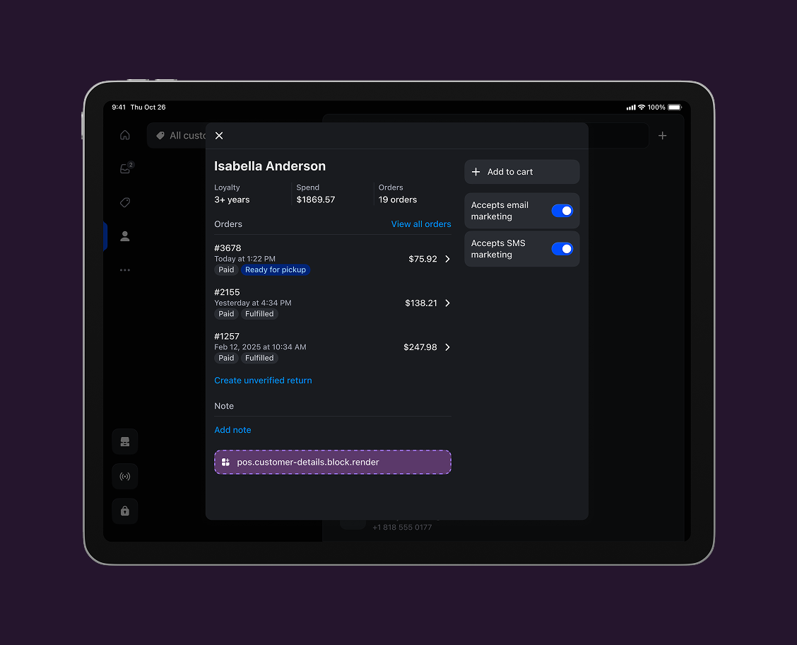
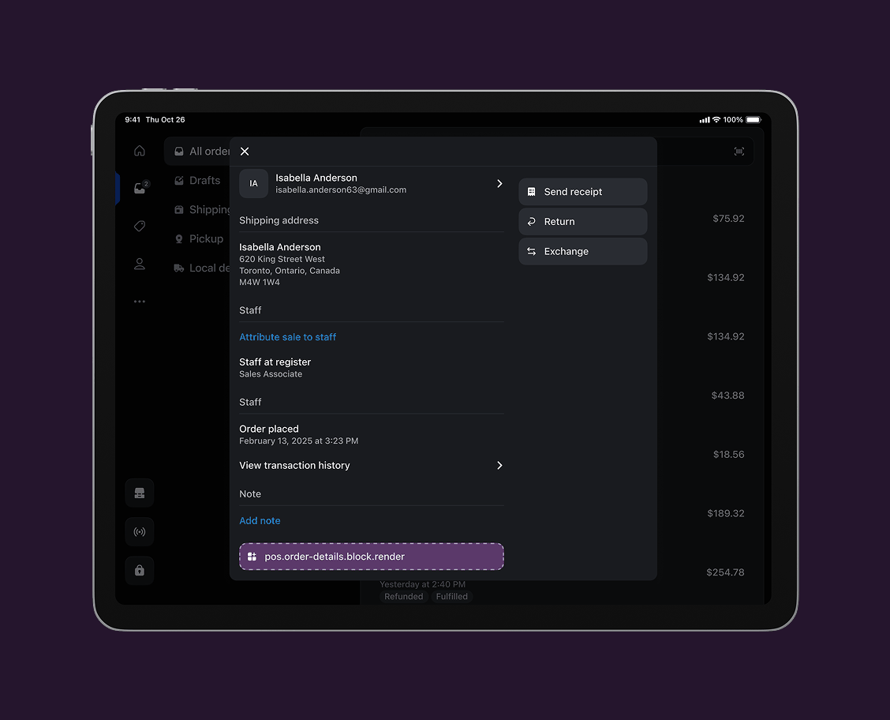

# SPF Custom App Solution Library 8 — POS

| Field | Value |
| :---- | :---- |
| Owner | Bắc PV — NodeJS BE Dev Lead |
| Audience | Dev (NodeJS BE) |
| Last reviewed | 2026-11-18 |
| Review cadence | Quarterly |
| Version | v1.0 |
| Linked from | Ref_Dev_spf-custom-app-solution-library_v1.0 |
| Status | Live |

Doc này là mục 8 của [SPF Custom App Solution Library](Ref_Dev_spf-custom-app-solution-library_v1.0.md), nghiệp vụ Shopify POS. Doc nêu tính năng mặc định của Shopify, các yêu cầu tùy chỉnh kèm giải pháp, và ràng buộc kỹ thuật. Cách đọc các cột và điều kiện chung nằm ở [doc index](Ref_Dev_spf-custom-app-solution-library_v1.0.md).

## 1. Tính năng mặc định

| Tính năng | Gói cơ bản | POS Pro |
| :---- | :---- | :---- |
| Smart grid, in receipt tùy chỉnh, refund, discount code, discount thủ công, hồ sơ khách | Có | Có |
| Phân quyền nhân viên | Không | Có |
| Đổi hàng, hủy đơn | Không | Có |
| Ship về nhà, nhận tại cửa hàng, local delivery | Không | Có |
| Lưu cart, automatic discount, báo cáo bán hàng theo ngày | Không | Có |

- POS Pro tính phí theo location trên mọi plan. Plus có sẵn 20 location Pro đầu tiên.
- Receipt có sẵn custom Liquid block ở header và footer, dùng được `qrcode`, `barcode`, metafield của order và customer. Giới hạn 50 KB, không có CSS và script.
- Loyalty chỉ có qua app đặt trên smart grid.

## 2. Yêu cầu tùy chỉnh

| Yêu cầu | Giải pháp | Ràng buộc | Public app |
| :---- | :---- | :---- | :---- |
| Tra điểm thưởng, đổi điểm tại quầy | Target `pos.customer-details.block.render`, `pos.home.tile.render` kèm `pos.home.modal.render`. Cart API `applyCartDiscount`, `addCartCodeDiscount`. Gọi backend bằng session token | `getSessionToken` trả undefined khi nhân viên đang đăng nhập không có quyền dùng app | [BON Loyalty](https://apps.shopify.com/bon-loyalty-rewards). [Joy Loyalty](https://apps.shopify.com/joyio) |
| Discount riêng tại POS | Cart API `setLineItemDiscount`, `bulkSetLineItemDiscounts`. Discount Function có chạy trên POS | Automatic discount trên POS: cần POS Pro. Function trong custom app: cần Plus | [Dollarlabs Automatic Discounts](https://apps.shopify.com/dollar-discounts). [AIOD](https://apps.shopify.com/all-in-one-automatic-discounts) |
| Hiện thông tin khách, bảo hành tại POS | Block target ở màn customer, order, product. Gọi thẳng Admin GraphQL, scope khai báo trong TOML | Không chạy khi offline | [SeriaLogic](https://apps.shopify.com/serial-number-manager) (một phần: quét serial để tìm đơn, khách; không ghi bảo hành) |
| Receipt có QR code, thông tin hóa đơn VAT | Custom Liquid block có sẵn ở header, footer. Hoặc in tài liệu riêng qua Printing API | Extension không sửa được phần thân receipt chuẩn. Receipt đơn offline không render block | [Order Printer Pro](https://apps.shopify.com/order-printer-pro) (một phần: invoice có VAT in từ POS, không ghi QR) |
| Add-on cho sản phẩm tại POS | Target `pos.product-details.action.*`, `pos.cart.line-item-details.action.*`. Cart API `addLineItem`, `addLineItemProperties`, `addCustomSale` | Không tạo được nested cart line trên POS | [POSify: Custom POS Fields](https://apps.shopify.com/customize-pos-products). [Globo Product Options](https://apps.shopify.com/product-options-pro) (một phần) |
| Thao tác trên đơn tại POS: xuất hóa đơn điện tử, in nhãn | Target `pos.order-details.action.menu-item.render` kèm `.action.render`. Event `transactioncomplete` ở target nền `pos.app.ready.data` | Target nền: chỉ quan sát. PDF: chỉ in qua hộp thoại hệ thống, không in được trên Android | [Order Printer Pro](https://apps.shopify.com/order-printer-pro) (một phần: in invoice từ POS; e-invoice không theo chuẩn Việt Nam). [Avada PDF Invoice](https://apps.shopify.com/avada-pdf-invoice) (một phần) |
| Chạy khi mất mạng | Khai báo `runs_offline = true`, POS từ 11.0. Dùng Connectivity API, Storage API | Storage API: tối đa 100 entry. POS offline không có tìm khách, gift card, trả hàng, discount code, automatic discount | Không tìm thấy |

Hình 1. Block `pos.customer-details.block.render` ở màn Customer. Nguồn: [Targets](https://shopify.dev/docs/api/pos-ui-extensions/latest/targets).

Hình 2. Block `pos.order-details.block.render` ở màn Order. Nguồn: [Targets](https://shopify.dev/docs/api/pos-ui-extensions/latest/targets).

## 3. Ràng buộc kỹ thuật

- POS UI extension có 23 target: home tile và modal, các target block, menu-item, action ở màn product, customer, order, draft order, post-purchase, register details, và target nền `pos.app.ready.data`.
- Trang target `2026-10` không có target cho receipt, return, exchange. Target receipt chỉ thấy nhắc trên forum dạng preview theo lời mời, chưa xác nhận.
- Bundle tối đa 64 KB.
- Request tới domain của app được tự gắn header xác thực, từ POS 10.6.0 và API `2025-07`.
- Session token không dùng để gọi thẳng API của Shopify từ client.

## References

- [POS UI extensions](https://shopify.dev/docs/api/pos-ui-extensions/2026-10) và [danh sách target](https://shopify.dev/docs/api/pos-ui-extensions/2026-10/targets)
- [Cart API của POS](https://shopify.dev/docs/api/pos-ui-extensions/2026-10/target-apis/contextual-apis/cart-api)
- [So sánh tính năng POS](https://help.shopify.com/en/manual/sell-in-person/getting-started/identify-your-pos-needs)
- [Custom Liquid block trên receipt](https://help.shopify.com/en/manual/sell-in-person/shopify-pos/customize-pos/printed-receipts/custom-liquid-blocks)

## Changelog

| Date | Version | Change | By |
| :---- | :---- | :---- | :---- |
| 2026-11-18 | v1.0 | Bản đầu tiên. Owner duyệt trong chat ngày 2026-11-18. | Bắc PV |
