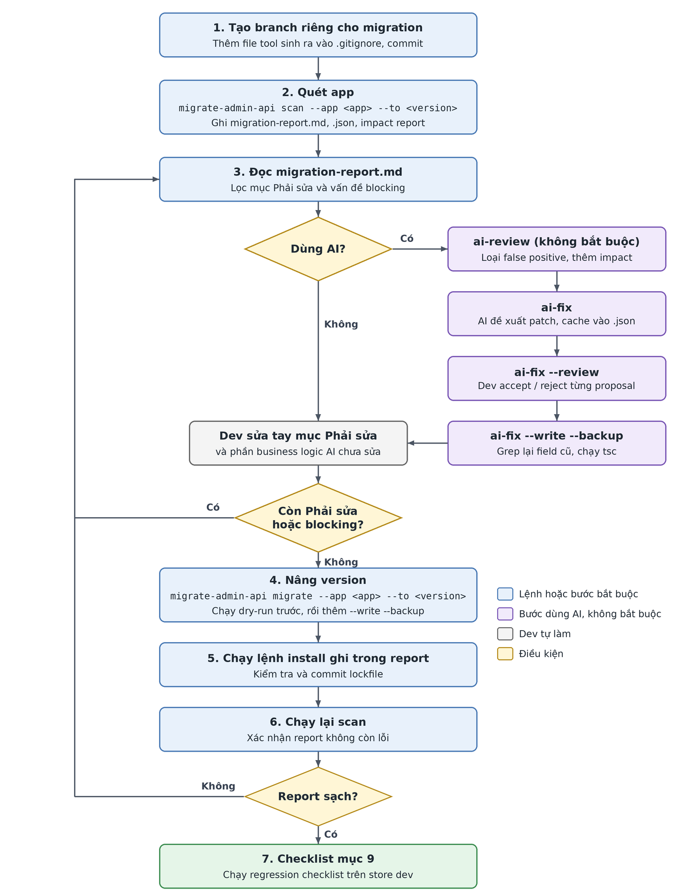

# Shopify API version upgrade tool

| Field | Value |
| :---- | :---- |
| Owner | Bắc PV — NodeJS BE Dev Lead |
| Audience | Dev (NodeJS BE) |
| Last reviewed | 2026-11-18 |
| Review cadence | Quarterly |
| Version | v1.0 |
| Linked from | (none) |
| Status | Live |

`migrate-admin-api` hỗ trợ nâng Shopify API version cho app: Admin GraphQL, Storefront GraphQL, versioned extensions và Admin UI extensions. Tool chỉ ra operation, extension hoặc REST call nào có thể lỗi khi nâng version, kèm `file:line`. Tool auto-fix các trường hợp an toàn, nhưng không tự migrate hoàn toàn. Dev đọc doc này trước khi nâng API version cho một app.

## 1. Khi nào dùng

Shopify ra API version mới mỗi quý và chỉ giữ mỗi version khoảng 12 tháng. Khi version app đang gọi sắp hết hạn, hoặc app cần field chỉ có ở version mới, dev phải nâng version.

Dùng tool cho các việc sau:

- Tìm operation Admin GraphQL và Storefront GraphQL sẽ lỗi hoặc đổi hành vi ở version đích.
- Nâng `api_version` trong `shopify.app.toml`, extension TOML, `apiVersion` trong code và config graphql-codegen.
- Kiểm tra Shopify package trong `package.json` (`@shopify/cli`, `@shopify/shopify-api`, `@shopify/shopify-app-*`...) có hỗ trợ version đích không.
- Tìm UI extension còn dùng React, Admin UI legacy và REST Admin URL ghi cứng version.

Tool không thay cho việc test lại app. Report sạch chỉ nghĩa là tool không thấy lỗi trong phạm vi nó quét được (mục 7).

## 2. Cách hoạt động

```txt
Config → Surface discovery → Schema fetch → Diff → Scan → Impact → Classify → Autofix → Report
```

Đi qua một lần chạy `scan`:

1. **Config.** Tool xác định version gốc theo thứ tự: `--from`, rồi `apiVersion:` truyền cho `shopifyApp`/`shopifyApi` trong code, cuối cùng là `api_version` trong toml.
2. **Surface discovery.** Tool tách operation Admin và Storefront, liệt kê extension TOML, tìm REST URL ghi cứng version và đọc mọi `package.json`.
3. **Schema fetch.** Tool lấy schema Admin và Storefront của version gốc và version đích qua proxy của shopify.dev, không cần token. Schema được cache trong `.cache/schema/` của thư mục tool.
4. **Diff và Impact.** Tool validate từng operation với schema đích, rồi đối chiếu operation với diff giữa hai schema. Bước sau bắt field đổi type, field deprecated, input qua variable bị xóa field hoặc thêm field required.
5. **Classify.** Tool chỉ auto-fix khi field cuối của selection bị đổi tên, tên mới có trong schema đích và selection set không đổi. Mọi trường hợp khác là **Phải sửa** (sửa tay).
6. **Report.** Tool ghi 3 file vào thư mục gốc của app, không dùng AI:
   - `migration-report.md`: report kỹ thuật, gồm danh sách breaking change, dependency, access scope và tech stack.
   - `migration-report.json`: dữ liệu cho `ai-review` và `ai-fix`.
   - `migration-impact-report.md`: business logic bị ảnh hưởng và regression checklist.

Nhiều breaking change vẫn pass validation. Trên app oms-clone, validation thấy 2 mục, thêm bước Impact thấy 12 mục (`lesson-learn.md`).

## 3. Cài đặt

Tool nằm ở repo `tungdq/migrate-admin-api-tool`. Bản đầy đủ ở nhánh `DNODEJSBE-11`, PR #1 vào `master` đang open (kiểm tra ngày 2026-11-17). Nhánh `master` chưa có phân tích Storefront, extension, dependency audit và Codex.

```bash
git clone --branch DNODEJSBE-11 https://git.bssdev.cloud/tungdq/migrate-admin-api-tool.git
cd migrate-admin-api-tool
npm ci
npm run build   # tsc, then chmod +x dist/cli.js
npm link        # registers the migrate-admin-api command globally
```

Yêu cầu:

- Node.js ≥ 18 (`engines` trong `package.json` của tool).
- Claude Code CLI nếu dùng `ai-review` và `ai-fix`. Codex CLI nếu dùng `--ai-provider codex`.

## 4. Quy trình nâng version



Chạy theo thứ tự `scan → ai-review → ai-fix → migrate` (Hình 1). Bước 2 và 3 không bắt buộc. Mỗi bước giới hạn rõ AI được đọc gì:

| Lệnh | Gọi AI | AI đọc gì |
| :---- | :---- | :---- |
| `scan` | Không | — |
| `ai-review` | Có | Chỉ `migration-report.md` và `migration-report.json`, không đọc source |
| `ai-fix` | Có | `migration-report.json` và đoạn source quanh vị trí phải sửa |
| `migrate` | Không | — |

Trước khi chạy, tạo branch riêng và thêm file tool sinh ra vào `.gitignore` của app, rồi commit. Nếu không, `ai-fix --write` và `migrate --write` bị chặn (mục 7).

```gitignore
migration-report.md
migration-report.json
migration-impact-report.md
migration-ai-fix.log
migration-ai-fix-prompts/
.backup/
```

### 4.1 `scan`

```bash
migrate-admin-api scan --app ./my-shopify-app --to 2026-07
```

`scan` không sửa code. Output khi chạy trên app mẫu trong repo tool:

```txt
Migration Shopify APIs: 2024-10 → 2026-07
  Admin operations    : 2
  Tự sửa được       : 0
  Cần sửa tay       : 1
  Deprecation        : 0
  Webhook (cần kiểm) : 0
  Shopify dependencies: 0 (0 safe action, 0 major review, 0 manual)
  ! Phát hiện GraphQL động — xem cảnh báo coverage trong report.
  ! Schema gốc "2024-10" không khả dụng (có thể đã hết hạn). Tiếp tục với validation chỉ theo schema đích; ...
  ! Chưa nâng api_version / graphql-codegen schema: còn 1 GraphQL breaking change và 0 vấn đề surface blocking. ...
```

Ba cảnh báo `!` hay gặp:

- **Version gốc từ code khác toml.** Tool dùng giá trị trong code. Nếu code có nhiều `apiVersion` khác nhau, kiểm tra lại giá trị tool chọn và truyền `--from` khi cần.
- **Schema gốc không khả dụng.** Xem mục 7 và mục 8.
- **GraphQL động.** Dev tự rà query ghép bằng `${...}` (mục 7).

Sau đó mở `migration-report.md`, xử lý mục **Phải sửa** (mỗi dòng có `file:line` và lỗi validate).

### 4.2 `ai-review`

```bash
migrate-admin-api ai-review --app ./my-shopify-app
migrate-admin-api ai-review --app ./my-shopify-app --ai-provider codex
```

AI đọc report có sẵn để loại false positive của bước grep. AI cũng bổ sung dependency compatibility, tech stack cần đổi và business impact vào `migration-impact-report.md`. Kết quả này là gợi ý để đọc, chưa phải bằng chứng.

Model chọn bằng biến môi trường: `MIGRATE_AI_MODEL` cho Claude, `MIGRATE_CODEX_MODEL` cho Codex. Chạy lại với `--force` để review lại các mục đã có kết quả.

### 4.3 `ai-fix`

`ai-fix` đề xuất patch cho mục **Phải sửa**, theo hai bước tách rời:

```bash
# 1. Propose: calls the AI and caches proposals in migration-report.json
migrate-admin-api ai-fix --app ./my-shopify-app
# 2. Review proposals: accept, reject, add a userNote
migrate-admin-api ai-fix --app ./my-shopify-app --review
# 3. Apply the cached proposals, no AI call
migrate-admin-api ai-fix --app ./my-shopify-app --write --backup
```

`--write` chỉ áp dụng proposal đã cache, không gọi AI lại. Proposal sai thì ghi `userNote` để hướng AI, rồi chạy lại bước 1.

Proposal chưa phải bản sửa hoàn chỉnh (mục 7). Sau `--write`, grep lại field và argument cũ, rồi chạy `tsc` trên app. Business fix như refund flow hay kiểm tra tồn kho thì dev tự sửa.

### 4.4 `migrate`

```bash
migrate-admin-api migrate --app ./my-shopify-app --to 2026-07                   # dry-run
migrate-admin-api migrate --app ./my-shopify-app --to 2026-07 --write --backup
```

`migrate` quét lại, áp dụng auto-fix rồi nâng version ở mọi chỗ: app TOML, extension TOML, Admin `apiVersion`, Storefront `storefrontApiVersion` và `.graphqlrc.ts` / `graphql.config.*`.

Tool không nâng version khi còn mục **Phải sửa** hoặc vấn đề blocking, ví dụ UI extension dùng React ở target sau `2025-07`. Deprecation không chặn. `--force-bump` bỏ qua guard này.

Với Shopify dependency, `migrate --write` chỉ nâng trong cùng major. Major mới chỉ được ghi vào report dạng **MAJOR REVIEW**. Tool không chạy package manager. Sau `--write`, chạy lệnh install được ghi trong report, kiểm tra lại lockfile, rồi commit.

Cuối cùng chạy lại `scan` để xác nhận report sạch.

## 5. Flags thường dùng

| Flag | Lệnh | Tác dụng |
| :---- | :---- | :---- |
| `--app <path>` | tất cả | Thư mục app, mặc định `.` |
| `--to <version>` | `scan`, `migrate` | Version đích |
| `--from <version>` | `scan`, `migrate` | Ghi đè version gốc |
| `--storefront-from <version>` | `scan`, `migrate` | Version gốc của Storefront khi khác Admin |
| `--shop <domain>` | `scan`, `migrate`, `dump-schema` | Lấy schema từ store thật, token đọc từ env |
| `--ignore <globs>` | `scan`, `migrate`, `ai-fix` | Loại file khỏi quét; với `ai-fix` là loại khỏi context gửi AI |
| `--write` | `migrate`, `ai-fix` | Ghi thay đổi, mặc định chỉ dry-run |
| `--backup` | `migrate`, `ai-fix` | Sao lưu file vào `.backup/` trước khi ghi, gồm cả TOML và `package.json` |
| `--no-git-check` | `migrate`, `ai-fix` | Cho `--write` chạy khi working tree chưa sạch |
| `--force-bump` | `migrate` | Nâng version dù còn breaking change |
| `--no-dependency-check` | `scan`, `migrate` | Bỏ audit Shopify package |
| `--no-dependency-update` | `migrate` | Vẫn audit nhưng không sửa `package.json` |
| `--ai-provider <claude\|codex\|auto>` | `ai-review`, `ai-fix` | AI runtime, mặc định `claude` |
| `--refresh` / `--no-cache` | `scan`, `migrate`, `dump-schema` | Lấy lại schema / bỏ qua cache |

`dump-schema --version 2026-07` tải schema ra file SDL, đặt tên theo version Shopify thực sự trả về.

## 6. An toàn khi AI đọc source

- `ai-review` chỉ đọc report và các đoạn code mà `scan` đã trích sẵn.
- `ai-fix` là lệnh duy nhất đọc source, và chỉ đọc vùng code quanh vị trí cần sửa.
- `ai-fix` luôn loại `.env*`, file credential và secret, private key, database, log khỏi context. Dùng thêm `--ignore` cho file nhạy cảm riêng của project, ví dụ `--ignore "**/fixtures/**,app/internal/**"`.
- Token, password, JWT, private key nằm inline trong code bị redact trước khi gửi.
- AI chạy trong thư mục tạm không chứa project. Tool và MCP của Claude bị tắt, Codex chạy sandbox read-only.

## 7. Hạn chế và ngoài phạm vi

### 7.1 Hạn chế

- **Report làm `--write` bị chặn.** Bước kiểm tra git coi report do `scan` vừa ghi là thay đổi chưa commit (mục 4).
- **Version gốc hết hạn thì report thiếu.** Tool chỉ validate với schema đích và bỏ bước Impact, bước bắt 10 trong 12 mục trên oms-clone (mục 2). Cách xử lý ở mục 8.
- **GraphQL động.** Tool không phân tích được query ghép bằng `${...}`.
- **`ai-fix` chỉ là bản nháp.** Giới hạn đã gặp trên app thật (`lesson-learn.md` mục 10):
  - Proposal chỉ sửa chuỗi GraphQL. Variables và type ở chỗ gọi vẫn có thể sai.
  - `validated: true` chỉ nghĩa là đoạn `search` khớp duy nhất trong file. Tool không chạy `tsc`.
  - Với field input bị xóa, AI có thể xóa luôn key và làm mất business logic đi kèm.
  - Một số file có trong kết quả grep nhưng không có proposal.
- **Chưa merge vào `master`.** Mỗi dev tự build từ nhánh `DNODEJSBE-11` (mục 3).

### 7.2 Ngoài phạm vi

Dev tự xử lý các việc sau:

- Node.js runtime trong `Dockerfile`, CI, `.nvmrc`, `nixpacks.toml`. Tool chỉ liệt kê `engines.node` trong report.
- Nâng major của framework không thuộc Shopify: NestJS, Express, Fastify, Next.js, Prisma.
- Nâng major của Shopify package. Tool chỉ thêm checklist MAJOR REVIEW, ví dụ đổi lệnh `shopify webhook trigger` thành `shopify app webhook trigger` từ CLI v4.
- Chuyển UI extension từ React sang Preact và Polaris web components. Tool chặn bump và đưa vào `ai-fix`, nhưng không có codemod.
- So sánh schema REST Admin, tự migrate access scope.
- Shopify Functions: tool không validate input query của Function, chỉ ghi yêu cầu regenerate schema, build và test.

## 8. Lỗi thường gặp

| Hiện tượng | Nguyên nhân | Cách xử lý |
| :---- | :---- | :---- |
| `Schema gốc "2024-10" không khả dụng` | Version gốc đã hết hạn, proxy không trả schema | Đặt `SHOPIFY_SHOP` và `SHOPIFY_ADMIN_TOKEN` của store còn hỗ trợ version đó, hoặc chép schema lưu trữ vào `.cache/schema/` của thư mục tool: `<version>.json` cho Admin, `storefront-<version>.json` cho Storefront |
| Version gốc trong report khác toml | Tool đọc `apiVersion` trong code trước toml | Kiểm tra code; truyền `--from` nếu tool chọn sai |
| `Chưa nâng api_version / graphql-codegen schema` | Còn mục **Phải sửa** hoặc vấn đề blocking | Sửa hết rồi chạy lại, hoặc dùng `--force-bump` có chủ đích |
| `Property 'July26' does not exist on type 'typeof ApiVersion'` | Đã nâng version nhưng `@shopify/shopify-api` đang cài chưa có enum đó | Nâng Shopify package, install, chạy `tsc`, rồi `migrate` lại. Không tự thêm member vào `.d.ts` |
| `Không tìm thấy đường dẫn app` | `--app` sai, hoặc chạy trong container mà chưa mount thư mục app | Sửa `--app`, hoặc mount thư mục app vào container |
| `ai-fix` trả prose thay vì JSON | AI trả sai format | Xem `migration-ai-fix.log` và `migration-ai-fix-prompts/`, chạy lại |

Gọi version đã hết hạn, Shopify trả schema của version cũ nhất còn hỗ trợ mà không báo lỗi. Tool phát hiện qua header `X-Shopify-API-Version` và dừng nếu đó là version đích.

## 9. Checklist trước khi coi migration xong

- [ ] Version gốc của Admin và Storefront khớp với code đang chạy, không chỉ theo toml.
- [ ] Report không còn mục **Phải sửa** hay vấn đề blocking.
- [ ] Đã tự rà GraphQL động và các mục deprecation.
- [ ] Nếu dùng `ai-fix`: đã review từng proposal, grep lại field cũ, `tsc` pass.
- [ ] `migrate --write --backup` đã nâng version ở mọi TOML và config graphql-codegen.
- [ ] Đã chạy lệnh install trong report và commit lockfile.
- [ ] Shopify Function đã regenerate schema và build lại.
- [ ] `scan` chạy lại cho report sạch.
- [ ] Đã chạy regression checklist trong `migration-impact-report.md` trên store dev.

## References

- [migrate-admin-api-tool](https://git.bssdev.cloud/tungdq/migrate-admin-api-tool) — Repo của tool. `README.md` và `lesson-learn.md` ở nhánh `DNODEJSBE-11`
- [Shopify API versioning](https://shopify.dev/docs/api/usage/versioning) — Lịch ra version và thời gian hỗ trợ
- Jira DNODEJSBE-11 — Kết quả chạy tool trên app của dự án v567

## Changelog

| Date | Version | Change | By |
| :---- | :---- | :---- | :---- |
| 2026-11-18 | v1.0 | Mục 4 thêm sơ đồ quy trình nâng version (Hình 1). Chuyển doc và ảnh vào folder `Shopify API Version Upgrade Tool/`. Owner duyệt trong chat ngày 2026-11-18. | Bắc PV |
| 2026-11-18 | v1.0 | Mục 7 đổi tên thành "Hạn chế và ngoài phạm vi", thêm 7.1 Hạn chế. Các hạn chế ở mục 4, 4.1, 4.3 chuyển về 7.1, chỗ cũ trỏ tới mục 7. Bỏ các câu trùng ý ở mục 2, 4.1, 4.3, 6 và 7.2 để giữ body dưới 2,000 từ. | Bắc PV |
| 2026-11-18 | v1.0 | Mục 4 thêm bước đưa file tool sinh ra vào `.gitignore` của app. Đã chạy thử: report do `scan` ghi làm `migrate --write` bị chặn; thêm `.gitignore` thì qua. Bỏ câu chạy tool không qua `npm link` để giữ body dưới 2,000 từ. | Bắc PV |
| 2026-11-17 | v1.0 | Viết nội dung cho các mục 1–9. | Bắc PV |
| 2026-11-12 | v1.0 | Chuyển lên Live. Owner duyệt trong chat ngày 2026-11-12. | Bắc PV |
| 2026-11-12 | v0.1 | Draft đầu tiên, chỉ có khung heading. | Bắc PV |
