# Shopify Custom App — Tổng quan

| Field | Value |
| :---- | :---- |
| Owner | Bắc PV — NodeJS BE Dev Lead |
| Audience | Dev (NodeJS BE) |
| Last reviewed | 2026-11-18 |
| Review cadence | Quarterly |
| Version | v1.0 |
| Linked from | Ref_Dev_spf-custom-app-solution-library_v1.0 |
| Status | Live |

Doc này hướng dẫn xây dựng và triển khai custom app cho Shopify. Doc nêu app can thiệp được vào surface nào, mỗi surface dùng công cụ gì, cách dựng app và quy trình triển khai. Dev NodeJS BE đọc doc này trước khi làm dự án custom app. Để tra theo nhu cầu cụ thể của khách, xem [SPF Custom App Solution Library](Ref_Dev_spf-custom-app-solution-library_v1.0.md).

Doc này vượt cap 2.000 từ của Foundation 0 mục B4. Áp dụng exception pure reference data. Mục 1.2, 1.5 và 3.2 chứa phần dữ liệu tra cứu.

Nội dung được đối chiếu với shopify.dev ngày 2026-11-18, Admin API stable là `2026-10`.

## 1. Tổng quan

### 1.1 Giới thiệu

Custom app là Shopify app làm riêng cho một store, cho nhu cầu mà public app trên Shopify App Store không đáp ứng được. Đặc điểm:

- Không qua quy trình review của Shopify App Store.
- Đọc và ghi dữ liệu store qua Admin GraphQL API bằng access token của app.
- Tạo trong Dev Dashboard (dev.shopify.com) rồi cài lên store bằng link (mục 2.3). Từ 2026-01-01, Shopify admin không cho tạo custom app mới nữa, app cũ vẫn chạy.
- Dev Dashboard thay Partner Dashboard để quản lý app và dev store.
- Hay dùng cho tích hợp ERP, WMS, BI và workflow tự động.

### 1.2 App surfaces & công cụ

Surface là vùng giao diện hoặc luồng xử lý của Shopify mà app can thiệp được.

#### 1.2.1 Shopify Admin

Phạm vi: trang quản trị của merchant và nhân viên, nơi quản lý product, order, discount, customer.

| Công cụ | Dùng để |
| :---- | :---- |
| App Bridge | Thư viện JavaScript để dùng UI có sẵn của admin: Modal, Toast, Resource Picker, Save Bar |
| Polaris | Web component theo chuẩn giao diện Shopify, dùng cho Admin, Checkout, Customer account |
| Metafield, metaobject | Thêm dữ liệu tùy chỉnh cho object của Shopify |
| Admin UI extensions | Gắn UI của app vào trang Products, Customers, Orders |

Admin UI extensions có 6 nhóm target:

- Action: mục trong menu More actions, mở UI dạng modal.
- Selection action: action cho nhiều bản ghi được chọn (bulk).
- Block: block của app chèn vào trang chính.
- Configuration: cấu hình product, variant và setting của Function như discount, validation.
- Print action: in dữ liệu ở trang product và order.
- Runnable: chạy không có UI, dùng cho Sidekick và customer segment template.

Admin link là extension riêng, chuyển merchant từ trang admin sang trang của app.

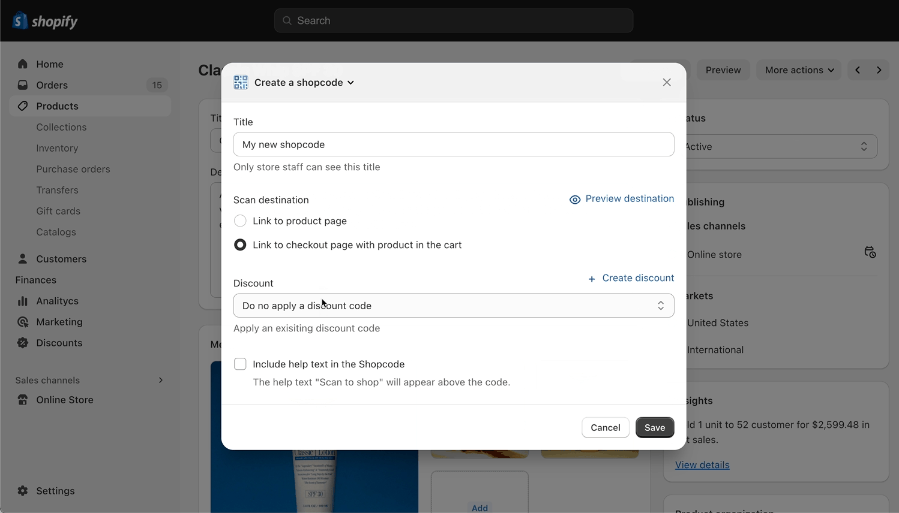

Hình 1. Admin action mở dạng modal từ menu More actions ở trang product. Nguồn: [Apps in admin](https://shopify.dev/docs/apps/build/admin).

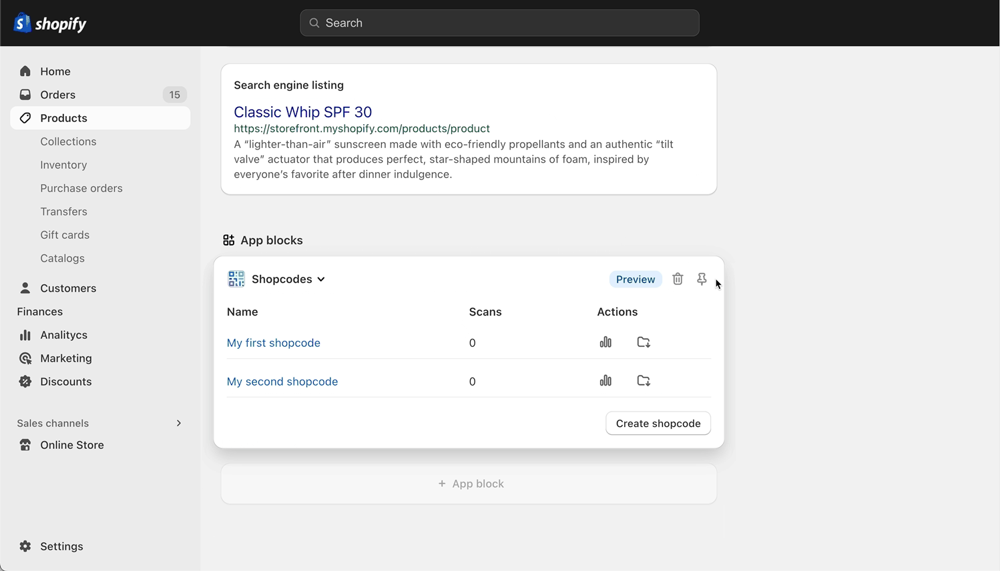

Hình 2. Admin block của app trong trang product. Nguồn: [Apps in admin](https://shopify.dev/docs/apps/build/admin).

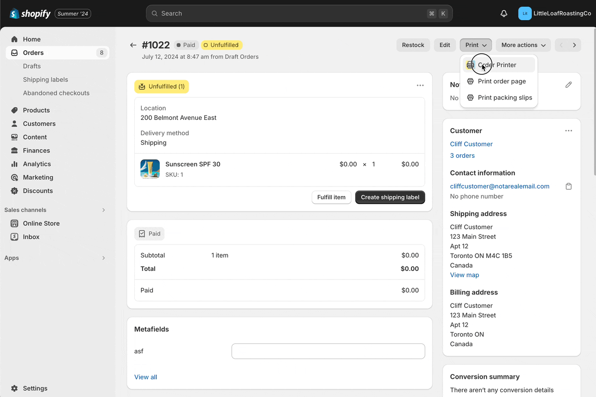

Hình 3. Admin print action trong menu Print ở trang order. Nguồn: [Apps in admin](https://shopify.dev/docs/apps/build/admin).

#### 1.2.2 Checkout

Phạm vi: trang Checkout, Thank you và Order status. Các bước information, shipping, payment chỉ tùy chỉnh được trên Shopify Plus. Thank you và Order status dùng được cho mọi plan trừ Starter.

| Công cụ | Dùng để |
| :---- | :---- |
| Checkout UI extensions | Thêm UI vào các bước checkout, trang Thank you, trang Order status |
| Shopify Functions | Logic backend chạy trên Shopify: discount, delivery customization, payment customization, cart và checkout validation, cart transform, fulfillment constraints, order routing, pickup point. Custom app chứa Function chỉ chạy trên store Plus |
| Payment extensions | Phương thức thanh toán riêng. Chỉ Partner được Shopify duyệt mới build được |
| Post-purchase extensions | UI sau khi đơn được xác nhận, trước trang Thank you. Vẫn là beta, store live phải xin quyền (mục 3.2.2). Trong custom app chỉ cài được trên Plus |

Merchant cấu hình Function trong admin theo 3 kiểu, khai báo trong TOML của Function:

| Kiểu | Function | Merchant vào đâu | Khai báo |
| :---- | :---- | :---- | :---- |
| Form của app nằm trong trang Shopify | Discount | Trang tạo discount, chọn loại trong picker | `[extensions.ui] handle`, target `admin.discount-details.function-settings.render` |
| Form của app nằm trong trang Shopify | Checkout validation | Settings > Checkout > Checkout rules | `[extensions.ui] handle`, target `admin.settings.validation.render` |
| Form của app nằm trong trang Shopify | Order routing location rule | Settings, phần order routing | Target `admin.settings.order-routing-rule.render` |
| Shopify liệt kê Function, bấm vào thì mở trang của app | Payment customization | Settings > Payments > Payment customizations | `[extensions.ui.paths]` với `create`, `details` |
| Shopify liệt kê Function, bấm vào thì mở trang của app | Delivery customization | Settings > Shipping and delivery > Delivery customizations | `[extensions.ui.paths]` với `create`, `details` |
| Không có giao diện cho merchant | Cart Transform | — | App gọi `cartTransformCreate` |
| Không có giao diện cho merchant | Fulfillment constraints | — | App gọi `fulfillmentConstraintRuleCreate` |

`[extensions.ui]` và `[extensions.ui.paths]` loại trừ nhau. Checkout UI extension và customer account UI extension có `[extensions.settings]`, tối đa 20 setting, merchant cấu hình trong checkout and accounts editor.

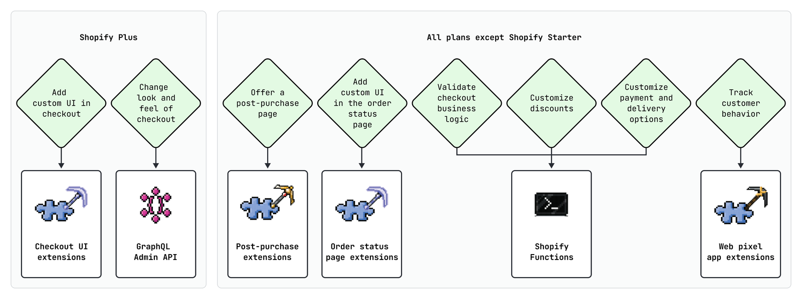

Hình 4. Sơ đồ chọn công cụ checkout theo nhu cầu và plan. Nguồn: [Checkout technologies](https://shopify.dev/docs/apps/build/checkout/technologies).

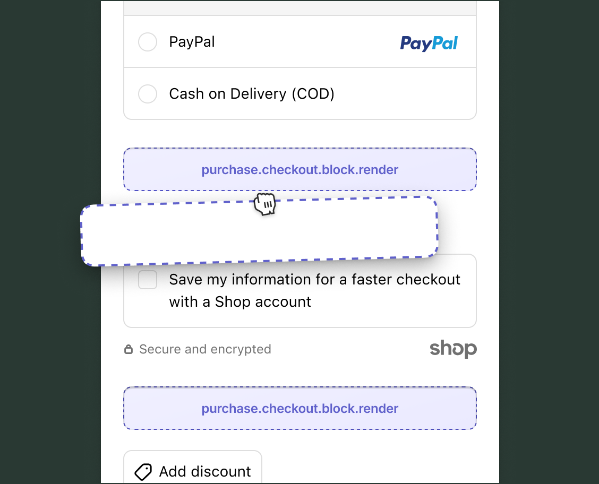

Hình 5. Vị trí block target `purchase.checkout.block.render` ở bước payment. Nguồn: [Checkout UI extension targets](https://shopify.dev/docs/api/checkout-ui-extensions/latest/targets).

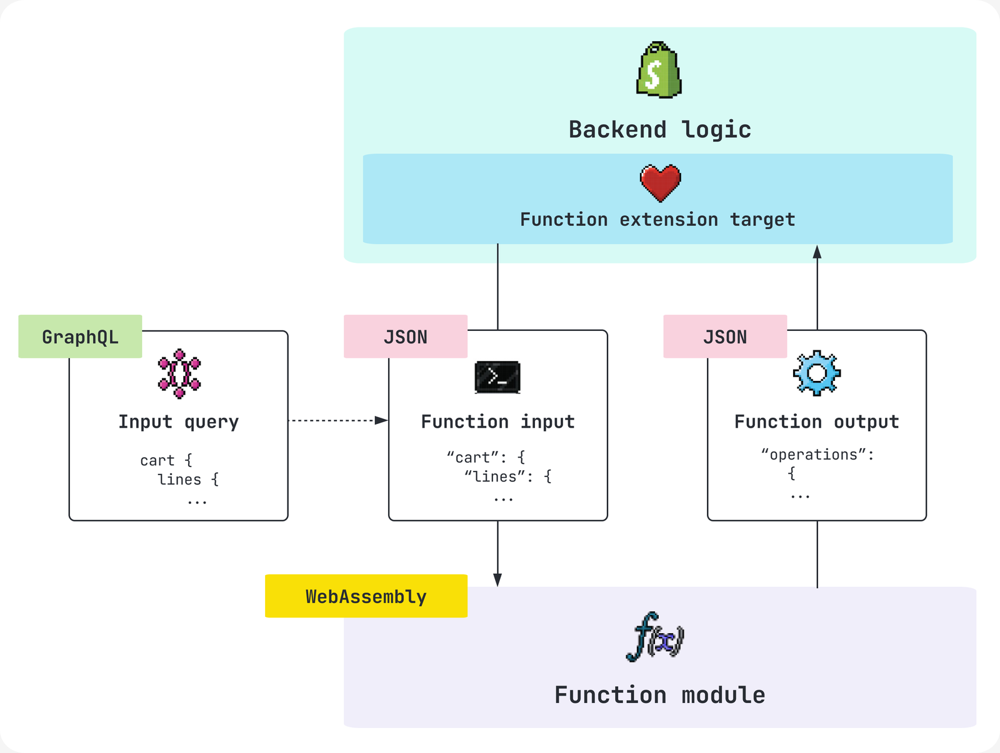

Hình 6. Shopify gọi Function qua target: input query, Function input, Function output. Nguồn: [Shopify Functions](https://shopify.dev/docs/apps/build/functions).

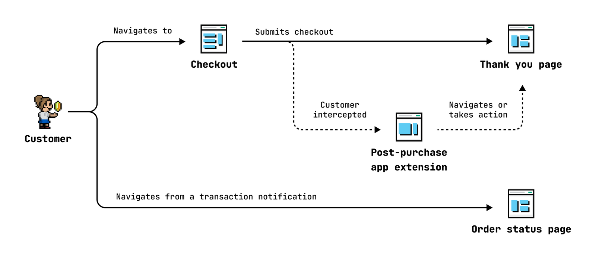

Hình 7. Luồng khách tới trang Thank you và Order status, có post-purchase extension. Nguồn: [Thank you and Order status pages](https://shopify.dev/docs/apps/build/checkout/thank-you-order-status).

#### 1.2.3 Customer account

Phạm vi: các trang customer account mới. Legacy customer accounts bị deprecate từ 2026-02-26 và không hỗ trợ extension.

| Công cụ | Dùng để |
| :---- | :---- |
| Customer account UI extensions | Thêm UI vào trang Order index, Order status, Profile, hoặc tạo trang mới |
| Polaris web components | Từ API `2025-10`, Checkout và Customer account extension dùng `s-banner`, `s-text`, `s-button`… thay cho React component cũ |

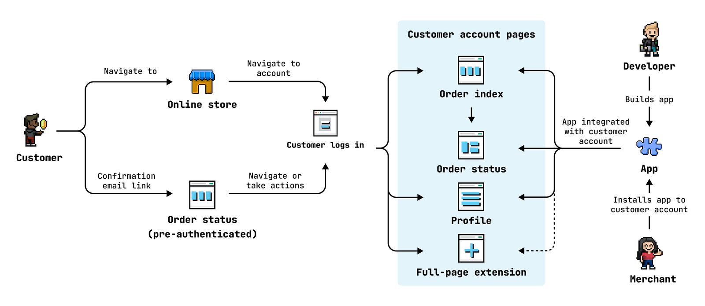

Hình 8. Các trang customer account và full-page extension của app. Nguồn: [Customer accounts](https://shopify.dev/docs/apps/build/customer-accounts).

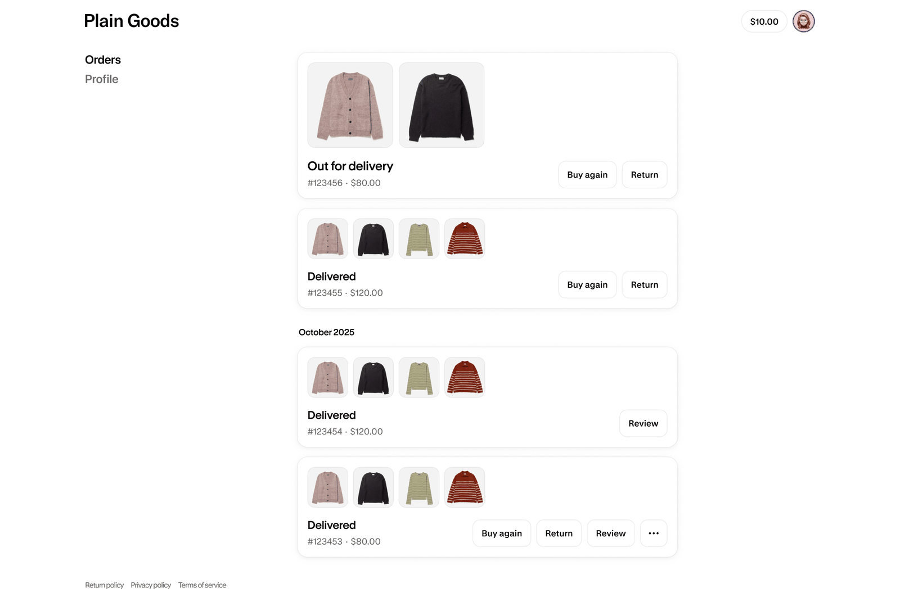

Hình 9. Trang Order index của customer account. Nguồn: [Customer accounts](https://shopify.dev/docs/apps/build/customer-accounts).

#### 1.2.4 Flow

Shopify Flow cho merchant tự dựng workflow từ trigger và action. Trigger và action của custom app chỉ dùng được trên store Plus.

| Công cụ | Dùng để |
| :---- | :---- |
| Flow trigger | App báo sự kiện cho Flow qua mutation [`flowTriggerReceive`](https://shopify.dev/docs/api/admin-graphql/latest/mutations/flowtriggerreceive) |
| Flow action | Việc app làm khi workflow chạy tới, ví dụ gọi API ngoài |
| Flow template | Workflow dựng sẵn để merchant dùng ngay |

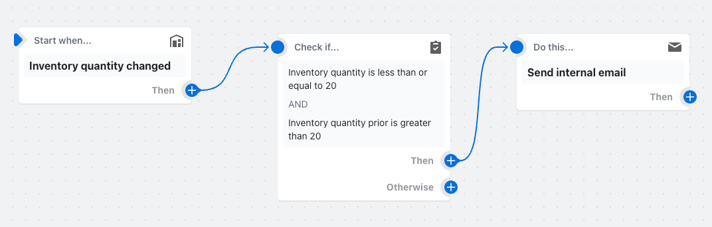

Hình 10. Workflow mẫu: trigger, condition và action. Nguồn: [Shopify Flow](https://shopify.dev/docs/apps/build/flow).

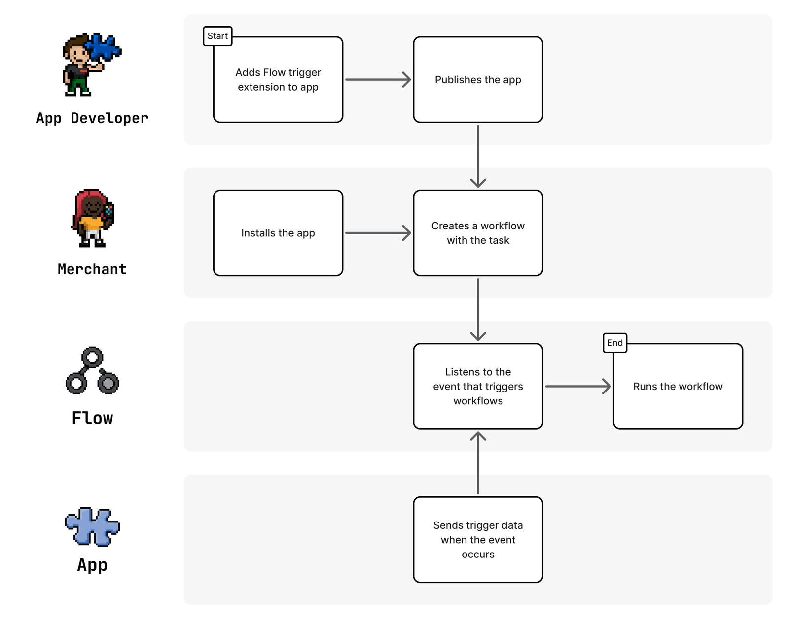

Hình 11. Luồng trigger của app gửi sự kiện cho Flow. Nguồn: [Flow triggers](https://shopify.dev/docs/apps/build/flow/triggers).

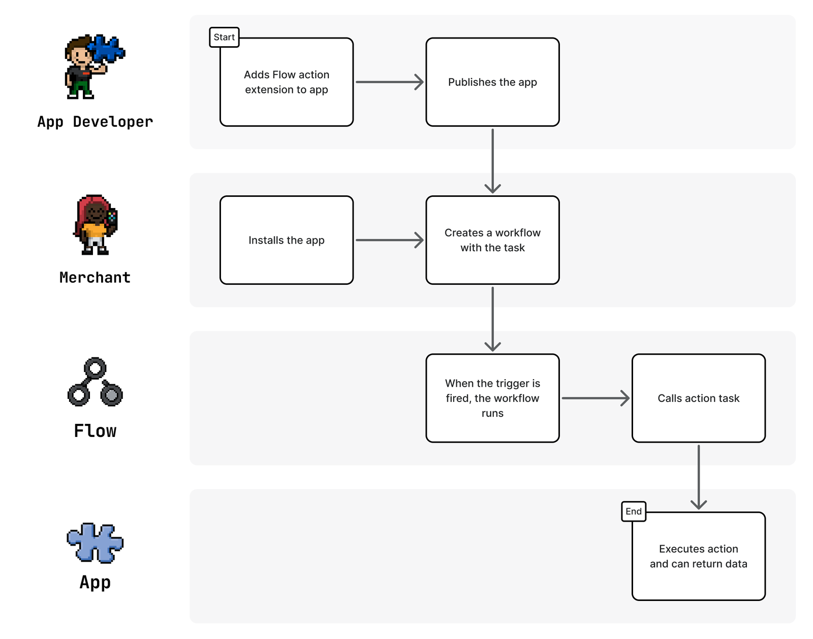

Hình 12. Luồng Flow gọi action của app. Nguồn: [Flow actions](https://shopify.dev/docs/apps/build/flow/actions).

#### 1.2.5 Online Store

Phạm vi: các trang storefront như homepage, collection, product detail.

| Công cụ | Dùng để |
| :---- | :---- |
| Theme app extensions | Thêm app block và app embed vào theme, không sửa code theme gốc |
| Web pixels | Thu thập customer event trên storefront cho marketing, analytics |

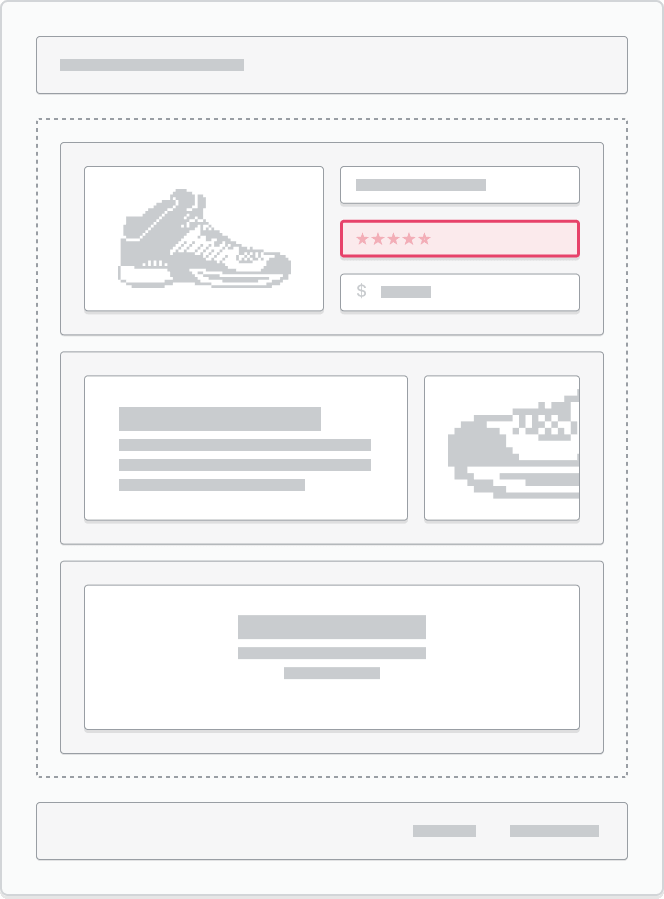

Hình 13. App block nằm trong một section của theme. Nguồn: [Theme app extensions configuration](https://shopify.dev/docs/apps/build/online-store/theme-app-extensions/configuration).

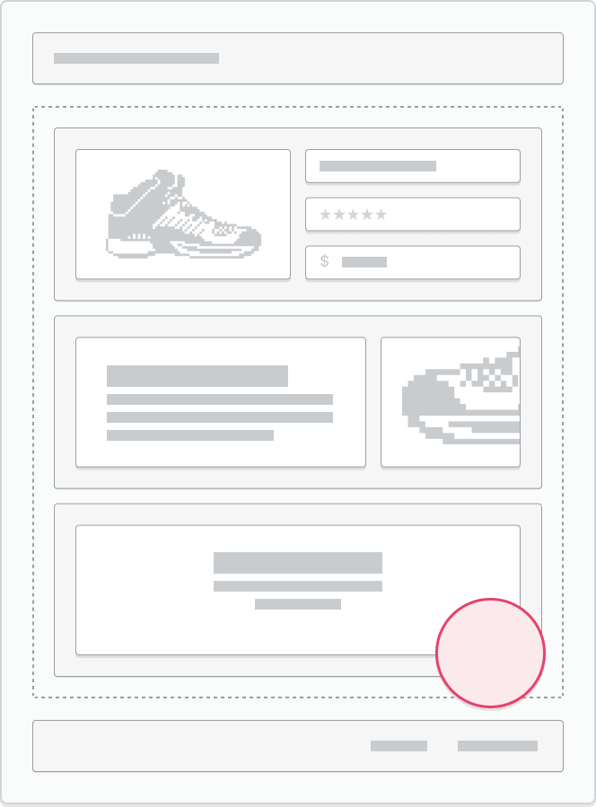

Hình 14. App embed block nổi ở góc trang. Nguồn: [Theme app extensions configuration](https://shopify.dev/docs/apps/build/online-store/theme-app-extensions/configuration).

#### 1.2.6 POS

Công cụ là POS UI extensions. Target gồm tile trên Home (smart grid), màn Product, Cart line item, Customer, Draft order, Order, Post-purchase và Register details.

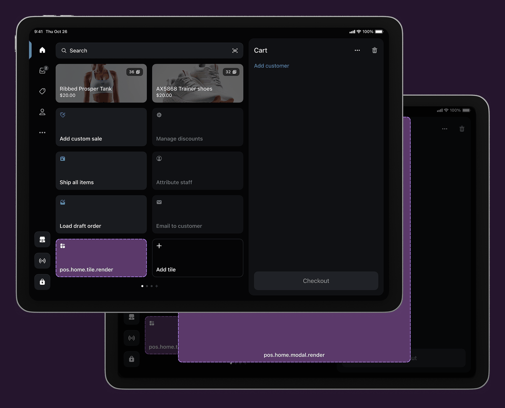

Hình 15. Tile `pos.home.tile.render` trên smart grid và modal của POS. Nguồn: [App surfaces](https://shopify.dev/docs/apps/build/app-surfaces).

### 1.3 Cấu trúc app

| Thành phần | Nội dung |
| :---- | :---- |
| App config | `shopify.app.toml`, hoặc nhiều file `shopify.app.{config-name}.toml` cho nhiều app hay nhiều môi trường |
| Web | Code app, mỗi thư mục có file `shopify.web.toml` |
| Extensions | Thư mục `extensions/`, mỗi extension có file `shopify.extension.toml` |
| Env | File `.env` của app. ID của extension nằm ở key `uid` trong `shopify.extension.toml`, do CLI sinh |

Key cần chú ý trong app config:

- `scopes`: một số scope phải xin quyền trước (mục 3.2.2).
- `use_legacy_install_flow`: luôn đặt `false` để Shopify tự xin scope khi cài app hoặc khi đổi `scopes`.

`app deploy` luôn đẩy config trong file app config lên Shopify. Key `include_config_on_deploy` cũ đã bị bỏ, CLI tự xoá key này.

Team dùng repo `bssdev03/shopify-app-starter-node`, dựa trên `@shopify/shopify-app-express`. Repo là yarn workspace gồm `client` (React, Tailwind CSS) và `server` (NestJS, Prisma, PostgreSQL). Package này vẫn được maintain, bản 8.0.5 ra ngày 2026-11-06. Với app mới, Shopify khuyên dùng template React Router.

Repo có sẵn:

- Swagger ở `/tools/swagger`, tự xác thực khi gọi từ trong app.
- Decorator `@ShopSession()` lấy session của shop, `@ShopClient('gql')` lấy GraphQL client.
- Hook `useApi` ở client gửi request đã xác thực tới server.
- GraphQL codegen sinh type cho query, config ở `server/.graphqlrc.ts`.

Trong file app config, khai báo `server` trước `client` để vite proxy hoạt động:

```toml
web_directories = [ "server", "client" ]
```

### 1.4 Chuẩn bị môi trường

1. Đăng ký tài khoản [Shopify Partner](https://accounts.shopify.com/signup), tham gia hoặc tạo organization.
2. Tạo [development store](https://shopify.dev/docs/apps/build/stores/development-stores) ở Dev Dashboard > Stores > Create store, hoặc bằng `shopify store create dev`.
3. Cài theme qua Online Store > Themes > Import theme, hoặc chọn trong Theme library.
4. Clone starter repo và chạy:

```sh
cp server/.env.example server/.env   # then fill in the values
yarn
yarn migrate:dev
yarn dev
```

### 1.5 Shopify CLI

Các lệnh team hay dùng, chạy với tiền tố `shopify`. Danh sách đủ ở [Shopify CLI docs](https://shopify.dev/docs/api/shopify-cli/app).

| Lệnh | Dùng để |
| :---- | :---- |
| `app config link` | Tạo app mới, hoặc kéo config của app có sẵn từ Dev Dashboard về |
| `app config use` | Chọn file config mặc định |
| `app env pull`, `app env show` | Tạo hoặc xem file `.env` |
| `app generate extension` | Tạo extension |
| `app dev` | Chạy bản preview trên development store |
| `app build` | Build web và extensions |
| `app deploy` | Đẩy config và extensions lên, tạo version mới. Không deploy web app |
| `app function build`, `run`, `replay`, `schema`, `typegen` | Làm việc với Shopify Function |
| `app logs`, `app logs sources` | Xem log của function extension |
| `app info` | Xem cấu trúc app và scope |
| `app webhook trigger` | Gửi webhook thử |

### 1.6 Tạo app, cấu hình

1. Clone starter repo, vào container `shopify` để dùng Shopify CLI.
2. Tạo custom app bằng `shopify app config link`, chọn tạo app mới.
3. Khai báo `scopes`, webhook, app proxy và các cài đặt khác trong file app config.

File config chung đặt tên `example` hoặc `base` và commit lên repo. Chỉ thêm scope khi dùng đến API cần scope đó.

### 1.7 Cài đặt MCP cho AI development tool

Mục này để tham khảo. Shopify Dev MCP nay thuộc [Shopify AI Toolkit](https://shopify.dev/docs/api/ai-toolkit), chạy local và không cần xác thực. Khai báo MCP server trong AI tool như Cursor, Claude Desktop bằng lệnh `npx -y @shopify/dev-mcp@latest`.

## 2. Triển khai

### 2.1 Phân tích tính năng

1. Phân tích use case, chọn surface và công cụ theo mục 1.2.
2. Viết tài liệu phân tích thiết kế.
3. Dự án chưa có design thì thiết kế theo nguyên tắc thiết kế app của Shopify, gồm cả [accessibility](https://shopify.dev/docs/apps/build/accessibility).
4. Code theo [NestJS Coding Standard](Ref_Dev_nestjs-coding-standard_v1.0.md).
5. Thiết kế logging và cảnh báo từ đầu (mục 3.2.6).

### 2.2 Triển khai và thử nghiệm

Chạy `yarn dev` rồi mở Preview URL mà CLI in ra.

| Phần | Cách test |
| :---- | :---- |
| Theme block, extension | Cài trên development store |
| Webhook | `shopify app webhook trigger`, hoặc chạy app trên development store |
| Function | Các lệnh `app function` và `app logs` |
| App proxy | Test trên development store bằng simple request |
| Flow | Cài action lên store, gửi trigger qua `flowTriggerReceive` |

`yarn dev` mặc định dùng Cloudflare tunnel với URL tự sinh. App URL chỉ tự cập nhật khi đặt `automatically_update_urls_on_dev = true`. Webhook khai báo bằng URL tuyệt đối thì phải deploy lại khi URL đổi.

Git flow: nhánh môi trường là `master` và `staging`. Nhánh task đặt theo mã task, rẽ từ `master`. Merge nhánh task vào `staging` để test, vào `master` để go live.

### 2.3 Cài đặt và sử dụng

Deploy lần đầu theo repo [`bssdev03/shopify-docker-prod`](https://git.bssdev.cloud/bssdev03/shopify-docker-prod) và [Deploy to a hosting service](https://shopify.dev/docs/apps/launch/deployment/deploy-to-hosting-service):

1. Cài Docker, nginx, SSL cert và các container shopify, db, node. Kiểm tra `docker-compose.yml`.
2. Vào container `shopify`, clone code, checkout `master`.
3. Tạo file `shopify.app.prod.toml` cho app production, copy config từ file `example` hoặc `base`.
4. Tạo `.env` ở root, `server/.env`, `client/.env`. Giá trị chỉ nằm trên server, không commit.
5. Build, deploy config, rồi start app bằng pm2 qua file `pm2.json`.

```sh
(cd client && yarn build)
(cd server && SHOPIFY_API_KEY=<api-key> yarn build)
shopify app deploy --config=prod
node ./server/dist/main.js   # entry point that pm2 starts
```

```sh
DATABASE_URL=   # server/.env keys only, no values in docs
SHOPIFY_API_KEY=
SHOPIFY_API_SECRET=
HOST=
NODE_ENV=production
PORT=
SCOPES=
```

Deploy lại: pull code, build, deploy, rồi restart app bằng pm2 để giảm downtime. Xem [Deploy app versions](https://shopify.dev/docs/apps/launch/deployment/deploy-app-versions).

Cài app cho store: trong Dev Dashboard, chọn app > Select distribution method > Custom distribution > Manage custom install link. Nhập store domain, bấm Generate link, rồi dùng link đó để cài.

IP allowlist là bắt buộc khi cài custom app lên store ngoài organization của team, tức store của khách:

- Từ 2026-11-20, app phải có IP allowlist mới cài mới được.
- Từ 2027-01-01, mọi bản cài đang chạy ngoài organization cũng phải có. Một app thiếu allowlist sẽ chặn việc cài mọi app khác của organization.
- Cấu hình ở Dev Dashboard > app > Settings > IP allowlist > Manage. Nhập IP hoặc CIDR của server, hoặc ASN nếu egress động.
- Bấm Run test với traffic gần đây, rồi bật Enforce IP allowlist. Request Admin API từ IP ngoài danh sách sẽ bị trả 403.

Xem [IP allowlist](https://shopify.dev/docs/apps/build/dev-dashboard/ip-allowlist).

## 3. Tối ưu

### 3.1 Best practices

Performance:

- Hạn chế thư viện ngoài. Ảnh, video, script, CSS nặng thì đưa lên cloud, cache hoặc minify.
- Chỉ tải tài nguyên khi cần, theo import-on-interaction pattern.
- Checkout: call sang hệ thống ngoài chạy song song, có xử lý timeout.
- Custom carrier rates: cache rates, có default rates khi bên cung cấp lỗi hoặc timeout.
- Storefront: đo Lighthouse của home page, product detail, collection trước và sau khi thêm block của app.

Localize:

- Mọi chuỗi hiển thị cho user nằm trong file dịch.
- Ngày tháng, số, giá format theo locale bằng `Intl` hoặc hàm có sẵn của từng loại extension.

### 3.2 Các lưu ý

#### 3.2.1 API rate limit

Admin GraphQL API, Payments Apps API và Customer Account API có rate limit theo leaky bucket. Storefront API không giới hạn buyer traffic, nhưng throttle bot, crawler và việc tạo checkout.

- Mỗi app có mức cost tối đa riêng, tùy loại API và plan của store.
- Mỗi request trừ cost theo độ phức tạp của query. Cost hồi lại theo từng giây.
- Admin GraphQL hồi 100 point/giây với plan Standard, 200 với Advanced, 1000 với Plus, 2000 với Commerce Components.
- Hết cost thì GraphQL trả 200 kèm lỗi `THROTTLED`, REST trả 429 kèm header `Retry-After`.
- Một query tối đa 1000 cost. Một mảng trả về tối đa 250 item.
- Store có từ 500.000 variant chỉ tạo thêm tối đa 10.000 variant mỗi ngày. Store Plus được miễn.
- Storefront API trả 430 Shopify Security Rejection thì thêm header `Shopify-Storefront-Buyer-IP`.

Giảm cost bằng cách chỉ lấy field cần dùng và chia nhỏ query. Gặp `THROTTLED` thì chờ 1 giây rồi retry. Gặp 503 thì retry với backoff.

#### 3.2.2 API access scope

Xin các quyền sau ở Dev Dashboard > Apps > app > Settings > Access requests:

- `read_all_orders`, chỉ cần xin khi app thuộc Partner organization.
- Subscription APIs, post-purchase extensions, Chat UI for checkout.
- Protected customer data, cho các field chứa dữ liệu cá nhân của khách.
- Network access cho Checkout và Customer account UI extension. Yêu cầu này được duyệt tự động.

Các scope như `read_/write_payment_mandate`, `read_customer_payment_methods` không có trong Access requests. Muốn dùng phải liên hệ Shopify Support.

#### 3.2.3 App database

- Đo và tối ưu query chậm.
- Kiểm tra connection pool và connection timeout theo số request song song.
- Theo dõi dung lượng ổ đĩa của database.

#### 3.2.4 Webhook

- Shopify không đảm bảo thứ tự message. Dùng header `X-Shopify-Triggered-At` hoặc `updated_at` để sắp xếp.
- App không phản hồi trong 5 giây thì Shopify gửi lại. Sau 8 lần thất bại trong 4 giờ, message bị bỏ.
- Sau 8 lần thất bại liên tiếp, subscription tạo qua Admin API bị xoá tự động.
- Phản hồi ngay khi nhận message, xử lý sau. Không phản hồi kịp là lỗi timeout hay gặp nhất.
- Log 7 ngày gần nhất ở Dev Dashboard > app > Logs. Metric ở Overview > Operations.
- Xem thêm [HTTPS delivery](https://shopify.dev/docs/apps/build/webhooks/subscribe/https) và [Troubleshoot webhooks](https://shopify.dev/docs/apps/build/webhooks/troubleshoot).

#### 3.2.5 App proxy

- App proxy chuyển một URL trên domain của shop tới server của app, có signature để xác thực.
- App proxy không hỗ trợ cookie và bỏ một số header.
- Store có redirect domain dễ gây lỗi CORS. Dùng simple request để tránh [preflight](https://developer.mozilla.org/en-US/docs/Glossary/Preflight_request).

Xem [Display dynamic data](https://shopify.dev/docs/apps/build/online-store/display-dynamic-data).

#### 3.2.6 Monitoring và log

- App logs trên Dev Dashboard: API health, webhook, function, app event.
- Custom log của app theo [NestJS Logger](https://docs.nestjs.com/techniques/logger), tách file theo tuần hoặc tháng.
- Server log: CPU, RAM, disk, network.
- Có cảnh báo khi app hoạt động bất thường.

#### 3.2.7 Product access

App không đọc được product thường do:

- Thiếu scope `read_products` hoặc `write_products`.
- Storefront API chỉ trả product đã publish lên sales channel của app, kể cả Headless channel.
- Đọc inventory mà thiếu `read_inventory`, hoặc đọc location mà thiếu `read_locations`.

#### 3.2.8 App hỗ trợ

| App | Dùng để |
| :---- | :---- |
| [Shopify Flow](https://apps.shopify.com/flow) | Dựng và quản lý workflow |
| [Checkout Blocks](https://apps.shopify.com/checkout-blocks) | Thêm block vào Thank you, Order status, chỉnh checkout branding. Store Shopify Plus tùy chỉnh thêm được checkout |
| [Shopify GraphiQL App](https://shopify-graphiql-app.shopifycloud.com) | Chạy thử và debug GraphQL query, mutation. Khi chạy `shopify app dev`, bấm `g` để mở GraphiQL local |

## References

- Google Doc [Shopify Custom App](https://docs.google.com/document/d/1N0_-wMTNjUcKVyQo5PljKIXKQb7K7EPzdWpPtye-9R4/edit)
- Repo [`bssdev03/shopify-app-starter-node`](https://git.bssdev.cloud/bssdev03/shopify-app-starter-node), nhánh `develop`, commit `59800c3`
- Repo [`bssdev03/shopify-docker-prod`](https://git.bssdev.cloud/bssdev03/shopify-docker-prod)
- [Shopify developer docs](https://shopify.dev/docs), [Help Center](https://help.shopify.com), [developer community](https://community.shopify.dev)

## Changelog

| Date | Version | Change | By |
| :---- | :---- | :---- | :---- |
| 2026-11-18 | v1.0 | Mục 1.2.2 thêm bảng chỗ merchant cấu hình Function trong admin. Owner duyệt trong chat ngày 2026-11-18. | Bắc PV |
| 2026-11-18 | v1.0 | Thêm 15 ảnh minh họa từ shopify.dev cho mục 1.2, lưu ở `images/`. Owner duyệt trong chat ngày 2026-11-18. | Bắc PV |
| 2026-11-18 | v1.0 | Viết nội dung cho mọi mục, thêm mục 3.2.1–3.2.8. Sửa phần đã cũ: Dev Dashboard, admin extension targets, Function chỉ chạy trên Plus với custom app, Polaris web components, POS targets. Sửa thêm CLI, rate limit, access requests, webhook, IP allowlist. Khai báo exception B4. Owner duyệt trong chat ngày 2026-11-18. | Bắc PV |
| 2026-11-12 | v1.0 | Chuyển lên Live. Owner duyệt trong chat ngày 2026-11-12. | Bắc PV |
| 2026-11-12 | v0.1 | Draft đầu tiên, chỉ có khung heading. | Bắc PV |
